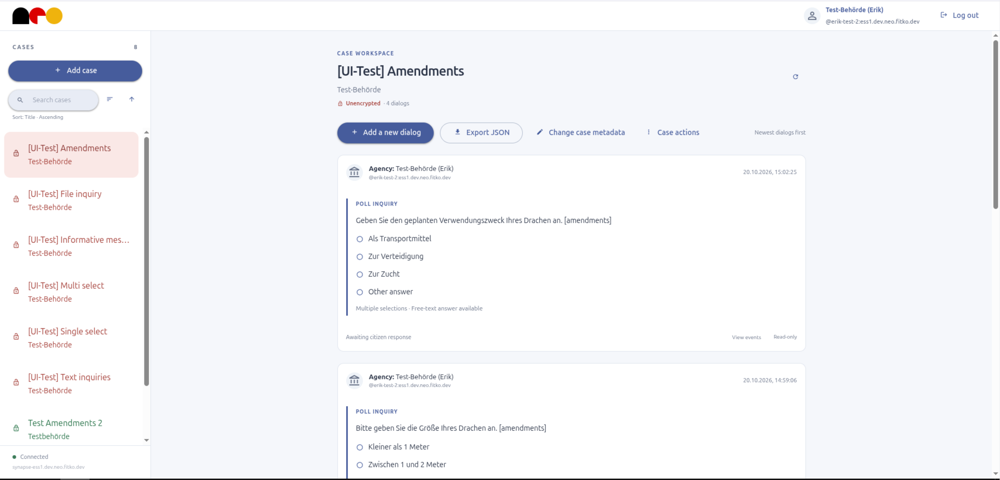

<!--
SPDX-FileCopyrightText: 2026 FITKO (Föderale IT-Kooperation)

SPDX-License-Identifier: CC-BY-SA-4.0
-->

# Neo Cases Devtool

## About

A web UI to create cases and send inquiries or messages for the Neo app/web client.

**Warning: This is just a prototype for internal testing/development.
It is not production-ready software.**



## Getting started

### Using Docker

1. Pull the image from the GitLab container registry:

   ```sh
   docker pull registry.opencode.de/fitko/matrix-g2x/neo-cases-devtool:main
   ```

2. Start the app:

   ```sh
   docker run --rm -p 8080:80 registry.opencode.de/fitko/matrix-g2x/neo-cases-devtool:main
   ```

3. Open <http://localhost:8080>

### Manual

1. Install [`rustup`](https://rustup.rs/),
   [Node.js](https://nodejs.org/en/download), [`pnpm`](https://pnpm.io/installation)
2. Add the rustup target: `rustup target add wasm32-unknown-unknown`
3. Install dependencies: `pnpm install`
4. Build everything: `pnpm build`
5. Start the app: `pnpm start` and open the URL printed in the terminal

## Homeserver selection

Multiple Matrix homeservers can be configured to be available for login.
They are read at runtime from `config.json`, so either modify
`public/config.json` or mount a different `config.json` using container mounts,
reverse proxying, etc.

```json
{
  "homeservers": ["https://synapse-ess1.dev.neo.fitko.dev", "https://synapse-ess2.dev.neo.fitko.dev"]
}
```

## Technical information

- Currently, this app uses its own integration of the `neo-rust-sdk` instead of
  the `neo-web-sdk` in order to allow sending events that are not strictly
  Neo-conform (for example for legacy vs newer inquiry types).
- This web app uses Vite+ with pnpm for building, linting, testing and formatting.

## Development guidelines

For information on how to use the conventions defined in this project, check
out the expected [development workflow](docs/workflow.md).
Please also see [CONTRIBUTING.md](CONTRIBUTING.md) for details on how
you can contribute to this project.

## Licensing

This project is licensed under the
[European Union Public License 1.2](https://spdx.org/licenses/EUPL-1.2.html).
See [LICENSE](LICENSE) and the
[development workflow](docs/workflow.md#licensing) for licensing conventions.
