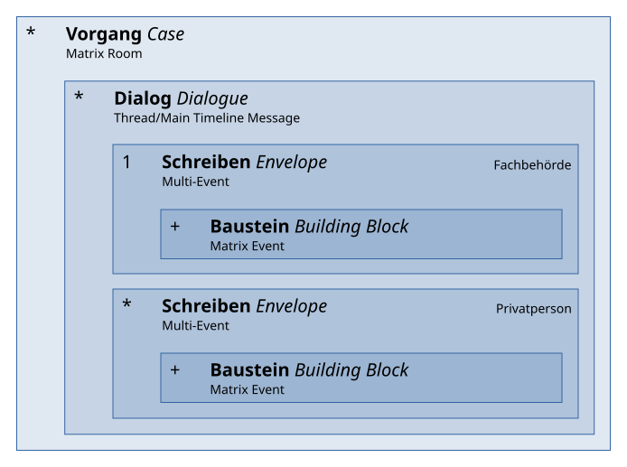
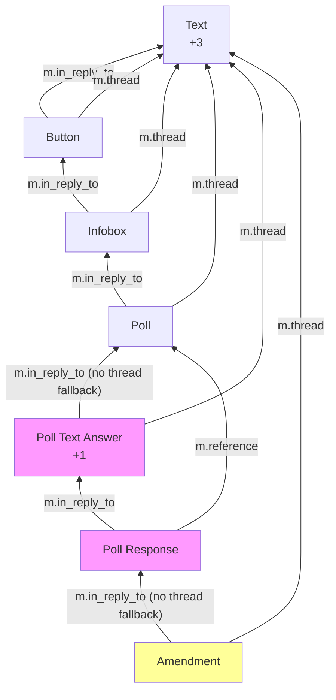
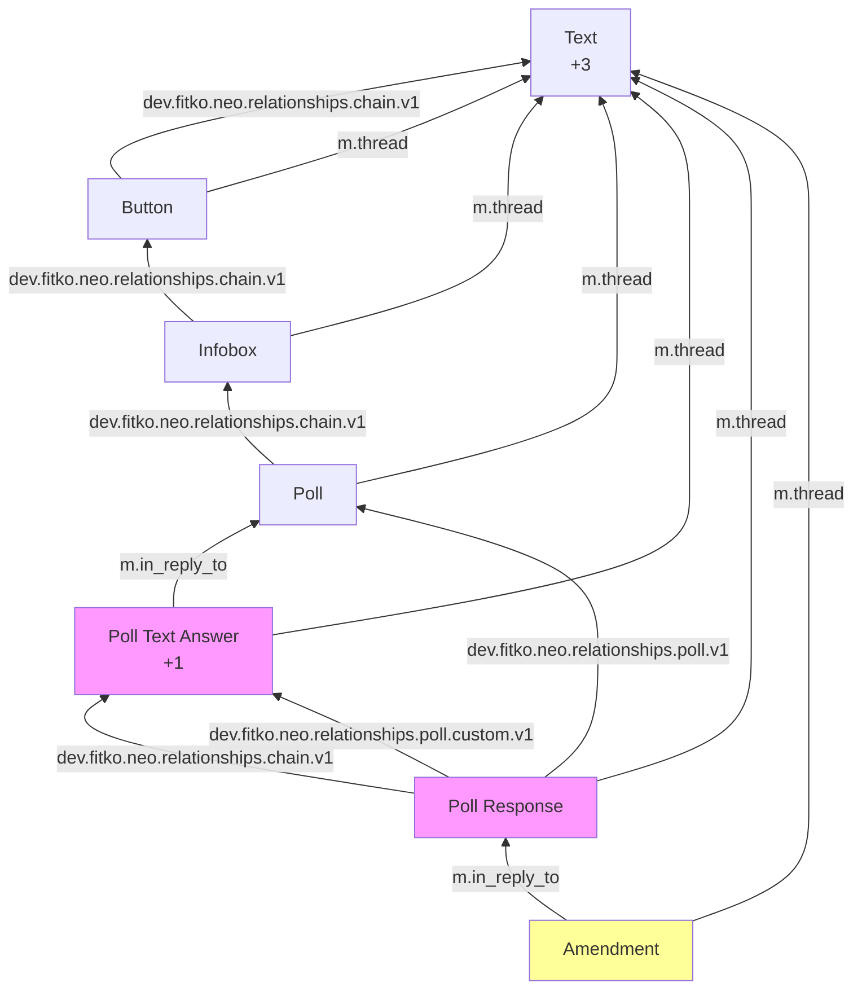

<!--
SPDX-FileCopyrightText: 2025-2026 FITKO (Föderale IT-Kooperation)

SPDX-License-Identifier: CC-BY-SA-4.0
-->

# Building Block View

## Message Formats

<TODO:
MSC3381 m.poll.close-like semantic is possible for "rechtskräftiges senden".
timestamps for this are set in the sending server, so cannot easily be faked
by clients>

We define a set of Matrix event types to fulfil the domain-specific requirements
of G2C communication.

### Definitions and Data Model

This chapter uses the following model to describe and define the components
that enable the communication on a technical level.



The communication is case-based \[vorgangsbezogen\]
and between one private individual and one competent government agency.
Each case is represented by a Matrix room shared by the conversation partners.
Both the private individual and the competent agency
may have any amount of cases between themselves
and other agencies and individuals, respectively.

Each case can contain any amount of dialogues.
Each dialogue represents a single exchange of information
between the conversation partners.
It always contains exactly one envelope \[Schreiben\] from the competent agency,
and may contain further envelopes sent by the private individual,
depending on the context:
An envelope sent by a government agency can be purely informative,
or may inquire about further information.
In the latter case it is technically marked as an [Inquiry](#inquiries),
to which a private individual may send a response of the requested shape.
This response is not to be confused with Matrix's concept of
[rich replies](https://spec.matrix.org/v1.17/client-server-api/#rich-replies) or
Poll [answers](#polls).
A dialogue is represented by Matrix "main timeline" events
and their associated threads.
Hence main are typically Matrix thread root messages
indicating the rest of the dialogue through the thread relationships,
though in the most minimal case there is a single informative event
which due to lack of other events relating to it is not technically a thread.

Each envelope consists of one or more building blocks \[Bausteine\],
regardless of the sender.
An envelope combining multiple building blocks associates and orders them
using the [Multi-Event](#composing-multi-events) mechanism
to guarantee integrity and to achieve a consistent presentation.
The minimal envelope uses just one building block
and does not need these additional attributes.

Building blocks are represented by the Matrix events defined below.
They are the atomic units from which user facing messages can be composed
in a modular way.

This chapter also heavily relies on the following technical terms.

- [Extensible Events][MSC1767]:
  MSC1767-style of composing events out of well-known "content blocks",
  enabling reuse and fallbacks for unrecognised event types.
- Content block:
  A reusable piece of content schema that appears in an event's `content` object,
  e.g. `m.text`.
- [Event Relationships][relations]:
  Matrix events can reference each other,
  which the specification calls event relationships or event relations.
- [Reply](https://spec.matrix.org/v1.17/client-server-api/#rich-replies):
  Technical description of a Matrix event that uses
  a `m.in_reply_to` relationship to create context to another event.
  Note the distinction to a response on a UX level.
- Answer:
  One of the options in a [Poll](#polls).
  Note the distinction to replies and responses.

### General Considerations

#### Extensible Events

The Matrix Spec Core team,
responsible for maintaining the specification,
has indicated the schema of "Extensible Events" will be the future solution
for composing Matrix event types.
While this is
[not published as definite specification](https://spec.matrix.org/proposals/#process)
at the time of writing,
this schema is already in use for some time to implement and standardise
new event schemata,
for example
[polls][MSC3381] or
[locations][MSC3488].
Due to not officially being standardised yet,
current implementations use
[unstable identifiers](https://spec.matrix.org/proposals/#unstable-endpoints-features-and-vendor-prefixes)
in place of the suggested final identifiers.
While the following descriptions refer to proposed stable identifiers from
[MSC1767 Extensible Events][MSC1767]
and further MSCs based on it,
we use the unstable identifiers per the regular Matrix specification process
in order to retain compatibility and hence reusability of
existing Matrix implementations supporting Extensible Events
as long as the feature is not stabilised.
Note this only applies to
[message events](https://spec.matrix.org/latest/client-server-api/#types-of-room-events)
(also known as "timeline events")
for consistency,
while stable state events remain in use for compatibility with current
server implementations. For example:

- `m.message` becomes `org.matrix.msc1767.message`.
- `m.room.create` remains as-is.

We also define some domain-specific "custom events" and follow the Matrix
[common namespaced identifier grammar](https://spec.matrix.org/v1.17/appendices/#common-namespaced-identifier-grammar)
and
[namespacing guidelines](https://spec.matrix.org/v1.17/#namespacing)
to remain conflict free and enable reusability across possible other projects.
All custom identifiers for this project use the prefix `dev.fitko.neo`.
In case of proposals upstreaming such events to the Matrix specification,
our vendor-namespace serves to fulfil the requirements to unstable identifiers.

#### Versioning

We choose to version our identifiers by appending a segment
consisting of `v` and a positive integer,
for example `dev.fitko.neo.button.v1`.
While we can control the rollout of client versions to private individuals
to an extent,
we expect a potentially very heterogeneous version landscape
on the government agencies' side.
Versioning,
combined with the fallback-properties of Extensible Events,
allows us to transition between versions smoothly.
This roughly implies the following process for worst cases where
a type or version is not known by a recipient:

1. Adjust the schema of any content block.
2. Increment the version of that block to signify the change.
3. Add the new content block to any event types that should prefer to use it.
4. Increment the version of affected event types.
   Clients that should support the new content block need this change to the
   event type in order to not prefer the old block via the old event schema.
   Clients that do not support the new event type version will not recognise the
   new updated type via Extensible Event semantics.
   They will parse the event content instead in search for the best match.
5. Sending clients have a certain amount of control over the way the receiving
   side is able to interpret the message,
   depending on what versions it supports.
   Updated event types that contain all fields from a prior version would usually
   fall back to the prior version,
   while not including the proper fields can avoid
   falling back to undesired presentations in specific cases.
   Implementations will need to take care that implemented behaviour is
   as expected on a case-to-case basis.

It is further possible to make a client deliberately forward (in)compatible
regarding specific event types,
should it become required in the future.
An event type schema could be excluded from the list of
types considered for matching during extensible event fallback evaluation.

Since communication is initiated one-sided in our use case
(see [below](#private-individuals)),
we can control the client version rollouts
(particularly supported event versions on the client side),
and our [Inquiry](#inquiries) mechanism works by requesting
specific (versioned) event types,
there is an implicit handshake between government and private clients
about the supported event type versions,
which to a large extent resolves the issue of unsupported types.

<TODO: rationale for not using room versions instead?>

#### End-to-end Encryption

Any message content payloads exchanged via this system MUST be
end-to-end encrypted in order to protect against unauthorised access.
[MSC3956] drafts a new Extensible Event type for encrypted events,
but remains in an early stage of development with many open questions.
Finishing and using it would be desirable for the sake of consistency,
however there is no other immediate benefit in terms of features
compared to the status quo.

Matrix currently defines the
[`m.room.encrypted`](https://spec.matrix.org/v1.17/client-server-api/#mroomencrypted)
event type as a wrapper to transport message content that is
end-to-end encrypted using Megolm.
It is
[agnostic](https://spec.matrix.org/v1.17/client-server-api/#mmegolmv1aes-sha2)
about the structure of the message event it contains.
Most metadata does not need to be duplicated from the inner
encrypted event's payload and is stored in the wrapper instead.
A client interpreting an encrypted message must aggregate properties of both
the decrypted event and the wrapper to consider all data relevant for displaying
a decrypted event correctly.
The wrapper event's `content` may also contain additional properties that must
be handled in a similar way,
as is the case for
[event relationships](https://spec.matrix.org/v1.17/client-server-api/#forming-relationships-between-events).
Notably the format of event relationships for
the currently stable `m.room.encrypted` messages is drop-in compatible
to the Mixin proposed for Extensible Events [below](#relationship-mixin).
The same is the case for the scalable relationships format of [MSC3051].

Due to this decoupling,
this project uses the `m.room.encrypted` schema for end-to-end encrypted events
as an interim solution,
accepting potential overhead cost in client implementations for maintaining
two different paradigms of event parsing,
and with the strong suggestion to push for upstream adoption of Extensible Events
including encrypted events in the future
(cf. [#515](https://gitlab.opencode.de/fitko/matrix-g2x/planning/-/work_items/515)).

#### Handling Invalid Events

<TODO: how to handle cases where events or sets of events are invalid/incomplete?>

### Event Types

The below definitions and examples use a shorthand-notation where indicated,
leaving out standard fields and fields added to the event body by the server,
see also <https://spec.matrix.org/v1.17/client-server-api/#put_matrixclientv3roomsroomidsendeventtypetxnid>.
Further, all examples use decrypted event schemata
while actual events on the wire will be end-to-end encrypted.

> [!note]
> Formal definitions of all event types as well as example/test data
> are available in the [JSON schema](https://json-schema.org) format as part of
> the [Neo Rust SDK](https://gitlab.opencode.de/fitko/matrix-g2x/neo-rust-sdk/-/tree/develop/crates/matrix-sdk-events/schema).

#### Text

We rely on MSC1767 `m.message` events.

We intend to use `text/html`-type representations for formatted messages,
deliberately choosing to restrict the allowed tags according to
the recommendation of the upstream Matrix specification
in order to simplify the API and avoid edge cases.
Migration of tags and attributes that are excluded compared to the ZBP
specification will be solved as part of the migration concept.
The `m.text`'s block support for further arbitrary markup leaves it open for us
to extend the approach to support further or custom attributes
should it become required at a later point.
Since in contrast to the open Matrix federation this is a closed ecosystem,
HTML is defined as part of baseline support and the need to include any other
representations in `m.text` content blocks is eliminated
where markup content is supported.
We do however include plain text for compatibility
when using `m.text` blocks as fallbacks.

The `m.text` content block additionally future-proofs for additional features,
such as translated message content as proposed in [MSC3554].
We hence use it for all fields that may contain message content,
potentially with additional constraints.

##### Example

```jsonc
{
  // irrelevant fields not shown
  "type": "m.message",
  "content": {
    "m.text": [
      { "body": "<i>Hello world</i>", "mimetype": "text/html" },
      { "body": "Hello world" }
    ]
  }
}
```

##### Alternatives

It would be possible to use the Matrix v1.17 stable `m.room.message`
with `msgtype: m.text` event instead.
We prefer to use Extensible Events across all our timeline events
for consistency.

#### Files

We base our file event type on [MSC3551] `m.file` events,
but introduce a versioned custom type `dev.fitko.neo.file.v1`
both to address some different needs compared to the current MSC,
and the high potential for the MSC to change,
given open comments.

- It has a REQUIRED `dev.fitko.neo.file.v1` content block.
- It has an OPTIONAL `dev.fitko.neo.title.v1` content block,
  which contains a short (few words) description of the content.
- It has an OPTIONAL `m.caption` content block as defined by MSC3551.
  It is present here in order to track upstream,
  but is unused in the context of this project.
- MSC3551 REQUIRES a text fallback representation.
  While this is not strictly needed in this context,
  we choose to include the fallback text representation anyway,
  e.g. for potential support when using the Element Web client as a "Demo Client"
  ([LB 3.2.3]) or to show non-rich summaries as the receiving client.

##### File Content Block

Similar to the event type,
the `dev.fitko.neo.file.v1` content block is inherited from the upstream MSC
but uses a versioned custom type to address its instability.

It has the following fields:

- `uri`: REQUIRED.
  A [Matrix content URI](https://spec.matrix.org/v1.17/client-server-api/#matrix-content-mxc-uris).
- `name`: REQUIRED.
  A plain text file name.
  This attribute is present here to track upstream,
  but clients MUST NOT use the local file name of the uploaded file
  to prevent users from leaking information inadvertently.
- `mimetype`: RECOMMENDED.
  An [RFC2046](https://datatracker.ietf.org/doc/html/rfc2046) media type,
  see [MIME types].
- `size`: RECOMMENDED.
  A non-negative integer representing the file size in bytes.
- `dev.fitko.neo.file.encrypted.v1"`: OPTIONAL. File encryption metadata,
  see [End-to-end Encrypted File Content Block](#end-to-end-encrypted-file-content-block).

```jsonc
"dev.fitko.neo.file.v1": {
  "uri": "mxc://fitko.dev/abcd1234",
  "name": "anlage.pdf",
  "mimetype": "application/pdf",
  "size": 12345678,
}
```

Clients MAY use this metadata as part of a best effort preview about the file,
but SHOULD treat all metadata as untrusted and verify it
upon downloading the real file.

##### Example

```jsonc
{
  // irrelevant fields not shown
  "type": "dev.fitko.neo.file.v1",
  "content": {
    "dev.fitko.neo.title.v1": { // optional
      "m.text": [
        {"body": "Passierschein A-38"}
      ]
    },
    "dev.fitko.neo.file.v1": {
      "uri": "mxc://fitko.dev/abcd1234",
      "name": "anlage.pdf",
      "mimetype": "application/pdf",
      "size": 12345678
    },
    "m.caption": { // optional
      "m.text": [{"body": "Nobody will read this caption!"}]
    },
    "m.text": [ // text fallback
      {"body": "anlage.pdf (12 MB)"}
    ]
  }
}
```

##### End-to-end Encrypted File Content Block

We define the `dev.fitko.neo.file.encrypted.v1` content block,
which CAN be optionally added into the `dev.fitko.neo.file.v1` content block
to signify that the file is encrypted and to transport the decryption data.
If this content block is present,
clients MUST treat the referenced file as encrypted file.

> [!note]
> While the schema leaves this field optional for upstreaming purposes,
> the [requirement to end-to-end encrypt](#end-to-end-encryption)
> all message content including attachments in this project
> makes using this content block a requirement in practice.

The properties work equivalent to the definition of
[EncryptedFile](https://spec.matrix.org/latest/client-server-api/#extensions-to-mroommessage-msgtypes).

```jsonc
"dev.fitko.neo.file.encrypted.v1": {
  "key": {
    "kty": "oct",
    "key_ops": ["encrypt", "decrypt"],
    "alg": "A256CTR",
    "k": "aWF6-32KGYaC3A_FEUCk1Bt0JA37zP0wrStgmdCaW-0",
    "ext": true
  },
  "iv": "w+sE15fzSc0AAAAAAAAAAA",
  "hashes": {
    "sha256": "fdSLu/YkRx3Wyh3KQabP3rd6+SFiKg5lsJZQHtkSAYA"
  },
  "v": "v2"
}
```

A complete example is:

```jsonc
{
  // irrelevant fields not shown
  "type": "dev.fitko.neo.file.v1",
  "content": {
    "dev.fitko.neo.title.v1": { // optional
      "m.text": [
        {"body": "Passierschein A-38"}
      ]
    },
    "dev.fitko.neo.file.v1": {
      "uri": "mxc://fitko.dev/abcd1234",
      "name": "anlage.pdf",
      "mimetype": "application/pdf",
      "size": 12345678,
      "dev.fitko.neo.file.encrypted.v1": {
        "key": {
          "kty": "oct",
          "key_ops": ["encrypt", "decrypt"],
          "alg": "A256CTR",
          "k": "aWF6-32KGYaC3A_FEUCk1Bt0JA37zP0wrStgmdCaW-0",
          "ext": true
        },
        "iv": "w+sE15fzSc0AAAAAAAAAAA",
        "hashes": {
          "sha256": "fdSLu/YkRx3Wyh3KQabP3rd6+SFiKg5lsJZQHtkSAYA"
        },
        "v": "v2"
      }
    },
    "m.caption": { // optional
      "m.text": [{"body": "Nobody will read this caption!"}]
    },
    "m.text": [ // required text fallback
      {"body": "anlage.pdf (12 MB)"}
    ]
  }
}
```

#### Images

We base our image event type on [MSC3552] `m.image` events,
but introduce a custom type `dev.fitko.neo.image.v1`
both to address some different needs compared to the current MSC,
and the high potential for the MSC to change,
given open comments.
This type effectively inherits all properties
of the `dev.fitko.neo.file.v1` type and adds some more specific to images.

- It has a REQUIRED `dev.fitko.neo.file.v1` content block.
- It has an OPTIONAL `dev.fitko.neo.title.v1` content block,
  which contains a short (few words) description of the content.
- It has an OPTIONAL `dev.fitko.neo.image.details.v1` content block.
- It has an OPTIONAL `dev.fitko.neo.thumbnail.v1` content block.
- It has an OPTIONAL `m.caption` content block as defined by MSC3551.
  It is present here in order to track upstream,
  but is unused in the context of this project.
- It has an OPTIONAL `m.alt_text` content block as defined by MSC3552,
  which MUST contain an `m.text` content block.
- MSC3552 REQUIRES a text fallback representation.
  While this is not strictly needed in this context,
  we choose to include the fallback text representation anyway,
  e.g. for potential support when using the Element Web client as a "Demo Client"
  ([LB 3.2.3]) or to show non-rich summaries as the receiving client.

##### Image Details Content Block

The `dev.fitko.neo.image.details.v1` content block iterates upon
[MSC3552]'s `m.image_details` content block.

It has the following fields:

- `width`: OPTIONAL.
  The image's width in pixels.
- `height`: OPTIONAL.
  The image's height in pixels.
- `is_animated`: OPTIONAL.
  Whether the image content is animated,
  e.g. in GIF, APNG, or WebP format.
  Defaults to false.

```jsonc
"dev.fitko.neo.image.details.v1": {
  "width": 640,
  "height": 480,
  "is_animated": false
}
```

Clients MAY use this metadata as part of a best effort preview about the image,
but SHOULD treat all metadata as untrusted and verify it
upon downloading the real file.

##### Thumbnail Content Block

The `dev.fitko.neo.thumbnail.v1` content block
is equivalent to the `m.thumbnail` content block as defined by [MSC3552],
but uses the project-specific modified content blocks.

It is an array of objects containing the following fields:

- `dev.fitko.neo.file.v1`: REQUIRED.
- `dev.fitko.neo.image.details.v1`: REQUIRED.

```jsonc
"dev.fitko.neo.thumbnail.v1": [
  {
    "dev.fitko.neo.file.v1": {
      "uri": "mxc://fitko.dev/dcba4321",
      "mimetype": "image/jpeg",
      "size": 123
    },
    "dev.fitko.neo.image.details.v1": {
      "width": 160,
      "height": 120
    }
  }
]
```

> [!note]
> The thumbnail object is not scoped to the image namespace
> with the perspective to include [MSC2448] BlurHashes or other content types.*

##### Example

```jsonc
{
  "type": "dev.fitko.neo.image.v1",
  "content": {
    "dev.fitko.neo.title.v1": { // optional
      "m.text": [
        {"body": "ID Photo"}
      ]
    },
    "dev.fitko.neo.file.v1": {
      "uri": "mxc://fitko.dev/abcd1234",
      "name": "profile.png",
      "mimetype": "image/png",
      "size": 1234567
    },
    "dev.fitko.neo.image.details.v1": { // optional
      "width": 640,
      "height": 480,
      "is_animated": false
    },
    "dev.fitko.neo.thumbnail.v1": [ // optional
      {
        "dev.fitko.neo.file.v1": {
          "uri": "mxc://fitko.dev/dcba4321",
          "mimetype": "image/jpeg",
          "size": 123
        },
        "dev.fitko.neo.image.details.v1": {
          "width": 160,
          "height": 120
        }
      },
      // ...
    ],
    "m.caption": { // optional
      "m.text": [{"body": "Nobody will read this caption!"}]
    },
    "m.alt_text": { // optional
      "m.text": [{"body": "A photo of a green forest dragon, ca. 65cm in length."}]
    },
    "m.text": [ // text fallback
      {"body": "A photo of a green forest dragon, ca. 65cm in length. profile.png (1.2 MB)"}
    ]
  }
}
```

#### Videos

We base our video event type on [MSC3553] `m.video` events,
but introduce a custom type `dev.fitko.neo.video.v1`
both to address some different needs compared to the current MSC,
and the high potential for the MSC to change,
given open comments.
This type effectively inherits all properties
of the `dev.fitko.neo.file.v1` type and adds some more specific to images.

- It has a REQUIRED `dev.fitko.neo.file.v1` content block.
- It has an OPTIONAL `dev.fitko.neo.title.v1` content block,
  which contains a short (few words) description of the content.
- It has an OPTIONAL `dev.fitko.neo.video.details.v1` content block.
- It has an OPTIONAL `dev.fitko.neo.thumbnail.v1` content block.
- It has an OPTIONAL `m.caption` content block as defined by MSC3551.
  It is present here in order to track upstream,
  but is unused in the context of this project.
- MSC3553 REQUIRES a text fallback representation.
  While this is not strictly needed in this context,
  we choose to include the fallback text representation anyway,
  e.g. for potential support when using the Element Web client as a "Demo Client"
  ([LB 3.2.3]) or to show non-rich summaries as the receiving client.

##### Video Details Content Block

The `dev.fitko.neo.video.details.v1` content block iterates upon
[MSC3553]'s `m.video_details` content block.

It has the following fields:

- `width`: OPTIONAL.
  The video's width in pixels.
- `height`: OPTIONAL.
  The video's height in pixels.
- `duration`: OPTIONAL.
  The video's length in milliseconds.

```jsonc
"dev.fitko.neo.video.details.v1": {
  "width": 640,
  "height": 480,
  "duration": 31416
}
```

Clients MAY use this metadata as part of a best effort preview about the video,
but SHOULD treat all metadata as untrusted and verify it
upon downloading the real file.

##### Example

```jsonc
{
  "type": "dev.fitko.neo.video.v1",
  "content": {
    "dev.fitko.neo.title.v1": { // optional
      "m.text": [
        {"body": "Evidence"}
      ]
    },
    "dev.fitko.neo.file.v1": {
      "uri": "mxc://fitko.dev/abcd1234",
      "name": "insurance_claim.mkv",
      "mimetype": "video/matroska",
      "size": 12345678
    },
    "dev.fitko.neo.video.details.v1": { // optional
      "width": 640,
      "height": 480,
      "duration": 31416
    },
    "dev.fitko.neo.thumbnail.v1": [ // optional
      {
        "dev.fitko.neo.file.v1": {
          "uri": "mxc://fitko.dev/dcba4321",
          "mimetype": "image/jpeg",
          "size": 123
        },
        "dev.fitko.neo.image.details.v1": {
          "width": 160,
          "height": 120
        }
      },
      // ...
    ],
    "m.caption": { // optional
      "m.text": [{"body": "Nobody will read this caption!"}]
    },
    "m.text": [ // text fallback
      {"body": "Smaug circles over Lake-town, torching its buildings. insurance_claim.mkv (12 MB)"}
    ]
  }
}
```

#### Audio

We base our audio event type on [MSC3927] `m.audio` events,
but introduce a custom type `dev.fitko.neo.audio.v1`
both to address some different needs compared to the current MSC,
and the high potential for this or related MSCs to change,
given open comments.
This type effectively inherits all properties
of the `dev.fitko.neo.file.v1` type and adds some more specific to audio.

- It has a REQUIRED `dev.fitko.neo.file.v1` content block.
- It has an OPTIONAL `dev.fitko.neo.title.v1` content block,
  which contains a short (few words) description of the content.
- It has an OPTIONAL `dev.fitko.neo.audio.details.v1` content block
  as defined by MSC3927.
- It has an OPTIONAL `m.caption` content block as defined by MSC3551.
  It is present here in order to track upstream,
  but is unused in the context of this project.
- MSC3927 REQUIRES a text fallback representation.
  While this is not strictly needed in this context,
  we choose to include the fallback text representation anyway,
  e.g. for potential support when using the Element Web client as a "Demo Client"
  ([LB 3.2.3]) or to show non-rich summaries as the receiving client.

<TODO:
waveforms? <https://github.com/matrix-org/matrix-spec-proposals/pull/3246>
voice messages? <https://github.com/matrix-org/matrix-spec-proposals/pull/3245>>

##### Audio Details Content Block

The `dev.fitko.neo.audio.details.v1` content block iterates upon
[MSC3927]'s `m.audio_details` content block.

It has the following fields:

- `duration`: OPTIONAL.
  The audio's length in milliseconds.

```jsonc
"dev.fitko.neo.audio.details.v1": {
  "duration": 1337
}
```

Clients MAY use this metadata as part of a best effort preview about the audio,
but SHOULD treat all metadata as untrusted and verify it
upon downloading the real file.

##### Example

```jsonc
{
  "type": "dev.fitko.neo.audio.v1",
  "content": {
    "dev.fitko.neo.file.v1": {
      "uri": "mxc://fitko.dev/abcd1234",
      "name": "toothless.ogg",
      "mimetype": "audio/ogg",
      "size": 12345
    },
    "dev.fitko.neo.audio.details.v1": { // optional
      "duration": 1337
    },
    "m.caption": { // optional
      "m.text": [{"body": "Nobody will read this caption!"}]
    },
    "m.text": [ // text fallback
      {"body": "Example pronunciation of the name \"Toothless\" (IPA: ˈtuːθləs). toothless.ogg (12 kB)"}
    ]
  }
}
```

#### Button

We create a new `dev.fitko.neo.button.v1` event to create a button consisting of
a text label and a hyperlink that is followed upon pressing the button.

- It has a REQUIRED `dev.fitko.neo.hyperlink.v1` content block.
- We choose to include a REQUIRED fallback text representation,
  matching the general consensus for Extensible Events,
  e.g. for potential support when using the Element Web client as a "Demo Client"
  ([LB 3.2.3]).

The rationale for this design over a `button` HTML element is
compatibility with existing Matrix-compliant HTML parsers (see [Text](#text))
as well as limiting the freedom to avoid being exploited what we consider
messaging patterns to be avoided.

##### Label Content Block

We define the new `dev.fitko.neo.label.v1` content block.

It consists of a nested `m.text` content block,
which MUST contain a plain text representation.
Clients ignore any representations using different `mimetypes`.

```jsonc
"dev.fitko.neo.label.v1": {
  "m.text": [
    { "body": "Open Website" }
  ]
}
```

##### Hyperlink Content Block

We define the new `dev.fitko.neo.hyperlink.v1` content block.

- It has a REQUIRED `dev.fitko.neo.label.v1` content block.
- It has a REQUIRED `url` field.
  The content is a URL using the `https` scheme as defined by
  [RFC 9110](https://www.rfc-editor.org/rfc/rfc9110#name-http-related-uri-schemes).

```jsonc
"dev.fitko.neo.hyperlink.v1" : {
  "dev.fitko.neo.label.v1": {
    "m.text": [
      { "body": "Open Website" }
    ]
  },
  "url": "https://drachen-einfach.de"
}
```

##### Example

```jsonc
{
  // irrelevant fields not shown
  "type": "dev.fitko.neo.button.v1",
  "content": {
    "dev.fitko.neo.hyperlink.v1" : {
      "dev.fitko.neo.label.v1": {
        "m.text": [
          { "body": "Open Website" }
        ]
      },
      "url": "https://drachen-einfach.de"
    },
    "m.text": [ // text fallback
      { "body": "<a href=\"https://drachen-einfach.de\">Open Website</a>",
        "mimetype": "text/html" },
      { "body": "[Open Website](https://drachen-einfach.de)" }
    ]
  }
}
```

#### Infobox

We create a new `dev.fitko.neo.infobox.v1` event to create
a highlighted part of text with raised importance.

- It has a REQUIRED `dev.fitko.neo.infobox.text.v1` content block consisting of
  an `m.text` content block.
- It has an OPTIONAL `dev.fitko.neo.title.v1` content block,
  to be used as the infobox title.
- It has an OPTIONAL `dev.fitko.neo.hyperlink.v1` content block
  as defined [above](#button).
  Clients MAY show the hyperlink's label in this context
  but SHOULD use it as alt text.
- We choose to include a REQUIRED fallback text representation,
  matching the general consensus for Extensible Events,
  e.g. for potential support when using the Element Web client as a "Demo Client"
  ([LB 3.2.3]).

Clients SHOULD choose sensible defaults when optional attributes are missing.

##### Title Content Block

We define the new `dev.fitko.neo.title.v1` content block.

It consists of a nested `m.text` content block,
which MUST contain a plain text representation.
Clients ignore any representations using different `mimetypes`.

```jsonc
"dev.fitko.neo.title.v1": {
  "m.text": [
    { "body": "Please note" }
  ]
}
```

The structure of the title content block is equivalent
to that of the label content block,
but it has a different semantic meaning.
Being separate content blocks,
it is also possible to use both in parallel in the same event.

##### Example

```jsonc
{
  // irrelevant fields not shown
  "type": "dev.fitko.neo.infobox.v1",
  "content": {
    "dev.fitko.neo.title.v1": { // optional
      "m.text": [
        { "body": "Please note" }
      ]
    },
    "dev.fitko.neo.infobox.text.v1": {
      "m.text": [
        { "body": "<i>Hello world</i>", "mimetype": "text/html" },
        { "body": "Hello world" }
      ]
    },
    "dev.fitko.neo.hyperlink.v1" : { // optional
      "dev.fitko.neo.label.v1": { // here: to be interpreted as alt text
        "m.text": [
          { "body": "Open Website" }
        ]
      },
      "url": "https://drachentermin.de"
    },
    "m.text": [ // text fallback
      { "body": "<h1>Please note</h1><br /><i>Hello world</i><br /><a href=\"https://drachentermin.de\">Open Website</a>",
        "mimetype": "text/html" },
      { "body": "Hello world" }
    ]
  }
}
```

#### Relationship-Mixin

Relationships allow clients to easily and uniquely access events that
we consider semantically related,
such as Inquiries and matching responses.
This mechanism also enables the use of Matrix's relationship APIs.
Since these APIs are powered by the homeserver,
the content of relationships
must be sent unencrypted even when the event content is otherwise encrypted,
and hence leaks to the homeserver.
We consider this unproblematic since we are already grouping messages about the
same case \[Vorgang\] in one Matrix room.
We could alternatively encrypt event relationships
and only interpret them client side,
and/or distribute conversations
across multiple rooms.
This approach is not followed at this time for being too complicated
in comparison to the potential benefit at this time.

[Event replacements](https://spec.matrix.org/v1.17/client-server-api/#event-replacements)
(edited messages) are not permitted.

##### Legacy `m.relates_to` Mixin

Matrix version 1.17 implements relationships via the `m.relates_to` object,
which can contain a single generic relationship structure,
for example creating a thread,
and an additional rich reply structure,
resulting in up to two usable relationships.

This format is usable with support in clients, SDKs, and servers today
and can be used as a Mixin in initial feature-limited POC implementations.
Clients MAY send `"is_falling_back": true` to improve the display
in general purpose Matrix clients.

```jsonc
"m.relates_to": {
  // The m.thread relationship structure
  "rel_type": "m.thread",
  "event_id": "$root",

  // The rich reply structure
  "m.in_reply_to": {
    "event_id": "$target"
  }
}
```

##### Scalable Relationship Mixin

[MSC3051] proposes a new format that unifies the two different approaches
of the legacy format while at the same time allowing an event
to relate to practically arbitrarily many other events.
This also enables the use of custom relationship types to more clearly
indicate the purpose of each relationship.
New custom `rel_types` include:

- `dev.fitko.neo.relationships.chain.v1`
  introduced [below](#composing-multi-events),
- `dev.fitko.neo.relationships.poll.v1` as a more specific indicator
  inside the scalable relationship array instead of `m.reference`,
- potentially `dev.fitko.neo.relationships.inquiry_auth.v1`
  (tbd, see [below](#private-individuals)).

This format can be used under its unstable identifier as defined in the MSC
to implement advanced features requiring additional relationships in the future.

```jsonc
"im.nheko.relations.v1.relations": [
  {
    "event_id": "$previous_event",
    "rel_type": "dev.fitko.neo.relationships.chain.v1"
  },
  {
    "event_id": "$thread_root",
    "rel_type": "m.thread"
  },
  {
    "event_id": "$inquiry_event",
    "rel_type": "dev.fitko.neo.relationships.inquiry_auth.v1"
  }
]
```

#### Composing Multi-Events

We fully rely on event relationships to compose Multi-Events.
See [ADR-0004](/architecture_decisions/0004-multi-events.md)
for more background info.

Each Multi-Event is a chain of related events,
more precisely a non-circular singly linked list,
directed from tail to head event.
This guarantees the order of messages.
Events use a relation of type `dev.fitko.neo.relationships.chain.v1`
to create this chain,
with `m.in_reply_to` of the [legacy](#legacy-mrelates_to-mixin) relation format
added on top for compatibility.

The messages exchanged about one case [Vorgang] are mapped into one Matrix room.
An individual *dialogue*,
consisting either of just one informative (Multi-)Event
or a Multi-Event with Inquiry, response and potentially multiple amendments,
is additionally annotated as a thread via the regular `m.thread` relation type
for both legacy and scalable relationships.
This enables the use of Matrix's native thread APIs
for efficient handling of related messages,
including aggregations such as thread summaries.

*In the future,
an MSC could be proposed to create an API
which allows a sender to atomically send multiple events at once,
including the server filling in relations for multi-events as required.*

##### Multi-Event Length Mixin

This Mixin is a simple positive integer property,
indicating how many events follow this one in the Multi-Event chain.
It MUST be set in the head event of a Multi-Event.

Single events without a chain are thus still valid,
but not considered Multi-Events.
Events explicitly setting the length value to `0` are not expected,
but harmless,
and SHOULD still be evaluated as normal when received.

> [!note]
> Single events are valid envelopes and can thus be valid dialogues.
> For this reason it is not sufficient to use only
> the Matrix threading APIs to fetch all dialogues.

```jsonc
"dev.fitko.neo.multi.length.v1": 3
```

Multi-Events must not be nested,
hence events that are part of a Multi-Event MUST NOT use the length Mixin.

##### Validating Integrity

The linked list design does not prevent the theoretical creation of trees
rather than chains of events.
Sending any other shape of Multi-Event than a chain is not permitted.
Receiving clients SHOULD discard Multi-Events
containing forks (tree-shaped rather than chain) upon detecting them.

The ordering implied by the linked list allows clients to resolve the chain up
to the list head upon receiving any Multi-Event segment
to validate integrity and completeness in the direction towards the head.

The Multi-Event length field in the head event additionally allows clients
to check whether they have received the complete Multi-Event towards the tail.
If the amount of received events does not match the indicated length,
clients can try to fetch missing events via Matrix's relationships APIs.
Multi-Events indicating an invalid length (negative values) SHOULD be discarded.
Any chained events exceeding the indicated expected length SHOULD be discarded.
Any events part of a Multi-Event chain setting a length on their own
(indicating they are the head of a Multi-Event themselves)
SHOULD be discarded.

Incomplete Multi-Events MUST be hidden from the user
until they can be resolved to be complete.

A Multi-Event may contain at most one [Inquiry](#inquiries),
typically at the end to match the presentation to the user.
Any additional Inquiries SHOULD be discarded.

##### User Experience

The ordering given by the event relationships allows senders to manually order
the events representing the building blocks of a Multi-Event.
Clients MUST display Multi-Event contents in the given order, except:

- Files, including images, video, and audio events
  MUST be displayed collected in a single place per dialogue,
  for example towards the dialogue end,
  directly above a potential Inquiry.
- Inquiries MUST always be displayed at the end of a Multi-Event.
  Since Inquiry contents are usually part of the response UI,
  they MAY be displayed solely e.g. as part of input UI elements.

##### Example

The following example depicts a *Dialogue* using a Multi-Event with Poll Inquiry,
a Multi-Event *Response* including a free text Poll answer,
and a Response *Amendment*.

Grey: A Multi-Event consisting of four events in order:

1. Text (Multi-Event head)
2. Button
3. Infobox
4. Poll (Inquiry)

Pink: A Response Multi-Event with two events.

1. Poll Text Answer
2. Poll Response

Yellow: The Response is followed by an Amendment.

###### `m.relates_to`

As described [above](#legacy-mrelates_to-mixin),
the `m.relates_to` Mixin is too limited to cover our complete use case,
but used to capture the most essential relationships
to enable the basic working system
compatible with current upstream specification.

It results in the following model:



Notably,
the following relationships are only implied due to the above limitations:

1. The distinction between the `m.in_reply_to` relationships within Multi-Events
   compared to a semantic *Response* is only implied
   by additional attributes such as the Multi-Event length or event sender.
   Similarly,
   distinguishing Response from Amendments,
   or Amendments from each other,
   is only possible by implications based on multiple properties.
2. The Poll Response does not have a `m.thread` relationship,
   but it is implied to be in the same thread as the Poll
   via the `m.reference` relationship that associates them.
3. The Poll Response does not explicitly indicate which event contains
   the text of the selected free text answer.

###### Scalable Relationship Format



#### Inquiries

Communication in the Matrix system is always initiated from the government side
(usually after having received an application out of band).
Government agencies may send either informative messages,
or include an Inquiry to ask private individuals to share further information.
Private individuals are not expected to send messages proactively,
without being prompted by a government agency.
The default case when no Inquiry is present is to expect no response.

An Inquiry always expects a specific response event type
out of the set of response event types permitted to be sent by
[private individuals](#private-individuals).
We define an Inquiry event type for each of the possible response types (see below).
This implicitly implements a handshake where the government agency
indicates to the private individual's client what versions it supports;
see also [Versioning](#versioning).

Inquiry types are to be treated as opaque strings (like any other event type).
Since Inquiries may possibly be responded to with multiple event types as defined,
implementations have to perform a lookup and can **not** infer the response type
solely by parsing the Inquiry type.
For example,
all Inquiries can alternatively always be responded to with free form text
instead of or in addition to the primary type as defined via the Inquiry type,
hence all Inquiries MAY contain a text Inquiry content block in addition
to the Inquiry-specific content block.

The following list gives an overview over response types per inquiry type.

- `dev.fitko.neo.inquiry.message.v1`
  - official response: 1 of
    - `m.message`
  - amendments: any number of
    - `m.message`
- `dev.fitko.neo.inquiry.file.v1`
  - official response: 1 of either
    - `dev.fitko.neo.file.v1`
    - `dev.fitko.neo.image.v1`
    - `dev.fitko.neo.video.v1`
    - `dev.fitko.neo.audio.v1`
    - `m.message`
  - amendments: any number of
    - `m.message`
- `dev.fitko.neo.inquiry.poll.v1`
  - official response: 1 of
    - `dev.fitko.neo.poll.response.v1`
    - Multi-Event of `m.message` followed by `dev.fitko.neo.poll.response.v1`
  - amendments: any number of
    - `m.message`

There may only be
[at most one Inquiry event per Multi-Event](#validating-integrity).

<TODO: <https://gitlab.opencode.de/fitko/matrix-g2x/planning/-/issues/424>>

We choose to include a REQUIRED fallback text representation,
matching the general consensus for Extensible Events,
e.g. for potential support when using the Element Web client as a "Demo Client"
([LB 3.2.3]).

##### Inquiry for Text

An Inquiry requesting a free form text response can be sent using a
`dev.fitko.neo.inquiry.message.v1` Inquiry message type event.

It authorises a response using an `m.message` event.

- It has a REQUIRED `m.text` content block for fallback support.
- It MAY contain a `dev.fitko.neo.inquiry.message.v1` content block.

The `dev.fitko.neo.inquiry.message.v1` content block:

- MAY contain a `dev.fitko.neo.title.v1` content block
  that SHOULD be used as a custom title for the response input box.
- MAY contain a `dev.fitko.neo.label.v1` content block
  that SHOULD be used as a custom placeholder text in the response input box.

###### Example

```jsonc
{
  // irrelevant fields not shown
  "type": "dev.fitko.neo.inquiry.message.v1",
  "content": {
    "dev.fitko.neo.inquiry.message.v1": { // optional
      "dev.fitko.neo.title.v1": { // optional
        "m.text": [
          { "body": "Description of the dragon" }
        ]
      },
      "dev.fitko.neo.label.v1": { // optional
        "m.text": [
          { "body": "Please provide a description of the dragon. Example: 'The dragon is an approx 65 cm large green forest dragon.'" }
        ]
      }
    },
    "m.text": [ // text fallback
      { "body": "<h1>Please provide a description of the dragon</h1><br />Example: The dragon is an approx 65 cm large green forest dragon.", "mimetype": "text/html" },
      { "body": "Please provide a description of the dragon\n\nExample: The dragon is an approx 65 cm large green forest dragon." }
    ]
  }
}
```

##### Inquiry for File

An Inquiry requesting a file response can be sent using a
`dev.fitko.neo.inquiry.file.v1` Inquiry message type event.

Despite being a general Inquiry for a file,
it authorises a response using *one* out of the file-based message types

- `dev.fitko.neo.file.v1`,
- `dev.fitko.neo.image.v1`,
- `dev.fitko.neo.video.v1`,
- `dev.fitko.neo.audio.v1`.

A sending client SHOULD pick the appropriate message type automatically
based on the selected file.

It MAY additionally or alternatively be responded to
with any number of `m.message` events.

A File Inquiry event has the following content blocks:

- It MAY contain a `dev.fitko.neo.inquiry.file.v1` content block.
- It MAY contain a `dev.fitko.neo.inquiry.message.v1` content block,
  which SHOULD be used as defined for the respective Inquiry,
  if a user chooses to fall back to a text response.
- It has a REQUIRED `m.text` content block for fallback support.

The `dev.fitko.neo.inquiry.file.v1` content block
MAY contain a `dev.fitko.neo.title.v1` content block
which SHOULD be used as the file event's `dev.fitko.neo.title.v1` attribute
as well as custom title for the UI related to the file selector.

###### Example

```jsonc
{
  // irrelevant fields not shown
  "type": "dev.fitko.neo.inquiry.file.v1",
  "content": {
    "dev.fitko.neo.inquiry.file.v1": { // optional
      "dev.fitko.neo.title.v1": { // optional
        "m.text": [
          { "body": "ID Photo" }
        ]
      }
    },
    "dev.fitko.neo.inquiry.message.v1": { // optional
      "dev.fitko.neo.title.v1": { // optional
        "m.text": [
          { "body": "Supplementary" }
        ]
      },
      "dev.fitko.neo.label.v1": { // optional
        "m.text": [
          { "body": "Your custom description text..." }
        ]
      }
    },
    "m.text": [ // text fallback
      { "body": "Please send an <i>ID Photo</i>.", "mimetype": "text/html" },
      { "body": "Please send an \"ID Photo\"." }
    ]
  }
}
```

##### Polls

We base our Poll event types on [MSC3381] `m.poll.*` events,
but introduce versioned custom types below
both to address some different needs compared to the current MSC,
and to define a clear format while the MSC still develops,
given its history.

A Poll is a special kind of Inquiry.
It requests a Poll Response type response
which is not meaningful in contexts other than a Poll.
Poll Inquiries can be sent by including the
`dev.fitko.neo.inquiry.poll.v1`
Inquiry message type event.

This authorises a response using up to
one `dev.fitko.neo.poll.response.v1` type event.
It MAY additionally or alternatively be responded to
with any number of `m.message` events.

The `dev.fitko.neo.inquiry.poll.v1` type
is technically an Inquiry for a Poll Response
and is based on the MSC `m.poll.start` event.

- It has a REQUIRED `dev.fitko.neo.poll.v1` content block.
- It MAY contain a `dev.fitko.neo.inquiry.message.v1` content block,
  which SHOULD be used as defined for the respective Inquiry,
  if a user chooses to fall back to a text response.
- MSC3381 REQUIRES a text fallback representation.
  While this is not strictly needed in this context,
  we choose to include the fallback text representation anyway,
  e.g. for potential support when using the Element Web client as a "Demo Client"
  ([LB 3.2.3]) or to show non-rich summaries as the receiving client.

The `dev.fitko.neo.poll.response.v1` is based on the MSC `m.poll.response` event.

- It has a REQUIRED `dev.fitko.neo.selections.v1` content block,
  consisting of an array of strings,
  referencing the `m.id` entries of the answers array of the Inquiry.
  Note this can be an empty array to explicitly indicate choosing no answer.
- It has a REQUIRED `im.nheko.relations.v1.relations` content block,
  using a `dev.fitko.neo.relationships.poll.v1` relationship to the Inquiry
  on top of the usual relationships required for responses.
  - This amount of relationships is not possible to implement
    using the legacy `m.relates_to` content block.
    For compatibility,
    we use a `rel_type` of `m.reference` pointing to the Inquiry,
    plus the usual `m.in_reply_to` required for responses.
    This notably drops the explicit thread relationship,
    which is now merely implied transitively by relating to the Inquiry.
    Clients not supporting the scalable relationship type MUST consider this
    when implementing the case detail view.

The `m.poll.end` proposed in MSC3381 is not needed in this context.
Like other specific Inquiries,
private individuals MUST NOT send more than one Poll Response type event
for each Poll Inquiry event.
This implicitly closes the poll,
and applies the same behaviour for ignoring further responses as the upstream MSC.

The inquiring side SHOULD ignore any responses not sent
by the intended private individual.

###### Poll Content Block

Similar to the event type,
the `dev.fitko.neo.poll.v1` content block is inherited from the upstream MSC
but uses a versioned custom type to address its instability.

It has the following fields:

- `kind`: OPTIONAL.
  Can be one of `m.disclosed` or `m.undisclosed`.
  Defaults to `m.undisclosed`.
  This attribute is unused due to the present use case
  and only kept to track upstream.
- `max_selections`: OPTIONAL.
  A positive integer to indicate how many answers a response may select at most.
  Defaults to `1`.
  In the context of the Neo project,
  the only valid values are:
  - unset or `1` ("single select")
  - the length of the `answers` array ("multiple select")
- `question`: REQUIRED.
  Contains an `m.text` content block representing the question.
- `answers`: REQUIRED.
  A non-empty array listing the possible options.
  Each entry is an object combining a string `m.id`
  and an `m.text` content block.
  Each text block MUST have at least one plain text representation.

###### Example

```jsonc
"dev.fitko.neo.poll.v1": {
  "kind": "m.disclosed",
  "max_selections": 1,
  "question": {
    "m.text": [{"body": "Please indicate the size of your dragon."}]
  },
  "answers": [
    {"m.id": "foo", "m.text": [{"body": "Smaller than 1 metre"}]},
    {"m.id": "bar", "m.text": [{"body": "Between 1 and 2 metres"}]},
    {"m.id": "baz", "m.text": [{"body": "Bigger than 2 metres"}]}
  ]
}
```

###### Additional Free Text Option

Besides the usual response amendment mechanics,
it is also always possible choose a single free text answer option
in addition to the prescribed answers.
For this purpose,
senders MUST include an option with the fixed `m.id`
`dev.fitko.neo.poll.custom.v1` among the `answers`.
Clients SHOULD filter out this option when rendering the poll and display
the prescribed free text option labels and placeholders instead.
The behaviour of `max_selections` and `dev.fitko.neo.selections.v1`
thus remains applicable also in light of the free text option.

A poll responder wishing to include a free text answer to the poll MUST:

1. select the `dev.fitko.neo.poll.custom.v1`
   per the regular Poll Response semantics,
2. send a Multi-Event where the head is an `m.message` event
   containing the free text,
3. followed by the `dev.fitko.neo.poll.response.v1`,
   which additionally relates to the free text message using the
   `dev.fitko.neo.relationships.poll.custom.v1` relationship type
   in addition to the regular Poll Response relationships
   (using the scalable relationship format only).

Note the semantic difference between a custom text poll response compared to
a response amendment in text form.

If a client receives a Poll Inquiry missing the `dev.fitko.neo.poll.custom.v1` answer,
the Poll is invalid and SHOULD be discarded.
If a client receives a Poll Response with the custom answer selected and
the same Multi-Event does not contain exactly the one text message indicated by
the `dev.fitko.neo.relationships.poll.custom.v1` relationship,
then the Response is invalid and SHOULD be discarded.

###### Example With Free Text Option

Poll Start:

```jsonc
{
  // irrelevant fields not shown
  "type": "dev.fitko.neo.inquiry.poll.v1",
  "content": {
    "dev.fitko.neo.poll.v1": {
      "kind": "m.undisclosed", // optional
      "max_selections": 1, // optional
      "question": {
        "m.text": [{"body": "Please indicate the size of your dragon."}]
      },
      "answers": [
        {"m.id": "foo", "m.text": [{"body": "Smaller than 1 metre"}]},
        {"m.id": "bar", "m.text": [{"body": "Between 1 and 2 metres"}]},
        {"m.id": "baz", "m.text": [{"body": "Bigger than 2 metres"}]},
        {"m.id": "dev.fitko.neo.poll.custom.v1", "m.text": [{"body": "Something else"}]}
      ]
    },
    "dev.fitko.neo.inquiry.m.message.v1": { // optional
      "dev.fitko.neo.title.v1": { // optional
        "m.text": [
          { "body": "Supplementary" }
        ]
      },
      "dev.fitko.neo.label.v1": { // optional
        "m.text": [
          { "body": "Your custom description text..." }
        ]
      }
    },
    "m.text": [ // text fallback
      {
        "body": "Please indicate the size of your dragon.\n1. Smaller than 1 metre\n2. Between 1 and 2 metres\n3. Bigger than 2 metres"
      }
    ]
  }
}
```

Poll Response:

```jsonc
{
  // irrelevant fields not shown
  "type": "dev.fitko.neo.poll.response.v1",
  "content": {
    "dev.fitko.neo.selections.v1": ["foo"],
    "im.nheko.relations.v1.relations": [
      {
        "event_id": "$previous_event",
        "rel_type": "dev.fitko.neo.relationships.chain.v1"
      },
      {
        "event_id": "$thread_root",
        "rel_type": "m.thread"
      },
      {
        "event_id": "$inquiry_event",
        "rel_type": "dev.fitko.neo.relationships.poll.v1"
      }
    ],
    "m.relates_to": {
      "rel_type": "m.reference",
      "event_id": "$inquiry_event",
      "m.in_reply_to": {
        "event_id": "$previous_event"
      }
    }
  }
}
```

See the [Event Relationships Example](#example-7) for a comprehensive overview
of relationships including a Poll with a free text Response.

#### Message Types by Sender

##### Government Agencies

Government agencies MAY send
single events
or Multi-Events
consisting out of any event type defined in this document.

Note that Multi-Events MUST NOT include more than one Inquiry event
as defined [above](#validating-integrity).

##### Private Individuals

Private individuals MAY send events only in response to Inquiries,
i.e. messages containing an Inquiry.
The allowed types of responses are described by the respective Inquiry.
It is additionally always allowed to respond to any Inquiry with one or multiple
`m.message` text messages,
including when the requested type was not text.

The first response to an Inquiry uses a Relationship-Mixin
to relate directly to the Inquiry,
i.e. `m.in_reply_to` (both legacy and scalable).
It also uses the thread relationship to be in the same thread as the Inquiry.

Note a response can also be a Multi-Event,
as long as it continues to adhere to the general limitations for responses.

Subsequent additional messages ("amendments") use `m.in_reply_to`
(both legacy and scalable) to relate to
the previous response for ordering.
They also belong to the same thread.

<TODO:
we could implement server side checks to actually enforce the Mixin behaviour.
this would mean keeping or duplicating the info about the requested message type
in the unencrypted payload.>
<https://gitlab.opencode.de/fitko/matrix-g2x/planning/-/issues/296>>

[MIME types]: https://www.iana.org/assignments/media-types/media-types.xhtml

[relations]: https://spec.matrix.org/v1.17/client-server-api/#forming-relationships-between-events

[MSC1767]: https://github.com/matrix-org/matrix-spec-proposals/blob/0251b757019c2e8d40e0b5f59d91ce427b1d9913/proposals/1767-extensible-events.md "Extensible Events"
[MSC2448]: https://github.com/matrix-org/matrix-spec-proposals/blob/754fa7a3b11aee2f5d2296b0c6e88c51a5ccc81d/proposals/2448-blurhash-for-media.md "Using BlurHash as a Placeholder for Matrix Media"
[MSC3051]: https://github.com/deepbluev7/matrix-doc/blob/2f71295a747c867eef8e57d0769654b2e989c9cb/proposals/3051-scalable-relations.md "Scalable Relations"
[MSC3381]: https://github.com/matrix-org/matrix-spec-proposals/pull/3381 "Polls (mkII)"
[MSC3488]: https://github.com/matrix-org/matrix-spec-proposals/pull/3488 "Extensible Location Events"
[MSC3551]: https://github.com/matrix-org/matrix-spec-proposals/blob/4349abc4ded6f365b28171079000f87fbac9f10c/proposals/3551-extensible-events-files.md "Extensible File Events"
[MSC3552]: https://github.com/matrix-org/matrix-spec-proposals/blob/4acff066420a53bc0d5a2d8bc5e3513d63bc0549/proposals/3552-extensible-events-images.md "Extensible Image and Sticker Events"
[MSC3553]: https://github.com/matrix-org/matrix-spec-proposals/blob/64188eb05d9d8913d5dab5c5663a44f15d4d912b/proposals/3553-extensible-events-video.md "Extensible Video Events"
[MSC3554]: https://github.com/matrix-org/matrix-spec-proposals/blob/c8c3143b3f725b0831f0a5d69a893062e3b947f1/proposals/3554-extensible-events-translatable-messages.md "Translatable Text"
[MSC3927]: https://github.com/matrix-org/matrix-spec-proposals/blob/00fe00392cbcf9f9d846ce7a5850f163a264e7ed/proposals/3927-extensible-events-audio.md "Extensible Audio Events"
[MSC3956]: https://github.com/matrix-org/matrix-spec-proposals/blob/dde49409ae566f5068c78fe327288ee2cdc45709/proposals/3956-extensible-events-encryption.md "Extensible Encrypted Events"

[LB 3.2.3]: https://gitlab.opencode.de/fitko/matrix-g2x/gitlab-profile/-/blob/main/Leistungsbeschreibung.md###323-demo-client-zur-darstellung-der-aktivit%C3%A4ten-von-fachbeh%C3%B6rden
