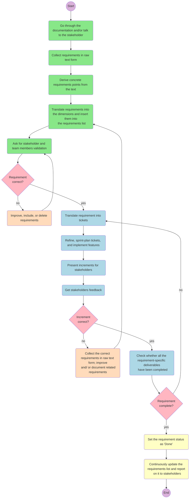

<!--
SPDX-FileCopyrightText: 2025 FITKO (Föderale IT-Kooperation)

SPDX-License-Identifier: CC-BY-SA-4.0
-->

# Methodologies

[[_TOC_]]

## Requirements Engineering

### Technical and functional requirements management

This document describes the approach adopted for managing requirements within the Neo project.

### Introduction

The goals of requirements engineering (RE) are to gather, define, analyze, refine, document and validate requirements.
In other words, the system functional expectations of customers and stakeholders must be described as a target state and challenged by RE against technical feasibility, the project timeline and available resources.
RE aims to answer the following questions:

- Current state: What is the current system's functional and non-functional status?
- Target state: What additional functional and non-functional functionalities are required of the system?
- Target state: Does the list of required features, once complete, describe the target state?
- Stakeholder management: Who is requiring which feature?
- Stakeholder management: Who are the key stakeholders?
- Feasibility: Which of the expected functionalities to be implemented are incompatible with the target state or too demanding in terms of resources?
- Feasibility: Can all the requirements be met within the project timeline and budget?
- Quality: How can we guarantee that the system will behave according to customer and stakeholder expectations?
- Documentation: How can initial, changing and growing requirements be documented most effectively?
- Documentation: Where are all the customer and stakeholder requirements documented?
  Which tool is being used?
- Validation: Do the collected and described requirements align with the expectations of the customer and stakeholders?
- Requirements management: How can changing requirements be managed most effectively?
- Requirement identification: Which are all the dimensions that must be considered for a single requirement?

### Proposed solution approach

The challenge during project execution is to continuously and efficiently track whether all project requirements are being considered when building the system, to whom each requirement belongs, which requirements are still open or missing, and, most importantly, the dependencies between requirements that may result in impediments or bottlenecks.
To solve these issues and answer the above questions, the following approach is proposed.

#### Dimensioning

There are several dimensions from which each interested party in the project may want to view it.
For instance, a stakeholder such as a competent government agency using the solution would only be interested in the requirements list from their own perspective, namely whether all their requirements were addressed.
Meanwhile, the architecture team would like to know which requirements will impact the designed solution.
In other words, the requirements list must be able to provide each stakeholder or project team member with a view of their dimension of interest.
Therefore, to take into account all parties involved in the project and address this issue, a querying or filtering approach is suggested.
This allows each interested party to query or filter the requirements according to their desired dimensions.
The following dimensions are recommended:

- UID: Assigns a unique identifier to each requirement.
  The UID will be generated automatically according to the requirements source added to consecutive incremental counting.
  Each requirements source will have its independent counting, as follows:
  Ex.: ZaPuK_1; ZaPuK_2;  ZaPuK_3; ....; ZaPuK_(n).
  Ex.: OZG_1; OZG_2; OZG_3; ...; OZG_(n).
- Requirement: Summarizes the requirement itself in about one sentence.
- Status: The status of a requirement can be either 'open', 'in progress', 'done', 'blocked', and 'to be checked'.
- Rank: The requirement's ranking cab be either 'must do', 'should do', 'could do', and 'wont do'.
- Priority: The level of priority of a requirement can be 'low', 'medium', 'high' or 'utmost urgent'.
- Stakeholder(s): Lists all the stakeholders who have an interest in this requirement.
- Category: Refers to what part of the requirements source, chapter, section, article or thematic area the requirement comes from.
- Topic labels: Uses labels defined by the Neo project team designed to classify and facilitate identification of development tasks.
- Team(s): This determines which Neo project team should be involved when addressing the requirement.
- Platform: Web client, iOS app, or both.
- Keywords: Suggested are “Hosting & infrastructure”, “Matrix backend”, “Frontend/ UI”, “Business logic”, “BundID postbox”, “BundID component”, “FIT-Connect component”, and “eID”.
  The goal here is to allow visualisation of the requirements through each of these scopes.
- GitLab ticket: Related GitLab ticket, if any.
- Source: Defines the origin of this requirement.
  For example, it could be from a user, a stakeholder, a document, a norm, a guideline, a standard or the Neo requirements catalogue.
- Comments: Provides further explanations about the requirement if necessary, and more information about status updates.

##### Under-prioritized dimensions

The following dimensions were also considered to be part of this RE solution approach.
However, the above dimensions have so far proven sufficient for the purpose of identifying requirements.
Moreover, the following dimensions can always be included if proven necessary.

- Phase: The first year of the Neo project is divided into 3 phases.
- Non-functional classification: Performance, security, availability, usability, scalability, portability and compliance.
- Work package: Assigns the respective defined Neo work package.
- Title: Gives the requirement a title.
  Ideally, the title should have a maximum of five words.
- Type: Non-functional requirement, system requirement, high-level user requirement.
- Problem description: Summarizes the problem in about one sentence.
- Deliverables: Provides a checklist of artifacts that need to be delivered according to stakeholder requirements, plus it provides stakeholders with information of the current state of the requirement and what is missing to be fulfilled.
- Dependencies: Link any other requirements that depend on this one The goal here is to identify bottlenecks.

#### Verifiability through filtering

The purpose of including all the dimensions described above is to enable all project members and stakeholders to view the project requirements from their own specific perspective.
This means that different stakeholders will need to visualise the requirements from different points of view in order to verify them.
The auditability of the requirements is only as good as the ability to see what the auditor needs to see.
Providing each stakeholder with the means to select or filter the dimensions they need ensures they can find the requirements they are looking for and verify whether they have been addressed correctly.

#### Transparency

The main value of working with dimensions and providing all project members and stakeholders with a means of verifying their own requirements is transparency.
This increases the chances of implementing the right features requested because stakeholders can continuously and asynchronously verify their requirements and provide feedback if they were incorrectly recorded.
Moreover, transparency within the requirements context provides a shared understanding of the goals, the work in progress trust, and facilitates visualising the relationship between the requirements and the developed tickets.

### Proposed tool

The next step will be to simulate or conduct an experiment based on the above-described solution approach.
Therefore, a software tool is required.
There are several open-source tools available that claim to be suitable for requirements engineering.
However, none of them were suitable enough to be used as a viable solution.
They are:

- [StrictDoc](https://github.com/strictdoc-project/strictdoc):
  Possibly more suitable as a files and docs organizer.
- [RNF](https://eclipse.dev/rmf/):
  Impossible to download for some reason.
- [osrmt](https://github.com/osrmt/osrmt):
  Need to build your own database first. Not clear how UI works.
- GitLab project (tickets management):
  Managing hundreds of requirements translated into tickets via labels can lead to excessive overhead.
- [openReq](https://github.com/OpenReqEU/openreq-live):
  Installation and configuration are unclear. Moreover, it can run locally only.
- [doorstop](https://github.com/doorstop-dev/doorstop):
  Documentation are saved in a Git repo, and requirements are stored as text files with version control.
  Could be an option if UI shows up to be acceptable and stakeholders are willing to install it.
- [reqT](https://github.com/reqT/reqT):
  Can present limitation for more than 10 users using the tool at the same time.
- [reqFlow](https://goeb.github.io/reqflow/):
  Available only for Windows and Linux. It can run locally only.
- [fret](https://github.com/NASA-SW-VnV/fret):
  Still under analysis. Could be an option.
- [rmToo](https://rmtoo.florath.net/):
  Unclear how to install it.

In general, the issue with the above-mentioned tools is not only whether the dimensioning and filtering can be configured as expected, but also how this will appear or be prompted on the UI.
Moreover, and more importantly, the tool with the data from the inserted requirements must not only run locally.
Ideally, it should be an online service or accessible through a cloud service so that stakeholders and team members can access it easily.
So far, it appears that the best option is to create an OnlyOffice spreadsheet.
The OnlyOffice table will allow us to insert and configure the dimensions in a way that is more advantageous for project members and stakeholders, and it will be more easily accessible to any interested party through NextCloud.
The table will therefore provide the required level of verifiability and transparency.

As the table grows, more attention will be required when handling and maintaining it.
Therefore, depending on how complex this solution is, it may be necessary to create new versions of the table.
This will ensure that the needs of all parties involved are met, while still making the table a useful tool for project members.

### Requirements processing

The process of collecting and addressing requirements can be divided into two categories, as depicted above.
The first is about collecting, refining and verifying the requirements, while the second is about how stakeholders and project members can confirm the implementation of features defined based on these requirements.
This will enable stakeholders and project members to evaluate and approve implemented features continuously and according to their
particular area of interest.

#### Stakeholders

The Neo project stakeholders play a key role in RE, as it is also their requirements that will help to define the objectives, constraints and expectations that shape the final system.
Failing to consider their views from an early stage of the project can result in a mismatch between what is delivered and what is actually needed.
Therefore, within the context of the Neo project, it is imperative to actively engage with stakeholders, aiming to identify diverse viewpoints, uncover hidden needs, clarify ambiguities and resolve conflicting interests early in the development process.
Furthermore, understanding and integrating stakeholder requirements guarantees that the project stays aligned with its intended purpose and succeeds technically and organisationally.
