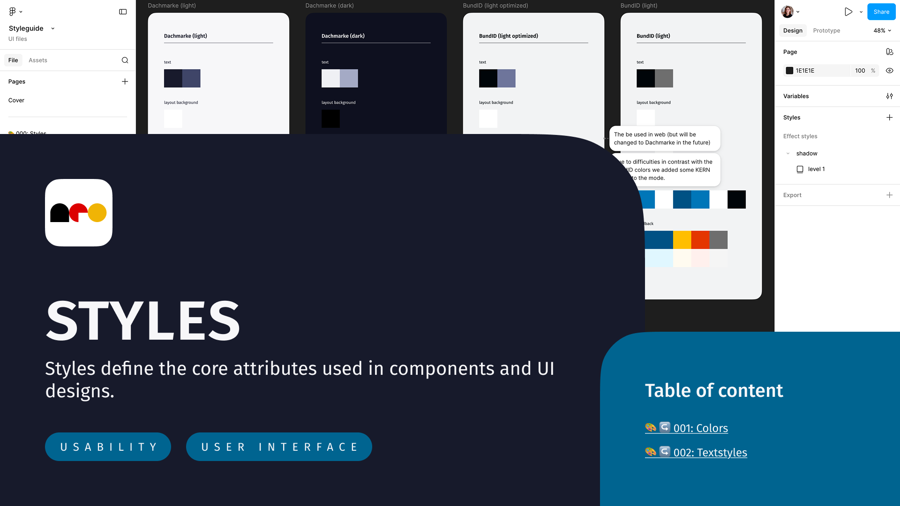
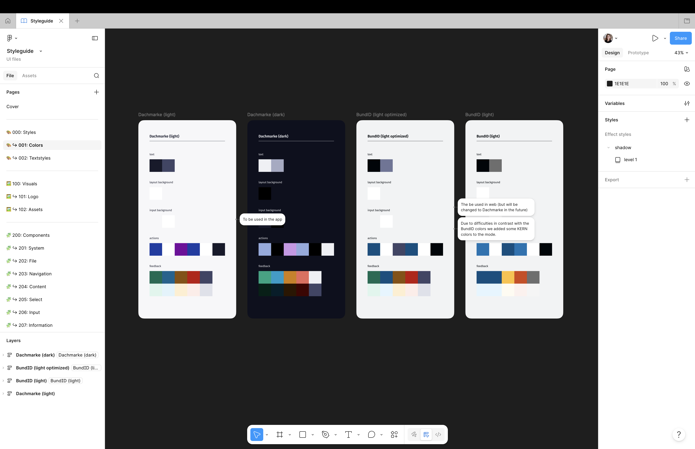

# Styles

Styles define the core attributes used in components and UI designs.

## Table of Content

This section consists of the following elements: 

| ID  | Link |
| ----- | ------- |
| 000 | [→ Overview](https://www.figma.com/design/1p3XZ9tl0awG6w8K7wW5FV/Styleguide?node-id=1-48) |
| 001 | [→ Colors](https://www.figma.com/design/1p3XZ9tl0awG6w8K7wW5FV/Styleguide?node-id=104-885) |
| 002 | [→ Textstyles](https://www.figma.com/design/1p3XZ9tl0awG6w8K7wW5FV/Styleguide?node-id=104-896) |

## Sample Preview

