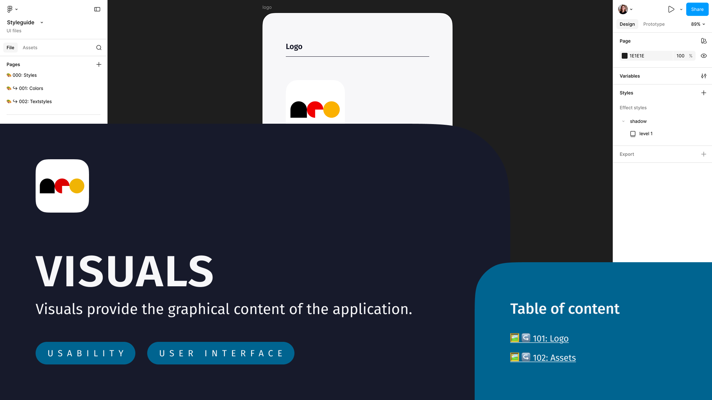
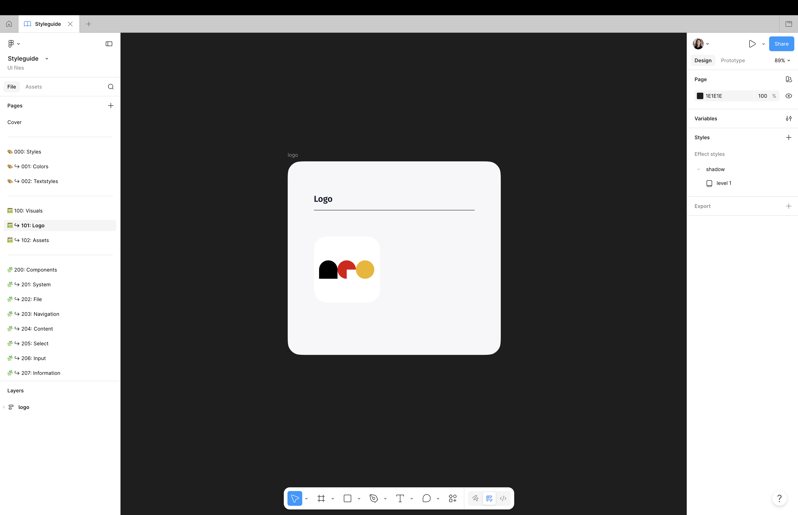

# Visuals

Visuals provide the graphical content of the application.

## Table of Content

This section consists of the following elements: 

| ID  | Link |
| ----- | ------- |
| 100 | [→ Overview](https://www.figma.com/design/1p3XZ9tl0awG6w8K7wW5FV/Styleguide?node-id=1-48) |
| 101 | [→ Logo](https://www.figma.com/design/1p3XZ9tl0awG6w8K7wW5FV/Styleguide?node-id=1509-92) |
| 102 | [→ Assets](https://www.figma.com/design/1p3XZ9tl0awG6w8K7wW5FV/Styleguide?node-id=1-45) |

## Sample Preview

