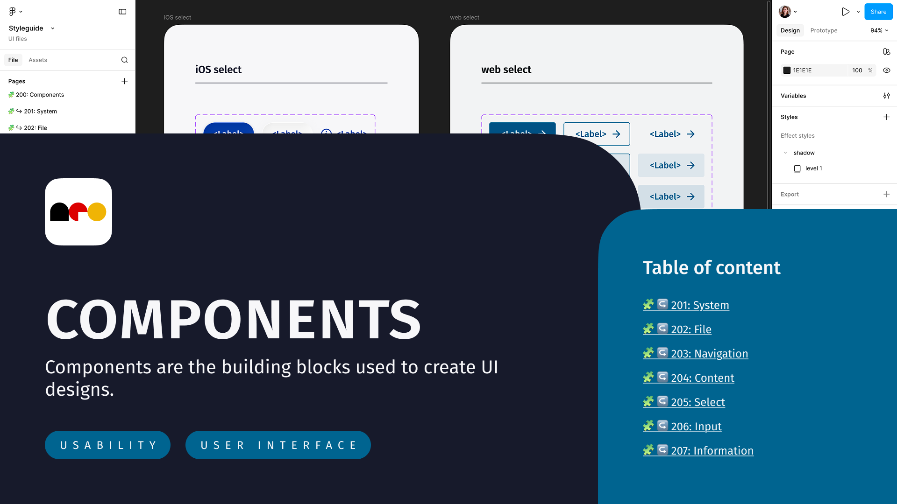
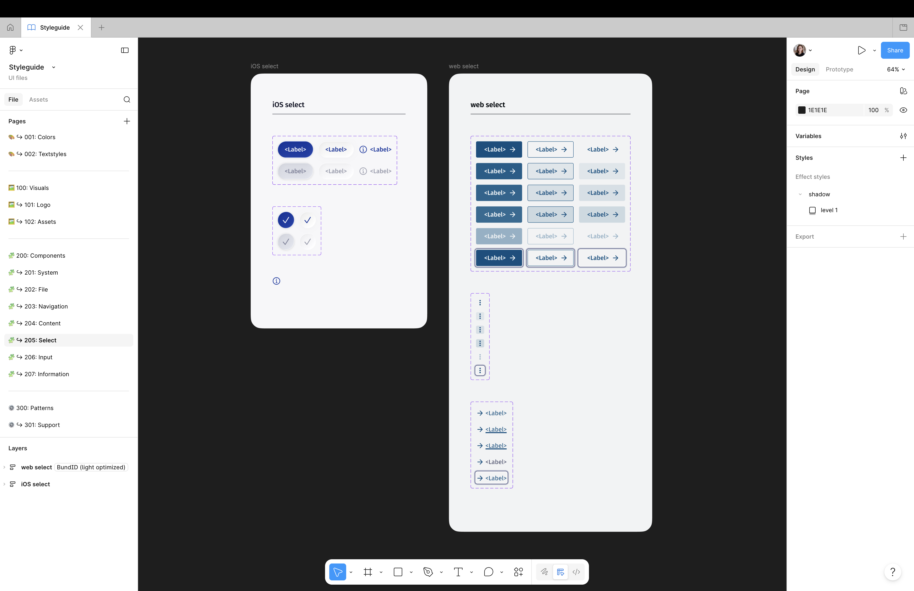

# Components

Components are the building blocks used to create UI designs.

## Table of Content

This section consists of the following elements: 

| ID  | Link |
| ----- | ------- |
| 200 | [→ Overview](https://www.figma.com/design/1p3XZ9tl0awG6w8K7wW5FV/Styleguide?node-id=1-44) |
| 201 | [→ System](https://www.figma.com/design/1p3XZ9tl0awG6w8K7wW5FV/Styleguide?node-id=16-424)|
| 202 | [→ File](https://www.figma.com/design/1p3XZ9tl0awG6w8K7wW5FV/Styleguide?node-id=0-1) |
| 203 | [→ Navigation](https://www.figma.com/design/1p3XZ9tl0awG6w8K7wW5FV/Styleguide?node-id=6-3) |
| 204 | [→ Content](https://www.figma.com/design/1p3XZ9tl0awG6w8K7wW5FV/Styleguide?node-id=144-1011) |
| 205 | [→ Select](https://www.figma.com/design/1p3XZ9tl0awG6w8K7wW5FV/Styleguide?node-id=23-299) |
| 206 | [→ Input](https://www.figma.com/design/1p3XZ9tl0awG6w8K7wW5FV/Styleguide?node-id=30-115) |
| 207 | [→ Information](https://www.figma.com/design/1p3XZ9tl0awG6w8K7wW5FV/Styleguide?node-id=46-2857) |

## Sample Preview

