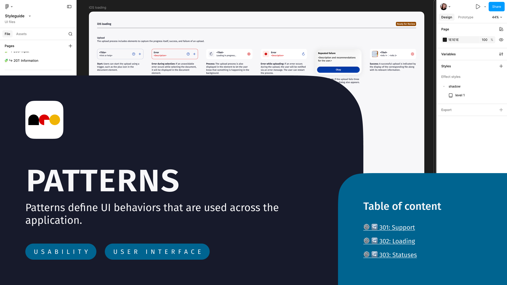
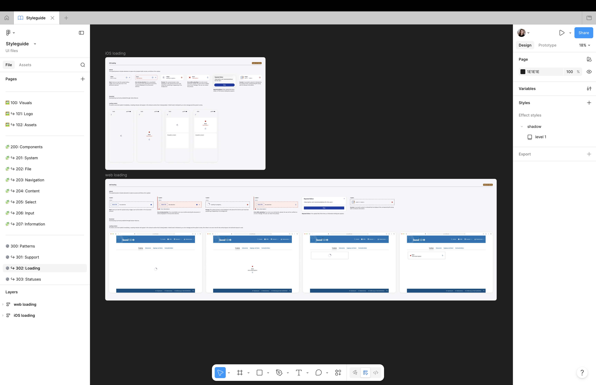

# Patterns

Patterns define UI behaviors that are used across the application.

## Table of Content

This section consists of the following elements: 

| ID  | Link |
| ----- | ------- |
| 300 | [→ Overview](https://www.figma.com/design/1p3XZ9tl0awG6w8K7wW5FV/Styleguide?node-id=1165-16) |
| 301 | [→ Support](https://www.figma.com/design/1p3XZ9tl0awG6w8K7wW5FV/Styleguide?node-id=1165-53)|
| 302 | [→ Loading](https://www.figma.com/design/1p3XZ9tl0awG6w8K7wW5FV/Styleguide?node-id=1165-54) |
| 303 | [→ Statuses](https://www.figma.com/design/1p3XZ9tl0awG6w8K7wW5FV/Styleguide?node-id=1181-2) |

## Sample Preview

