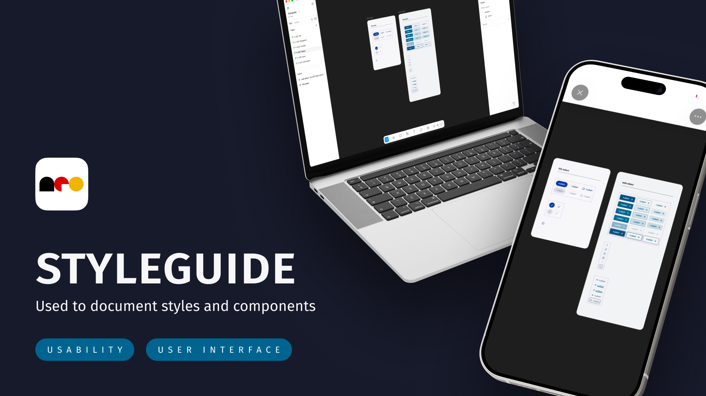

# Style Guide for the Neo User Interface Design

The style guide sets out guidelines for the user interface design of the Neo iOS app and the web application. It is maintained and kept up to date in Figma. This repository serves as a guide and a starting point for navigating the relevant sections of the Figma file.

[→ Go directly to the Figma file](https://www.figma.com/design/1p3XZ9tl0awG6w8K7wW5FV/Styleguide?node-id=33-207)

The definitions in our style guide are based on the specifications of the KERN 2 Design System and utilise the libraries published for it in Figma. Our web definitions combine KERN 2 components with BundID styling guidelines, as our web application is intended to be integrated into BundID. The app combines native iOS elements with styling guidelines from the KERN 2 Design System. Our aim is to achieve stable and efficient development whilst maintaining high usability through the use of interaction elements familiar within the iOS context. 

Any changes to the KERN 2 Design System are monitored by us and manually incorporated into our style guide.

[→ KERN 2 Design System](https://www.kern-ux.de/design-system/)

## Table of Content

The style guide consists of the following sections: 

| ID  | Link |
| ----- | ------- |
| 000 | [↪ Styles](000_styles.md) |
| 100 | [↪ Visuals](100_visuals.md) |
| 200 | [↪ Components](200_components.md) |
| 300 | [↪ Patterns](300_patterns.md) |