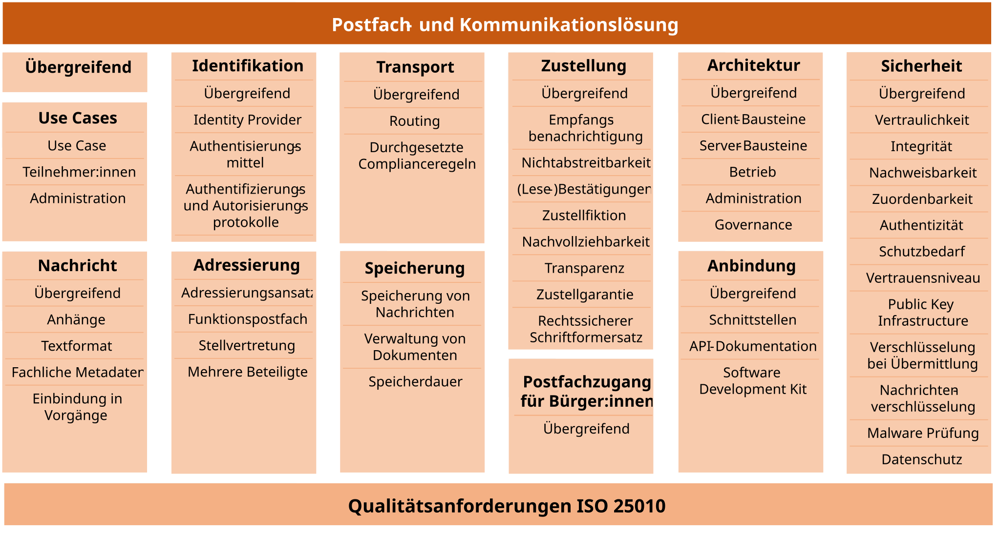

# Föderale Zielarchitektur für Postfach- und Kommunikationslösungen

***Zukunftsweisende föderale Infrastruktur für die Kommunikation zwischen Privatpersonen, privaten Organisationen und öffentlichen Stellen***

**Version 1.0** &ndash; **Stand: 13.05.2025** &ndash; **01 Anforderungserhebung und Bestandsanalyse**

> Dieses Dokument ist die maschinenlesbare Textfassung des vom IT-Planungsrat im PDF-Format verabschiedeten Dokuments ["01 Anforderungserhebung und Bestandsanalyse" in Version 1.0](./2025-06-26_Beschluss-2025-28_ZaPuK_Anforderungs-und-Bestandsanalyse.pdf). Bei der Überführung wurden redaktionelle Änderungen für eine bessere Lesbarkeit und Anpassung an die openCode-Struktur vorgenommen.

------

| Titel | Dokumentart | Inhalt |
| ----- | ----------- | ------ |
| [Überblick und Handlungsempfehlung](../../Zielarchitektur/Zusammenfassung/) | Klammerdokument | Übergreifende Zusammenfassung des Vorhabens und Darstellung strategischer Implikationen |
| **01 Anforderungserhebung und Bestandsanalyse** | **Begleitdokument** | **Beschreibung des Vorgehens und der Erkenntnisse aus der Anforderungs- und Bestandsanalyse mit Auflistung der 151 konsolidierten Anforderungen** |
| [02 Konzept Zielarchitektur](../../Zielarchitektur/Architekturkonzept/) | Begleitdokument | Darstellung der auf die Ziele des Vorhabens ausgerichtete Zielarchitektur zur Umsetzung der identifizierten Anforderungen |
| [03 Glossar und Rahmenbedingungen](../../Zielarchitektur/Rahmenbedingungen/) | Begleitdokument | Übersicht über die zentralen Begriffe und Rahmenbedingungen |

## Nutzungsbedingungen

Die Inhalte dieses Dokumentes unterliegen der [Creative Commons Namensnennung 4.0 International Public License (CC BY 4.0)](https://creativecommons.org/licenses/by/4.0/).

------

## 1. Einleitung

Wesentliche Grundlage für den Entwurf einer föderalen Zielarchitektur für Postfach- und Kommunikationslösungen bildet die umfassende Kenntnis zu erfüllender Anforderungen sowie die Erkenntnisse, die aus bereits bestehenden Lösungen und Best-Practices abgeleitet werden können. Das vorliegende Dokument beschreibt das Vorgehen und die zentralen Erkenntnisse aus der Anforderungs- und Bestandsanalyse (Projektphase I).

[Kapitel 2](#2-methodisches-vorgehen) beschreibt das methodische Vorgehen bei der Anforderungsanalyse. Die Analyse bestehender Lösungen bildete dabei eine wesentliche Quelle für die Ermittlung von Anforderungen. Darüber hinaus wurden hierbei auch Funktionsmerkmale sowie architektonische und technologische Grundlagen der Lösungen vergleichend dokumentiert, um diese Aspekte in der Konzeption der Zielarchitektur aufgreifen zu können.

Die Anforderungen werden führend in einem Anforderungskatalog vorgehalten und verwaltet. Ein aktueller Auszug der abgeleiteten konsolidierten Anforderungen an die Zielarchitektur ist in [Kapitel 3](#3-konsolidierte-anforderungsliste-der-zielarchitektur) einsehbar.

Im abschließenden [Kapitel 4](#4-wesentliche-analytische-erkenntnisse) werden wesentliche Erkenntnisse aus der Anforderungs- und Bestandsanalyse dargestellt.

## 2. Methodisches Vorgehen

Die Anforderungen an die Zielarchitektur wurden in einem strukturierten multi-methodischen Analyseprozess zwischen Herbst 2024 und Frühjahr 2025 systematisch erhoben und konsolidiert. Ausgangspunkt für die strukturierte Erhebung von Anforderungen sowie die Ableitung relevanter Erkenntnisse für die Entwicklung der Zielarchitektur bildete

- die Bestandsanalyse bestehender Postfachlösungen und Best-Practices sowie
- die Analyse von Rahmenbedingungen.

Im weiteren Verlauf erfolgte

- die Durchführung von Workshops mit Fachexpert:innen sowie
- die Konsultation über openCode für eine breitere Öffentlichkeit.

Das Vorgehen orientierte sich an dem im Folgenden beschriebenen Phasenmodell.

### 2.1 Erhebung und Validierung von Anforderungen

Die Erhebung erfolgte anhand von Textanalysen anforderungsrelevanter Quellen sowie strukturierter Interviews. Ergänzend wurden weitere regulatorische, architektonische und strategische Rahmenbedingungen (Gesetze, Verordnungen, Architekturrichtlinien, die Föderale Digitalstrategie sowie relevante Technische Richtlinien des BSI) analysiert. Diese Quellen wurden bewertet, priorisiert und in die Anforderungsanalyse einbezogen.

Alle analysierten Quellen wurden in ein umfassendes Quellenverzeichnis aufgenommen, wobei die zugehörigen Dokumente in einer zentralen Projektablage hinterlegt wurden. Die zunächst unkonsolidiert erfassten ca. 900 Anforderungen (Stand: 04/2025) wurden thematisch strukturiert und rückverfolgbar zu den jeweiligen Quelldokumenten und den entsprechenden Textpassagen dokumentiert. Ergänzend wurden diese zunächst noch unkonsolidierten Anforderungen in Interviews und Workshops mit Fachexpert:innen validiert und erweitert.

In die Bestandsanalyse wurden wesentliche bestehende Postfach- und Kommunikationslösungen mit Relevanz für die föderale IT-Landschaft vertieft einbezogen.

Neben der Ableitung von **Anforderungen** für die Zielarchitektur wurden die Bestandslösungen auch hinsichtlich ihrer **Fähigkeiten** sowie ihren **architektonischen und technologischen Merkmalen** analysiert und dokumentiert.

> *Tabelle 1: Dokumentation der Ergebnisse aus der Bestandsanalyse*

| &nbsp; | Untersuchungsgegenstand | Dokumentation |
| ------ | ----------------------- | ------------- |
| 1. | Strukturierung und Dokumentation von Anforderungen | *&rarr; Anforderungsliste (unkonsolidiert)* |
| 2. | Strukturierung und Dokumentation von Fähigkeiten | *&rarr; Produktsteckbrief* |
| 3. | Erkenntnisgewinn über die jeweilige Architektur und Technologie | *&rarr; Produktsteckbriefe* |

Aufgrund der zeitlichen Begrenzungen des Projektes lag der Fokus dabei insbesondere auf generalistischen Lösungen sowie solchen, die technologisch-architektonisch alternative Ansätze verfolgen. Spezifische Postfachlösungen einzelner Fachdomänen (z. B. Arbeit und Soziales oder Rentenversicherung) wurden hingegen nicht vertiefend betrachtet. Diese können jedoch im Rahmen der weiteren Arbeiten an einer gemeinsamen Zielarchitektur zukünftig berücksichtigt werden.

Die folgende Tabelle gibt einen Überblick über die analysierten Bestandslösungen:

> *Tabelle 2: Übersicht betrachteter deutscher Bestandslösungen*

| Bestandslösung | Zweck |
| --- | --- |
| Zentrales Bürgerpostfach (ZBP) | Das ZBP ist eine digitale Kommunikationsplattform, um zwischen öffentlichen Stellen und Privatpersonen eine sichere und effiziente Zustellung von Bescheiden und Nachrichten zu ermöglichen, wodurch der postalische Versand ersetzt werden kann. Das ZBP realisiert damit in erster Linie den digitalen Rückkanal nach digital in Anspruch genommenen OZG-Leistungen. |
| Postfach 2.0 | Das Postfach 2.0 ist eine von zwei Postfachkomponenten von "Mein Unternehmenskonto" zur rechtsverbindlichen und digitalen Kommunikation zwischen öffentlichen Stellen und privaten Organisationen. Unterscheidungsmerkmal zum OZG-PLUS-Postfach ist die beschränkte Abbildbarkeit komplexerer Unternehmensstrukturen bei der Adressierung und Zugriffsberechtigung. |
| OZG-PLUS-Postfach | Das OZG-PLUS-Postfach ist eine alternative Postfachkomponente von "Mein Unternehmenskonto". Es wurde geschaffen, um eine einheitliche digitale *Ende-zu-Ende-verschlüsselte* (E2EE) Kommunikation zwischen öffentlichen Stellen und privaten Organisationen gemäß OZG zu gewährleisten. Dabei unterstützt es komplexere Unternehmensstrukturen durch eigenverwaltete Funktionspostfächer und Vertretungsregelungen. |
| De-Mail | De-Mail bietet eine sichere, vertrauliche und nachweisbare elektronische Kommunikationsinfrastruktur für einen verbindlichen Rechts- und Geschäftsverkehr zwischen öffentlichen Stellen, Privatpersonen und privaten Organisationen. |
| TI-Messenger | Die TI-Messenger Infrastruktur erlaubt die sichere, vertrauliche und datenschutzkonforme Echtzeitkommunikation zwischen verschiedenen Akteuren im Gesundheitswesen und in Zukunft auch für Krankenversicherte. |
| Elektronisches Gerichts- und Verwaltungspostfach (EGVP) | Der elektronische Rechtsverkehr (ERV) ermöglicht die elektronische Kommunikation mit Gerichten und Behörden unter Wahrung der Rechtssicherheit. Es können Schriftsätze, Dokumente sowie maschinenlesbare strukturierte Daten im XJustiz-Format rechtswirksam an alle teilnehmenden Gerichte und Behörden übermittelt werden. Ursprüngliches Ziel ist es, den Beteiligten an gerichtlichen Verfahren die Abgabe verbindlicher Erklärungen gegenüber den Gerichten und Justizbehörden in elektronischer Form zu ermöglichen. Mittlerweile finden aber auch weitere Kommunikationsszenarien bis hin zu Registerabfragen statt.  EGVP bildet die grundlegende Transportinfrastruktur. Für die Nutzung der Infrastruktur ist je Domäne individuelle ERV-Sende- und Empfangssoftware (ERV-SES) erforderlich, die sich an diese Infrastruktur anbinden muss und die für den jeweiligen Nutzerkreis eigene Zugangswege für IT-Systeme oder Benutzeroberflächen schafft. Beispiele sind beA, beN, beSt, beBPo. |
| Besondere elektronische Bürger- und Organisationspostfach (eBO) / Mein Justizpostfach (MJP) | Mit dem eBO können Privatpersonen und private Organisationen elektronische Dokumente sicher und zuverlässig mit der Justiz über die EGVP-Transportinfrastruktur austauschen. Diese ERV-SES-Lösung bietet allerdings ausschließlich einen Postfach- und Schnittstellenzugang. Anwender benötigen spezifische Clients für den Zugriff. Seit dem 12. Oktober 2023 steht für Privatpersonen zusätzlich das kostenlos nutzbare Mein Justizpostfach (MJP) als Browseranwendung zur Verfügung zur Kommunikation mit der Justiz sowie mit Behörden, Anwält:innen, Notar:innen und Steuerberater:innen. Als ERV-SES erfordern beide Lösungen die EGVP-Transportinfrastruktur. |
| BwMessenger / BundesMessenger | Der BundesMessenger ist ein quelloffener Messenger für die öffentliche Verwaltung. Er ist die Weiterentwicklung des BwMessengers, der eigens für die Bundeswehr entwickelt wurde. Das Ziel ist eine moderne und sichere Zusammenarbeitsplattform für die Verwaltung in Deutschland zu schaffen, die sich den Bedürfnissen und Vorgaben der Verwaltung anpasst (primärer Use-Case ist die verwaltungsinterne Kommunikation zwischen Behördenmitarbeitenden). |

Ein zentraler Bestandteil im Anforderungsmanagement war die Einbindung der relevanten Stakeholder. Durch strukturiertes Stakeholdermanagement wurden die Beteiligten identifiziert, um die aktive Einbindung aller relevanten Fachexpert:innen in die Untersuchung der betrachteten Bestandslösungen sicherzustellen. In Workshops und Interviews wurden technologische und fachliche Anforderungen konkretisiert und wichtige Perspektiven zu den bestehenden Lösungen aufgenommen. Die Ergebnisse dieser Zusammenarbeit schufen damit eine fundierte Grundlage für die Entwicklung der Zielarchitektur.

Parallel zur Anforderungserhebung anhand der Erkenntnisse der Bestandssysteme erfolgte durch das Projektteam eine Ableitung von insbesondere übergreifenden Anforderungen auf Grundlage von Erfahrungswissen aus der Disziplin des *Föderalen IT-Architekturmanagements (FIT-AM)*.

### 2.2 Thematische Strukturierung

Zur Unterstützung einer vergleichenden und strukturierten Analyse erfolgte eine induktive Zerlegung des Lösungsraumes in thematische Kategorien und Unterkategorien. Das resultierende **Kategorienschema** war strukturgebend sowohl für die Methodik (bspw. Interviewleitfaden, Stakeholderworkshop), als auch für die Ergebnisartefakte. Ergänzt wurden die thematischen Kategorien um Kategorien für **Qualitätsanforderungen**, die sich an der Struktur des Standards ISO/IEC 25010[^1] orientieren.

> *Abbildung 1: Thematische Struktur der Anforderungsliste und Produktsteckbriefe*

In der folgenden Tabelle werden die Kategorien knapp erläutert. Es ist zu beachten, dass dort getätigte Aussagen nicht zwingend einer Anforderung an die Zielarchitektur entsprechen müssen, sondern beschreibende Eigenschaften von Bestandslösungen darstellen.

> *Tabelle 3: Erläuterung der Kategorien*

| Kategorie | Beschreibung |
| --- | --- |
| Use Case | Die Kategorie **Use Case** beschreibt geschäftliche Anwendungsfälle, die von Postfach- und Kommunikationslösungen zu unterstützen sind, die beteiligten Teilnehmer:innen sowie administrative Prozesse, die zur Steuerung und Verwaltung notwendig sind. |
| Nachrichten | Die Kategorie **Nachrichten** umfasst Merkmale und Funktionen wie den Versand von Anhängen (z. B. Bescheide, Nachweise) mit bestimmten Größen- und Formatvorgaben. Zudem können Nachrichten in unterschiedlichen Textformaten gestaltet werden und mit fachlichen Metadaten wie Fallbezügen oder Identifikatoren angereichert werden. Durch die Einbindung in Vorgänge lassen sich Nachrichten in Prozesse oder Workflows integrieren, etwa für Widersprüche. |
| Identifikation | Die Mechanismen zur Verifizierung und Authentisierung von Nutzer:innen im System werden in der Kategorie **Identifikation** behandelt. Dazu gehören Identity Provider, die Identitäten bestätigen. Zudem spielen Authentisierungsmittel wie beispielsweise eID oder ELSTER-Zertifikate eine Rolle. Die Kommunikation und Sicherstellung der Identitäten erfolgt über Authentifizierungs- und Autorisierungsprotokolle. |
| Adressierung | In der Kategorie **Adressierung** wird beschrieben, wie Empfänger:innen adressiert werden. Dabei kann die Adressierung zum Beispiel initiativ aus einem Adressbuch, aus Übermittlung eines Antrags oder als Antwort erfolgen. Darüber hinaus sollen Regelungen zur Stellvertretung möglich sein, die temporär oder dauerhaft vergeben werden können. Ein weiteres Merkmal ist die Nutzung von Funktionspostfächern, die mehreren berechtigten Personen gemeinsamen Zugriff auf Nachrichten ermöglichen. Die Kommunikation mit mehreren Beteiligten wird ebenfalls betrachtet. |
| Transport | **Transport** bezeichnet den Prozess der Auswahl des Pfades für die Übertragung von Nachrichten oder Datenpaketen von einer Absender:in zu einer Empfänger:in über ein Netzwerk. Dabei umfasst das Routing die Auswahl des Übertragungspfads. Gegebenenfalls sind beim Transport die Einhaltung von Complianceregeln sicher zu stellen. |
| Speicherung | Die Kategorie **Speicherung** beschreibt die Fähigkeiten zur Speicherung und Löschung von Nachrichten auf Ebene der Infrastruktur. An dieser Stelle werden keine Anforderungen an die Speicherung auf Clients beschrieben. |
| Zustellung | In der Kategorie **Zustellung** werden Mechanismen behandelt, die sicherstellen, dass Nachrichten zuverlässig, nachvollziehbar und rechtssicher zugestellt werden. Die Nachvollziehbarkeit gewährleistet eine lückenlose Dokumentation des Zustellprozesses, während Nichtabstreitbarkeit sicherstellt, dass der Versand und Empfang von Nachrichten nicht geleugnet werden können. Bestätigungen quittieren den Versand und die Abholung von Nachrichten. Die Zustellgarantie stellt sicher, dass Nachrichten nicht verloren gehen, während die Zustellfiktion festlegt, unter welchen Bedingungen eine Nachricht als zugestellt gilt. Durch rechtssicheren Schriftformersatz werden gesetzliche Anforderungen erfüllt, z. B. bei Fristen oder Widersprüchen. Schließlich sorgt eine Eingangsbenachrichtigung dafür, dass Empfänger:innen über neue Nachrichten auf alternativem Weg informiert werden. |
| Postfachzugang | Die Kategorie **Postfachzugang** beinhaltet Anforderungen und Funktionen der nutzendenseitigen Zugänge zur Infrastruktur insbesondere aus Perspektive der Privatpersonen.  Anforderungen an Clients mit graphischen Bedienoberflächen wurden allerdings nicht strukturiert und explizit erfasst, sondern nur im Zuge der Quellenanalyse mit dokumentiert. Für die aktuelle Phase der Arbeit an einer Zielarchitektur mit Fokus auf einer interoperablen Infrastruktur wurde die Detail-Konzeption von Clients zunächst ausgeklammert. Diese Konzeption wird im Falle der Umsetzung des Projektes mit der Erstellung der Lösungsarchitektur adressiert. Dabei gilt es dann, die Zugänge zur Infrastruktur aus Nutzer:innenperspektive zu gestalten. Aus Sicht der Privatpersonen muss der Zugang zum Postfach in den Kontext der allgemeinen Interaktionsmöglichkeiten mit öffentlichen Stellen gestellt werden, wie zum Beispiel der Antragstellung, der Verwaltung von Authentisierungsmitteln, Vollmachten und Dokumenten oder der Integration in Wallets. |
| Architektur | Die Kategorie **Architektur** differenziert sich in die Beschreibung von Client- und Server-Bausteinen. Unter Administration werden Systeme zur Verwaltung von Benutzer:innen, Berechtigungen und Systemkomponenten geführt. Die Governance legt Richtlinien und Verantwortlichkeiten zur Steuerung fest. Die Unterkategorie Betrieb umfasst alle Aktivitäten und Prozesse, die notwendig sind, um eine Lösung zuverlässig und effizient auszuführen und zu administrieren.  Die Unterkategorien dienen in erster Linie der strukturierten Beschreibung in den Produktsteckbriefen. Anforderungen zur Kategorie Architektur wurden nur begrenzt erfasst, da diese über andere Wege dokumentiert werden (Architekturprinzipien, Architekturrichtlinien). |
| Anbindung | Die Kategorie **Anbindung** beschreibt die Möglichkeiten und Anforderungen für die Integration durch externe Systeme. Über Schnittstellen erfolgt die Kommunikation zwischen Komponenten. *Software Development Kits* (*SDKs*) erleichtern die Entwicklung und Anbindung von Anwendungen, während die API-Dokumentation sicherstellt, dass Schnittstellen nachvollziehbar und standardkonform für Menschen und Maschinen lesbar beschrieben sind. |
| Sicherheit | Die Kategorie **Sicherheit** beschreibt Maßnahmen zum Schutz von Nachrichten und Daten vor unbefugtem Zugriff, Manipulation und Malware. Der Schutzbedarf ist abhängig von der Vertraulichkeit von Daten. Das zu realisierende Vertrauensniveau erfordert ein diesem angemessenes Sicherheitsniveau, insbesondere hinschlich des Grads des Vertrauens in die Identität einer Person oder eines Systems. Die Authentizität und Integrität einer Nachricht werden durch Siegel oder Signaturen gewährleistet, um die Echtheit und Unversehrtheit der Daten sicherzustellen. Eine PKI dient zur Verwaltung und Verifikation von Schlüsseln. Für den sicheren Transport kommt eine Ende-zu-Ende-Verschlüsselung zum Einsatz. Zudem wird durch Nachrichtenverschlüsselung sichergestellt, dass gespeicherte Nachrichten nur für autorisierte Personen zugänglich sind. |

### 2.3 Anforderungskonsolidierung

Die ca. 900 identifizierten Einzelanforderungen wurden in einem Konsolidierungsprozess zusammengeführt und mündeten in einem Entwurf einer [**konsolidierten Anforderungsliste**](../) mit ungefähr 150 Anforderungen. Hierzu wurden verschiedene Faktoren holistisch abgewogen, insbesondere deren Architekturrelevanz und das jeweilige Abstraktionsniveau. Im Rahmen des Prozesses erfolgte somit zunächst eine Bewertung des Abstraktionsgrades und der Relevanz der Anforderungen. Detailanforderungen ohne Relevanz für die übergreifende Zielarchitektur wurden für eine spätere Betrachtung im Rahmen der Realisierung konkreter Lösungsarchitekturen ausgegrenzt. Technologiebezogene sowie lösungsspezifische, nicht generalisierbare Anforderungen wurden ausgegrenzt oder verworfen. Darüber hinaus wurden redundante Anforderungen aus unterschiedlichen Quellen zusammengefasst.

Ein weiterer Schwerpunkt des Konsolidierungsprozesses lag auf der begrifflichen Schärfung und Vereinheitlichung. Dazu wurde ein [**Glossar**](../../Glossar.md) erstellt, welches zentrale Begriffe definiert und so die durchgängige Verwendung einer kohärenten Terminologie sicherstellt.

Durch ein System methodengetriebener Verweise in einem zentralen Anforderungsregister wurde die **Rückverfolgbarkeit** aller Anforderungen sichergestellt, sodass die Herkunft jeder konsolidierten Anforderung zurückführbar auf eine oder mehrere nicht-konsolidierte Ursprungsanforderungen ist und bis auf die entsprechende Textpassage ihrer ursprünglichen Quelle nachvollzogen werden kann (siehe Abbildung 2).

> *Abbildung 2: Ableitung und Konsolidierung von Anforderungen aus Quellen*

### 2.4 Qualitätssicherung

Aufgrund der hohen Relevanz der konsolidierten Anforderungsliste erfolgten im Verlauf des Projektes bereits verschiedene Maßnahmen zur Qualitätssicherung. Neben einer kontinuierlichen **internen Qualitätssicherung** im Projektteam wurde die konsolidierte Anforderungsliste den Verantwortlichen der Bestandslösungen, den Mitgliedern der Arbeitsgruppe des Föderalen IT-Architekturboards sowie weiteren Fachexpert:innen **zur Kommentierung bereitgestellt**. In einem **Anforderungsworkshop** am 27. Januar 2025 erfolgte mit ca. 30 Stakeholdern aus Bund und Ländern unter Einbeziehung der Betreiber:innen aller Bestandslösungen ein intensiver Diskurs über die erste Fassung der konsolidierten Anforderungsliste. Nach Einarbeitung der Ergebnisse aus dem Workshop wurde diese Liste mit Stand v0.6 zur breiteren Konsultation auf der Plattform openCode veröffentlicht.

## 3. Konsolidierte Anforderungsliste der Zielarchitektur

Der aktuelle Stand der [konsolidierten Anforderungsliste](../) und eine detaillierte Beschreibung des methodischen Vorgehens zur Anforderungsanalyse findet sich auf der [Plattform openCode](../../).

<!-- Anmerkung der Redaktion: Dokument ist nicht Teil des IT-PLR-Beschlusses und in dieser Form nicht existent  -->
<!-- Eine Version v0.6 zum Berichtszeitpunkt (Stand 04/2025) findet sich unter "02 Konsolidierte Anforderungsliste". -->

## 4. Wesentliche analytische Erkenntnisse

Über die konsolidierte Anforderungsliste hinausgehende wesentliche Erkenntnisse aus der Anforderungs- und Bestandsanalyse werden im Folgenden zusammenfassend dargestellt.

**Alle Lösungen setzen überwiegend identische Fähigkeiten um**: Alle Lösungen bieten ähnliche grundlegende Funktionsmerkmale zum Austausch von elektronischem Schriftverkehr. Dies bedeutet, dass in der Postfachlandschaft aktuell zahlreiche funktional ähnliche Lösungen parallel entwickelt und betrieben werden.

**Vergleichbare Fähigkeiten sind heterogen umgesetzt und strukturell verankert**: Ähnlich geartete Fähigkeiten werden in bestehenden Postfach- und Kommunikationslösungen unterschiedlich umgesetzt. Sie unterscheiden sich insbesondere aufgrund der heterogenen und historisch gewachsenen technischen, juristischen und organisatorisch-strukturellen Lagen innerhalb der und zwischen den verschiedenen Bereichen des staatlichen Handelns.

Exemplarisch konnten folgende Arten und Quellen der Heterogenität identifiziert werden:

- **Rechtliche Rahmenbedingungen wirken auf die Systemgestaltung ein**: Die aktuelle Postfachlandschaft ist historisch gewachsen. Grundlegend und existenzbegründend sind in der Regel Rechtsvorschriften, die teils kleinteilig und inkrementell Fähigkeiten vorgeben.[^2] Darüber hinaus schreiben Rechtsvorschriften teilweise auch architektonische Rahmenbedingungen oder konkrete technische Standards vor (Beispiel: Verwendung von OSCI im ERV). Eine über alle staatlichen Institutionen reichende Gesamtstrategie ist ohne Anpassung der aktuellen Rechtsgrundlagen vermutlich nicht abbildbar.

Als konkretes Beispiel sei hier die Umsetzung von Fähigkeiten für die Erfüllung von Anforderungen der Nichtabstreitbarkeit zu nennen. Die Beweiskraft der Umsetzungsansätze ist dabei unterschiedlich weitreichend. Dies ist auch darin begründet, dass heterogene Regelungen definiert sind, beziehungsweise Freiheitsgrade in Rechtsgrundlagen Interpretationen für die Umsetzung erlauben. Die Heterogenität der Rechtsgrundlagen erschwert damit auch Ansätze für ein gemeinsame Zielarchitektur. Digitaltauglichkeitsprüfungen von Gesetzesentwürfen sollten hier zukünftig für eine Harmonisierung sorgen.

- **Governance- und Organisationsstrukturen sind heterogen**: Bestehende Lösungen werden teils im Rahmen entkoppelter Strukturen finanziert, gesteuert, technisch und planerisch weiterentwickelt und betrieben.
- **Nutzer:innen-Orientierung ist kontextuell beschränkt**: Meist betrachtet jede Bestandslösung Nutzer:innen isoliert im Kontext ihrer jeweiligen fachlichen Perspektive. Dem Umstand, dass dieselbe natürliche Person oder Organisation in unterschiedlichen Situationen in unterschiedlichen fachlichen Rollen auftritt (z. B. als Antragsteller:in, Kläger:in, Patient:in, Mitarbeiter:in, ...) wird nur selten Rechnung getragen.
- **Lösungen sind architektonisch und technologisch unterschiedlich ausgestaltet**: Die historisch und planerisch entkoppelte Genese der bestehenden Lösungen führte zu Technologie- und Architekturentscheidungen, die zum jeweiligen Entwicklungszeitpunkt ggf. den gegebenen Anforderungen und dem Stand der Technik entsprachen, in der heutigen Gesamtschau der IT-Landschaft aber zu Komplexität führen. Beispiele sind dezentrale vs. zentrale Architekturen, Identitäten, die Umsetzung der Verschlüsselung oder die Schnittstellentechnologien.
  - Dezentrale vs. zentrale Architektur: Bei den analysierten Kommunikationslösungen waren sowohl zentrale als auch zunehmend dezentrale föderierte Architekturen anzutreffen. Diese Dimension erstreckt sich dabei über verschiedene architektonische Bereiche, wie Betriebsverantwortung, Datenhaltung etc.
  - Dezentrale vs. zentrale Identitäten: Auch in Bezug auf die Einbindung von Identity Providern unterscheiden sich die Ansätze. Während zum Beispiel im Gesundheitssektor ein föderiertes sektorales Identitätsmanagement für Versicherte anzutreffen ist, finden sich bei anderen Lösungen zentralisierte Ansätze für Nutzergruppen.
  - Verschlüsselungsansatz: Es existiert eine Vielzahl von Verschlüsselungsansätzen, die an verschiedenen Stellen im Einsatz sind. Die untersuchten Matrix-basierten Kommunikationslösungen (TI-Messenger, BundesMessenger) verwenden die im Standard übliche Ende-zu-Ende-Verschlüsselung mit kurzlebigen Schlüsseln (Double Ratchet Algorithms), die in Zukunft auch durch den neuen Standard Messaging Layer Security (MLS) umgesetzt werden kann. Andere Lösungen dagegen verwenden langlebige Schlüssel, manchmal auch unter Aufbrechen der Verschlüsselung (z. B. zur Umschlüsselung) oder unter Verwendung von Proxy Reencryption, um eine Entschlüsselung durch mehrere Teilnehmende zu ermöglichen. Lösungen sehen Ende-zu-Ende-Verschlüsselung optional oder verpflichtend vor. Einige Systeme setzen keine Ende-zu-Ende-Verschlüsselung um und nutzen stattdessen separate Verschlüsselungen für jede Punkt-zu-Punkt-Verbindung sowie Verschlüsselung zur Speicherung von Daten.
  - Schnittstellendesign und -technologie: Sowohl an den Versand- und Empfangsschnittstellen für den Transport als auch für die Authentifizierung kommen vielfältige Paradigmen, Kommunikationsprotokolle, Spezifikationen und Datenformate zur Anwendung. So werden an der Versand- und Empfangsschnittstelle unter anderem individuelle SOAP oder REST Services mit individuell definierten Datenserialisierungen in JSON oder XML verwendet. Mit XTA/OSCI oder der Matrix-Client-Server-API kommen auch standardisierte Schnittstellen- und Datenformate zur Anwendung. Auch der umgekehrte Weg ist anzutreffen, indem der Standard SMTP verwendet und angepasst wurde, sodass er in Teilen inkompatibel mit anderen, den Ursprungsstandard verwendenden, Lösungen wird. Die Verwendung bestimmter Protokolle wird teils in Rechtsgrundlagen festgelegt (Beispiel EGVP = OSCI). Die Vielfalt in der Ausprägung der Schnittstellen erschwert die Interoperabilität und stellt anbindende Akteure vor deutlich erhöhte Integrationsaufwände.
  - Abbildung von Fähigkeiten in unterschiedlichen Architekturbausteinen: Fähigkeiten sind unterschiedlichen Architekturbausteinen zugeschlagen. Die Fähigkeit, Nachrichten dauerhaft zu speichern wird teils in der zentralen Transportinfrastruktur und über dessen Transportprotokoll realisiert. Andere Ansätze lagern diese Fähigkeit aus der Transportinfrastruktur aus und nutzen diese nur als temporären Zwischenspeicher bis zur Abholung und sorgen mit eigenen Postfachverwaltungskomponenten (teils wieder Client-Server-Architekturen) für eine dauerhafte Speicherung und Verwaltung ausgehender und eingehender Nachrichten (Beispiel EGVP/OSCI mit ERV-Sende- und Empfangskomponenten). Die Architekturentscheidung zur Verteilung von Fähigkeiten auf bestimmte Architekturbausteine hat somit auch Auswirkungen auf die Wahl der nutzbaren Interoperabilitätsstandards oder umgekehrt, die Wahl eines Interoperabilitätsstandards erfordert geeignet geschnittene Architekturbausteine.

**Unterschiede liegen in konkreten Funktionalitäten**: Neben zahlreichen gleich oder ähnlich gearteten Fähigkeiten, die heterogen umgesetzt sind, setzen einzelne untersuchte Lösungen auch individuelle Fähigkeiten um. Im Folgenden sollen einige beispielhaft hervorgehoben werden, da diese im Zuge einer Arbeit an einer gemeinsamen Zielarchitektur erörtert und berücksichtigt werden müssen:

- Funktionspostfach: Das OZG-PLUS-Postfach verfügt über das Funktionspostfach mit konfigurierbarer Zugriffsmöglichkeit für mehrere Personen. Eine berechtigte Rolle in der Organisation übernimmt die Verwaltung und Zugriffssteuerung.
- Adressierung / Adressbücher: Unterschiedliche Ansätze werden auch im Kontext von Adressierung und Adressbüchern verfolgt. So sind in bestimmten Lösungen keine zentralen Adressbücher vorgesehen und nötig, da zum Beispiel im Kontext OZG die Zieladresse für eine Bescheidzustellung über die Antragstellung an eine Behörde übermittelt wird und in diesem Zuge auch die Einwilligung zum elektronischen Empfang erfolgt. Bei diesem speziellen Anwendungsfall muss also weder eine Behörde durch den Antragsteller adressiert werden noch muss eine Behörde eine Adresse ermitteln, da diese bereits mit dem Antrag mitgeliefert wird. Allerdings sind damit keine initiativen oder proaktiven Anwendungsfälle möglich (keine initiative Kontaktaufnahme von Privatpersonen oder Behörden). Im Kontext des elektronischen Rechtsverkehrs hingegen existiert der SAFE-Verzeichnisdienst, der bei Nutzung des MJP durch Privatpersonen die Speicherung von Kontaktdaten und öffentlichem Zertifikat zwingend vorsieht und für öffentliche Stellen auffindbar macht. Privatpersonen werden hier automatisch mit der Anlage des Postfachs aufgenommen. Ein föderiertes Adressbuch für Privatpersonen mit zentraler Suchkomponente existiert auch bei De-Mail, hier erfolgt die Aufnahme allerdings als Opt-In.
- Zustellregeln: Zustellregeln stellen sicher, dass Nachrichten technisch und rechtlich zugestellt werden dürfen. Die Regeln und die Ansätze zur Realisierung dieser Regel sind in den Bestandslösungen heterogen umgesetzt.

**Unzureichende Adressierung zukünftiger Herausforderungen**: Die Föderale Digitalstrategie benennt die Herausforderungen und Rahmenbedingungen einer zukunftsweisenden digitalen Infrastruktur (Entwicklung und Eingliederung in eine Deutschland-Architektur, konzeptionelle Berücksichtigung von Security- und Privacy-by-Design, Zero-Trust-Ansatz, Resilienz, Cloud-Fähigkeit, Interoperabilität mit EU-Lösungen etc.). Dies bekräftigt die Notwendigkeit ambitionierter strategisch-architektonischer Planung durch eine gemeinsame Zielarchitektur.

Die aktuellen, teils über einen langen Zeitraum gewachsenen, Bestandslösungen sind zum jeweiligen Zeitpunkt der Konzeption mit dem Stand der Technik und den dort gültigen Rahmenbedingungen entstanden. Diese in der föderalen Digitalstrategie genannten Herausforderungen waren daher meist keine zentralen Gestaltungsziele und werden unter den Bestandslösungen daher noch nicht holistisch adressiert.

Für den Kontext der Zielarchitektur besonders relevant ist dabei der Aspekt Sicherheit. Mit den Ansätzen Zero-Trust, Security-by-Design und Privacy-by-Design geht die Notwendigkeit von E2E-Verschlüsselung und Kryptoagilität einher, um auf zukünftigen Angriffsvektoren, insbesondere hinsichtlich einer Post-Quantum-Sicherheit, reagieren zu können. Skalierbarkeit und Resilienz der Infrastruktur sowie die ebenenübergreifende Vernetzung sollen die Grundlage schaffen, um auch in Krisenfällen handlungsfähig zu bleiben. Eine Betreibbarkeit der Infrastruktur in einer Cloud zahlt ebenfalls darauf ein. Hinzu kommen zukünftig Anforderungen an die Interoperabilität mit EU-Infrastrukturen und Lösungen.

Diese und darüberhinausgehende Weiterentwicklungsbedarfe bekräftigen die Notwendigkeit der zentralen strategisch-architektonischen Planung der vorliegenden Zielarchitektur.

## 5. Glossar und Abkürzungen

Die jeweils aktuellen Versionen befinden sich auf der Plattform openCode:

- [Glossar](../../Glossar.md)
- [Abkürzungsverzeichnis](../../Abkürzungen.md)

[^1]: [ISO/IEC 25010:2023 - Systems and software engineering — Systems and software Quality Requirements and Evaluation (SQuaRE) — Product quality model](https://www.iso.org/standard/78176.html)
[^2]: vgl. [Impulse für eine kohärente Digitalverfahrensgesetzgebung – NEGZ · Kompetenznetzwerk Digitale Verwaltung](https://negz.org/publikation/impulse-fuer-eine-kohaerente-digitalverfahrensgesetzgebung/)
