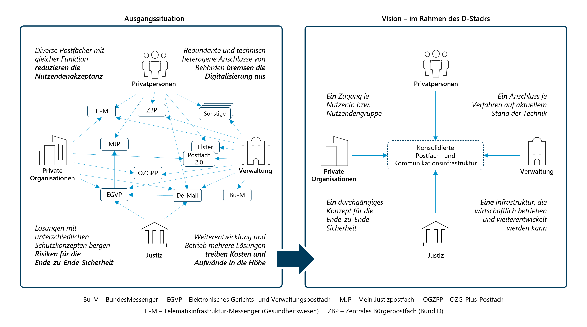
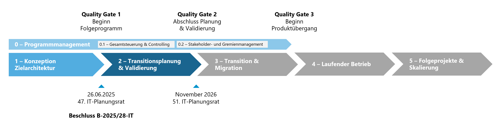

> [!note] 🌍 A note for international visitors 🌎
> 
> 

> 
Show note

>
> This openCode repository contains information about the federal target IT architecture for mailbox and communication solutions of the German public administration and other public bodies in Germany.  
> Its legal basis are [decisions B-2024/28-IT](https://www.it-planungsrat.de/beschluss/beschluss-2024-28) and [decision B-2025/28-IT](https://www.it-planungsrat.de/beschluss/beschluss-2025-28) of the German IT-Planning-Council.
>
> As the project seeks to engage primarily German-speaking stakeholders in its current phase, the artifacts presented here are initially created and made available in German.  
> English and other translations may follow in due course as operational capacity permits.
> 
> Inquiries for English translations can be directed via email at zapuk[at]fitko.de
> 

> [!note] 📢 Feedback und Fragen zur Zielarchitektur 📢
> 
> Die neuesten öffentlichen Inhalte der Zielarchitektur für Postfach- und Kommunikationslösungen können fortlaufend hier über openCode kommentiert werden.
>
> | [Jetzt Feedback geben oder Fragen einreichen](./Konsultationen/Phase-2_Architektur-v1.0_fortlaufend/README.md) |
> | - |

# Zielarchitektur Postfach- und Kommunikationslösungen

1. [Über das Programm](#über-das-programm)
1. [Roadmap](#roadmap)
1. [Logbuch](#logbuch)
1. [Anforderungen an die Zielarchitektur](#anforderungen-an-die-zielarchitektur)
1. [Dokumentation von Architekturentscheidungen](#dokumentation-von-architekturentscheidungen)
1. [Glossar](#glossar)
1. [FAQ](#faq)

## Über das Programm

Die öffentliche Hand entwickelt und betreibt derzeit diverse IT-Lösungen zur Kommunikation von öffentlichen Stellen mit Privatpersonen und privaten Organisationen (bspw. Unternehmen und Vereine). Für Nutzer:innen ist diese Vielzahl an Postfach- und Kommunikationslösungen undurchsichtig und schwer vermittelbar.
Auch OZG-Umsetzungsvorhaben in Bund, Ländern und Kommunen stellt diese Heterogenität vor große Herausforderungen bei der Integration von Postfach- und Kommunikationssystemen in ihre IT-Infrastrukturen.
Bestehende Postfach-Lösungen basieren dabei auf unterschiedlichen Technologie-Stacks und entsprechen oft nicht dem aktuellen Stand der Technik (z. B. hinsichtlich Usability-Eigenschaften oder der Umsetzung einer Ende-zu-Ende-Verschlüsselung).
Der Betrieb mehrerer paralleler Lösungen ist zudem teuer, komplex und bindet wertvolle Ressourcen in der Verwaltung.

Als Teil der Deutschland-Architektur soll die _Zielarchitektur für Postfach- und Kommunikationslösungen_ (ZaPuK) daher die digitale Mensch-zu-Mensch und Maschine-zu-Mensch-Kommunikation zwischen öffentlichen Stellen, privaten Organisationen und Bürger:innen neu ordnen - also alles von der Zustellung von Bescheiden bis zu Rückfragen an Behörden in Echtzeit. Die Basiskomponente 'Postfach/Benachrichtigung' im Plattformkern des Deutschland-Stacks wird nach den Vorgaben der ZaPuK aufgebaut (vgl. Beschluss des IT-Planungsrates [B-2026/18-IT](https://www.it-planungsrat.de/beschluss/b-2026-18-it)). 

Die ZaPuK wurde durch das Vorhaben "Neo" (formell: Vorhaben _Pilotierung Matrix-basierter Kommunikationskanal für die G2C-Kommunikation_) des Föderalen IT-Architekturboards pilotiert und technisch validiert. [Alle Informationen zum Vorhaben Neo finden sich hier](https://gitlab.opencode.de/fitko/matrix-g2x/gitlab-profile/).

### Historie

ZaPuK geht auf eine Initiative des [Föderalen IT-Architekturboards](https://www.fitko.de/foederale-koordination/gremienarbeit/foederales-it-architekturboard) (FIT-AB) und der [FITKO](https://www.fitko.de/) zurück.  
Phase I zur initialen Erarbeitung der Zielarchitektur als Umsetzung von [Beschluss 2024/28](https://www.it-planungsrat.de/beschluss/beschluss-2024-28) des IT-Planungsrates wurde von September 2024 bis Juni 2025 durch das FIT-AB umgesetzt. Mit [Beschluss 2025/28](https://www.it-planungsrat.de/beschluss/beschluss-2025-28) beauftragte der IT-Planungsrat die FITKO mit der "Initiierung eines Umsetzungsprogramms zur Etablierung einer einheitlichen föderalen Postfach- und Kommunikationsinfrastruktur auf Basis der Zielarchitektur Postfach- und Kommunikationslösungen" (Abs.5).  
Die daraus resultierende Phase II zur "Transitionsplanung und Validierung" steht nun vor dem Abschluss. In dieser Phase wurde die Zielarchitektur technisch validiert, konzeptionelle Details der IT-Architektur geschärft, die rechtliche Machbarkeit durch unabhängige Gutachter geprüft und für wesentliche existierende Postfach-Lösungen der föderalen IT Strategien und Pläne für die Transition zur ZaPuK ausgearbeitet. In der 51. Sitzung des IT-Planungsrats soll Version 1.1 der ZaPuK verabschiedet und Phase III, die Umsetzung der Zielarchitektur unter Federführung des Bundesministeriums für Digitalisierung und Staatsmodernisierung (BMDS), beschlossen werden.

### Vision

Die Zielarchitektur soll als Rahmen für eine künftige föderale Postfach- und Kommunikationsinfrastruktur dienen. Durch sie sollen die föderalen Postfach- und Kommunikationslösungen konsolidiert und zukunftsfähig aufgestellt werden, sodass diese auf dem Stand der Technik und digital souverän betrieben und weiterentwickelt werden können. Wesentliche Ziele sind insbesondere Komplexitätsreduktion in der föderalen IT, Förderung einer konsequenten Ende-zu-Ende-Verschlüsselung, die Vereinfachung der Anbindung von Drittsystemen und eine grundlegende Verbesserung der Nutzer:innenerfahrung.

### Beteiligte

In Phase I und II hatten das Architekturmanagement der FITKO gemeinsam mit der Freien und Hansestadt Hamburg und dem Land Sachsen-Anhalt die gemeinsame Programm-Federführung inne. Nach Beschluss [B-2026/18-IT](https://www.it-planungsrat.de/beschluss/b-2026-18-it) trägt zukünftig der Bund mit Unterstützung der FITKO die fachliche Verantwortung für die verfassungsrechtskonforme Konzeption und Entwicklung, Betrieb, Wartung, Pflege und Weiterentwicklung der Basiskomponente 'Postfach/Benachrichtigung' im Deutschland-Stack auf Basis der ZaPuK. Dies entspricht Phase III des ZaPuK-Umsetzungsprogramms. Die Umsetzung und Validierung der ZaPuK wird durch externe Dienstleister unterstützt und in einer Arbeitsgruppe durch Mitglieder des Föderalen IT-Architekturboards sowie bestehender Postfachlösungen begleitet. 

### Relevante Beschlüsse

Die folgenden Beschlüsse haben für ZaPuK direkte Relevanz:

- [Beschluss 2024/28](https://www.it-planungsrat.de/beschluss/beschluss-2024-28): Beauftragung des FIT-ABs mit der initialen Ausarbeitung der Zielarchitektur Postfach- und Kommunikationslösungen
- [Beschluss 2025/28](https://www.it-planungsrat.de/beschluss/beschluss-2025-28): Beschluss der Zielarchitektur in Version 1.0 und Beauftragung der Phase II zur Transitionsplanung und Validierung
- [Beschluss 2026/03-IT](https://www.it-planungsrat.de/beschluss/b-2026-03-it): Aufnahme von ZaPuK als Grundlage für den Basisdienst "Postfach" in den D-Stack
- [Beschluss 2026/04-IT](https://www.it-planungsrat.de/beschluss/b-2026-04-it): Beschluss des Funktionsbausteins "Postfach und Interaktion (G2C)" für die Deutschland-Architektur
- [Beschluss 2026/18-IT](https://www.it-planungsrat.de/beschluss/b-2026-18-it): Beschluss zum Aufbau der Basiskomponente "Postfach/Benachrichtigung" im D-Stack auf Grundlage der ZaPuK und Beauftragung eines ZaPuK-Finanzierungskonzepts zur 52. Sitzung des IT-Planungsrats

## Roadmap

Die folgende Roadmap gibt einen Überblick über die Phasenplanung des Programms:

## Logbuch

[23.06.2026] Beschluss FIT-AB 2026/11: Das Projekt "Neo" zur Pilotierung von Matrix-basierter G2C-Kommunikation geht in ZaPuK auf

- Das Föderale IT-Architekturboard (FIT-AB) beschließt in [FIT-AB 2026/11](https://docs.fitko.de/fit/fit-ab/beschluesse/) den Abschluss des Vorhabens "Pilotierung Matrix-basierter Kommunikationskanal für die G2C-Kommunikation (Neo)".
- Mit den im Projekt entwickelten Ergebnissen, u.a. einer iOS-App für die Kommunikation mit der Verwaltung, z.B. dem Gesundheitsamt, sieht das Gremium den Nachweis der technischen Realisierbarkeit eines sicheren und nutzenden-freundlichen Kommunikationskanals auf Basis des Matrix-Standards als erbracht an.
- Das Projektteam soll nun die Phase II von ZaPuK unterstützen, um eine Umsetzung in einem Produkt in Phase III vorzubereiten.
- Das Neo-Pilotprojekt wird abgeschlossen.

[17.06.2026] B-2026/18-IT: Beschluss des D-Stack Finanzierungsmodells und der fachlichen Verantwortung durch den Bund

- Der IT-Planungsrat beschließt in [B-2026/18-IT](https://www.it-planungsrat.de/beschluss/b-2026-18-it), dass der Bund künftig mit Unterstützung der FITKO die fachliche Verantwortung für die verfassungskonforme Konzeption und Entwicklung, Betrieb und Weiterentwicklung von u.a. der D-Stack-Basiskomponente Postfach/Benachrichtigung auf Grundlage von ZaPuK trägt.
- Darüber hinaus wurde beschlossen, dass bis zur 52. IT-PLR-Sitzung ein Konzept für Betrieb und Finanzierung für ZaPuK erarbeitet werden soll. 

[25.03.2026] Ende der Konsultation zur Version 1.0 der Zielarchitektur für Postfach- und Kommunikationslösungen und Übergang in fortlaufende Kommentierung

- Die offizielle Konsultationsphase zur ersten Version der Zielarchitektur, welche am 21.01.2026 startete, endet. Die gesammelten Einreichungen werden gesichtet und neue Anforderungen werden aufgenommen.
- Auch nach Ende der Konsultationsphase können [weiterhin Feedback und Fragen eingereicht werden](Konsultationen/Phase-2_Architektur-v1.0_fortlaufend/README.md). Das Projekt auf openCode wird jedoch u.U. weniger aktiv betreut als zuvor.

[18.03.2026] B-2026/03-IT: Aufnahme von ZaPuK in den Deutschland-Stack

- Der IT-Planungsrat beschließt in [B-2026/03-IT](https://www.it-planungsrat.de/beschluss/b-2026-03-it), dass ZaPuK künftig für den Basisdienst "Postfach" im Funktionsbaustein "Postfach und Interaktion (G2C)" Teil des D-Stacks sein wird.
- Damit bildet ZaPuK die Grundlage für die zukünftige föderale Postfach- und Kommunikationsinfrastruktur im Plattformkern des Bundes.
- Viele Fragen bzgl. der Governance, Finanzierung und produkthaften Fortentwicklung einer auf ZaPuK basierenden Infrastruktur müssen nun auf Ebene des D-Stacks für alle enthaltenen Produkte beantwortet werden. Das Governance-Modell aus Phase II liefert hierfür erste Anhaltspunkte.

[10.02.2026] Info-Veranstaltung zur Konsultation zur Version 1.0 der Zielarchitektur für Postfach- und Kommunikationslösungen

[&rarr; Vortragsfolien](./Foliensätze/2026-02-05-Info_Termin_Teilnahme_Konsultation_v1.0.pdf)  
- Kurze Einführung in die aktuelle Zielarchitektur und Schritt-für-Schritt-Anleitung zu [Einreichungen zum Konsultationsverfahren zur Zielarchitektur (v1.0)](./Konsultationen/Phase-2_Architektur-v1.0_21-01-2026/).

[21.01.2026] Start der Konsultation zur Version 1.0 der Zielarchitektur für Postfach- und Kommunikationslösungen

- Ab dem 21.01.2026 kann die erste Version der Zielarchitektur auf openCode kommentiert werden. Der Fokus liegt hierbei auf der Bewertung der [Architekturentscheidungen](./Zielarchitektur/Architekturentscheidungen/) und dem [Architekturkonzept](./Zielarchitektur/Architekturkonzept/2025-06-26_Beschluss-2025-28_ZaPuK_Architekturkonzept.pdf). Eingehende Verständnisfragen werden kontinuierlich beantwortet, das eingehende Feedback wird nach Ende der Konsultationsphase ausgewertet und in eine neue Version der Zielarchitektur eingearbeitet. Zur Teilnahme folgen Sie der [Anleitung zum Konsultationsprozess zur Zielarchitektur (v1.0)](./Konsultationen/Phase-2_Architektur-v1.0_21-01-2026/).

[16.01.2026] Die FITKO stellt vor: Die föderale Zielarchitektur für Postfach- und Kommunikationslösungen (ZaPuK)

[&rarr; Vortragsfolien](./Foliensätze/2026-01-16_Die-FITKO-stellt-vor_ZaPuK.pdf)  
[&rarr; Informationen zur Veranstaltung (16.01.2026 | 11:00 - 12:00 Uhr | Online)](https://www.fitko.de/veranstaltung/detail/infoveranstaltung-die-fitko-stellt-vor-die-foederale-zielarchitektur-fuer-postfach-und-kommunikationsloesungen-zapuk)

- Die FITKO veranstaltet als "Die FITKO stellt vor" regelmäßige Infoveranstaltungen zu Themen im OZG-Umfeld. Ziele, Arbeitsstand und Beteiligungsmöglichkeiten der ZaPuK werden einer interessierten Fachöffentlichkeit von ca. 300 Teilnehmer:innen präsentiert. Fragen aus dem Publikum werden aktuell beantwortet und im [FAQ](#faq) ergänzt.
- Aufgrund des großen Interesses wird kurze Zeit später eine inhaltsgleiche Folgeveranstaltung für alle angeboten, die kein Ticket für die erste Veranstaltung mehr erhalten konnten. 

 [02.10.2025] Präsentation auf der Smart Country Convention (SCCON)

[&rarr; Vortragsfolien](./Foliensätze/2025-10-02_SCCON-2025_Vorstellung-ZaPuK-und-Neo.pdf)

- Hamburg, Sachsen-Anhalt und das Föderale IT-Architekturmanagement der FITKO (FITKO-AM) stellen das Vorhaben gemeinsam mit dem [Vorhaben zur Matrix-basierten Antrags-Folgekommunikation („Neo“)](https://gitlab.opencode.de/fitko/matrix-g2x/) auf der [Smart Country Convention](https://www.smartcountry.berlin/) vor.

 [26.06.2025] Beschluss 2025/28 des IT-Planungsrates

- Der IT-Planungsrat beschließt mit [🠒 Beschluss 2025/28](https://www.it-planungsrat.de/beschluss/beschluss-2025-28) die Initiierung eines Umsetzungsprogramms zur Etablierung einer einheitlichen föderalen Postfach- und Kommunikationsinfrastruktur auf Basis der in [🠒 Beschluss 2024/28](https://www.it-planungsrat.de/beschluss/beschluss-2024-28) beauftragten Zielarchitektur Postfach- und Kommunikationslösungen.
- Beschluss 2025/28 liegen die [Ergebnisdokumente der mit Beschluss 2024/28 beauftragten Zielarchitektur Postfach- und Kommunikationslösungen bei](https://www.it-planungsrat.de/beschluss/beschluss-2025-28). Die **Anlagen des Beschlusses** sind zudem hier auf openCode einsehbar:
    - [Zusammenfassender Foliensatz](./Foliensätze/2025-06-26_Beschluss-2025-28-IT-Planungsrat_ZaPuK-Foliensatz.pdf)
    - [Überblick und Handlungsempfehlungen für Entscheider:innen (Version 1.0)](./Zielarchitektur/Zusammenfassung/2025-06-26_Beschluss-2025-28_ZaPuK_Überblick-und-Handlungsempfehlungen.pdf)
    - [Architekturkonzept Zielarchitektur Postfach- und Kommunikationslösungen (Version 1.0)](./Zielarchitektur/Architekturkonzept/2025-06-26_Beschluss-2025-28_ZaPuK_Architekturkonzept.pdf)
    - [Auszug des Glossars und Analyse der Rahmenbedingungen (Version 1.0)](./Zielarchitektur/Rahmenbedingungen/2025-06-26_Beschluss-2025-28_ZaPuK_Glossar-und-Rahmenbedingungen.pdf)
    - [Methodische Erläuterungen zur Anforderungs- und Bestandsanalyse (Version 1.0)](./Konsolidierte-Anforderungen/Lesefassung/2025-06-26_Beschluss-2025-28_ZaPuK_Anforderungs-und-Bestandsanalyse.pdf)

 [24.06.2025] Vorstellung der Zielarchitektur auf dem Zukunftskongress

[&rarr; Vortragsfolien](./Foliensätze/2025-06-24-Zukunftskongress-2025_Post-vom-Staat.pdf)

- Vortrag auf dem Zukunftskongress mit dem Titel „[Wie bekomme ich morgen Post vom Staat? - Die neue Zielarchitektur für einfache und nutzendenzentrierte Kommunikation mit der Verwaltung](https://www.zukunftskongress.de/de/node/9252)“.

 [03.06.2025] Version 0.7 der konsolidierten Anforderungen ist nun verfügbar

- Siehe [hier](./Konsolidierte-Anforderungen/README.md).

 [19.03.2025] Start der Konsultation zu Anforderungen an eine föderale Architektur für Postfach- und Kommunikationslösungen

- Ab Mitte März 2025 werden fortlaufend Liefergegenstände des Projektes hier auf openCode veröffentlicht. Der erste Meilenstein ist dabei die öffentliche Kommentierung der Anforderungen, die in einer föderalen Zielarchitektur für Postfach- und Kommunikationslösungen umgesetzt werden müssen. Diese können in einer ersten Runde ab sofort bis 2. Mai 2025 öffentlich kommentiert und diskutiert werden. Das eingehende Feedback wird kontinuierlich beantwortet, ausgewertet und in zukünftige Versionen der Anforderungsliste eingearbeitet. Beachten Sie die [Anleitung zur Kommentierung](./Konsultationen/Phase-1_Konsolidierte-Anforderungen_19-03-2025/README.md) und die zu kommentierende [konsolidierte Anforderungsliste](./Konsolidierte-Anforderungen/README.md).

 [03.03.2025] Zwischenbericht auf der 46. Sitzung des IT-Planungsrates (26.03.2025)

- In dessen 46. Sitzung wird dem IT-Planungsrat ein Zwischenstand der Arbeitsergebnisse vorgelegt. Dies umfasst insbesondere einen Projektzwischenbericht sowie die [🠒 *konsolidierte Anforderungsliste* (v0.5)](./Konsolidierte-Anforderungen/Vorversionen/Konsolidierte-Anforderungen-v-0-5-0.md). 

 [27. & 28.01.2025] Präsenzworkshop mit breitem Teilnehmerkreis in Frankfurt am Main

- An zwei sehr intensiven aber auch konstruktiven Tagen wurde die erste Fassung der konsolidierten Anforderungsliste (v0.1) (Tag 1) sowie wichtige Dimensionen der Architekturarbeit (Tag 2) mit föderalen Stakeholdern diskutiert. 
- Mit dabei waren neben Vertreter:innen von FITKO, ST, HH und anderen Mitgliedern des FIT-AB insbesondere auch Vertreter:innen verschiedener bestehender Postfach- und Kommunikationslösungen, u.A. aus den Bereichen allgemeine Leistungsverwaltung, Steuerverwaltung, Verteidigung, öffentliches Gesundheitswesen und Justiz.

 [10.12.2024] Abstimmung eines aktualisierten Projektplans in der 35. AL-Runde 

- Gespräche mit einer Vielzahl an Anspruchsgruppen haben sich als zeitintensiv erwiesen. Nach zeitlichen Verzögerungen in der Anforderungserhebung wurde daher mit der [🠒 Abteilungsleiterrunde des IT-Planungsrates (AL-Runde)](https://www.it-planungsrat.de/foederale-zusammenarbeit/gremien) nun ein angepasster Projektzeitplan abgestimmt: Dem IT-PLR werden in seiner 46. Sitzung Zwischenergebnisse vorgelegt, in der 47. Sitzung beschlussreife Endergebnisse.

 [13.11.2024] Zwischenbericht in der 45. Sitzung des IT-Planungsrates

- Dem IT-Planungsrat wurde in der 45. Sitzung ein kurzer Zwischenbericht zum Projektstand vorgelegt. 

 [23.09.2024] Projektstart

- Das Projekt zur Erarbeitung einer *Zielarchitektur Postfach- und Kommunikationslösungen* beginnt. Die Arbeitsgruppe wird nun bis ca. Ende März 2025 von externen Dienstleistern bei der operativen Projektarbeit unterstützt. Der Fokus liegt dabei in Projektphase I auf der Anforderungs- und Bestandsanalyse. 

 [26.08.2024] Arbeitsgruppe Zielarchitektur Postfach- und Kommunikationslösungen trifft sich zum ersten Mal

- Das FIT-AB gründet am 20.08.2024 per Beschluss eine Arbeitsgruppe (FIT-AG) zur Erarbeitung der *Zielarchitektur Postfach- und Kommunikationslösungen* (kurz: ZA PuK). Vertreter:innen der Bundesländer Hamburg (HH), Sachsen-Anhalt (ST) und der FITKO übernehmen in deren erstem Treffen am 26.08.2024 gemeinsam die Federführung.

 [16.06.2024] Beschluss 2024/28 des IT-Planungsrates

- Basierend auf einer Voranalyse des Föderalen IT-Architekturboards (FIT-AB) fasst der IT-Planungsrat [🠒 Beschluss 2024/28](https://www.it-planungsrat.de/beschluss/beschluss-2024-28). In diesem beauftragt er u.a. das FIT-AB mit der „Ausarbeitung einer Zielarchitektur zur Konsolidierung von Postfach- und assoziierten Kommunikationslösungen zu Bürger:innen, Unternehmen und Organisationen in der föderalen IT-Landschaft“.

## Anforderungen an die Zielarchitektur

Auf Basis der Analyse von Bestandssystemen in Deutschland und Europa, dem Input von Wissensträger:innen sowie übergreifenden architektonischen Überlegungen wurde in Phase I des Projektes eine Anforderungsanalyse durchgeführt, die als Grundlage für die Erarbeitung der Zielarchitektur für Postfach- und Kommunikationslösungen dient. Vorläufiges Ergebnis dieser Erhebung ist die sogenannte *Konsolidierte Anforderungsliste* (aktuell: Version 0.5.1 | Stand: 17.02.2025).

| [Zur Konsolidierten Anforderungsliste](./Konsolidierte-Anforderungen/README.md) |
| - |

## Dokumentation von Architekturentscheidungen

Die Zielarchitektur Postfach- und Kommunikationslösungen ist die Summe einer Reihe von Architekturentscheidungen. Die im Rahmen der Erarbeitung der Zielarchitektur getroffenen Entscheidungen haben mitunter große finanzielle, organisatorische sowie rechtliche Auswirkungen auf die Föderale IT-Landschaft. Aus diesem Grund ist für jede Architekturentscheidung eine Beschreibung des Kontexts, eine Analyse der Entscheidungstreiber, eine Erörterung aller jeweils betrachtete Alternativen sowie die Architekturentscheidung im engeren Sinne in Form eines [Architecture Decision Records](https://cognitect.com/blog/2011/11/15/documenting-architecture-decisions) dokumentiert.
Getroffene Architekturentscheidungen finden sich im Verzeichnis Zielarchitektur und können dort kommentiert werden.

| [Zu den Architekturentscheidungen](./Zielarchitektur/) |
| - |

## Glossar

Damit die gemeinsame Zielarchitektur für Postfach- und Kommunikationslösungen für alle Beteiligten verständlich und diskutierbar ist müssen die eingesetzten Begriffe daher möglichst klar definiert und semantisch abgegrenzt sein. Dafür wird fortlaufend ein Glossar zur Zielarchitektur gepflegt, welches insb. die in der [🠒 Konsolidierten Anforderungsliste](./Konsolidierte-Anforderungen/README.md) genutzen wesentlichen Begriffe definiert. Ist ein Begriff in eckigen Klammern aufgeführt \(\[Beispiel\]\) existiert eine korrespondierende Definition im Glossar. 

| [Zum Glossar](./Glossar.md) |
| - |

## FAQ
*Häufig gestellte Fragen | Stand: 10.10.2026 | Ihre Frage wird noch nicht beantwortet? Email an: [zapuk@fitko.de](mailto:zapuk@fitko.de)*

Was sind die Ziele des Programms?

Die Zielarchitektur Postfach- und Kommunikationslösungen soll unter anderem die Komplexität in der föderalen IT-Landschaft reduzieren und die Anbindung von Postfächern für alle Beteiligten vereinfachen.
Zudem fördert sie gezielt die Anwendung moderner kryptografischer Verfahren wie Ende-zu-Ende-Verschlüsselung, Security-by-Design und Zero-Trust.
Übergreifend wird sie die Weichen stellen für eine zukunftsfähige föderale Kommunikationsinfrastruktur, die eine moderne User Experience, einen wirtschaftlichen und sicheren Betrieb sowie eine stetige Weiterentwicklung auf dem Stand der Technik ermöglicht.
Zudem wird die Integration in EU-Infrastrukturen von Anfang an mitgedacht.
Die wichtigsten Ziele sind in [🠒 Pkt. 2 von Beschluss 2024/28 des IT-Planungsrates](https://www.it-planungsrat.de/beschluss/beschluss-2024-28) benannt.

 

Wer ist von der Zielarchitektur Postfach- und Kommunikationslösungen betroffen?

Die Zielarchitektur Postfach- und Kommunikationslösungen betrachtet grundlegend die Postfach-Kommunikation öffentlicher Stellen mit Privatpersonen, Unternehmen und anderen Organisationen in Deutschland und der Europäischen Union sowie untereinander.  
Darüber hinaus sind viele Erkenntnisse auf die Kommunikation über Postfächer hinaus, z.B. Maschine-zu-Maschine, übertragbar.

Wer ist verantwortlich für die Umsetzung des Programms?

Der IT-Planungsrat hat dem Bund die fachliche Verantwortung für die verfassungsrechtskonforme Entwicklung, Betrieb und Wartung einer auf der Zielarchitektur Postfach- und Kommunikationslösungen (ZaPuK) basierenden Postfachinfrastruktur im D-Stack gegeben ([B-2026/18-IT, Pkt. 2](https://www.it-planungsrat.de/beschluss/b-2026-18-it)).  
Mit der initialen Erarbeitung von ZaPuK hat der IT-Planungsrat das [Föderale IT-Architekturboard (FIT-AB)](https://www.fitko.de/foederale-koordination/gremienarbeit/foederales-it-architekturboard) beauftragt ([2024/28, Pkt. 1](https://www.it-planungsrat.de/beschluss/beschluss-2024-28)).
Die Umsetzung erfolgt als mehrphasiges Umsetzungsprogramm, in Phase I und II unter gemeinsamer Federführung der FITKO sowie der Bundesländer Sachsen-Anhalt und Hamburg. Die Arbeiten werden von einer Arbeitsgruppe unter Federführung des FIT-AB u.A. durch Expert:innen bestehender Postfachlösungen in der föderalen IT begleitet.
Die operative Arbeit wird zudem von mehreren externen Dienstleistungsfirmen unterstützt.
Das FITKO Architekturmanagement ist aufbauend auf der Zielarchitektur mit der Entwicklung von Referenzarchitekturen und möglicher Transitions- und Migrationswege beauftragt ([2024/28, Pkt. 3](https://www.it-planungsrat.de/beschluss/beschluss-2024-28)).

Wer ist außerdem am Projekt beteiligt?

Vorangetrieben wird das Vorhaben mit fortlaufender Unterstützung des föderalen IT-Architekturboards (FIT-AB), in dem eine große Mehrheit der Bundesländer sowie die FITKO und der Bund vertreten sind.
Zusätzlich zu den offiziell mit dem Vorhaben beauftragten Stellen wurden Gespräche, Interviews sowie Workshops insbesondere mit Expert:innen und Verantwortlichen von Bestandslösungen durchgeführt.
Diesen konstruktiven Dialog planen wir auch in Zukunft weiter fortzuführen.

Was ist die Rechtsgrundlage des Projektes?

Ursprüngliche Grundlage des Vorhabens ZaPuK ist [Beschluss 2024/28 der 44. Sitzung des IT-Planungsrats](https://www.it-planungsrat.de/beschluss/beschluss-2024-28).
Der [IT-Planungsrat](https://www.it-planungsrat.de/) ist das zentrale politische Steuerungsgremium für die Digitalisierung der öffentlichen Verwaltung in Deutschland.
Sein Mandat beruht auf dem [IT-Staatsvertrag](https://www.it-planungsrat.de/der-it-planungsrat/rechtliche-grundlagen).
Dem Beschluss vorausgegangen ist eine Vorerhebung des FIT-AB zu bestehenden Postfachsystemen.

Welche Bestandslösungen wurden im Projekt analysiert?

In Phase II des ZaPuK-Programms wurden regelmäßig Gespräche zum Zweck der Transitionsplanung und Validierung mit dem [Zentralen Bürgerpostfach (ZBP) der BundID](https://id.bund.de/de), dem [OZG-PLUS-Postfach und dem Postfach 2.0 hinter dem Mein Unternehmenskonto](https://info.mein-unternehmenskonto.de/ueberblick-funktionalitaeten/postfachfunktionen/), dem [Mein ELSTER Postfach der Steuerverwaltung](https://www.elster.de/eportal/start) und mit [Mein Justizpostfach](https://mjp.justiz.de/) geführt.

Die bis Ende März 2025 laufende Bestandsanalyse und Anforderungserhebung hat darüber hinaus unter anderem auch den [TI-Messenger der gematik](https://www.gematik.de/anwendungen/ti-messenger), die [De-Mail](https://www.de-mail.info/), den [BundesMessenger des BWI](https://gitlab.opencode.de/bwi/bundesmessenger), einschlägige Systeme des Elektronischen Rechtsverkehrs (ERV) der Justiz, sowie weitere bestehende Postfach- und Kommunikationslösungen untersucht.

Zudem wurden ausgewählte Lösungen aus anderen europäischen Ländern dezidiert analysiert.

Mit welchen Kosten ist zu rechnen?

Auf Basis der aktuell entstehenden Zielarchitektur soll eine Kostenmodellierung und -schätzung erfolgen.
Diese Arbeiten haben bereits begonnen. Eine erste Einschätzung zu den finanziellen Auswirkungen der Umsetzung der Zielarchitektur wird dem IT-Planungsrat voraussichtlich zu dessen 52. Sitzung im Frühjahr 2027 vorgelegt.

Wie wird sichergestellt, dass das Endergebnis nicht nur eine weitere Postfachlösung von Vielen ist?

Dieses Vorhaben entwickelt eine Zielarchitektur, die als gemeinsame Grundlage aller einschlägigen Postfächer in der künftigen Bebauung der föderalen IT durch den IT-Planungsrat dient.
Dabei wird explizit nicht ein einzelnes, neues Postfachsystem konzipiert, sondern vielmehr auf föderaler Ebene eine system- und fachübergreifende Grundlage für eine zukunftsweisende und nutzendenzentrierte Postfachinfrastruktur gelegt.
Im Arbeitsprozess sind die Expert:innen der Bestandslösungen transparent miteingebunden.

Die Zielarchitektur wird als Grundlage für die Postfachinfrastruktur im D-Stack dienen, welche im Sinne eines Plattformkerns zentral angeboten und föderal nachgenutzt werden soll. Darüber hinaus wird der Rollout einer ZaPuK-basierten Infrastruktur eng zusammen mit bestehenden Lösungen wie FIT-Connect gedacht, um die Anbindung für alle Beteiligten schnell und einfach zu gestalten.

Wann ist das aktuelle Projekt abgeschlossen und wann wird die darin erarbeitete Zielarchitektur umgesetzt sein?

Die Ergebnisse aus Phase II des Vorhabens, die Transitionsplanung und Validierung in Vorbereitung auf eine umsetzende Phase III, werden zur 51. Sitzung des IT-Planungsrats eingereicht und die Phase II damit beendet werden. Für einen reibungslosen Übergang läuft das Projekt noch bis zum Start der Phase III, vsl. Anfang 2027, weiter. Dadurch wird sichergestellt, dass die Ergebnisse in der unter Federführung des Bundes geleiteten Phase III nahtlos aufgegriffen und für eine schnellstmögliche Umsetzung weitergeführt werden können.

Wo kann ich mich zum aktuellen Fortschritt des Projektes informieren?

Den aktuellen Arbeitsstand können Sie hier auf der openCode-Plattform einsehen.
Hier werden regelmäßig Neuigkeiten zum Projekt sowie Arbeitsergebnisse veröffentlicht.

 

Wie kann ich mich beteiligen?

Sie sind Expert:in im Bereich der Postfach- und Kommunikationslösungen oder Verantwortliche:r einer bestehenden Lösung in der föderalen IT und hatten bisher keinen Kontakt zum Projekt?
Wir freuen uns über Ihre Nachricht an zapuk[ät]fitko.de oder Ihren Input hier auf openCode.

---

Wenn nicht anders vermerkt, sind die Inhalte dieses Repositories lizenziert unter der Creative Commons Namensnennung 4.0 International Public License (CC BY 4.0). Enthaltene Informationen und Fakten stellen gemäß § 2 UrhG keine urheberrechtlich geschützten Werke dar.

The emoji used as project icon was designed by OpenMoji – the open-source emoji and icon project. License: CC BY-SA 4.0

