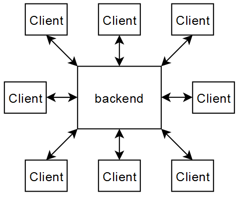
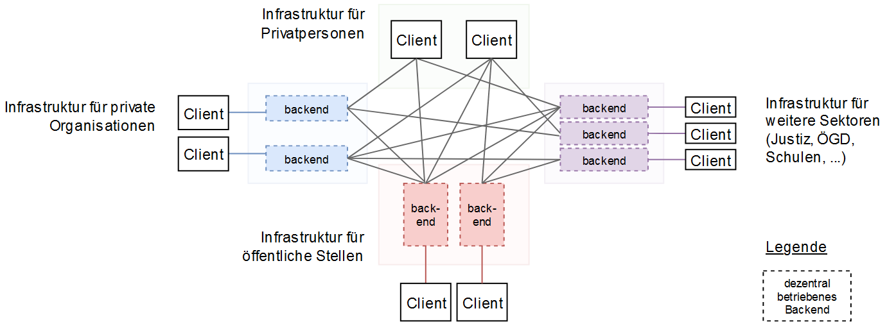
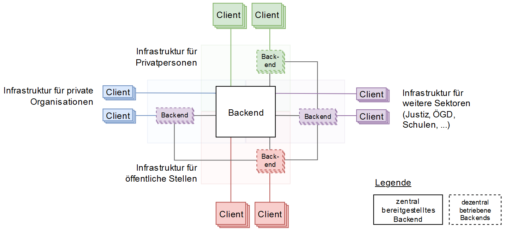

> **Status:** ✅ Beschlossen | **Datum:** 9. April 2025

> **Hinweis (Phase 2, Stand Oktober 2026):** Diese Entscheidung wurde in Phase 2 eingeschränkt. Privatpersonen nutzen das zentrale Postfach-Backend für Privatpersonen (ADR-1104, ADR-1114). Die hybride Topologie wird durch die Betriebsmodelle für Organisationen konkretisiert (ADR-1103).

# ADR-0002: Infrastrukturtopologie

## Kontext und Problembeschreibung

Wir wollen über die *Topologie der betrachteten Backend-Systeme des Kommunikationsverbunds* entscheiden, d.h. wie zentralisiert oder dezentralisiert die für die Realisierung der Kommunikation genutzten Backend-Systeme betrieben werden und wie der Betrieb dieser Systeme grundlegend strukturiert ist.

Dieses ADR konzentriert sich auf die Topologie der zur Kommunikation genutzten Backend-Systeme und trifft keine Aussagen über die (zentrale oder dezentrale) Softwareentwicklung dieser Komponenten und keine Aussagen darüber, welche konkreten Akteure diese Systemkomponenten betreiben.
Dieses ADR hat auch keinen Einfluss auf den Betrieb von anderen Infrastruktur-Komponenten im Scope der Zielarchitektur, die nicht Teil der reinen Kommunikationsinfrastruktur sind (bspw. Lookup-Services oder Cloud-Infrastruktur).
Der ADR trifft ebenfalls keine Aussage zum Betrieb externer Systeme außerhalb des betrachteten Systems (z.B. externe Identitätsanbieter).
Der ADR entscheidet zudem nicht über Governance-Aspekte, d.h. welche Organisation die betrachteten Backend-Systeme unterhält und weiterentwickelt.

## Entscheidungstreiber

- Eines der Hauptziele des Projekts ist die Reduktion der Anbindungskomplexität, d. h. die Reduzierung der Anzahl verschiedener APIs, mit denen insb. Fachverfahren interagieren müssen.
- Aus Privatsphäre-Sicht bieten verteilte Systeme gegenüber einem rein zentralen System häufig Vorteile, da sie eine Reduktion von zentral anfallenden Metadaten inhärent fördern.
- Verteilte Systeme erhöhen im Allgemeinen die Komplexität und damit die Entwicklungs- und Bereitstellungskosten.
- Verfügbarkeitsanforderungen müssen in verteilten Systemen dezentral umgesetzt werden. Weil mehr Akteure involviert sind, kann deren dezentrale Realisierung in Summe einen höheren Aufwand bedeuten. Gleichzeitig entfällt in verteilten Systemen der Single Point of Failure eines zentralen Systems hinsichtlich der Verfügbarkeit.
- Sicherheitsgarantien (insb. hinsichtlich der Betriebssicherheit) sind in verteilten Systemen tendenziell schwieriger durchzusetzen, u.a. auch deshalb, weil mehr Akteure und technische Systeme involviert sind. Der Einsatz von Technologien wie einer Ende-zu-Ende-Verschlüsselung kann dem entgegenwirken, Risiken im Betrieb jedoch nicht vollständig abschwächen.
- Zur Erreichung einer hohen Unabhängigkeit/Souveränität beteiligter Akteure erscheint eine Flexibilität zum Betrieb eigener Backend-Systeme wünschenswert. Gleichzeitig sollten die Hürden zur Nutzung der Infrastruktur möglichst stark reduziert werden.
- Das System sollte anschlussfähig sein für eine perspektivische Interoperabilität mit EU-Systeme.

## Betrachtete Optionen

* [Option 1: **Vollständig zentralisiertes System** mit einem zentral betriebenen Backend](#option-1-vollständig-zentralisiertes-system-mit-einem-zentral-betriebenen-backend)
* [Option 2: **Vollständig dezentrales System** ohne zentrale Infrastruktur-Komponenten](#option-2-vollständig-dezentrales-system-ohne-zentrale-infrastruktur-komponenten)
* [Option 3: **Hybrider Ansatz** mit sowohl zentral, als auch dezentral bereitgestellten Komponenten](#option-3-hybrider-ansatz-mit-sowohl-zentral-als-auch-dezentral-bereitgestellten-komponenten)

## Gegenüberstellung der jeweiligen Optionen

### Option 1: **Vollständig zentralisiertes System** mit einem zentral betriebenen Backend

Es gibt nur ein zentrales Backend (logischer Architekturbaustein).
Alle Clients interagieren mit diesem zentralen Backend und alle angeschlossenen Parteien, inklusive aller angeschlossenen öffentlichen Stellen, sind mit diesem zentralen Backend-System verbunden.

Hinweis: Das Vorhandensein eines einzigen zentralen Backend-Systems sagt nichts über die Anzahl der tatsächlichen IT-Systeme aus, aus denen das zentrale Backend besteht (z.B. kann das Backend immer noch aus 12 einzelnen Servern bestehen, die in 3 verschiedenen Rechenzentren betrieben werden).

* Gut, weil ein zentraler Ansatz die Komplexität für Clients erheblich reduziert (Clients müssen mit nur einem einzigen Backend-System interagieren)
* Gut, weil keine Interoperabilität und damit eine geringere Komplexität auf der Ebene der Backend-Systeme erforderlich ist
* Gut, weil die Wartbarkeit in einer zentralisierten Umgebung vergleichsweise hoch ist
* Neutral, da eine große Zahl bestehender Lösungen konsolidiert und schließlich abgeschaltet werden muss (enorme einmalige Transformationskosten, aber auch große Kosteneinsparungen in der Zukunft)
* Neutral, weil dadurch ein Single Point of Failure hinsichtlich der Verfügbarkeit entsteht (dieses Risiko kann jedoch durch den Einsatz von Cloud-Technologien erheblich reduziert werden)
* Schlecht, weil sich Teilnehmende in diesem Ansatz vollständig auf das zentral bereitgestellte Backend-System verlassen müssen und damit ein gewisses Maß an Souveränität über ihre eigene Infrastruktur aufgeben. Damit geht u.a. auch Möglichkeit verloren, die Umsetzung der Gewaltenteilung zwischen Exekutive und Legislative vollständig mit technischen Mitteln zu gewährleisten (mindestens kann beispielsweise immer die Verfügbarkeit beeinträchtigt werden).
* Schlecht, weil viele technische Kommunikations-Metadaten (wer kommuniziert mit wem usw.) an einer zentralen Stelle anfallen. Dies steht im Widerspruch zum Privacy-by-Design-Ansatz.
* Schlecht, weil dieser Ansatz aufgrund der in den jeweiligen Rechtsgrundlagen der Bestandssysteme definierten heterogenen Betriebsverantwortung (Postfach eines Nutzerkontos gemäß § 2 Abs. 7 S. 2 OZG, besonderes elektronisches Anwaltspostfach gemäß § 31a BRAO, ELSTER-Verfahren nach § 87a AO, etc.) eine Anpassung des bestehenden rechtlichen Rahmen erforderlich macht

### Option 2: **Vollständig dezentrales System** ohne zentrale Infrastruktur-Komponenten

In diesem Szenario werden keine zentralen Backend-Systeme bereitgestellt.
Beteiligte Parteien müssen daher ihre eigenen Backend-Systeme bereitstellen, um am Kommunikationsverbund teilnehmen zu können.
Da für Privatpersonen der Betrieb eigener Backend-Systeme als nicht realistisch angesehen wird, müssten Clients von Privatpersonen stattdessen in der Lage sein, ohne Verwendung eigener Backend-Systeme direkt mit allen beteiligten Backend-Systemen zu kommunizieren.
Alle Backend-Systeme werden daher von den teilnehmenden Parteien kontrolliert.

- Gut, weil dieser Ansatz unter dem Gesichtspunkt der Souveränität ideal ist (einschließlich einer einfachen Umsetzung der Gewaltenteilung)
- Gut, weil Dezentralisierung mit einem hohen Maß an Privatsphäre einhergeht (Privacy-by-Design-Ansatz)
- Gut, weil Zero-Trust-Eigenschaften in dezentralen Systemen aufgrund der geringeren Kumulation von notwendigem Vertrauen an zentraler Stelle besser umgesetzt werden können als in zentralen Systemen (Security-by-Design-Ansatz)
- Neutral, weil dieser Ansatz die Komplexität für einige Clients (welche nur mit einem Backend-System interagieren müssen) reduziert, während es für Clients für Privatpersonen (die mit vielen verschiedenen Backend-Systemen interagieren müssen) zu mehr Komplexität führt
- Schlecht, weil auch in diesem Szenario bestehende Lösungen ersetzt oder stark angepasst werden müssen, um Interoperabilität zu ermöglichen (enorme Transformationskosten, mittlere Kosteneinsparungen in der Zukunft)
- Schlecht, weil der Aufbau vollständig dezentralisierter Backend-Systeme eine inhärent höhere technische Komplexität mit sich bringt als Option 1.
- Schlecht, weil Akteure in diesem Ansatz die benötigte Backend-Systeme selbst betreiben müssen und nicht auf zentral bereitgestellte Backend-Systeme zurückgreifen können. Privatpersonen und kleine Organisationen verfügen in der Regel jedoch nicht über die entsprechenden Ressourcen hierzu. Daher müsste die Lösung so konzipiert sein, dass der Betrieb eigener Backend-Systeme durch Privatpersonen oder kleine Organisationen nicht erforderlich ist.
- Schlecht, weil Lösungen, die keine Backend-Systeme für Privatpersonen bzw. kleine Organisationen enthalten (z. B. reine Client-Lösungen), nicht sehr gut skalieren (insbesondere ist die technische Durchführbarkeit für Clients für Privatpersonen unklar).
- Schlecht, weil dies nicht gut mit dem bestehenden rechtlichen Rahmen vereinbar ist.

### Option 3: **Hybrider Ansatz** mit sowohl zentral, als auch dezentral bereitgestellten Komponenten

Im hybriden Ansatz werden zentrale Backend-Systeme für alle Parteien bereitgestellt, die keine eigene Infrastruktur betreiben.
Daneben besteht die Möglichkeit des Betriebs eigener Kommunikationsinfrastruktur in Form von zusätzlichen dezentral betriebenen Backend-Systemen.
Privatpersonen, öffentliche Stellen, private Organisationen sowie ganze Verwaltungsbereiche können damit bei Bedarf in eigener Verantwortung ihre eigenen Backend-Systeme als Teil des Kommunikationsverbunds selbst betreiben (vgl. [ADR-0002](ADR-0002-Infrastrukturtopologie.md)).
Hierzu müssen Anschlussbedingungen für den Beitritt zum Kommunikationsverbund definiert werden.
Bestehende Infrastrukturen könnten hierbei als Backend-Systeme für bestehende Stakeholder-Gruppen in den Kommunikationsverbund integriert werden.
Hierzu ist eine Realisierung der Interoperabilität von Bestands-Infrastrukturen mit dem Kommunikationsverbund auf Basis der in [ADR-0011](ADR-0011-Kommunikationsschicht.md) und [ADR-0012](ADR-0012-Ende-zu-Ende-Verschlüsselungsschicht.md) definierten Protokolle für die Kommunikations- und Ende-zu-Ende-Verschlüsselungsschicht erforderlich.

- Gut, weil dieser hybride Ansatz die Komplexität für Clients reduziert (Clients müssen mit nur genau einem Backend-System interagieren).
- Gut, weil durch die Bereitstellung von zentralen Backend-Systemen für verschiedene Stakeholdergruppen die Komplexität für Stakeholder, die sich auf diese zentrale Infrastruktur verlassen wollen, verringert wird, während die Flexibilität für diejenigen erhalten bleibt, die stattdessen eigene Backend-Systeme betreiben möchten
- Gut, weil dieser Ansatz unter dem Gesichtspunkt der Souveränität ideal ist (einschließlich einer einfachen Umsetzung der Gewaltenteilung)
- Gut, weil Dezentralisierung mit einem hohen Maß an Privatsphäre einhergeht (Privacy-by-Design-Ansatz)
- Gut, da dieser Ansatz aufgrund der inhärent erweiterbaren Architektur eine Integration weiterer Stakeholdergruppen und potenziell die Interoperabilität mit EU-Systemen erleichtert.
- Gut, weil Zero-Trust-Eigenschaften in dezentralen Systemen aufgrund der geringeren Kumulation von notwendigem Vertrauen an zentraler Stelle besser umgesetzt werden können als in zentralen Systemen (Security-by-Design-Ansatz)
- Neutral, weil dieser Ansatz durch die Möglichkeit, bestehende Infrastrukturen beizubehalten und deren Backend-Systeme interoperabel in den Kommunikationsverbund zu integrieren, vergleichsweise gut mit dem bestehenden rechtlichen Rahmen vereinbar ist.
- Neutral, weil bestehende Infrastrukturen zwar weiterbestehen können, aber (teilweise stark) angepasst werden müssen, um eine übergreifende Interoperabilität zu ermöglichen (mittlere/hohe Transformationskosten, große Kosteneinsparungen in der Zukunft).
- Schlecht, weil dieser Ansatz eine Interoperabilität der Backend-Systeme erfordert und daher eine inhärent höhere technische Komplexität mit sich bringt als Option 1.

## Architekturentscheidung

Gewählte Option: [**Option 3: Hybrider Ansatz**](#option-3-hybrider-ansatz-mit-sowohl-zentral-als-auch-dezentral-bereitgestellten-komponenten), da dieser Ansatz geringe Anbindungshürden (hohe organisatorische Skalierbarkeit) durch die Nutzung zentral bereitgestellter Backend-Systeme bietet, zugleich im Bedarfsfall einen hohen Grad an Flexibilität zum Betrieb eigener Backend-Systeme ermöglicht (zur Erreichung einer hohen Unabhängigkeit/Souveränität beteiligter Akteure) und im bestehenden Rechtsrahmen mit überschaubaren Gesetzes- und Verordnungsanpassungen realisierbar erscheint, während andere Optionen deutlich umfangreiche Änderungen des Rechtsrahmens erfordern würden.
Zudem unterstützt dieser Ansatz durch die Möglichkeit des Betriebs eigener Backend-Systeme eine technische Realisierung der Gewaltenteilung und ist aufgrund des modular erweiterbaren Designs anschlussfähig für eine perspektivische Anbindung an EU-Systeme.