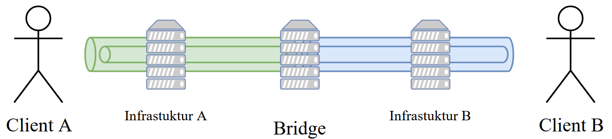
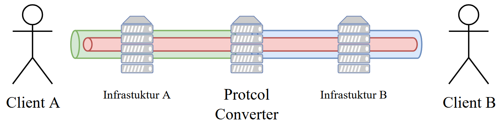
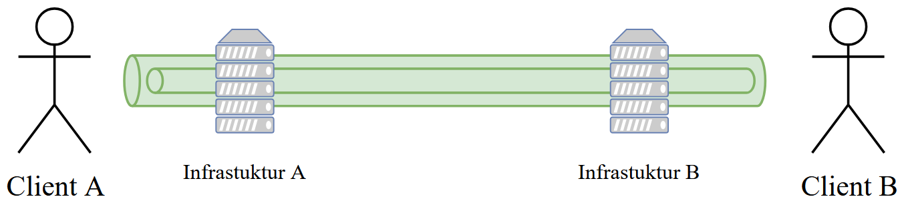
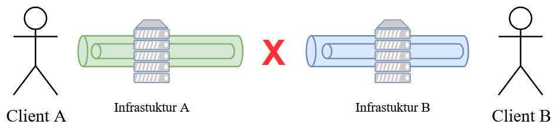

> **Status:** ✅ Beschlossen | **Datum:** 15. April 2025

# ADR-0010: Herstellung von Interoperabilität mit fremden Systemen außerhalb des Geltungsbereiches der Zielarchitektur

## Kontext und Problembeschreibung

Unter der Annahme, dass das Gesamtsystem aus mehreren nativ miteinander interoperablen Postfach-Backends besteht (siehe [ADR-0002](ADR-0002-Infrastrukturtopologie.md)), dabei aber perspektivisch mit anderen Systemen außerhalb des Geltungsbereiches der Zielarchitektur (insb. EU-Systeme) interoperabel sein muss, stellt sich die Frage, auf welcher Ebene diese Interoperabilität hergestellt wird.
Denkbar sind dabei insbesondere etwaige Interoperabilitätsanforderungen auf europäischer Ebene. Eine übergreifende Postfach-Infrastruktur der EU bzw. die Integration mit vergleichbaren Systemen anderer EU-Mitgliedsstaates ist zwar derzeit nicht konkret absehbar - sollte sie jedoch kommen, besteht ein Risiko, dass diese nicht mit der Zielarchitektur interoperabel ist.
Dieser ADR regelt, auf welcher Grundlage in diesen und ähnlichen Fällen gegebenenfalls notwendige Interoperabilität mit Kommunikationsinfrastrukturen außerhalb des Geltungsbereiches der Zielarchitektur Postfach- und Kommunikationslösungen hergestellt werden kann. 

Der ADR schränkt explizit _nicht_ den Geltungsbereich der Zielarchitektur ein. Der vorliegende ADR betrifft explizit nicht die (native) Integration von Backend-Systemen in den föderierten Kommunikationsverbund im Scope der Zielarchitektur (vgl. [ADR-0002](ADR-0002-Infrastrukturtopologie.md) und [ADR-0004](ADR-0004-Bereitstellung-von-Postfach-Backends.md)) auf Basis der in [ADR-0011](ADR-0011-Kommunikationsschicht.md) und [ADR-0012](ADR-0012-Ende-zu-Ende-Verschlüsselungsschicht.md) definierten Protokolle für die Kommunikations- und Ende-zu-Ende-Verschlüsselungsschicht.
Dieser ADR regelt zudem _nicht_, welche spezifischen technischen oder anderweitigen Anforderungen die Voraussetzung für Interoperabilität sind. 

## Entscheidungstreiber

- Gemäß den durch B-2024/28-IT definierten Projektzielen kommt der gezielten Förderung von Ende-zu-Ende-verschlüsselten Lösungskonzepten eine besondere Bedeutung zu. Auch bei Herstellung einer Interoperabilität mit anderen Systemen außerhalb der Zielarchitektur soll dieses Ziel nicht aufgegeben werden.
- Um eine Interoperabilität mit Systemen, die nicht der Kontrolle der Zielarchitektur unterliegen, realisieren zu können, sollen Interoperabilitätshürden für deren Anbindung möglichst niedrig sein.
- Relevante Anforderungen:
  - _SIC_VER_ÜBE_026: Das System stellt eine Ende-zu-Ende-Verschlüsselung der übermittelten [Nachrichten] (inklusive [Anhängen] und [Vertraulichen Metadaten]) sicher._
  - _SIC_VER_ÜBE_032: Die Verschlüsselung übermittelter und gespeicherter [Nachrichten] kann weder von der Betreiberin des Systems, noch von Dritten gebrochen, umgangen oder entschlüsselt werden._

## Betrachtete Optionen

- [Option 1: Interoperabilität ohne Beibehaltung der Ende-zu-Ende-Verschlüsselung (Einsatz von Bridges)](#option-1-interoperabilität-ohne-beibehaltung-der-ende-zu-ende-verschlüsselung-einsatz-von-bridges)
- [Option 2: Interoperabilität auf Ebene der Ende-zu-Ende-Verschlüsselungsschicht (Einsatz von Protocol Convertern)](#option-2-interoperabilität-auf-ebene-der-ende-zu-ende-verschlüsselungsschicht-einsatz-von-protocol-convertern)
- [Option 3: Interoperabilität auf Ebene Ende-zu-Ende-Verschlüsselungs- und der Kommunikationsschicht (vollständige Standardisierung)](#option-3-interoperabilität-auf-ebene-ende-zu-ende-verschlüsselungs--und-der-kommunikationsschicht-vollständige-standardisierung)
- [Option 4: Keine Interoperabilität mit Systemen außerhalb der Kontrolle der Zielarchitektur](#option-4-keine-interoperabilität-mit-systemen-außerhalb-der-kontrolle-der-zielarchitektur)

## Gegenüberstellung der jeweiligen Optionen

### Option 1: Interoperabilität ohne Beibehaltung der Ende-zu-Ende-Verschlüsselung (Einsatz von Bridges)

Beim Einsatz von sog. Bridges wird eine Interoperabilität ohne Beibehaltung der Ende-zu-Ende-Verschlüsselung hergestellt.
Bridges sind IT-Komponenten, welche übermittelte Nachrichten aus Infrastruktur A entschlüsseln und diese anschließend im Format Zielinfrastruktur B wieder verschlüsseln.
Hierzu implementieren Bridges die Protokolle der Kommunikationsschicht und der Ende-zu-Ende-Verschlüsselungsschicht sowie die Inhaltsdatenformate der Infrastrukturen A und B.
Dieser Ansatz ermöglicht durch die Herstellung einer Interoperabilität beliebiger zueinander sonst inkompatibler Infrastrukturen.
Die Ende-zu-Ende Verschlüsselung wird hierbei zum Anschluss an eine andere Postfach-Infrastruktur durchbrochen.

Aufgrund der unverschlüsselten Verarbeitung der übermittelten Nachrichten durch die Bridge an zentraler Stelle erfordert dieser Ansatz weitreichende Maßnahmen zum Schutz des Übergangspunktes.
Dazu gehört der Betrieb in gesicherten Betriebsumgebungen, der Einsatz von sicheren Hardwarekomponenten (Hardware Security Modules, Trusted Execution Environments).
Prinzipbedingt ergibt sich auch unter Umsetzung dieser Maßnahmen ein deutlich reduziertes Sicherheitsniveau ggü. der Beibehaltung des Ende-zu-Ende-verschlüsselten Kanals.

- Gut, denn die zu integrierenden Lösungen können mit geringem Aufwand und ohne oder nur mit geringen Anpassungsaufwänden an die Systeme der Zielarchitektur angebunden werden
- Schlecht, da die Anforderung zur nicht unterbrochenen Ende-zu-Ende Verschlüsselung nicht erfüllt wird (vgl. SIC_VER_ÜBE_026) und das Ziel zur Förderung von Ende-zu-Ende-verschlüsselten Lösungskonzepten wird verfehlt.
- Schlecht, da im Falle von Schwachstellen in den eingesetzten Betriebsumgebungen und Hardwarekomponenten Angriffsflächen hinsichtlich der Vertraulichkeit übermittelter Nachrichten entstehen (vgl. SIC_VER_ÜBE_032)

### Option 2: Interoperabilität auf Ebene der Ende-zu-Ende-Verschlüsselungsschicht (Einsatz von Protocol Convertern)

Beim Einsatz von Protocol Convertern wird eine Interoperabilität durch Standardisierung der Ende-zu-Ende-Verschlüsselungsschicht (inkl. Inhaltsdatenformat) hergestellt, sodass Nachrichten durchgehend verschlüsselt zwischen zwei Infrastruktur-Backends übermittelt werden können.
Protocol Converter übernehmen hierbei die Aufgabe, Nachrichten aus Infrastruktur A in verschlüsselter Form entgegenzunehmen und diese anschließend der Zielinfrastruktur B in verschlüsselter Form zu übergeben.
Dieser Ansatz ermöglicht die Herstellung einer Interoperabilität zwischen zwei Infrastruktur-Backends mit unterschiedlichen Protokollen auf Ebene der Kommunikationsschicht.
Die Ende-zu-Ende Verschlüsselung wird hierbei beibehalten.

Voraussetzung für den Einsatz von Protocol Convertern ist, dass Clients aus beiden Infrastrukturen auf Ebene der Ende-zu-Ende-Verschlüsselungsschicht denselben Standard unterstützen (siehe [ADR-0012](ADR-0012-Ende-zu-Ende-Verschlüsselungsschicht.md)) und sich auf ein gemeinsam unterstütztes Inhaltsdatenformat einigen.
Die hierzu nötige Festlegung des zu verwendenden Inhaltsdatenformats erfolgt zu einem späteren Zeitpunkt im Rahmen der Umsetzung der Zielarchitektur.

> [!note] Hinweis
> Dieser Interoperabilitäts-Ansatz unter Beibehaltung der Ende-zu-Ende-Verschlüsselung wird auch durch die EU-Kommission im Rahmen der [gemäß Art. 7 Digital Markets Act (DMA)](https://eur-lex.europa.eu/eli/reg/2022/1925) verbindlichen Interoperabilität von Messenger-Lösungen sogenannter Gatekeeper-Services verfolgt. Es erscheint daher plausibel, dass dieser Ansatz auch in einer künftigen Version der [Single Digital Gateway-Verordnung](https://eur-lex.europa.eu/eli/reg/2018/1724/) oder des [Interoperable Europe Act](https://eur-lex.europa.eu/eli/reg/2024/903/) eingeführt werden könnte.

Zur Herstellung der Interoperabilität auf dieser Ebene wäre eine Standardisierung auf genau ein übergreifend genutztes Ende-zu-Ende-Verschlüsselungsprotokoll und genau ein einziges Inhaltsdatenformat oder aber die *gleichzeitige Unterstützung* mehrerer Ende-zu-Ende-Verschlüsselungsprotokolle und Inhaltsdatenformate durch alle beteiligten Clients denkbar.

- Gut, denn alle Anforderungen zur Ende-zu-Ende Sicherheit werden erfüllt (insb. erfolgt kein Aufbrechen der Ende-zu-Ende-Verschlüsselung an zentraler Stelle)
- Gut, denn die interoperable Nutzung moderner Sicherheitsprotokolle in den zu integrierenden Lösungen erhöht oder bewahrt die Ende-zu-Ende Sicherheit in den zu integrierenden Lösungen
- Gut, denn eine Harmonisierung der darüber liegenden Protokolle der Kommunikationsschicht ist nicht erforderlich, was Migrationsaufwände in den zu integrierenden Lösungen reduziert
- Schlecht, denn die Umstellung auf ein gemeinsam genutztes Ende-zu-Ende-Verschlüsselungsprotokoll und ein gemeinsam genutztes Inhaltsdatenformat ist mit signifikanten Anpassungsaufwänden verbunden
- Schlecht, denn die Einigung auf ein einheitliches Protokoll auf Ebene der Ende-zu-Ende-Verschlüsselungsschicht könnte scheitern

### Option 3: Interoperabilität auf Ebene Ende-zu-Ende-Verschlüsselungs- und der Kommunikationsschicht (vollständige Standardisierung)

In diesem Ansatz wird eine Interoperabilität durch Standardisierung der Ende-zu-Ende-Verschlüsselungsschicht (inkl. Inhaltsdatenformat) und der Kommunikationsschicht hergestellt, sodass Nachrichten durchgehend verschlüsselt zwischen zwei Infrastruktur-Backends übermittelt werden können.

Alle zu integrierenden Lösungen müssen entsprechend der Anforderungen der Zielarchitektur zur Umsetzung der Ende-zu-Ende-Verschlüsselungsschicht angepasst werden (siehe [ADR-0012](ADR-0012-Ende-zu-Ende-Verschlüsselungsschicht.md)) und ein einheitliches Protokoll auf Ebene der Kommunikationsschicht nutzen (siehe [ADR-0011](ADR-0011-Kommunikationsschicht.md)), sofern sie an diese angeschlossen werden.
Die hierzu nötige Festlegung des zu verwendenden Inhaltsdatenformats erfolgt zu einem späteren Zeitpunkt im Rahmen der Umsetzung der Zielarchitektur.

Ohne diese weitreichenden Anpassungen wird keine Interoperabilität mit Systemen außerhalb der Kontrolle der Zielarchitektur zugelassen.

Diese Option kommt bei Realisierung der Anpassungen faktisch der Aufnahme der zu integrierenden Lösungen in die Zielarchitektur gleich.

- Gut, denn alle Anforderungen zur Ende-zu-Ende Sicherheit werden erfüllt (insb. erfolgt kein Aufbrechen der Ende-zu-Ende-Verschlüsselung an zentraler Stelle)
- Gut, denn die interoperable Nutzung moderner Sicherheitsprotokolle in den zu integrierenden Lösungen erhöht oder bewahrt die Ende-zu-Ende Sicherheit in den zu integrierenden Lösungen
- Gut, denn die weitreichende Angleichung der zu integrierenden Lösungen inkl. Kommunikationsschicht reduziert die gesamtheitliche technische Komplexität signifikant
- Schlecht, denn die Umstellung der zu integrierenden Lösungen auf ein einheitliches Protokoll auf Ebene der Kommunikationsschicht ist potentiell mit sehr hohen Migrationsaufwänden verbunden
- Schlecht, denn die Einigung auf ein einheitliches Protokoll auf Ebene der Ende-zu-Ende-Verschlüsselungsschicht, der Kommunikationsschicht und ein gemeinsam genutztes Inhaltsdatenformat könnte scheitern

### Option 4: Keine Interoperabilität mit Systemen außerhalb der Kontrolle der Zielarchitektur

In diesem Ansatz wird eine Interoperabilität mit Systemen außerhalb der Kontrolle der Zielarchitektur ausgeschlossen.
Eine Interoperabilität ist dementsprechend selbst bei Nutzung derselben Realisierung der Ende-zu-Ende-Verschlüsselungsschicht (inkl. Inhaltsdatenformat) und derselben Realisierung der Kommunikationsschicht (vgl. Option 3) nicht möglich.

- Gut, denn es entstehen keine Aufwände zur Herstellung einer Interoperabilität.
- Schlecht, denn die Systeme der Zielarchitektur sind nicht interoperabel mit Systemen außerhalb der Kontrolle der Zielarchitektur

## Architekturentscheidung

Gewählte Option: **[Option 2: Interoperabilität auf Ebene der Ende-zu-Ende-Verschlüsselungsschicht (Einsatz von Protocol Convertern)](#option-2-interoperabilität-auf-ebene-der-ende-zu-ende-verschlüsselungsschicht-einsatz-von-protocol-convertern)**, denn gegenüber Option 4 ist eine Interoperabilität gegenüber Systemen auf EU-Ebene realisierbar, gegenüber Option 1 wird hierbei die Ende-zu-Ende-Verschlüsselung beibehalten und gegenüber Option 3 stellt diese Option geringere Anforderungen an notwendige Anpassungen der zu integrierenden Systeme.

### Auswirkungen

- Gut, denn die Architekturentscheidung spiegelt die gewünschte Förderung von Ende-zu-Ende-verschlüsselten Lösungskonzepten mit dem hierzu geringstmöglichen Aufwand wieder.
- Neutral, denn zu integrierenden Lösungen können sich frei entscheiden, entweder nur die Ende-zu-Ende-Verschlüsselungsschicht der Zielarchitektur umzusetzen oder zusätzlich auch die Kommunikationsschicht zu adaptieren.
