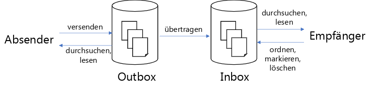

> **Status:** ✅ Beschlossen | **Datum:** 15. April 2025

# ADR-0011: Kommunikationsschicht

## Kontext und Problembeschreibung

Für die Kommunikation in einer verteilten Kommunikationsinfrastruktur (vgl. [ADR-0002](./ADR-0002-Infrastrukturtopologie.md)) muss ein technischer Standard zwischen Postfach-Zugängen und Postfach-Backends einerseits sowie zwischen Postfach-Backends untereinander andererseits festgelegt werden, welcher die technische Kommunikationsschicht der Infrastruktur spezifiziert.

Ein solcher Standard muss vielfältige Funktionalitäten unterstützen, die über den reinen Datentransport zwischen zwei technischen Systemen hinaus gehen.
Zum besseren Verständnis wird im folgenden zwischen verschiedenen Klassen von Kommunikationsstandards unterschieden, die sich in ihrem primären Verwendungszweck und daher in ihrem Funktionsumfang und ihrer üblichen Präsentation gegenüber Endnutzenden unterscheiden.
Eine eindeutige und trennscharfe Zuordnung bestehender Kommunikationsstandards in diese Klassifizierung ist in der Praxis nicht immer zweifelsfrei möglich, aber auch nicht zwingend erforderlich.
Die nachstehenden Klassifizierung dient ausschließlich der Illustration des Problemraums.

Konzeptionell können folgende Klassen von Kommunikationsstandards unterschieden werden:

**‚Postfach‘-Standards** sind speziell auf den Austausch von menschenlesbaren Nachrichten und deren dauerhafte Speicherung und Verwaltung in Postfächern ausgelegt.

<!--  -->

Sie unterstützen im Wesentlichen die folgenden Arten von Operationen:
- Authentifizierung und Sitzungsverwaltung
- Versenden, Weiterleiten und Abholen von Nachrichten
- Verwaltung von Nachrichten in den Postfächern, z.B.
  - Organisieren von Nachrichten in Ordnern
  - Speichern von Metadaten wie gelesen/beantwortet, Wiedervorlage oder Markierung mit Flaggen
  - Durchsuchen von Nachrichten und Anhängen

Die Verwaltungsfunktionen wirken dabei Übergreifend über alle Clients, jedoch nur auf das Postfach eines einzelnen Teilnehmers.
Wenn ein Empfänger also bspw. eine Nachricht löscht, ist sie in allen seinen Clients gelöscht, im Postfach des Absenders aber weiterhin vorhanden.

**‚Instant Messaging‘-Standards** sind auf den Austausch von Kurznachrichten auch mit mehreren Teilnehmenden in Echtzeit ausgerichtet.
Sie erlauben es insbesondere, Diskussionsverläufe mit mehreren Teilnehmenden für alle konsistent dazustellen.
Im Kontext der Zielarchitektur sind sie vor allem interessant, weil sie sehr typischerweise fortschrittliche und nutzendenfreundliche Mechanismen zur Realisierung einer Ende-zu-Ende-Verschlüsselung mitbringen.

Dazu unterstützen sie im Wesentlichen folgende Arten von Operationen:
- Authentifizierung und Sitzungsverwaltung
- Versenden, Weiterleiten und Abholen von Nachrichten
- Strukturierung von Kommunikation in Chatverläufen und Gruppen
- Austausch und Verwaltung von Schlüsselmaterial
- Übermittlungs- und Lesebestätigungen (Haken-Symbol)

Der Austausch und die Verwaltung von Schlüsselmaterial erfolgt dabei im Hintergrund ohne Zutun der Nutzenden.
Durch Zwischenspeicherung von Schlüsselmaterial und verschlüsselter Kommunikationsinhalte ist eine Ende-zu-Ende-Verschlüsselung bis in den Client möglich, auch wenn der:die Empfänger:in offline ist.

Die Standards XMPP, Matrix und MIMI stellen Beispiele für Standards mit diesen Funktionalitäten dar.

**‚Transport‘-Standards** realisieren nachrichtenbasierte Middlewares (_Message Oriented Middlewares_, MOM).
Ihr Schwerpunkt liegt auf der sicheren und nachvollziehbaren technischen Übermittlung von Nachrichten.
Wenn dabei eine offlinefähige (asynchrone) Kommunikation unterstützt wird, müssen Nachrichten zwischengespeichert werden, sodass sie zu einem späteren Zeitpunkt abgeholt werden können.

Sie unterstützen im Wesentlichen die folgenden Arten von Operationen:
- Authentifizierung und Sitzungsverwaltung
- Versenden, Weiterleiten und Abholen von Nachrichten
- Quittierung von Übermittlungen, z.B. zur Realisierung einer
  - Zustellgarantie (at-least-once- bzw. exactly-once-delivery)
  - Nichtabstreibarkeit der Übermittlung (Bereitstellungsbestätigung, Abrufbestätigung)

Da Transportprotokolle primär der Übermittlung von Nachrichten dienen, hat der Absender keinen Zugriff auf eine Kopie der von ihm versendeten Nachrichten.
Die Zwischenspeicherung der Nachrichten dient lediglich dazu, diese bis zu ihrer Abholung zu puffern.
Daher fehlen nicht nur die Postfachverwaltungsfunktionen, oftmals sind auch die Abholfunktionen weniger flexibel.
Teilweise sind Protokolle auf das Abholen einzelner Nachrichten beschränkt und skalieren nicht für große Postfächer (fehlende Massenabrufe), teilweise werden abgeholte Nachrichten automatisch quittiert und gelöscht, sodass Nachrichten nicht an mehrere Clients zugestellt werden können.

Keine der hier beschriebenen Protokollfamilien deckt alleine die Gesamtheit der Anforderungen der Zielarchitektur vollumfänglich ab.
Auch die in diesem ADR gegenübergestellten Protokolle müssen für den Einsatz in der Zielarchitektur gemäß der konkreten Anforderungen durch ergänzende Festlegungen adaptiert werden (Profilierung).
Es ist daher von Vorteil, wenn Protokolle bereits ein Erweiterungskonzept mitbringen.
Dann kann eine Erweiterung standardkonform erfolgen, ohne die grundsätzliche Interoperabilität des Protokolls einzuschränken.
Andernfalls müsste eine Veränderung des Protokolls erfolgen, die möglicherweise nicht interoperabel mit Standardimplementierungen ist.

Die hier erörterte Kommunikationsschicht unterstützt neben dem reinen Transport von verschlüsselten Nachrichten auch die Etablierung des hierzu erforderlichen verschlüsselten Kommunikationskanals (z.B. als Transportschicht für den Schlüsselaustausch).
Dieser ADR regelt jedoch nicht den Aufbau und die Verschlüsselung der Nachricht selbst. Die Umsetzung der Ende-zu-Ende-Verschlüsselungsschicht wird separat in [ADR-0012](./ADR-0012-Ende-zu-Ende-Verschlüsselungsschicht.md) beschrieben.

## Entscheidungstreiber
- Sämtliche Kommunikation zwischen Postfach-Zugängen und Postfach-Backends erfolgt über die Kommunikationsschicht. Diese muss alle Operationen unterstützen, die Postfachzugänge und Postfachbackends im Zusammenspiel erbringen. Das betrifft insbesondere Authentifizierung, Nachrichtenübermittlung, Postfachverwaltung und Qualitätsmerkmale wie die Abstreitbarkeit oder Nichtabstreitbarkeit des Versands (je nach fachlicher Anforderung).
- Das Kommunikationsprotokoll hat wesentlichen Einfluss darauf, wie einfach die Anbindung an Fachverfahren erfolgen kann. Es sollte daher auf verbreiteten und damit insb. für Fachverfahrens-Hersteller leicht zugänglichen Technologien basieren, die aufgrund der hohen Verbreitung am Markt von gängigen Entwicklungsumgebungen unterstützt werden und insbesondere auch im Web-Umfeld leicht einsatzfähig sind (Einsatz in Webanwendungen).
- Ein späterer Austausch der Kommunikationsschicht ist aufwändig und mit hohen Kosten verbunden. Daher sollte die Kommunikationsschicht auf zukunftssichere Technologien setzen, die von einer aktiven Community genutzt und gepflegt werden.
- Es ist von Vorteil, wenn die Tragfähigkeit des Protokolls und/oder die im Protokoll eingesetzten Technologien durch Standardisierung in einer vertrauenswürdigen internationalen Standardisierungsorganisation wie z.B. dem W3C oder der IETF bestätigt wurden und es mehrere interoperable Implementierungen gibt.
- Da die Verschlüsselungsschicht gemäß [ADR-0012](./ADR-0012-Ende-zu-Ende-Verschlüsselungsschicht.md) über die Kommunikationsschicht transportiert werden muss, muss die Kompatibilität der Kommunikationsschicht mit der in [ADR-0012](./ADR-0012-Ende-zu-Ende-Verschlüsselungsschicht.md) gewählten Architekturoption sichergestellt sein.

## Betrachtete Optionen

- [Option 1: Einsatz von E-Mail-Protokollen (SMTP, IMAP)](#option-1-einsatz-von-e-mail-protokollen-smtp-imap)
- [Option 2: Einsatz des Matrix Standards](#option-2-einsatz-des-matrix-standards)
- [Option 3: Einsatz des XMPP Standards](#option-3-einsatz-des-xmpp-standards)
- [Option 4: Einsatz des MIMI Standards](#option-4-einsatz-des-mimi-standards)
- [Option 5: Einsatz der Standards OSCI-Transport und XTA](#option-5-einsatz-der-standards-osci-transport-und-xta)
- [Option 6: Einsatz von FIT-Connect](#option-6-einsatz-von-fit-connect)
- [Option 7: Einsatz des CEF eDelivery AS4-Standards](#option-7-einsatz-des-cef-edelivery-as4-standards)
- [Option 8: Einsatz von XRoad](#option-8-einsatz-von-xroad)
- [Option 9: Einsatz von IRIS Connect](#option-9-einsatz-von-iris-connect)
- [Option 10: Bedarfsgerechte Eigenentwicklung](#option-10-bedarfsgerechte-eigenentwicklung)

## Gegenüberstellung der jeweiligen Optionen

### Option 1: Einsatz von E-Mail-Protokollen (SMTP, IMAP)

**Motivation**: Die Protokolle SMTP und IMAP dienen Übermittlung und des Empfangs von E-Mails über das Internet.

**Funktionsweise**: E-Mails werden vom Mail-User-Agent (Client) der Absender:in via SMTP an den Mail-Transfer-Agent (MTA) der Absender:in übertragen und von dort per SMTP an den Mail-Delivery-Agent (MDA) der Empfänger:in.
Dieser speichert Nachrichten dauerhaft, sodass der Mail-User-Agent (MUA) der Empfänger:in sie von dort über IMAP abholen kann.
Der Mail-Transfer-Agent speichert auch ausgegangene Mails dauerhaft, sodass die Absender:in diese auch wieder über IMAP abholen kann.
Die Nachrichten bleiben in der Regel dauerhaft auf dem MTA und MDA gespeichert.
Das Routing von MTA zum MDA erfolgt über in die E-Mail-Adressen kodierte Domainnamen des MDA, die über das DNS aufgelöst werden.
Mit DKIM und SPF wurden Mechanismen etabliert um den Versand von E-Mails über unzulässige MTAs zu unterbinden.

**Unterstützte Operationen**: Nutzer:innen können sich mit diversen Mechanismen authentifizieren (SASL, GSSAPI, ...).
Über SMTP können Nachrichten mit Anhängen übertragen werden.
Über IMAP können die Nachrichten am Server durchsucht werden (sofern Nachrichteninhalte in durchsuchbarer Form, d.h. unverschlüsselt, auf dem Server vorliegen) und effizient mit dem Client synchronisiert werden, bspw. indem zunächst nur Mailtexte aber keine Anhänge übermittelt werden.
Außerdem können Nachrichten mit Hilfe von Metadaten wie Tags oder einer Zuordnung zu Ordnern durch Nutzer:innen organisiert werden.
IMAP und SMTP bieten keine Nichtabstreibarkeit der Übermittlung.
Funktionen wie die Lesebestätigung werden als Protokollerweiterung ([RFC 8098](https://www.rfc-editor.org/rfc/rfc8098)) durch die meisten E-Mail Clients unterstützt.
Beide Protokolle unterstützen unterschiedliche Erweiterbarkeitskonzepte.

**Nichtfunktionale Eigenschaften**: Die Protokolle basieren auf dem textbasierte MIME-Format.
IMAP ist aufgrund seiner Postfachverwaltungsfunktionen recht komplex.
Die beiden Standards entsprechen nicht mehr dem Stand der Technik, werden jedoch aufgrund ihrer weiten Verbreitung von allen Entwicklungsplattformen sehr gut unterstützt.
Ein einfacher Abruf von Nachrichten durch Drittanwendungen (z.B. Fachverfahren) ist aufgrund großen Verbreitung und Verfügbarkeit diverser offen lizenzierter Implementierungen vergleichsweise einfach realisierbar.
Sämtliche Verbindungsstrecken können per TLS verschlüsselt werden.
Eine Ende-zu-Ende Verschlüsselung ist über die Erweiterungen PGP oder S/MIME möglich, bietet aber meine modernen kryptographischen Eigenschaften (vgl. [ADR-0012](./ADR-0012-Ende-zu-Ende-Verschlüsselungsschicht.md)).
Über diesen Mechanismus können Nutzende sich auch gegenseitig authentisieren.
Hierzu ist eine PKI oder ein Web of Trust erforderlich, um die genutzten Zertifikate zu erstellen und zu beglaubigen.

**Verwendung in Bestandslösungen**: De-Mail verwendet SMTP zur Übermittlung von Nachrichten und S/MIME für die Ende-zu-Ende Verschlüsselung.
Dabei kommt die lokale PKI der Anbieter zum Einsatz.
De-Mails können über ein Gateway an andere E-Mail Server weitergeleitet werden.
Darüber stehen jedoch nicht alle De-Mail-Funktionen zur Verfügung.

**Besonderheiten**: Neben dem IMAP-Standard steht mit POP3 ein weiteres Protokoll zum Abruf von E-Mails vom MDA zur Verfügung.
Dieses ist deutlich einfacher als IMAP, verfügt jedoch über keine Postfachverwaltungsfunktionen und hat nur noch geringe Bedeutung am Markt.
Es wird hier nicht weiter betrachtet.

- Gut, weil es die Übermittlung und Zwischenspeicherung von Nachrichten unterstützt
- Gut, weil es Postfachverwaltungsfunktionen mitbringt, z.b. Flaggen von Nachrichten, Organisieren von Nachrichten in Ordnern, uvm.
- Gut, weil es in der föderalen Verwaltung bereits weit verbreitet und bewährt ist
- Gut, weil es einfache Schnittstellen für die Anbindung an Fachverfahren mitbringt
- Gut, weil es ein internationaler Standard der IETF ist
- Gut, weil es ein lebendiges Ökosystem mit mehreren interoperablen Implementierungen gibt, darunter auch zahlreiche Open Source Implementierungen
- Gut, weil die Protokolle erweiterbar sind
- Neutral, weil eine Nichtabstreitbarkeit der des Versands in Form einer (nicht signierten) Bereitstellungsbestätigung durch den sendenden MTA und den empfangenden MDA unterstützt wird (Delivery Status Notification)
- Schlecht, weil es keinem am Markt etablierten Standard wie XML oder JSON folgt und somit nur eingeschränkt zur Übermittlung von maschinenlesbaren Metadaten geeignet ist
- Schlecht, weil die eingesetzten Verschlüsselungsverfahren OpenPGP und S/MIME keine modernen kryptographischen Anforderungen wie PFS und Deniable Encryption unterstützen
- Schlecht, weil keine wesentliche inhaltliche Weiterentwicklung der Protokolle mehr stattfindet
- Schlecht, weil keine Instant-Messaging-Funktionalitäten unterstützt werden

### Option 2: Einsatz des Matrix Standards

**Motivation**: Matrix ist ein von der [Matrix Foundation](https://matrix.org/) standardisiertes Kommunikationsprotokoll für dezentrale Echtzeitkommunikation.
Das Protokoll ermöglicht eine sichere Replikation von strukturierten Nachrichten in verteilten Systemen.
Hauptanwendungsfälle sind Instant Messaging, IP-Telefonie und Videokonferenzen (MatrixRTC).

Funktionsweise: Matrix nutzt eine verteilte Topologie aus Servern (sog. Matrix Home Server) und Clients.
Nutzer:innen registrieren einen Account auf einem Home-Server und können anschließend mit anderen Teilnehmenden auf demselben Home-Server oder mit Nutzenden auf dritten Home-Servern interagieren (Fähigkeit zur Föderation).
Der Standard beruht stark auf dem Konzept von Räumen, in denen Teilnehmende miteinander interagieren.
Teilnehmende senden Nachrichten in Form von Events in Räume, wo sie für alle anderen Teilnehmenden sichtbar werden.
Wenn Teilnehmende mit Accounts auf verschiedenen Home-Servern Mitglied eines Raumes sind, dann wird dieser Raum mit all seinen Ereignissen zwischen den beteiligten Home-Servern synchronisiert.
Das Routing zwischen Home-Servern erfolgt über in die Matrix-Adressen kodierte Domainnamen der jeweiligen Home-Server, die über DNS aufgelöst werden.

**Unterstützte Operationen**: Matrix unterstützt eine Ende-zu-Ende Verschlüsselung von Client zu Client auf dem Stand der Technik mittels des Olm/Megolm-Protokolls (basierend auf dem Double Ratchet Algorithmus).
Dazu bietet es Funktionen zur Speicherung und zum Austausch von Schlüsselmaterial zwischen Clients.
Postfachverwaltungsfunktionen und Nichtabstreibarkeit werden nicht nativ unterstützt, können aber über die Speicherung von hierzu erforderlichen Metadaten auf dem Server abgebildet werden (z.B. über den Client-Config-Mechanismus).
Durch die Definition eigener Raum- und Eventtypen sowie die Unterstützung von Feature Profilen kann das Protokoll um spezifische Funktionalitäten erweitert werden.
 
**Nichtfunktionale Eigenschaften**: Die vom Matrix-Standard definierten Schnittstellen basieren auf REST und JSON.
Sie entsprechen dem aktuellen Stand der Technik und können auf allen Entwicklungsplattformen und auch direkt im Browser eingesetzt werden.
Die APIs sind aufgrund der Vielfalt der Funktionen umfangreich und sollten mit Hilfe eines Matrix-SDKs angebunden werden, um Umsetzungsaufwände gering zu halten.
Matrix wird durch die herstellerunabhängige Matrix Foundation standardisiert.
Der Matrix-Standard ist international weit verbreitet, wird aktiv weiterentwickelt und es gibt einen Markt an interoperablen offenen Implementierungen aller notwendigen Komponenten (Server, Clients, SDKs, etc.).

**Verwendung in Bestandslösungen**: Sowohl der TI Messenger als auch der Bundesmessenger setzen auf den Matrix Standard.
Der Bundesmessenger basiert auf der frei verfügbaren Referenzimplementierung des Matrix-Servers Synapse.
Die Spezifikation des TI-Messenger überlässt die Implementierungen den beteiligten Akteuren.

- Gut, weil Matrix die Übermittlung und Zwischenspeicherung von Nachrichten unterstützt
- Gut, weil Matrix auf aktuellen Technologien mit hoher Verbreitung im Markt basiert
- Gut, weil Matrix besonders gut für den Einsatz im Web-Umfeld geeignet ist
- Gut, weil Matrix eine Ende-zu-Ende Verschlüsselung mitbringt
- Gut, weil Matrix moderne kryptographische Anforderungen wie PFS und Deniable Encryption mitbringt
- Gut, weil Matrix Mechanismen zur gegenseitigen (kryptographische) Authentisierung der Nutzer:innen unterstützt
- Gut, weil Matrix in einem herstellerunabhängigen Standardisierungsprozess als offener, international genutzter Standard entwickelt wird
- Gut, weil es im Matrix-Umfeld ein lebendiges Ökosystem mit mehreren interoperablen Implementierungen gibt
- Gut, weil die verfügbaren offenen Implementierungen eine Integration in anzubindende Systeme (z.B. Fachverfahren) einfach möglich machen
- Gut, weil das Protokoll erweiterbar ist
- Schlecht, weil das Protokoll keine Nichtabstreitbarkeit des Versands unterstützt (experimentelle Protokollerweiterung existiert)
- Schlecht, weil Matrix keine Postfachverwaltungsfunktionen realisiert

### Option 3: Einsatz des XMPP-Standards

**Motivation**: XMPP ist ein Instant-Messaging-Protokoll für Echtzeitkommunikation.
Es unterstützt neben Instant Messaging eine Vielzahl von Anwendungsszenarien über eine umfangreiche Bibliothek von sog. Extensions (XEPs).

**Funktionsweise**: XMPP nutzt eine verteilte Topologie aus Servern und Clients.
Das Kernprotokoll basiert auf persistenten, bidirektionalen XML-Streams zwischen zwei Kommunikationsparteien.
Das Protokoll kann durch XMPP Extension Protocols (XEPs) erweitert werden, welche von der XMPP Standards Foundation standardisiert werden.
Darüber wurde das Protokoll mittlerweile um Gruppenchats nach dem Raum-Konzept (XEP-045), Unterstützung für mehrere Clients (XEP-0280) und Offline-Clients (XEP-313) erweitert.
Das Routing zwischen XMPP-Servern erfolgt über in die XMPP-Adressen (JID) kodierte Domainnamen, die über DNS aufgelöst werden.

**Unterstützte Operationen**: XMPP unterstützt unterschiedliche Verschlüsselungsmechanismen über unterschiedliche XEP.
Mit dem XEP-0384 steht unter der Bezeichnung OMEMO eine mit Olm/MegOlm vergleichbare Implementierung des Double Ratchet Algorithmus zur Verfügung.
Damit unterstützt XMPP eine Ende-zu-Ende Verschlüsselung von Client zu Client.
Postfachverwaltungsfunktionen werden nicht nativ unterstützt, können aber über eine XML-Speicherfunktion auf dem Server (XEP-049) abgebildet werden.
Authentifizierung und Nichtabstreitbarkeit mittels elektronischer Signaturen werden perspektivisch gem. XEP-290 (experimentell) unterstützt.

**Nichtfunktionale Eigenschaften**: Das Protokoll basiert auf XML-Datenströmen, die wahlweise direkt über TCP Verbindungen oder über HTTP-Verbindungen transportiert werden.
Eine Übertragung von JSON Strukturen wird über XEP-0335 bzw. XEP-0432 (beide experimentell) unterstützt, ermöglicht jedoch keinen vollständigen Ersatz von XML oder eine Unterstützung für das REST-Paradigma.
Die XML-basierte Protokollgestaltung entspricht nicht mehr dem neusten Stand der Technik, wird jedoch weiterhin gut in Entwicklungsumgebungen unterstützt.
Die Kern-API gemäß RFC 6120 ist zwar gut und verständlich dokumentiert, wird jedoch durch eine Vielzahl von über 500 Extensions erweitert.
Die meisten davon sind für den elektronischen Schriftverkehr irrelevant.
Das wäre aber im Einzelfall zu prüfen.
XMPP ist durch die IETF in den RFCs 6120, 6121, 7622, 7590 und 7395 standardisiert.
Es ist weit verbreitet, wird aktiv weiterentwickelt und es gibt einen Markt an interoperablen offenen Implementierungen.

**Verwendung in Bestandslösungen**: XMPP kommt in keiner der analysierten Bestandslösungen zum Einsatz.
Es wurde in der Vergangenheit in zahlreichen Instant-Messengern eingesetzt, verliert jedoch an Bedeutung, da viele dieser Messenger mittlerweile vom Markt verschwunden sind.

- Gut, weil es die Übermittlung und Zwischenspeicherung von Nachrichten unterstützt
- Gut, weil es gut für den Einsatz im Web-Umfeld geeignet ist
- Gut, weil es eine Ende-zu-Ende Verschlüsselung mitbringt
- Gut, weil es moderne kryptographische Anforderungen wie PFS und Deniable Encryption mitbringt
- Gut, weil es Mechanismen zur gegenseitigen (kryptographische) Authentisierung der Nutzer:innen unterstützt
- Gut, weil es in einem herstellerunabhängigen Standardisierungsprozess der IETF als offener, international genutzter Standard entwickelt wird
- Gut, weil es ein lebendiges Ökosystem mit mehreren interoperablen Implementierungen gibt
- Gut, weil die verfügbaren offenen Implementierungen eine Integration in anzubindende Systeme (z.B. Fachverfahren) einfach möglich machen
- Gut, weil das Protokoll erweiterbar ist
- Schlecht, weil es auf Technologien mit sinkender Verbreitung im Markt und in der öffentlichen Verwaltung basiert
- Schlecht, weil es derzeit keine Nichtabstreitbarkeit der Zustellung bietet (XEP ist experimentell)
- Schlecht, weil es keine Postfachverwaltungsfunktionen realisiert

### Option 4: Einsatz des MIMI-Standards

**Motivation**: More Interoperable Instant Messaging (MIMI) ist ein in Entwicklung befindliches Instant-Messaging-Protokoll, welches das Ziel verfolgt, eine Interoperabilität zwischen bestehenden Instant-Messaging-Lösungen herzustellen.
Dazu wird ein einfaches, generalisiertes Protokoll vorgeschlagen, welches die Anbieter von Instant-Messaging-Lösungen als weiteres Protokoll zusätzlich zu ihrem eigenen Protokoll anbieten können.
MIMI wird durch eine Working Group der IETF entwickelt und soll in einem IETF-Standard (RFC) münden.

**Funktionsweise**: MIMI verfolgt den Ansatz, ein einfaches, generisches Instant-Messaging-Modell auf Basis von HTTPS, MLS und einem eigenen Application-Level-Protokoll anzubieten.
Es basiert auf dem Konzept von Räumen, an denen Nutzer:innen über Clients teilnehmen können und deren Zustand zwischen beteiligten Servern synchronisiert wird.

**Unterstützte Operationen**: MIMI nutzt MLS als Verschlüsselungsschicht.
Es bietet Operationen zum Schlüsselaustausch zwischen Clients.
Postfachverwaltungsfunktionen und Nichtabstreibarkeit werden nicht unterstützt.
Der Standard kann über Profile und Extension erweitert werden.

**Nichtfunktionale Eigenschaften**: MIMI standardisiert sowohl ein Application-Layer-Protokoll als auch ein Inhaltsprotokoll.
Das Application-Layer-Protokoll befindet sich in Arbeit.
Aktuell basiert es auf dem TLS-Binärformat, das bei Entwickler:innen (im Vergleich zu beispielsweise JSON oder XML) wenig bekannt ist und in Entwicklungsumgebungen weniger gut unterstützt wird.

**Verwendung in Bestandslösungen**: MIMI wird derzeit in keiner Bestandslösung genutzt.

**Besonderheiten**: MIMI befindet sich in Entwicklung. Der aktuelle Entwurf ist noch lückenhaft. Es sind noch keine praxistauglichen Implementierungen des Standards bekannt.

- Gut, weil es die Übermittlung und Zwischenspeicherung von Nachrichten unterstützt
- Gut, weil es auf aktuellen Technologien mit hoher Verbreitung im Markt basiert
- Gut, weil es gut für den Einsatz im Web-Umfeld geeignet ist
- Gut, weil es eine Ende-zu-Ende Verschlüsselung mitbringt
- Gut, weil es als Internet-Standard der IETF entwickelt wird
- Gut, weil das Protokoll erweiterbar ist
- Schlecht, weil die Entwicklung noch nicht abgeschlossen ist und noch keine Implementierungen existieren
- Schlecht, weil es keine Nichtabstreitbarkeit der Übermittlung von Nachrichten unterstützt
- Schlecht, weil es keine Postfachverwaltungsfunktionen realisiert

### Option 5: Einsatz der Standards OSCI-Transport und XTA

**Motivation**: Die Standards [OSCI-Transport und XTA](https://www.xoev.de/sicherertransport) sind sogenannte Anschluss- und Transportprotokolle der Deutschen öffentlichen Verwaltung, die für eine sichere, vertrauliche und rechtsverbindliche offlinefähige Kommunikation über unsichere und sichere Netze entwickelt wurden.

Funktionsweise: OSCI-Transport, kurz OSCI, nutzt dezentrale Server (sog. OSCI-Intermediäre) auf der Verbindungsstrecke zwischen Sender und Empfänger um Nachrichten vor dem Abruf zwischenzuspeichern.
Durch den Intermediär können Nachrichten entweder an einen Empfänger übermittelt oder von diesem beim Intermediär abgeholt werden.
Es gibt keine Vorgaben darüber, wie viele Intermediäre es in der föderalen Verwaltung geben soll.
Viele Behörden betreiben eigene Intermediäre, andere nutzen einen Intermediär des Landes oder des Bundes.
XTA ergänzt dieses Modell zu einem sog. 4-Corner Modell.
Dabei bedienen sich zwei Kommunikationsparteien jeweils eines XTA-Servers, welcher die Nachrichtenübermittlung für sie übernimmt und sich um Validierung, Verschlüsselung und weitere Funktionen kümmert.
Da XTA-Server die Ende-zu-Ende Verschlüsselung terminieren, sollten diese möglichst nah bei den miteinander kommunizierenden Systemen betrieben.
In der Praxis werden XTA-Server jedoch auch zentral für ganze Bundesländer betrieben, wobei keine Ende-zu-Ende Verschlüsselung realisiert wird.

**Unterstützte Operationen**: OSCI und XTA bieten Nichtabsteitkbarkeit über einen sogenannten „Laufzettel“.
Nachrichten können wahlweise an den Empfänger/Leser zugestellt oder durch diesen abgeholt werden.
Es ist möglich, viele Nachrichten auf einmal abzuholen und auf dieser Basis einen Postfachclient zu implementieren.
Postfachverwaltungsfunktionen stehen nicht zur Verfügung.
Der Intermediär wird üblicherweise im Umfeld des Empfängers betrieben.
Das Routing vom Absender zum Intermediär erfolgt über zusätzlich benötigte Verzeichnisdienste (i.d.R. DVDV oder SAFE).
Dort können die Verbindungsdaten des jeweiligen Intermediärs und ggf. des XTA-Servers des Adressaten anhand einer sog. Dienstekennung und eines Behördenschlüssels abgerufen werden.
OSCI kennt sogenannte Transportprofile.
Diese erlauben eine Profilierung bestehender Mechanismen (z.B. eingesetzte Verschlüsselungsalgorithmen), ermöglichen jedoch keine Erweiterung der Fähigkeiten des Transportprotokolls.

**Nichtfunktionale Eigenschaften**: Beide Protokolle basieren auf den Standards SOAP und XML.
Eine Inhaltsdatenverschlüsselung wird mittels XMLEncryption realisiert.
Sofern keine XTA-Server zum Einsatz kommen, ist über diesen Mechanismus die Realisierung einer Ende-zu-Ende-Verschlüsselung möglich.
Im Falle des Einsatzes von XTA-Servern ist eine Ende-zu-Ende-Verschlüsselung derzeit nur unter Beachtung zusätzlicher Vorgaben außerhalb der aktuellen Versionen der OSCI- und XTA-Spezifikationen realisierbar.
Die Protokolle selbst bieten keine Möglichkeit der Schlüsselübermittlung und nutzen stattdessen die für das Routing ohnehin erforderlichen Verzeichnisdienste für den Austausch öffentlicher Schlüssel.

OSCI und XTA sind Standards des IT-Planungsrates.
Die beiden Standards sind in der Deutschen Innenverwaltung (insb. Personenstandswesen, Meldewesen, Bestellung hoheitlicher Dokumente) und in der Justiz (Elektronischer Rechtsverkehr) bereits verbreitet und bewährt.
Sie wurden in der [OSCI-Studie: Untersuchung zur Leistungsfähigkeit und Skalierbarkeit von OSCI und XTA](https://www.it-planungsrat.de/beschluss/beschluss-2023-38) des BVA sowie in einem [Praxistest OSCI](https://www.it-planungsrat.de/beschluss/beschluss-2022-30) in NRW untersucht.
Beide Untersuchungen zeigen zahlreiche Mängel auf und beschreiben Maßnahmen, die vor einem flächendeckenden Einsatz von OSCI und XTA umgesetzt werden müssten.
Wesentliche Kritikpunkte sind fehlende Dokumentation, das Fehlen von Wissensträgern und fehlende Interoperabilität verschiedener Implementierungen aufgrund fehlender Festlegungen in den Standards.
Die Antwortzeiten beim Transport über OSCI werden je nach Einsatzszenario zwischen 1 und 4 Sekunden angegeben, was für eine Echtzeitkommunikation nicht ausreichen dürfte.
Das BSI hat die Sicherheit des OSCI Standards in einer Sicherheitsbewertung aus dem Jahr 2002 als hoch eingestuft (https://www.xoev.de/sixcms/media.php/13/2002-07-29-OSCI-Bewertung-BSI.pdf).
Eine entsprechende Bewertung für XTA liegt nicht vor.

**Verwendung in Bestandslösungen**: OSCI wird in der EGVP-Infrastruktur für den Transport und die Zwischenspeicherung von Nachrichten eingesetzt.
Die dauerhafte Speicherung und Verwaltung der Nachrichten erfolgt außerhalb der Infrastruktur.
Die OSCI- und XTA-Spezifikationen bietet dafür keine geeignete Unterstützung.

- Gut, weil OSCI/XTA die Übermittlung und Zwischenspeicherung von Nachrichten unterstützt
- Gut, weil OSCI/XTA die Nichtabstreitbarkeit der Übermittlung von Nachrichten über signierte Laufzettel unterstützen
- Neutral, weil keine offenen Referenzimplementierungen für die Kommunikation mittels OSCI/XTA im Webbrowser existieren, die E2EE über XML-Encryption jedoch grundsätzlich durchaus bis in den Browser realisierbar wäre.
- Schlecht, weil OSCI/XTA nicht auf Echtzeitkommunikation ausgelegt sind.
- Schlecht, weil die in OSCI/XTA eingesetzte XML-Encryption keine modernen kryptographischen Anforderungen wie PFS und Deniable Encryption unterstützt
- Schlecht, weil OSCI/XTA auf Technologien mit sinkender Verbreitung im Markt und in der öffentlichen Verwaltung basieren
- Schlecht, denn OSCI und XTA haben keinen internationalen Standardisierungsprozess durchlaufen (nationale Eigenentwicklung) und profitieren damit nicht von einem internationalen Ökosystem
- Schlecht, denn die Nutzung verwaltungsspezifischer Technologien erfordert die vollständige alleinige Übernahme der finanziellen und personellen Aufwände zur Weiterentwicklung und Pflege dieser Technologien durch die Verwaltung.
- Schlecht, weil es nur proprietäre, nicht öffentlich zugängliche und nicht interoperable Implementierungen der Standards gibt
- Schlecht, denn die Spezifikationen weisen zahlreiche bekannte Mängel auf
- Schlecht, weil OSCI/XTA keine Postfachverwaltungsfunktionen realisieren
- Schlecht, weil OSCI/XTA keine Instant-Messaging-Funktionalitäten unterstützen

### Option 6: Einsatz von FIT-Connect

**Motivation**: FIT-Connect ist eine von der FITKO entwickelte Transportinfrastruktur mit eigenem Transportprotokoll (REST-API) zur Übermittlung von Onlineanträgen an antragsverarbeitenden Stellen im Rahmen der Umsetzung des OZG.
Die Anträge können an einer zentralen Stelle zwischengespeichert und dort von den Empfänger:innen abgeholt werden.

**Funktionsweise**: Die Infrastruktur besteht aus einer zentralen Instanz, bei der Teilnehmende sich im Self-Service-Verfahren registrieren können und an die sie Ende-zu-Ende-verschlüsselte Inhalte übermitteln können.
Diese werden in einem sogenannten Zustellpunkt gespeichert und können dort von der Empfänger:in abgeholt werden.
FIT-Connect ist zwar speziell für den Einsatz der Übermittlung von Anträgen und der Realisierung von Berichtspflichten entwickelt worden, ist jedoch grundsätzlich in der Lage, beliebige Nachrichten zu übermitteln.

Die Adressierung erfolgt über einen Routing-Mechanismus, der die jeweilige Empfänger:in anhand der Zuständigkeit für die jeweilige Antragsleistung gemäß der im Portalverbund hinterlegten Zuständigkeitsinformationen ermittelt (FIM-Landesredaktionssysteme, PVOG).

FIT-Connect unterstützt darüber hinaus die Übermittlung von Postfach-Nachrichten aus den IT-Systemen der antragsbearbeitenden Stelle (Fachverfahren) an das Postfach der BundID (ZBP).
Hierbei werden Postfach-Nachrichten inhaltsdatenverschlüsselt über die FIT-Connect-Infrastruktur an das Backend der BundID übermittelt.

**Unterstützte Operationen**: FIT-Connect bietet eine API zu Ermittlung der für einen Antrag zuständigen Stelle sowie die API zur Übermittlung von Nachrichten (bidirektional inkl. Rückkanal zum antragssendenden System).
Über ein Event-Log kann die Übermittlung kryptographisch gesichert nachvollzogen werden.
Aufgrund der REST-basierten Umsetzung ist FIT-Connect grundsätzlich um weitere Funktionalitäten erweiterbar.

**Nichtfunktionale Eigenschaften**: FIT-Connect bringt eine eigene, spezifisch entwickelte API auf Basis von REST und JSON.
Es bietet einen Schlüsseltauschmechanismus und unterstützt eine Ende-zu-Ende Verschlüsselung mittels JSON Web Encryption (JWE).
Ein vom Produkt bereitgestelltes SDK unterstützt die Realisierung der Ende-zu-Ende-Verschlüsselung direkt im Browser sowie die Anbindung der FIT-Connect-Schnittstellen.
Nachrichten bis 2 GB können direkt übertragen werden, größere Nachrichten können aufgeteilt und beim Empfänger wieder zusammengesetzt werden.

**Verwendung in Bestandslösungen**: FIT-Connect wird genutzt, um Postfach-Nachrichten aus antragsbearbeitenden Stellen über die FIT-Connect-Infrastruktur an das ZBP zu übermitteln.

- Gut, weil es die Übermittlung und Zwischenspeicherung von Nachrichten unterstützt
- Gut, weil es Nichtabstreitbarkeit von Nachrichten über das signierte Event-Log unterstützt
- Gut, weil es auf aktuellen Technologien mit weiter Verbreitung im Markt basiert
- Gut, weil es (u.a. durch ein eigens hierfür bereitgestelltes SDK) gut für den Einsatz im Web-Umfeld geeignet ist
- Gut, weil es eine Ende-zu-Ende Verschlüsselung mitbringt
- Gut, weil es Nachrichten beliebiger Größe übertragen werden kann
- Gut, weil das Protokoll erweiterbar ist
- Schlecht, weil die Ende-zu-Ende Verschlüsselung keine modernen kryptographischen Anforderungen wie PFS unterstützt
- Schlecht, weil es keine Instant-Messaging-Funktionalitäten unterstützt
- Schlecht, weil es keine Postfachverwaltungsfunktionen realisiert
- Schlecht, weil FIT-Connect eine nationale Eigenentwicklung ohne internationale Standardisierung ist
- Schlecht, denn die Nutzung verwaltungsspezifischer Technologien erfordert die vollständige alleinige Übernahme der finanziellen und personellen Aufwände zur Weiterentwicklung und Pflege dieser Technologien durch die Verwaltung.
- Schlecht, weil der Einsatz von FIT-Connect erhebliche Spezifikations- und Entwicklungsaufwände für über den Standard hinausgehende Funktionalitäten (insb. Instant-Messaging-Funktionalitäten, Postfachverwaltungsfunktionen) erfordern würde.

### Option 7: Einsatz des CEF eDelivery AS4-Standards

**Motivation**: CEF eDelivery AS4, kurz eDelivery, ist ein Transportprotokoll der EU-Kommission für den grenzüberschreitenden Nachrichtenverkehr innerhalb der EU.
Er ist darauf ausgerichtet, Verwaltungsnetze der Mitgliedsstaaten über das Internet miteinander zu koppeln.

**Funktionsweise**: In den Mitgliedsstaaten kommen sogenannte Access Points zu Einsatz, die untereinander über das eDelivery-Protokoll verschlüsselt kommunizieren.
Nachrichten werden vom Absender an den Access Point im eigenen Mitgliedsstaat adressiert und von diesem an den Access Point im Mitgliedsstaat des Empfängers weitergeleitet, wo sie vom Empfänger abgeholt werden können.
Das Routing kann durch die zentralen Komponenten Service Metadata Publisher (SMP) und Service Metadata Locator (SML) unterstützt werden.
Die Kommunikationsstrecken innerhalb der Mitgliedsstaaten werden durch die EU-Kommission nicht standardisiert.

**Unterstützte Operationen**: eDelivery bietet Mechanismen zum Routing an den Ziel-Access Point und einen Quittungsmechanismus über Callbacks bei erfolgter Ablieferung bzw. Abholung.
eDelivery bietet keine Postfachverwaltungsfunktionen und keine Instant-Messaging-Funktionalitäten.
Die unterstützte Profilierung kann für Erweiterungen genutzt werden, das profilierte Protokoll ist dann aber potentiell nicht mehr Interoperabel mit Standardimplementierungen.

**Nichtfunktionale Eigenschaften**: CEF eDelivery AS4 ist eine Profilierung von ebMS und basiert auf ebXML.
AS4, ebMS und ebXML sind internationale OASIS-Standards.
Eine Inhaltsdatenverschlüsselung via XML-Encryption ist theoretisch möglich, in eDelivery jedoch nicht standardisiert.
Das Protokoll bietet keinen Schlüsselaustausch und die EU-Kommission hat weder eine europäische PKI noch einen Schlüsselaustauschmechanismus standardisiert.
Damit ist eine grenzüberschreitende Ende-zu-Ende Verschlüsselung derzeit nicht praktikabel umsetzbar.

Das AS4-Protokoll kommt auch in Peppol zum Einsatz, einem weiteren Standard der EU-Kommission zum grenzüberschreitenden Austausch elektronischer Rechnungen.
PEPPOL nutzt jedoch eine andere Profilierung des AS4-Standards und ist damit nicht interoperabel mit anderen AS4 Access Points.
Für die Betrachtung in diesem ADR spielt Peppol keine Rolle.

**Verwendung in Bestandslösungen**: eDelivery kommt in keiner der Bestandslösungen zum Einsatz.

- Gut, weil es die Übermittlung und Zwischenspeicherung von Nachrichten unterstützt
- Gut, weil es Nichtabstreitbarkeit von Nachrichten über Quittungsnachrichten unterstützt
- Gut, weil es auf internationalen Standards basiert
- Neutral, weil es auch grenzüberschreitende Kommunikation unterstützt, was keine Anforderung an die Zielarchitektur darstellt
- Schlecht, weil es keine Ende-zu-Ende Verschlüsselung unterstützt
- Schlecht, weil es insbesondere im Webumfeld nicht gut unterstützt wird
- Schlecht, weil es keine Postfachverwaltungsfunktionen realisiert
- Schlecht, weil es keine Instant-Messaging-Funktionalitäten unterstützt
- Schlecht, weil es auf älteren Technologien mit sinkender Verbreitung im Markt und in der öffentlichen Verwaltung basiert

### Option 8: Einsatz von XRoad

**Motivation**: X-Road ist ein ursprünglich in Estland entwickeltes Transportprotokoll, das mittlerweile in mehreren europäischen Ländern genutzt wird.
Es ist ausschließlich auf synchrone Kommunikation ausgelegt.
Daher bietet es keine Zwischenspeicherung von Nachrichten.
Darüber hinaus bietet es keine Postfachverwaltungsfunktionen, keine Instant-Messaging-Funktionalitäten und keine Nichtabstreitbarkeit.
Zur Realisierung einer Postfachlösung wäre XRoad nur als Baustein im Rahmen einer bedarfsgerechten Eigenentwicklung geeignet. Daher wird es hier alleinstehend nicht weiter betrachtet.

- Keine alleinstehende Betrachtung (siehe stattdessen Option 10)

### Option 9: Einsatz von IRIS Connect

**Motivation**: IRIS Connect ist ein während der Corona-Pandemie entwickeltes Transportprotokoll, das die Übermittlung von Infektionsdaten an die Gesundheitsämter ermöglichen sollte.
Es ist ausschließlich auf synchrone Kommunikation ausgelegt.
Daher bietet es keine Zwischenspeicherung von Nachrichten.
IRIS-Connect realisiert keine Postfachverwaltungsfunktionen und keine Nichtabstreitbarkeit.
Zur Realisierung einer Postfachlösung wäre IRIS-Connect nur als Bautsein im Rahmen einer bedarfsgerechten Eigenentwicklung geeignet. Daher wird es hier alleinstehend nicht weiter betrachtet.

- Keine alleinstehende Betrachtung (siehe stattdessen Option 10)

### Option 10: Bedarfsgerechte Eigenentwicklung

**Motivation**: Eine Eigenentwicklung kann ideal auf die Anforderungen der Zielarchitektur zugeschnitten werden.
Auch unter Zuhilfenahme von bestehenden Bausteinen (Standards, vorbestehende Implementierungen) ist die Spezifikation, Neuentwicklung und langfristige Pflege aller notwendigen Funktionalitäten sehr aufwendig und sollte daher nur in Erwägung gezogen werden, wenn es keine geeigneten Standards gibt.

**Funktionsweise**: Beim Aufbau des zu gestaltenden Protokolls kann auf die Erfahrungen aus den betrachteten Protokollen, aber auch den proprietären Protokollen der Bestandslösungen zurückgegriffen werden.

**Unterstützte Operationen**: Es werden genau die benötigten Operationen in genau der benötigten Form angeboten.
Dadurch kann die API die fachlichen Anforderungen vollumfänglich und ohne unnötige Komplexität abdecken.

**Nichtfunktionale Eigenschaften**: Bei der Eigenentwicklung können moderne und zukunftssichere Technologien eingesetzt werden.
Dabei können auch fortgeschrittene Verschlüsselungsmechanismen zum Einsatz kommen.
Die Entwicklung und Pflege eines solchen, komplexen Protokolls ist jedoch Ressourcenintensiv.
Referenzimplementierungen müssten geschaffen und Kompatibilitätstests samt geeigneter Testumgebungen bereitgestellt werden.
Eine Standardisierung des Protokolls durch eine Standardisierungsorganisation kann angestrebt werden, ist jedoch mit weiteren Kosten und Aufwänden verbunden.
Eine aktive Weiterentwicklung durch eine Community unter Beteiligung verwaltungsexterner Akteure ist denkbar, in der Praxis jedoch herausfordernd zu initiieren und zu moderieren.
Es ist damit zu rechnen, dass die Pflege und Weiterentwicklung des Protokolls und dessen Referenzimplementierung dauerhaft durch die öffentliche Hand finanziert werden müssen.

- Gut, weil alle funktionalen und nichtfunktionalen Anforderungen passgenau umgesetzt werden können.
- Neutral, weil die Neuentwicklung eines Protokolls zwar Risiken birgt, denen durch Nachnutzung von Konzepten aus den bestehenden Protokollen und durch Aufbau auf bestehende Lösungen jedoch entgegengewirkt werden kann.
- Schlecht, weil Entwicklung und Pflege des Protokolls, einer Referenzimplementierung und unterstützender Mechanismen erhebliche dauerhaft Kosten und Aufwände verursachen.

## Architekturentscheidung
Gewählte Option: **Option 2: „Einsatz des Matrix Standards“**, da Matrix die wesentlichen für die Umsetzung der Zielarchitektur nötigen Funktionen nativ mitbringt und weitere Funktionen über den Erweiterungsmechanismus ergänzt werden können.
Im Vergleich zu SMTP/IMAP, OSCI-Transport/XTA, FIT-Connect, eDelivery und XRoad weist Matrix in Kombination mit MegOlm/Olm bzw. perspektivisch MLS (vgl. [ADR-0012](./ADR-0012-Ende-zu-Ende-Verschlüsselungsschicht.md)) überragende kryptographische Eigenschaften auf. Im Vergleich zu SMTP/IMAP, XMPP, OSCI-Transport/XTA und eDelivery basiert Matrix auf moderneren Technologien und ist im Vergleich zu OSCI-Transport/XTA, XRoad und IRIS Connect auf internationaler Ebene standardisiert.
Matrix bietet zudem ein international aktives Ökosystem mit einer Vielzahl offener Implementierungen und verfügbarem Know-How.
Der Einsatz von Matrix in großflächigen Kommunikationsinfrastrukturen ist des Weiteren durch die Nutzung im TI-Messenger und im BundesMessenger in der deutschen öffentlichen Verwaltung, im europäischen Ausland (z.B. in Frankreich, Schweden und der Schweiz) sowie international (z.B. NATO) praxiserprobt.
Matrix bietet damit in der Gesamtschau die beste Kombinationen aus verfügbaren Funktionen, Erweiterbarkeit und nichtfunktionalen Eigenschaften.