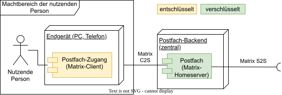
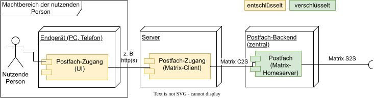

# ADR-1100: E2EE-Endpunkte bei bilateraler Kommunikation

> **Status:** ✔️ Operativ entschieden | **Datum:** 24. September 2026

## Kontext und Problembeschreibung

Die Zielarchitektur muss eine rechtssichere und vertrauliche Kommunikation ermöglichen, weshalb eine strikte [Ende-zu-Ende-Verschlüsselung](../../Glossar.md#ende-zu-ende-verschlüsselung) (E2EE) umgesetzt wird. In dieser Architekturentscheidung wird entschieden, ob die Ende-zu-Ende-Verschlüsselung bei der **bilateralen Kommunikation** immer in den Endgeräten der Kommunikationsteilnehmer terminieren muss oder auch auf einem vorgelagerten Server außerhalb des Zugriffs der Personen terminieren kann. Die Terminierung der Verschlüsselung bei Szenarien mit Gruppen von Teilnehmenden wie bei der Kommunikation über [Funktionspostfächer](../../Glossar.md#funktionspostfach) wird in einer Folge-Entscheidung behandelt.

## Entscheidungstreiber

- **Vertraulichkeit:** Strikte Umsetzung der Ende-zu-Ende-Verschlüsselung (SIC_VER_ÜBE_026)
- **Schlüsselhoheit:** Unmöglichkeit der Entschlüsselung durch Dritte oder Betreiber (SIC_VER_ÜBE_032)
- **Erwartung der Nutzenden:** [Privatpersonen](../../Glossar.md#privatperson) erwarten, dass ihre Daten nur von der zuständigen Person gelesen werden.

## Betrachtete Optionen

| **Merkmal**             | **Option A:** **E2EE bis Endgerät**                                                  | **Option B:** **E2EE endet auf Server**                 |
|-------------------------|--------------------------------------------------------------------------------------|---------------------------------------------------------|
| **Terminierung**        | Endgerät der nutzenden Person                                                        | Server außerhalb des [Machtbereichs](../../Glossar.md#machtbereich) der nutzenden Person |
| **Sicherheitsniveau**   | Maximal (ideale E2EE)                                                                | Vertrauen in Serverbetreiber nötig                      |
| **Schlüsselhoheit**     | Bei der nutzenden Person                                                             | Beim Serverbetreiber                                    |
| **Fachliche Identität** | Nicht aus dem [E2EE-Endpunkt](../../Glossar.md#e2ee-endpunkt) ableitbar. Prüfung über [Identitätsnachweis](../../Glossar.md#fachlicher-identitätsnachweis) pro [Nachricht](../../Glossar.md#nachricht) | Nicht aus dem Server-Endpunkt ableitbar                 |
| **Transport-Identität** | persönlicher Matrix-Account (ggf. [Pseudonym](../../Glossar.md#pseudonym))                                         | ggf. [technischer Nutzer](../../Glossar.md#technischer-nutzer)                                 |

### Detailbeschreibung der Optionen

- **Option A:** Die Ent- und Verschlüsselung der Nachrichten findet direkt im Endgerät ([Postfach-Zugang](../../Glossar.md#postfach-zugang)) der Kommunikationsteilnehmer statt. Das Matrix-Protokoll wird durchgängig bis zu den nutzenden Personen umgesetzt. Der Versand erfolgt über ein persönliches oder pseudonymes Matrix-Konto. Die fachliche [Identität](../../Glossar.md#identität) wird nicht aus dem E2EE-Endpunkt abgeleitet, sondern aus einem im Kommunikationskanal übermittelten Identitätsnachweis ermittelt. Details dazu regelt eine Folge-Entscheidung. Die nutzende Person hat die volle Kontrolle über ihre Schlüssel. Dieses Konzept ist so auch im TI-Messenger des Gesundheitswesens[^1] umgesetzt, wo Matrix-basierte Messenger-Systeme clientseitige E2EE mit mehreren Mandanten verwenden.

- **Option B:** Die Ent- und Verschlüsselung der Nachrichten findet auf einem Server statt, der nicht im Machtbereich der nutzenden Person liegt. Der Serverbetreiber hat damit technisch Zugriff auf den Klartext der Kommunikation. Dies gefährdet die Vertraulichkeit der Kommunikation.

### Gegenüberstellung der Optionen

#### Option A: E2EE bis Endgerät

- Gut, denn nur die Kommunikationsteilnehmer haben Zugriff auf den Klartext, womit die Vertraulichkeit der Kommunikation sicher ist, sofern keine Endgeräte kompromittiert sind.

- Gut, denn die Schlüssel bleiben unter Kontrolle der Kommunikationsteilnehmer und können bei Bedarf mit einem Identitätsnachweis verbunden werden.

- Schlecht, denn bei Verlust des Endgeräts sind auch die Nachrichten ohne Backup der Schlüssel verloren.

- Schlecht, denn Dienste wie Volltextsuche und Archivierung sind serverseitig nicht möglich. Sie müssen clientseitig umgesetzt werden.

#### Option B: E2EE endet auf einem Server

- Gut, denn eine serverseitige Verarbeitung der Nachrichten zum Beispiel zur Malware-Prüfung oder Archivierung ist möglich.

- Schlecht, denn der Betreiber des Servers kann auf den Klartext aller Nachrichten zugreifen, was eine zentrale Anforderung zur Vertraulichkeit verletzt (SIC_VER_ÜBE_032).

- Schlecht, denn der Server würde zum sicherheitskritischen System und müsste entsprechend aufwändig gehärtet werden.

- Schlecht, denn dies widerspricht dem Zero-Trust-Paradigma (SIC_ÜBE_ÜBE_018).

## Architekturentscheidung

Gewählte Option: **Option A (E2EE bis Endgerät)**, weil

- Nur die Terminierung im Endgerät gewährleistet die maximale Vertraulichkeit der Kommunikation (SIC_VER_ÜBE_026) und schließt den Zugriff durch Dritte oder Betreiber aus (SIC_VER_ÜBE_032).

- Das Matrix-Protokoll wird durchgängig bis in das Endgerät umgesetzt. Die Ent-/Verschlüsselung der Kommunikation findet ausschließlich dort statt.

**Option B wird ausgeschlossen**. Eine Terminierung der Verschlüsselung außerhalb des Machtbereichs der nutzenden Person widerspricht den Anforderungen an E2EE und dem Zero-Trust-Paradigma.

## Auswirkungen

- Für 1-zu-1-Kommunikation wird mit der clientseitigen Ent-/Verschlüsselung eine maximale Vertraulichkeit der Kommunikation gewährleistet (SIC_VER_ÜBE_026, SIC_VER_ÜBE_032).

- Eine serverseitige Volltextsuche über verschlüsselte Nachrichten ist bei clientseitiger E2EE nicht möglich. Die Suche erfolgt lokal im Client über den dort vorliegenden Klartext.

## Risiken

- Bei Verlust des Endgeräts oder des Schlüsselmaterials kann ein Key-Backup für die Wiederherstellung verwendet werden. Bei Matrix kann dies mit Secure Secret Storage and Sharing (SSSS) durch Cross-Signing umgesetzt werden. Alternative Lösungen sind denkbar, z.B. wiederholte Übermittlung von Schlüsseln nach erfolgreicher [Authentifizierung](../../Glossar.md#authentifizierung) gegenüber der Gesprächspartnerin.

## Folge-Entscheidungen

- **Mehrbenutzer-Szenarien:** Die E2EE-Terminierung bei Funktionspostfächern, Bearbeitungsgruppen und [Bearbeitungsvertretungen](../../Glossar.md#bearbeitungsvertretung) behandelt [ADR-1101](./ADR-1101-Mehrbenutzer-Kommunikation-Festlegung-E2EE-Endpunkte.md).

- **Identitätsnachweis:** Den Nachweis für die Identität des Kommunikationsteilnehmers und das [Vertrauensniveau](../../Glossar.md#vertrauensniveau) der verwendeten Authentifizierungsmethode behandeln [ADR-1106](./ADR-1106-Fachlicher-Identitaetsnachweis-Matrix-Nachrichtenkontext.md) und [ADR-1107](./ADR-1107-Nachweisformat-Identitaetsnachweis-Matrix-Nachrichten.md).

- **Schlüsselwiederherstellung:** Bei Verlust des Endgeräts oder Schlüsselmaterials müssen Schlüssel aus einem Backup wiederhergestellt werden, siehe [ADR-1147](./ADR-1147-Schluesselwiederherstellung.md).

## Referenzen

[^1]: [gematik gemSpec_TI-M_Basis, A_26435 (Client-seitige E2EE im TI-Messenger)](https://gemspec.gematik.de/docs/gemSpec/gemSpec_TI-M_Basis/latest/#A_26435)
