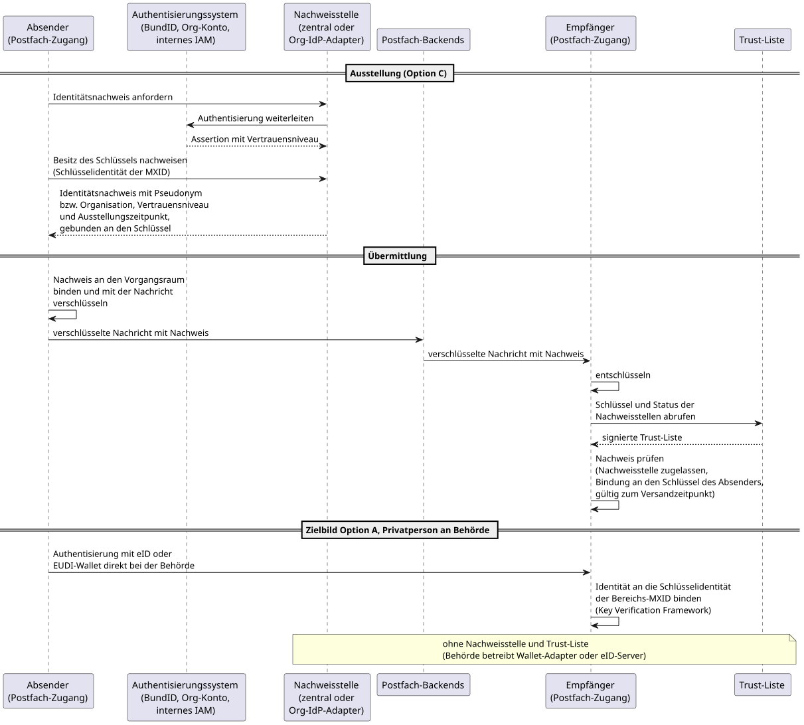

# ADR-1106: Fachlicher Identitätsnachweis im Matrix-Nachrichtenkontext

> **Status:** ✔️ Operativ entschieden | **Datum:** 6. November 2026

## Kontext und Problembeschreibung

In der Zielarchitektur kommunizieren die Teilnehmer Ende-zu-Ende-verschlüsselt auf Basis des Matrix-Protokolls ([ADR-0011](./ADR-0011-Kommunikationsschicht.md), [ADR-0012](./ADR-0012-Ende-zu-Ende-Verschlüsselungsschicht.md)). Dieser ADR behandelt, wie die [Authentifizierung](../../Glossar.md#authentifizierung) der Kommunikationspartner und die Ermittlung ihres [Vertrauensniveaus](../../Glossar.md#vertrauensniveau) umgesetzt werden ([ADR-0014](./ADR-0014-Authentizität-Identität-von-Privatpersonen.md) bis [ADR-0016](./ADR-0016-Authentizität-Identität-privater-Organisationen.md)).

Das Matrix-Protokoll ermöglicht die Prüfung der [Identität](../../Glossar.md#identität) verwendeter Geräte anhand der Geräteschlüssel. Die fachliche Identität der tatsächlichen Teilnehmer kann dadurch nicht sicher geprüft werden. Auch die [MXID](../../Glossar.md#mxid) inklusive der Domain ist diesbezüglich keine belastbare Aussage. Die Authentifizierung der fachlichen Teilnehmer basiert stattdessen auf einem kryptografisch abgesicherten [Identitätsnachweis](../../Glossar.md#fachlicher-identitätsnachweis).

Im Zielbild sind unterschiedliche Systeme für die Authentifizierung und die Ausstellung der Identitätsnachweise vorgesehen. [Privatpersonen](../../Glossar.md#privatperson) können hierfür den zentralen Identitäts-Provider (IdP) [BundID](../../Glossar.md#bundid), einen eID-Server der Gegenstelle und perspektivisch die [EUDI-Wallet](../../Glossar.md#europäische-brieftasche-für-die-digitale-identität) verwenden ([ADR-0014](./ADR-0014-Authentizität-Identität-von-Privatpersonen.md)). [Öffentliche Stellen](../../Glossar.md#öffentliche-stelle) und [private Organisationen](../../Glossar.md#private-organisation) nutzen das [Org-Konto](../../Glossar.md#org-konto), heute umgesetzt durch [MUK](../../Glossar.md#mein-unternehmenskonto) ([ADR-0015](./ADR-0015-Authentizität-Identität-öffentlicher-Stellen.md), [ADR-0016](./ADR-0016-Authentizität-Identität-privater-Organisationen.md)). Für die Nutzung eines organisationsinternen Identitätsmanagements kann ein Adapter ([Org-IdP-Adapter](../../Glossar.md#org-idp-adapter)) verwendet werden, der nach einer internen Berechtigungsprüfung die Identitätsnachweise für den [Verbund](../../Glossar.md#verbund) aufbereitet und signiert.

In [ADR-0013](./ADR-0013-Authentizität-in-der-Nachrichtenübermittlung.md) wurde eine Authentifizierung mittels Holder-Proof bzw. Proof-of-Possession entworfen. Beim [Holder-Binding](../../Glossar.md#holder-binding) ist der Nachweis an einen Schlüssel des Clients ([Postfach-Zugang](../../Glossar.md#postfach-zugang)) gebunden. Der Client weist bei jeder Verwendung des Nachweises den Besitz dieses Schlüssels nach (Proof-of-Possession). Der TI-Messenger nutzt zur Authentifizierung Holder-Binding über Smartcards (SMC-B/HBA). Ein zentraler IdP stellt ID_TOKEN (JWT) aus.[^1] Mit dem heutigen Stand der Identitäts-Provider BundID und MUK ist die Lösung aus [ADR-0013](./ADR-0013-Authentizität-in-der-Nachrichtenübermittlung.md) nicht umsetzbar. Diese IdP erzeugen signierte Assertions (Bearer-Token), die durch die Gegenstelle zwar prüfbar sind, aber keine Schlüssel des Authentisierenden verwenden. In dieser Architekturentscheidung werden deshalb auch Optionen betrachtet, die Bearer-Token-kompatibel sind.

Bei Verwendung der [eID](../../Glossar.md#eid-funktion) authentisieren sich Privatpersonen direkt gegenüber der Gegenstelle, wobei nach erfolgreicher Identitätsprüfung die Identität an die Schlüsselidentität der [Bereichs-MXID](../../Glossar.md#bereichs-mxid) gebunden wird. Bei Identitäts-Providern wie der BundID, die Holder-Binding nicht unterstützen, nimmt eine [Nachweisstelle](../../Glossar.md#nachweisstelle) der Zielarchitektur entsprechend dem Identity-Broker-Pattern die Assertion des Identitäts-Providers in den Identitätsnachweis auf.

## Entscheidungstreiber

- **Prüfbarkeit:** Empfangende müssen die Identität der sendenden Person, das verwendete Vertrauensniveau und die Gültigkeit des Nachweises zum Versandzeitpunkt prüfen (SIC_AUT_ÜBE_007, SIC_ÜBE_ÜBE_008, ANF_FUN_IDE_001).
- **Authentifizierungsmittel:** Die in der Zielarchitektur zugelassenen Mittel zur Authentifizierung von Privatpersonen und [Organisationen](../../Glossar.md#organisation) müssen unterstützt werden ([ADR-0014](./ADR-0014-Authentizität-Identität-von-Privatpersonen.md) bis [ADR-0016](./ADR-0016-Authentizität-Identität-privater-Organisationen.md), ANF_FUN_IDE_023, ANF_FUN_IDE_024, ANF_FUN_IDE_050).
- **Langzeitprüfbarkeit:** Wenn ein Beleg notwendig ist, dass der [Absender](../../Glossar.md#absenderin) auf dem angegebenen Vertrauensniveau authentisiert war, muss der mit der [Nachricht](../../Glossar.md#nachricht) übermittelte Identitätsnachweis prüfbar bleiben.
- **Zero Trust:** Nachweise sollen kryptografisch so abgesichert werden, dass sie für Dritte unfälschbar sind ([ADR-0013](./ADR-0013-Authentizität-in-der-Nachrichtenübermittlung.md), SIC_ÜBE_ÜBE_018).
- **Aktualität:** Ändern sich Berechtigungen oder Vertrauensniveau der authentifizierten Teilnehmer, muss sich dies zeitnah auswirken, ohne dass für jede Prüfung eines Identitätsnachweises Netzwerkaufrufe notwendig sind (LEI_ZEI_ÜBE_002).
- **Schutz von Verschlüsselung und Plausible Deniability:** Die Authentifizierung darf die [Ende-zu-Ende-Verschlüsselung](../../Glossar.md#ende-zu-ende-verschlüsselung) nicht brechen und soll möglichst keine unnötigen unverschlüsselten Metadaten erzeugen (SIC_VER_ÜBE_026, SIC_VER_ÜBE_032, SIC_VER_ÜBE_051, SIC_AUT_ÜBE_014).
- **Datenminimierung und Nichtverkettbarkeit:** Identitätsnachweise sollen nur die zwingend notwendigen personenbezogenen Informationen enthalten. Die Wiedererkennbarkeit von Privatpersonen ist zu vermeiden. Organisationsinterne Strukturen sollen nicht offengelegt werden (ANF_FUN_ADR_024, DAT_ÜBE_ÜBE_021).

## Betrachtete Optionen

### Option A: Kanal-gebundene Authentisierung entsprechend ADR-0013 Option 3

Beim Aufbau der Kommunikationsverbindung und der Authentifizierung durch die Gegenstelle wird der Identitätsnachweis an die Schlüsselidentität des Gerätes gebunden, wobei der Client den Besitz des Geräteschlüssels nachweist (Holder-Binding). Dadurch ist der Nachweis nicht auf andere Geräte übertragbar. Die zugehörigen Geräteschlüssel werden in Matrix über Cross-Signing und das Key Verification Framework verifiziert. Erstellte Nachrichten sind über die Verschlüsselung an den Geräteschlüssel gebunden, wodurch die Prüfung der Zuordnung von Nachricht und Identität ohne Vertrauen in ein Backend möglich ist. Durch die [Authentisierung](../../Glossar.md#authentisierung) beim Aufbau der Verbindung bzw. Erzeugung des Raumes ist die Bindung auf diesen konkreten Kommunikationskanal begrenzt, womit eine Wiederverwendung des Nachweises in anderen Kanälen (Replay-Attacke) ausgeschlossen ist. Bei der Verwendung der eID oder der EUDI-Wallet kann die Bindung direkt bei der Authentisierung entstehen. Für IdP, die nur Bearer-Token ausstellen, wie derzeit BundID und MUK, müsste der Nachweis dagegen durch die Nachweisstelle an den Geräteschlüssel gebunden werden. Die Identitätsbindung kann als [Event](../../Glossar.md#event) im Matrix-Raum des jeweiligen [Vorgangs](../../Glossar.md#vorgang) übermittelt werden. Dieser Identitätsnachweis bleibt auch im weiteren Verlauf und nach erneuter Authentifizierung bestehen, wodurch sich eine historische Prüfung, etwa bei einem Wechsel des Vertrauensniveaus, umsetzen lässt.

- Gut, denn die Lösung folgt dem Zero-Trust-Prinzip und nutzt das Backend nicht für die Authentifizierung.

- Gut, denn Replay-Attacken werden verhindert, da der Identitätsnachweis an den Kanal bzw. das Gerät gebunden und damit nicht übertragbar ist.

- Gut, denn es entstehen keine Metadaten zur Anmeldung außerhalb des Kanals, was Privacy by Design entspricht.

- Schlecht, denn BundID und Org-Konto, die in der Zielarchitektur als IdP vorgesehen sind, können Bearer-Token derzeit nicht an die Geräteschlüssel binden.

- Schlecht, denn die [Behörden](../../Glossar.md#behörde) müssen einen eID-Server betreiben oder betreiben lassen, mit dem die Authentifizierung durchgeführt wird.

- Schlecht, denn die organisationsbezogene Herkunftsbindung, etwa das Handeln für ein [Funktionspostfach](../../Glossar.md#funktionspostfach), lässt sich aus einer eID oder Wallet allein nicht ableiten und so nicht an den Identitätsnachweis binden.

- Schlecht, denn um den Identitätsnachweis zu einer Nachricht zu prüfen oder beim Export mitzugeben, müssen die historisierten Identitätsnachweise ausgelesen und mit den Nachrichten verknüpft werden.

### Option B: Nachrichten mit exklusiv ausgestelltem Identitätsnachweis

Die Nachweisstelle erzeugt für jede Nachricht exklusive Identitätsnachweise, die der Client jeder Übermittlung hinzufügt.

- Gut, denn der Identitätsnachweis ist in jeder Nachricht (bedingt auch nach einem Export) direkt prüfbar.

- Gut, denn eine Sperrung oder Attributänderung wirkt sofort, da Identitätsnachweise nur einmalig gültig sind.

- Gut, denn eine Authentifizierung mit BundID und MUK ist so umsetzbar.

- Gut, denn beim Backend entstehen keine Metadaten zur Anmeldung (Privacy by Design).

- Schlecht, denn der verschlüsselte Nachrichteninhalt wird größer.

- Schlecht, denn die Nachweisstelle muss für jede Nachricht einen Nachweis erzeugen.

- Schlecht, denn die Last der Systeme wird durch die häufige Nachweiserzeugung erhöht, was eine [Echtzeitkommunikation](../../Glossar.md#echtzeitkommunikation) erschwert.

### Option C: Nachrichten mit kurzlebigem Identitätsnachweis

Die Nachweisstelle erzeugt kurzlebige Identitätsnachweise, die signiert in der verschlüsselten Nutzlast der Nachrichten-Events mitgeführt werden (Format, vgl. Folge-Entscheidung). Der Client kann einen ausgestellten Nachweis innerhalb einer konfigurierbaren Frist für mehrere Nachrichten verwenden.

- Gut, denn der Identitätsnachweis ist in jeder Nachricht (bedingt auch nach einem Export) direkt prüfbar.

- Gut, denn eine Authentifizierung mit BundID und MUK ist so umsetzbar.

- Gut, denn beim Backend entstehen keine Metadaten zur Anmeldung, was Privacy by Design entspricht.

- Gut, denn die Nachweisstelle muss nicht für jede Nachricht einen Nachweis erzeugen.

- Schlecht, denn der verschlüsselte Nachrichteninhalt wird größer.

- Schlecht, denn die Frist für die Nutzung muss korrekt konfiguriert sein.

## Architekturentscheidung

Gewählte Optionen: **Option A, Kanal-gebundene Authentisierung** für eID und perspektivisch EUDI-Wallet sowie **Option C, Nachrichten mit kurzlebigem Identitätsnachweis** als Übergangslösung für BundID, Org-Konto und Org-IdP-Adapter.

**Option A für eID und EUDI-Wallet:** Privatpersonen verwenden ihre eID, um sich direkt gegenüber einer Behörde zu authentisieren. Die geprüfte Identität wird dabei ohne BundID und ohne Nachweisstelle an die Schlüsselidentität der Bereichs-MXID gebunden. Das Vertrauensniveau hoch ist so ohne vermittelnden Dienst erreichbar, wie in [ADR-0013](./ADR-0013-Authentizität-in-der-Nachrichtenübermittlung.md) und [ADR-0014](./ADR-0014-Authentizität-Identität-von-Privatpersonen.md) vorgesehen. Die Behörde muss dafür einen eID-Server betreiben oder betreiben lassen. Sowohl die Lösung über die eID als auch eine Lösung mit der EUDI-Wallet sind kurzfristig noch nicht verfügbar.

**Option C als Übergangslösung:** BundID und MUK bleiben [Authentisierungssysteme](../../Glossar.md#authentisierungssystem) für die Authentifizierung und werden mit Option C direkt unterstützt. Die Nachweisstelle übernimmt das Vertrauensniveau aus der Assertion des Identitäts-Providers und ergänzt die Bindung an den Schlüssel des Clients und ggf. das Funktionspostfach. Da der Identitätsnachweis verschlüsselt in jeder Nachricht mitgeführt wird, kann er je Nachricht geprüft und mit ihr veraktet werden. Gegenüber Option B entfällt die Ausstellung eines Nachweises für jede einzelne Nachricht.

**Zielbild Option A:** Zielbild bleibt Option A, also die in [ADR-0013](./ADR-0013-Authentizität-in-der-Nachrichtenübermittlung.md) beschriebene Kanalbindung. Option A erfordert Identitätsnachweise mit Holder-Binding und ist derzeit mit BundID und MUK nicht umsetzbar. Sobald die EUDI-Wallet breit verfügbar ist oder die Identitäts-Provider Holder-Binding unterstützen, wird Option A für alle Authentisierungssysteme umgesetzt.

## Umsetzung der gewählten Option

Bei Option A wird das Holder-Binding über das Key Verification Framework umgesetzt, wenn der [Vorgangsraum](../../Glossar.md#vorgangsraum) aufgebaut wird. Die Angaben stammen bei Option A aus der eID bzw. der EUDI-Wallet.

Bei Verwendung der vorgelagerten Authentisierungssysteme (BundID, Org-Konto) für die Anmeldung (vgl. Folge-Entscheidung) erzeugen zugelassene Nachweisstellen die eigentlichen Identitätsnachweise. Diese Nachweisstellen arbeiten als Vermittlungsdienst zwischen den authentisierenden Clients und dem Authentisierungssystem. Eine Nachweisstelle kann fachliche Angaben im Identitätsnachweis ergänzen. Angaben des Authentisierungssystems übernimmt sie nur, soweit sie zwingend erforderlich sind.

Die Nachweise benötigen mindestens Angaben zur Identitätsbindung sowie zum Vertrauensniveau und müssen kryptografisch prüfbar sein. Weitere Informationen wie eine Postfach-Zugehörigkeit können enthalten sein, sofern sie zwingend erforderlich sind. Bei Privatpersonen enthält der Nachweis als Kennung nur das [Pseudonym](../../Glossar.md#pseudonym) aus der Bereichs-MXID ([ADR-1105](./ADR-1105-Pseudonym-Adressierung-von-Privatpersonen.md)). Im von der Nachweisstelle ausgestellten Nachweis ist der Zeitpunkt der Ausstellung enthalten. Mit ihm und der konfigurierten Nutzungsfrist lässt sich die Gültigkeit zum Versandzeitpunkt ermitteln und eine langfristige Prüfung z. B. im Archiv umsetzen.

Der Identitätsnachweis wird innerhalb des verschlüsselten Kanals übermittelt, nicht als unverschlüsseltes Matrix-Event bzw. Metadatum. Die Nachweisstelle bindet den Nachweis an die Matrix-Schlüsselidentität oder einen Binding-Key, nachdem der Client den Besitz des Schlüssels nachgewiesen hat. Die Bindung an den Kontext setzt der Client bei der Übermittlung (vgl. Folge-Entscheidung). Der Nachweis ist nur im gebundenen Vorgangsraum gültig. Bei Privatpersonen wird die vom Client erzeugte Schlüsselidentität der jeweiligen Bereichs-MXID verwendet ([ADR-1105](./ADR-1105-Pseudonym-Adressierung-von-Privatpersonen.md)). Ein gemeinsamer Schlüssel würde das Zusammenführen der Kommunikation einer Privatperson über unterschiedliche [Bereiche](../../Glossar.md#bereich) ermöglichen. Im Gegensatz zu Option A wird hier ein Vertrauen in die Nachweisstelle notwendig, da die Bindung nicht während der Authentisierung mit der Gegenstelle direkt stattfindet.

Eine Signatur über den Nachrichteninhalt ist nicht Bestandteil des Nachweises. Die Bindung betrifft ausschließlich den Schlüssel, niemals den Nachrichteninhalt, damit Nachrichten abstreitbar bleiben (SIC_AUT_ÜBE_014). Durch den Identitätsnachweis ist die Authentisierung des Absenders im Vorgang belegt. Die [Integrität](../../Glossar.md#integrität) des Inhalts und die nachweisbare Autorenschaft werden in [ADR-0017](./ADR-0017-Authentizität-und-Integrität-von-Inhalten.md) und [ADR-0018](./ADR-0018-Nichtabstreitbarkeit-Übermittlung.md) behandelt.

Ein Identitätsnachweis ist nicht bei jeder Kommunikation notwendig und sinnvoll. Bei Anwendungsfällen wie rein informeller Kommunikation oder Beratung können die Kommunikationsteilnehmenden anonym bleiben. Dadurch wird die [Plausible Deniability](../../Glossar.md#plausible-deniability) der Kommunikation entsprechend den Anforderungen ermöglicht (vgl. SIC_AUT_ÜBE_014).

## Auswirkungen

- [Empfänger](../../Glossar.md#empfängerin) prüfen jeden Identitätsnachweis mindestens einmal innerhalb seiner Gültigkeitsdauer.

- Die Nachweisstellen müssen in den Trust-Verbund aufgenommen werden (vgl. Folge-Entscheidung).

- Clients können für einzelne [Postfächer](../../Glossar.md#postfach) bzw. Adressen steuern, ob ein Identitätsnachweis für eingehende Nachrichten verlangt wird oder eine anonyme Nutzung zugelassen ist.

- Für eID und EUDI-Wallet wird das in [ADR-0013](./ADR-0013-Authentizität-in-der-Nachrichtenübermittlung.md) beschriebene Zielbild der Bindung an den Kommunikationskanal umgesetzt. Für BundID, Org-Konto und Org-IdP-Adapter wird es für die Übergangszeit abweichend umgesetzt, wobei Vertrauen in die Nachweisstelle erforderlich ist.

- [ADR-0014](./ADR-0014-Authentizität-Identität-von-Privatpersonen.md) wird konkretisiert. Die eID wird wie dort in Option 1 beschrieben genutzt. Für die BundID, die laut [ADR-0014](./ADR-0014-Authentizität-Identität-von-Privatpersonen.md) den Kommunikationskanal nicht authentisieren kann, stellt in der Übergangszeit eine Nachweisstelle den Identitätsnachweis aus.

## Risiken

- Die Gültigkeitsdauer der Identitätsnachweise ist ausgewogen zu konfigurieren, so dass Sperren oder Attributwechsel zeitnah wirken können, aber eine Echtzeitkommunikation möglich bleibt.

- Die Wiederverwendung von Nachweisen in einem falschen Kontext muss verhindert werden.

- Bei Privatpersonen dürfen im Nachweis keine stabilen Kennungen sichtbar werden, über die sich Nachrichten unterschiedlicher Bereiche zusammenführen lassen.

- Eine Kompromittierung der Nachweisstelle ermöglicht die Ausstellung gefälschter Identitätsnachweise und gefährdet die Vertrauensannahme des Holder-Bindings. Schlüsselmaterial und Ausstellungsprozess der Nachweisstellen sind entsprechend abzusichern.

## Folge-Entscheidungen

- Das Format des Identitätsnachweises legt [ADR-1107](./ADR-1107-Nachweisformat-Identitaetsnachweis-Matrix-Nachrichten.md) fest.

- Die zugelassenen Nachweisstellen und die Org-IdP-Adapter behandelt [ADR-1108](./ADR-1108-Nachweisstellen-Org-IdP-Adapter.md).

- Anforderungen an die notwendige PKI für die Nachweisstellen finden sich in [ADR-1144](./ADR-1144-PKI-Anforderungen-und-Vertrauensinfrastruktur.md).

- Schlüsselwiederherstellung nach Verlust der Schlüsselidentität und Auswirkungen auf das Holder-Binding bestehender Identitätsnachweise behandelt [ADR-1147](./ADR-1147-Schluesselwiederherstellung.md).

- [Anschlussbedingungen](../../Glossar.md#anschlussbedingungen) für Nachweisstellen, etwa Aufbewahrung, Audit und Konformität, behandelt [ADR-1145](./ADR-1145-Anschlussbedingungen-und-Foederationskontrolle.md).

- Die Entkopplung von [Nutzerkonto](../../Glossar.md#nutzerkonto) und Postfach mit Nutzerkonten und Wallets als Authentisierungssystemen behandelt [ADR-1110](./ADR-1110-Entkopplung-von-Nutzerkonto-und-Postfach.md).

- Die Auflösung von Postfachadressen getrennt von der fachlichen Identitätsbindung behandelt [ADR-1111](./ADR-1111-Auflösung-Organisationsbezogene-Postfachadressen.md).

## Offene Punkte

- Durchsetzung eines Mindest-Vertrauensniveaus vor der Schlüsselverteilung im Vorgangsraum.

- Zuordnung bei Verwendung von Pseudonymen von BundID und eID zum selben Postfach ([ADR-1105](./ADR-1105-Pseudonym-Adressierung-von-Privatpersonen.md)).

- Wahl des gebundenen Schlüssels (Geräteschlüssel oder Master Signing Key der Bereichs-MXID).

## Referenzen

[^1]: [gematik, gemSpec_IDP_Dienst (ID_TOKEN; TelematikID/ProfessionOID)](https://gemspec.gematik.de/docs/gemSpec/gemSpec_IDP_Dienst/), abgerufen am 26. Juni 2026.
