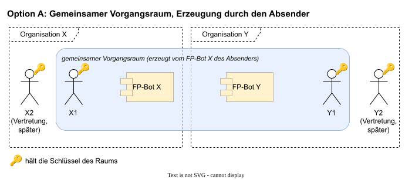
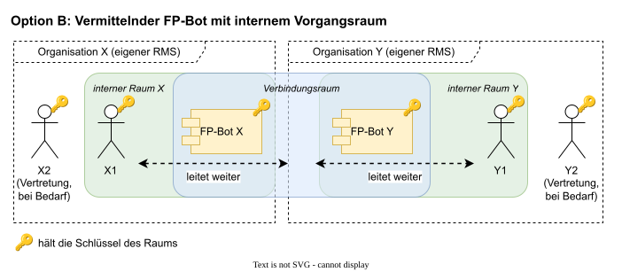
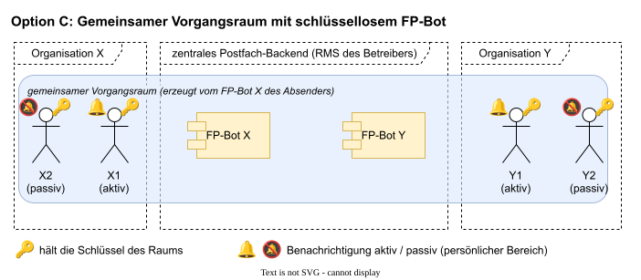
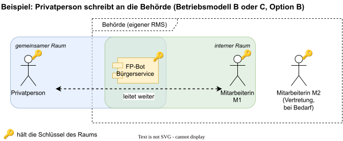
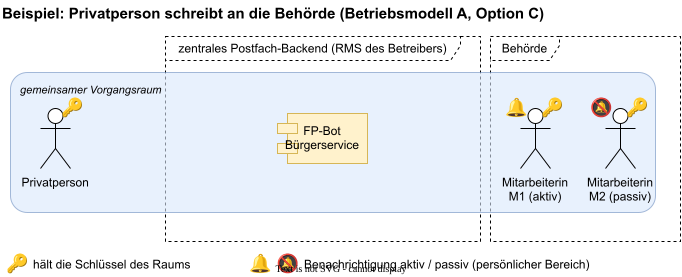

# ADR-1109: Raumtopologie bei Kommunikation mit Funktionspostfächern

> **Status:** ✔️ Operativ entschieden | **Datum:** 11. November 2026

## Kontext und Problembeschreibung

Bei einer Kommunikation zwischen Personen erzeugt der [Absender](../../Glossar.md#absenderin) einen [Vorgangsraum](../../Glossar.md#vorgangsraum), der auf die [Postfach-Backends](../../Glossar.md#postfach-backend) der Teilnehmenden repliziert wird (vgl. [ADR-1100](./ADR-1100-Bilaterale-Kommunikation-Festlegung-E2EE-Endpunkte.md)). Wenn bei der Kommunikation [Funktionspostfächer](../../Glossar.md#funktionspostfach) beteiligt sind, also Gruppen von Teilnehmenden (vgl. [ADR-1102](./ADR-1102-Umsetzung-von-Funktionspostfächern-und-Vorgangsräumen.md)), stellt sich die Frage, wer die Räume eröffnet und dann verwaltet. Die Mitgliedschaften der [Organisation](../../Glossar.md#organisation) im Raum müssen durch Administratoren der jeweiligen Organisation selbst verwaltet werden können. Im Matrix-Raum liegen die Administratorrechte seit Raumversion 12 allerdings dauerhaft beim Ersteller des Raums (MSC4289[^1]). Darüber hinaus sind bei der Kommunikation mit Organisationen Anforderungen bzgl. des Schutzes der Privatsphäre der Mitarbeitenden und der organisationsinternen Strukturen zu erfüllen.

Diese Architekturentscheidung untersucht die unterschiedlichen Möglichkeiten zur Erzeugung von Vorgangsräumen und der damit verbundenen Administration im Raum.

### Abgrenzung

- Allgemeine Trennung von Funktionspostfach und Vorgangsraum, Einführung des [Raum-Management-Service](../../Glossar.md#raum-management-service) und Raumadministration, siehe [ADR-1102](./ADR-1102-Umsetzung-von-Funktionspostfächern-und-Vorgangsräumen.md)
- [Berechtigungsverzeichnis](../../Glossar.md#berechtigungsverzeichnis) legt die Gruppen und Rollen für Funktionspostfächer fest, siehe Folge-Entscheidung

## Entscheidungstreiber

- **Bearbeitungsvertretung:** Das System muss berechtigte Personen in einen Vorgangsraum aufnehmen, ohne dass die ursprünglich zuständige Person mitwirken muss (ANF_FUN_ADR_025).
- **Kommunikationshistorie:** Alte [Nachrichten](../../Glossar.md#nachricht) müssen neuen Teilnehmern zugänglich sein (ANF_FUN_ADR_063).
- **Unabhängige Verwaltung:** Organisationen verwalten ihre Bearbeitergruppen selbst (ANF_FUN_ADR_062, vgl. Folge-Entscheidung).
- **Datenschutz:** Die [Identität](../../Glossar.md#identität) der Mitarbeitenden und interne Strukturen der Organisation sollen nicht nach außen gegeben werden, wenn dies nicht zwingend notwendig ist.
- **E2EE-Konformität:** Betreiber der Infrastruktur können den Klartext der Nachrichten nicht einsehen (SIC_VER_ÜBE_032).
- **Betriebsmodelle:** Zentrale und dezentrale [Betriebsmodelle](../../Glossar.md#betriebsmodell) sollen unterstützt werden (vgl. [ADR-1103](./ADR-1103-Mehrbenutzer-Organisationen-Betriebsmodelle.md)).
- **Auditierung:** Änderungen an Mitgliedschaften und Räumen sind revisionssicher zu protokollieren (SIC_NAC_NAC_005, ANF_FUN_ADR_070).

## Betrachtete Optionen

### Option A: Erzeugung eines gemeinsamen Vorgangsraums durch den Absender

Vorgangsräume werden immer durch den Absender erzeugt und weitere Teilnehmende eingeladen. Wenn auf Absender-Seite ein Funktionspostfach steht, wird ein [technischer Nutzer](../../Glossar.md#technischer-nutzer) (FP-Bot) eingeladen, der den Raum und alle Teilnehmenden verwaltet. Ebenso würde der FP-Bot der Empfängerseite eingeladen, der wiederum die Mitarbeitenden seiner Organisation einlädt.

- Gut, denn für jeden [Vorgang](../../Glossar.md#vorgang) existiert nur ein Matrix-Raum. Die [Ende-zu-Ende-Verschlüsselung](../../Glossar.md#ende-zu-ende-verschlüsselung) ist strikt umgesetzt und terminiert nur auf den Endgeräten der Teilnehmenden.
- Schlecht, denn es gäbe bei einem Raum für mehrere Organisationen auch nur einen Administrator, der die Teilnehmenden mehrerer Organisationen verwalten würde. Oder es müsste eine Erweiterung für Matrix entwickelt werden.
- Schlecht, denn auch eine Einzelperson, die Absender:in ist, wäre weiterhin Administrator.
- Schlecht, denn das Löschen einer Nachricht durch eine Seite der Kommunikationsteilnehmer würde auch bei der anderen Seite direkt durchschlagen.
- Schlecht, denn die internen Strukturen und Teilnehmende einer fremden Organisationseinheit wären einsehbar.

### Option B: Vermittelnder FP-Bot mit internem Vorgangsraum

Bei der Kommunikation mit Organisationen erzeugt der FP-Bot einen organisationsinternen Vorgangsraum. In diesen lädt er alle Personen ein, die für das Funktionspostfach zuständig sind. Mit der Gegenseite kommuniziert der FP-Bot in einem zweiten Raum. Ist die Gegenseite eine Einzelperson, schreibt er direkt mit ihr in diesem Raum. Ist die Gegenseite ebenfalls ein Funktionspostfach einer Organisation, kommunizieren beide FP-Bots miteinander in einem gemeinsamen Verbindungsraum. Die Mitarbeitenden beider Seiten befinden sich dann jeweils mit ihrem FP-Bot in einem eigenen internen Raum.

Die FP-Bots haben Zugriff auf den Klartext der Nachrichten und leiten diese zwischen dem internen Raum und dem Verbindungsraum weiter. Sie können die Schlüssel alter Nachrichten mit neu hinzugefügten Teilnehmenden teilen. Somit sind [Bearbeitungsvertretungen](../../Glossar.md#bearbeitungsvertretung) vollständig automatisierbar umsetzbar, auch wenn sich die Gruppenmitgliedschaften ändern und neue Gruppenmitglieder aufgenommen werden. Ein technischer Nutzer kann mit eigenen Geräteschlüsseln an der Ende-zu-Ende-Verschlüsselung teilnehmen. Für Application Services erweitern MSC3202 und MSC4203 dies. Diese Umsetzung entspricht [ADR-1101](./ADR-1101-Mehrbenutzer-Kommunikation-Festlegung-E2EE-Endpunkte.md) Option B mit E2EE-Teilnahme eines technischen Nutzers.

- Gut, denn die Verwaltung der Teilnehmenden ist durch die Administration in ihrer jeweiligen Organisation möglich.
- Gut, denn die Mitglieder der Gruppe des Funktionspostfaches treten nicht nach außen in Erscheinung. Interne Strukturen und Adressen der Gruppenmitglieder sind durch die Gegenseite nicht einsehbar.
- Gut, denn Bearbeitungsvertretungen erhalten jederzeit den Zugriff auf die gesamte Kommunikationshistorie, da der FP-Bot die Schlüssel teilen kann.
- Gut, denn nur die direkt und notwendigerweise mit dem Fall betrauten Personen haben Zugriff auf die Nachrichten.
- Schlecht, denn die Ende-zu-Ende-Verschlüsselung terminiert auf dem Server (RMS), weshalb eine Umsetzung nur mit organisationseigenem Server mit Betriebsmodell B oder C zulässig ist.
- Schlecht, denn die Nachricht wird den Mitarbeitenden durch ihren organisationsintern betriebenen FP-Bot übermittelt, womit der [Identitätsnachweis](../../Glossar.md#fachlicher-identitätsnachweis) durch den FP-Bot und nicht durch den Client der Mitarbeitenden geprüft werden muss.

### Option C: Gemeinsamer Vorgangsraum mit schlüssellosem FP-Bot

Es wird ein gemeinsamer Vorgangsraum wie in Option A genutzt, in den die Mitarbeitenden beider Organisationen eingeladen werden. Die FP-Bots verfügen hier nicht über die Schlüssel des Raums, sie verwalten ausschließlich die Mitgliedschaften über die Application-Service-API.

Der FP-Bot der jeweiligen Organisation lädt alle Mitglieder der Bearbeitergruppe in den Vorgangsraum ein und hält die Mitgliedschaften entsprechend dem Berechtigungsverzeichnis aktuell. Da er selbst keine Schlüssel weitergeben kann, findet die Aufnahme bei der Erzeugung des Raums statt. Somit werden die Mitglieder über die Schlüssel der gesamten Kommunikation des Raums verfügen. Die Mitgliedschaft im Raum legt fest, wer auf einen Vorgang zugreifen kann. Welche Vorgänge eine Person aktiv bearbeitet, wird über persönliche Bereiche (Matrix-Spaces) gesteuert. Der [Postfach-Zugang](../../Glossar.md#postfach-zugang) benachrichtigt die [Nutzenden](../../Glossar.md#nutzerinnen) nur für Räume im aktiven Bereich. Eine Vertretung erfordert keine erneute Aufnahme in den Raum, sie wird stattdessen durch die Aktivierung der Benachrichtigungen in diesem Raum aktiv.

Wird ein neues Mitglied in die Bearbeitergruppe aufgenommen, etwa als zeitlich begrenzte Vertretung (vgl. Folge-Entscheidung), nimmt der FP-Bot es in alle Vorgangsräume des Funktionspostfachs auf. Die Megolm-Session-Keys älterer Nachrichten erhält es erst, wenn der Client eines bestehenden Mitglieds sie mit ihm teilt (vgl. [ADR-1102](./ADR-1102-Umsetzung-von-Funktionspostfächern-und-Vorgangsräumen.md)). Bis dahin hat das Mitglied nur Zugriff auf Nachrichten ab seinem Beitritt.

- Gut, denn die strikte Ende-zu-Ende-Verschlüsselung zwischen den Endgeräten bleibt vollständig erhalten.
- Gut, denn Bearbeitungsvertretungen haben Zugriff auf die gesamte Kommunikationshistorie, sofern sie seit der Erstellung Mitglied des Raums sind.
- Gut, denn die Umsetzung ist in allen Betriebsmodellen möglich.
- Gut, denn die Identitätsnachweise werden unverändert durch die sendende Person übermittelt und geprüft ([ADR-1106](./ADR-1106-Fachlicher-Identitaetsnachweis-Matrix-Nachrichtenkontext.md), [ADR-1107](./ADR-1107-Nachweisformat-Identitaetsnachweis-Matrix-Nachrichten.md)).
- Schlecht, denn bei einem Raum für mehrere Organisationen könnten die Administratoren die Teilnehmenden auch der jeweils anderen Organisationen verwalten. Oder es müsste eine Erweiterung für Matrix entwickelt werden.
- Schlecht, denn die Mitgliedschaften beider Organisationen sind als State [Events](../../Glossar.md#event) für die Gegenseite und beide Postfach-Backends sichtbar.
- Schlecht, denn Mitglieder der Bearbeitergruppe können auch auf Nachrichten von Vorgängen ihres Funktionspostfachs zugreifen, mit denen sie nicht betraut sind.
- Schlecht, denn nach der Erstellung des Raums aufgenommene oder verspätet beigetretene Mitglieder haben keinen Zugriff auf die Kommunikationshistorie, solange ihnen kein anderes Mitglied des Raums die Schlüssel teilt.

## Architekturentscheidung

Gewählte Optionen: **Option B (Vermittelnder FP-Bot mit internem Vorgangsraum)** und **Option C (Gemeinsamer Vorgangsraum mit schlüssellosem FP-Bot)**, weil sie die unterschiedlichen Anforderungen an Vertraulichkeit, Verfügbarkeit und Betrieb abdecken. Die Wahl für eine der Optionen trifft die Organisation entsprechend ihrem Schutzbedarf und dem gewählten Betriebsmodell nach [ADR-1103](./ADR-1103-Mehrbenutzer-Organisationen-Betriebsmodelle.md).

Option C ist im Betriebsmodell A die einzig konforme Umsetzung der Funktionspostfächer. Der RMS im zentralen Postfach-Backend betreibt die FP-Bots, die keine Schlüssel besitzen.

Option B kann von Organisationen gewählt werden, die eigene Infrastruktur betreiben. Die FP-Bots der organisationseigenen RMS halten die Schlüssel, was eine zuverlässigere Umsetzung von Bearbeitungsvertretungen ermöglicht.

Bei beiden Optionen wird der Vorgangsraum durch den FP-Bot erzeugt. Wird die Kommunikation von einem Funktionspostfach als Absender initiiert, erzeugt der FP-Bot den Raum ebenso, wie wenn eine Einzelperson an ein Funktionspostfach schreibt. Damit liegen die Administrationsrechte immer beim FP-Bot.

Kommuniziert eine Einzelperson mit einem Funktionspostfach, ist in beiden Optionen nur ein FP-Bot im Raum. Die Frage, wer die Mitglieder welcher Organisation verwaltet, stellt sich dort nicht. Sie betrifft ausschließlich die Kommunikation zwischen zwei Funktionspostfächern.

Die Optionen lassen sich auf beiden Seiten einer Kommunikation unabhängig voneinander wählen. Betreibt die eine Organisation einen eigenen RMS (Option B) und nutzt die andere das zentrale Postfach-Backend (Option C), sitzt auf der einen Seite nur der weiterleitende FP-Bot im gemeinsamen Raum, auf der anderen Seite die Bearbeitergruppe mit ihrem schlüssellosen FP-Bot.

Nutzen beide Kommunikationsteilnehmer Funktionspostfächer über die zentrale Infrastruktur, verwalten beide FP-Bots denselben Raum. Beide werden im RMS desselben zentralen Betreibers betrieben. Dass jeder FP-Bot nur die Mitglieder der eigenen Organisation verwaltet, kann durch die Implementierung des RMS und über die [Anschlussbedingungen](../../Glossar.md#anschlussbedingungen) abgesichert werden (vgl. Folge-Entscheidung).

## Auswirkungen

- Die Organisation in den dezentralen Betriebsmodellen des RMS (B, C) kann zwischen einer Umsetzung von Funktionspostfächern mit und ohne Schlüsselbesitz der FP-Bots wählen.
- Eine Organisation im Betriebsmodell A (zentral) muss bei einer Neuaufnahme von Mitarbeitenden in Gruppen von Funktionspostfächern dafür sorgen, dass ein bereits bestehendes Mitglied die Schlüssel der alten Nachrichten mit dem neuen Mitglied teilt.
- [ADR-1102](./ADR-1102-Umsetzung-von-Funktionspostfächern-und-Vorgangsräumen.md) wird hier präzisiert. Den Vorgangsraum erzeugt und verwaltet immer der technische Nutzer eines Funktionspostfachs. Schreibt eine Einzelperson an ein Funktionspostfach, ist es der technische Nutzer des empfangenden Funktionspostfachs. Wenn eine Einzelperson eine Funktionspostfachadresse in einen Raum einlädt, nimmt der technische Nutzer des Funktionspostfachs die Einladung an und eröffnet den Vorgangsraum auf Organisationsseite.

## Risiken

- **Komplexität:** Die Umsetzung der Raumtopologie, das Hinzufügen und Entfernen von Mitgliedern aus den Vorgangsräumen und die Verwaltung neuer Mitglieder sind komplexe Prozesse, die sorgfältig umgesetzt werden müssen.
- **MLS:** Je nach Umsetzung von MLS in Matrix kann die Trennung von unverschlüsselten State Events und verschlüsselten Message Events entfallen. Der FP-Bot müsste dann über die Schlüssel des Raums verfügen, um ihn zu verwalten. Ob Option C mit MLS umsetzbar bleibt, ist derzeit nicht abschließend geklärt (vgl. [ADR-1101](./ADR-1101-Mehrbenutzer-Kommunikation-Festlegung-E2EE-Endpunkte.md), [ADR-1102](./ADR-1102-Umsetzung-von-Funktionspostfächern-und-Vorgangsräumen.md)).
- **Raummitglieder:** Bei Option C muss verhindert werden, dass das Backend fremde Teilnehmende in den Raum aufnimmt, was durch entsprechende Maßnahmen im Betrieb und Absicherungen der Software umzusetzen ist.
- **Zwei Optionen:** Das SDK ([ADR-0009](./ADR-0009-SDKs-zur-vereinfachten-Anbindung-von-Postfach-Zugängen.md)) muss mehrere Optionen unterstützen, wodurch sich der Entwicklungsaufwand und die Angriffsfläche erhöhen. Postfach-Zugänge zeigen bei Option B anhand einer Markierung an, ob Nachrichten von technischen oder menschlichen Nutzern stammen.

## Folge-Entscheidungen

- Berechtigungsverzeichnis: Gruppen und Rollen für Funktionspostfächer, siehe [ADR-1112](./ADR-1112-Berechtigungsverzeichnis-Funktionspostfächer.md).
- Anschlussbedingungen und [Föderationskontrolle](../../Glossar.md#föderationskontrolle): Absicherung des RMS, siehe [ADR-1145](./ADR-1145-Anschlussbedingungen-und-Foederationskontrolle.md).

## Offene Punkte

- Es ist zu prüfen, wie Matrix das Teilen von Schlüsseln im Raum für ältere Nachrichten umsetzt bzw. wie dies in Matrix umgesetzt werden kann.
- Absicherung, dass ein FP-Bot in Räumen mit Organisationen außerhalb des zentralen Postfach-Backends nur die Mitglieder der eigenen Organisation verwaltet, etwa über die Anschlussbedingungen (vgl. Folge-Entscheidung).

## Referenzen

[^1]: [Matrix Spec, Room Version 12](https://spec.matrix.org/latest/rooms/v12/), abgerufen am 11. November 2026.
