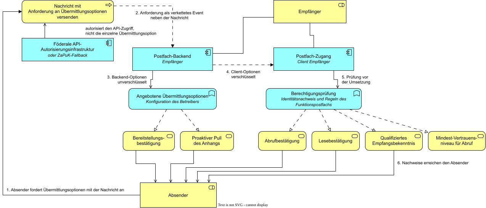

# ADR-1119: Absendergesteuerte Übermittlungsoptionen

> **Status:** ✔️ Operativ entschieden | **Datum:** 13. Oktober 2026

## Kontext und Problembeschreibung

Die Zielarchitektur muss unterschiedlichste Anforderungen und eine Vielzahl von Gesetzesgrundlagen erfüllen, die die Nachweisbarkeit der Kommunikation betreffen. Beispiele sind die durch das Empfänger-Backend automatisch erzeugte [Bereitstellungsbestätigung](../../Glossar.md#bereitstellungsbestätigung) ([ADR-0018](./ADR-0018-Nichtabstreitbarkeit-Übermittlung.md)) oder die im Client eingeforderte manuelle [Lesebestätigung](../../Glossar.md#lesebestätigung) ([ADR-1118](./ADR-1118-Abruf-und-Lesebestätigungen.md)).

Dieser ADR betrachtet die Möglichkeit, wie ein [Absender](../../Glossar.md#absenderin) steuern kann, welche Art von Übermittlung er benötigt und welche Nachweise dafür durch die Empfängerseite erzeugt werden sollen. Es wird betrachtet, wie die unterstützten Optionen des empfangenden Backends bzw. Clients ermittelt und durch diese nach der Prüfung umgesetzt werden. Neben der Steuerung von Quittungen wird auch das Veranlassen von proaktiven Downloads (Pull) von [Anhängen](../../Glossar.md#anhang) durch das Empfänger-Backend betrachtet (vgl. Folge-Entscheidung).

## Entscheidungstreiber

- **Anforderungen an die Nachweisbarkeit:** Diverse Rechtsgrundlagen und Kommunikationsarten führen zu unterschiedlichen Anforderungen an eine Nachweisbarkeit. [Verwaltungsakte](../../Glossar.md#verwaltungsakt) müssen rechtssicher und beweisbar bekanntgegeben werden. Für Auskünfte und Rückfragen ist das weder notwendig noch sinnvoll (ANF_FUN_ZUS_044, ANF_FUN_ZUS_024).
- **Optionale Nachweise:** Nachweise der Bereitstellungs-, Abruf- und Lesebestätigungen sollen nicht bei jeder [Nachricht](../../Glossar.md#nachricht) erzeugt werden (SIC_NAC_NIC_004, ANF_FUN_ZUS_044).
- **Datensparsamkeit:** Da bei Nachweisen Metadaten entstehen und [Plausible Deniability](../../Glossar.md#plausible-deniability) nicht möglich ist, sollen sie nur erzeugt werden, wenn dies erforderlich ist (SIC_VER_ÜBE_051, DAT_ÜBE_ÜBE_021).

## Betrachtete Optionen

### Option A: Gleiche Funktionen für alle Nachrichten

Alle Nachrichten im System werden gleich behandelt. Nachweise werden immer erzeugt bzw. eingeholt. Die Konfiguration der [Postfach-Backends](../../Glossar.md#postfach-backend) oder Clients steuert, wie auf Nachrichten reagiert wird bzw. welche Nachweise erzeugt werden.

- Gut, denn eine Umsetzung der dynamischen Steuerung von [Übermittlungsoptionen](../../Glossar.md#übermittlungsoption) wäre so nicht notwendig.

- Gut, denn das Verhalten im System ist vorhersehbar.

- Gut, denn eine Prüfung, ob ein Kommunikationsteilnehmer ein bestimmtes Verhalten bei der Übermittlung einfordern darf, wäre nicht notwendig.

- Schlecht, denn alle Nachrichten erzeugen den maximalen Aufwand. Eine informelle Nachricht würde gleiche Nachweise produzieren wie die [Bekanntgabe](../../Glossar.md#bekanntgabe) eines [Bescheids](../../Glossar.md#bescheid).

- Schlecht, denn die Anforderungen an [Nichtabstreitbarkeit](../../Glossar.md#nichtabstreitbarkeit), Privacy by Design und die Minimierung von Metadaten wären nicht umgesetzt bzw. auf einem einheitlichen geringsten Niveau umgesetzt.

### Option B: Absendergesteuerte Übermittlungsoptionen

Der Absender kann pro Nachricht die benötigten Übermittlungsoptionen anfordern. Was er anfordern darf, ergibt sich aus der Art des Absenders, der Organisationszugehörigkeit, dem [Vertrauensniveau](../../Glossar.md#vertrauensniveau) und der [Teilnehmendengruppe](../../Glossar.md#teilnehmendengruppe), etwa [Organisationen der Justiz](../../Glossar.md#organisation-der-justiz). Eine [Behörde](../../Glossar.md#behörde) darf bei der Bekanntgabe eines Verwaltungsakts mehr anfordern als eine [Privatperson](../../Glossar.md#privatperson) bei einer Rückantwort. Der Absender weist seine fachliche [Identität](../../Glossar.md#identität) beim Versand über den [Identitätsnachweis](../../Glossar.md#fachlicher-identitätsnachweis) nach. API-Zugriffe, etwa auf einen Upload-Endpunkt, werden über die föderale API-Autorisierungsinfrastruktur[^1] oder den ZaPuK-Fallback nach dem ADR zur API-Autorisierung im [Verbund](../../Glossar.md#verbund) autorisiert. Betreiber konfigurieren darüber die angebotenen Übermittlungsoptionen ihrer Postfach-Backends.

Backend-seitige Übermittlungsoptionen werden im empfangenden Postfach-Backend umgesetzt. Anforderungen clientseitiger Übermittlungsoptionen werden verschlüsselt transportiert und durch den Client umgesetzt. Anforderungen an das Empfänger-Backend werden unverschlüsselt übertragen, da sie im Backend ausgewertet werden müssen. Eine Verschlüsselung würde voraussetzen, dass ein backend-seitiger Dienst als E2EE-Teilnehmer die Schlüssel des Raums erhält und damit alle Nachrichten lesen könnte (vgl. [ADR-0018](./ADR-0018-Nichtabstreitbarkeit-Übermittlung.md), [ADR-1101](./ADR-1101-Mehrbenutzer-Kommunikation-Festlegung-E2EE-Endpunkte.md)).

- Gut, denn weitere Übermittlungsoptionen lassen sich ohne Bruch des bestehenden Verfahrens ergänzen.

- Schlecht, denn clientseitige Übermittlungsoptionen können von nicht-konformen Clients unterdrückt werden.

## Architekturentscheidung

Gewählte Option: **Option B Absendergesteuerte Übermittlungsoptionen**, weil sich die Anforderungen an Nachweisbarkeit je nach Kommunikationsart bzw. Verfahren grundlegend unterscheiden.

## Beispielhafte Übermittlungsoptionen

| Übermittlungsoption                                              | Art     | Beispiel                          | Bezug              |
|------------------------------------------------------------|---------|-----------------------------------|--------------------|
| Bereitstellungsbestätigung anfordern                       | Backend | Bekanntgabe Verwaltungsakt        | [ADR-0018](./ADR-0018-Nichtabstreitbarkeit-Übermittlung.md)           |
| Pull eines Anhangs durch das Empfänger-Backend veranlassen | Backend | Förmliche Zustellung mit Anhängen | Folge-Entscheidung |
| [Abrufbestätigung](../../Glossar.md#abrufbestätigung) anfordern                                 | Client  | Dokument                          | [ADR-1118](./ADR-1118-Abruf-und-Lesebestätigungen.md)           |
| Lesebestätigung anfordern                                  | Client  | Kenntnisnahmepflicht              | [ADR-1118](./ADR-1118-Abruf-und-Lesebestätigungen.md)           |
| Qualifiziertes Empfangsbekenntnis anfordern                | Client  | Justizkommunikation               | [ADR-1118](./ADR-1118-Abruf-und-Lesebestätigungen.md)           |
| Mindest-Vertrauensniveau für Abruf                         | Client  | Erhöhter Schutzbedarf             | [ADR-1106](./ADR-1106-Fachlicher-Identitaetsnachweis-Matrix-Nachrichtenkontext.md)           |

## Umsetzung

- **Anforderungen der Übermittlungsoptionen** werden als eigenes [Event](../../Glossar.md#event) mit der Nutzdaten-Nachricht verkettet, analog zur Multi-Event-Architektur des NEO-Projekts (NEO-ADR-0004 [^2]). Events zur Anforderung clientseitiger Übermittlungsoptionen sind durchgängig Ende-zu-Ende-verschlüsselt. Sie können auch als Metadaten im verschlüsselten Inhalt der Nachricht übermittelt werden. Events zur Anforderung von Backend-Optionen sind unverschlüsselt und damit im Postfach-Backend einsehbar. Lesbar ist dabei nur die angeforderte Option, nicht der Inhalt der Nachricht.

- **Backend-seitige Optionen** können analog zu [ADR-0018](./ADR-0018-Nichtabstreitbarkeit-Übermittlung.md) (Bereitstellungsbestätigung) umgesetzt werden. Der backend-seitige Dienst wertet das Steuerungs-Event aus und veranlasst die Durchführung. Die Wahl der Umsetzung trifft der Betreiber (vgl. [ADR-0018](./ADR-0018-Nichtabstreitbarkeit-Übermittlung.md)). Weitere Backend-Optionen lassen sich analog ergänzen.

- **Proaktiver Medien-Pull:** Anhänge werden bei Matrix durch die [Empfänger](../../Glossar.md#empfängerin) erst bei Bedarf aus dem Absender-Repository geladen (vgl. Pull-Prinzip, Folge-Entscheidung). Dies kann Probleme hinsichtlich der beweissicheren Übermittlung mit sich bringen. Durch eine Übermittlungsoption kann ein Empfängerbackend veranlasst werden, Dateien proaktiv ins eigene Medien-Repository zu laden. Dabei entsteht im Backend eine Zuordnung zwischen Datei und empfangender Person, was in der Folge-Entscheidung zu berücksichtigen ist.

- **Berechtigungsprüfung:** Clientseitige Übermittlungsoptionen prüft der [Postfach-Zugang](../../Glossar.md#postfach-zugang) der empfangenden Person. Er wertet den Identitätsnachweis des Absenders und die für den [Vorgangsraum](../../Glossar.md#vorgangsraum) bzw. das [Funktionspostfach](../../Glossar.md#funktionspostfach) geltenden Regeln aus und setzt die Option nur um, wenn der Absender sie anfordern darf. Ohne Identitätsnachweis entsteht keine Berechtigung, in abstreitbarer Kommunikation bleiben solche Anforderungen deshalb unberücksichtigt. Eine Prüfung des Identitätsnachweises im Empfänger-Backend ist nicht möglich, weil der Nachweis ausschließlich im verschlüsselten Kanal übermittelt wird (vgl. [ADR-1106](./ADR-1106-Fachlicher-Identitaetsnachweis-Matrix-Nachrichtenkontext.md)).

- **Standardisierung:** Die Anforderung von Übermittlungsoptionen eignet sich ggf. als [MSC](../../Glossar.md#msc), aufbauend auf MSC2127 (Federation Capabilities API)[^3], der die Ermittlung angebotener Funktionen spezifiziert.

## Auswirkungen

- In Postfach-Backends müssen die angebotenen Übermittlungsoptionen entsprechend konfiguriert werden.

- Absender-Clients müssen die Anforderung von Übermittlungsoptionen unterstützen. Die Berechtigungsprüfung für clientseitige Optionen setzen die Clients der empfangenden Personen um.

## Risiken

- **Unterdrückbarkeit clientseitiger Optionen:** Nicht-konforme Clients können eine Lesebestätigung nicht umsetzen oder unterdrücken. Verfahren, die diese Lesebestätigungen benötigen, dürfen sich nicht auf eine Umsetzung verlassen (z. B. Empfangsbekenntnis im Justiz-Bereich).

- **Unverschlüsselte Metadaten mit Anforderung von Backend-Optionen:** Wenn Nachweise angefordert werden sollen, die das Backend erzeugt, müssen diese Metadaten für die Anforderung unverschlüsselt übermittelt werden, damit das Backend sie lesen kann. Der Inhalt der Nachricht bleibt aber unangetastet und für das Backend unsichtbar.

## Folge-Entscheidungen

- **Anschlussbedingungen:** Übermittlungsoptionen, die ein Postfach-Backend unterstützen muss, siehe [ADR-1145](./ADR-1145-Anschlussbedingungen-und-Foederationskontrolle.md).

- **Übermittlung von Anhängen:** Entscheidung zum proaktiven Pull, siehe [ADR-1120](./ADR-1120-Beweissichere-Übermittlung-von-Anhängen.md).

## Referenzen

[^1]: [Föderale API-Autorisierungsinfrastruktur](https://gitlab.opencode.de/sachsen-anhalt/mid/foederale-api-autorisierungsinfrastruktur)

[^2]: [NEO-Projekt: ADR-0004 Multi-Events](https://gitlab.opencode.de/fitko/matrix-g2x/solution-architecture)

[^3]: [Matrix Spec Proposal MSC2127: Federation Capabilities API](https://github.com/matrix-org/matrix-spec-proposals/pull/2127)
