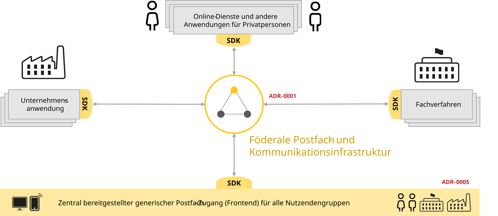
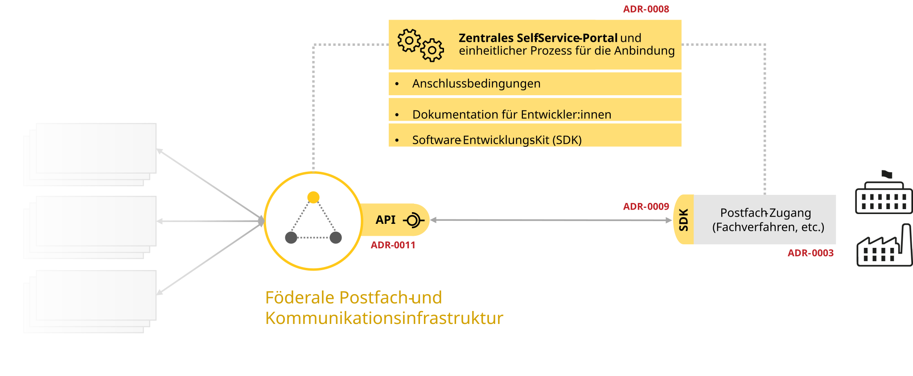
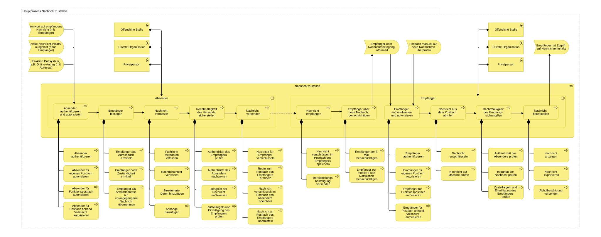
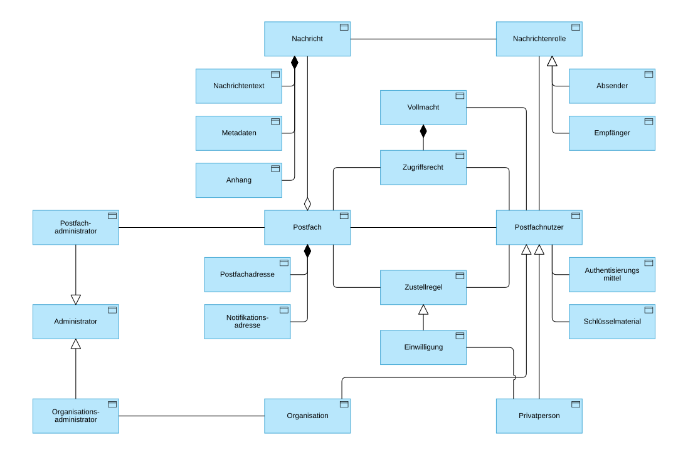
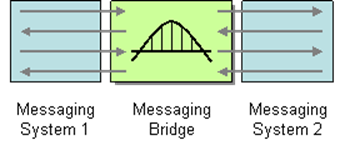
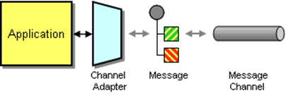

# Föderale Zielarchitektur für Postfach- und Kommunikationslösungen

***Zukunftsweisende föderale Infrastruktur für die Kommunikation zwischen Privatpersonen, privaten Organisationen und öffentlichen Stellen***

**Version 1.0** &ndash; **Stand: 13.05.2025** &ndash; **02 Konzept Zielarchitektur**

> Dieses Dokument ist die maschinenlesbare Textfassung des vom IT-Planungsrat im PDF-Format verabschiedeten Dokuments ["02 Konzept Zielarchitektur" in Version 1.0](./2025-06-26_Beschluss-2025-28_ZaPuK_Architekturkonzept.pdf). Bei der Überführung wurden redaktionelle Änderungen für eine bessere Lesbarkeit und Anpassung an die openCode-Struktur vorgenommen.

------

## Dokumentübersicht

| Titel | Dokumentart | Inhalt |
| ----- | ----------- | ------ |
| [Überblick und Handlungsempfehlung](../Zusammenfassung/) | Klammerdokument | Übergreifende Zusammenfassung des Vorhabens und Darstellung strategischer Implikationen |
| [01 Anforderungserhebung und Bestandsanalyse](../../Konsolidierte-Anforderungen/Lesefassung/) | Begleitdokument | Beschreibung des Vorgehens und der Erkenntnisse aus der Anforderungs- und Bestandsanalyse mit Auflistung der 151 konsolidierten Anforderungen |
| **02 Konzept Zielarchitektur** | **Begleitdokument** | **Darstellung der auf die Ziele des Vorhabens ausgerichtete Zielarchitektur zur Umsetzung der identifizierten Anforderungen** |
| [03 Glossar und Rahmenbedingungen](../Rahmenbedingungen/) | Begleitdokument | Übersicht über die zentralen Begriffe und Rahmenbedingungen |

## Nutzungsbedingungen

Die Inhalte dieses Dokumentes unterliegen der [Creative Commons Namensnennung 4.0 International Public License (CC BY 4.0)](https://creativecommons.org/licenses/by/4.0/).

------

## 1. Einleitung

Dieses Dokument beschreibt die föderale Zielarchitektur für Postfach- und Kommunikationslösungen (nachfolgend: Zielarchitektur). Sie ist auf die im Dokument [*"Überblick und Handlungsempfehlung"*](../Zusammenfassung/) beschriebenen Ziele des Abbaus von Hürden für den Anschluss von Drittsystemen, der Förderung von wirtschaftlichem Betrieb durch Konsolidierung der bestehenden IT-Landschaft, der Förderung von Ende-zu-Ende-Verschlüsselung, der übergreifende Verbesserung der Nutzendenerfahrung und der Ermöglichung einer zukunftsfähigen Weiterentwicklung auf dem Stand der Technik ausgerichtet. Sie stellt die Grundlage für die Umsetzung einer föderalen Postfach- und Kommunikationsinfrastruktur dar, welche die in der Anlage zum Dokument [*"01 Anforderungserhebung und Bestandsanalyse"*](../../Konsolidierte-Anforderungen/Lesefassung/) erfassten Anforderungen abdeckt.

Das vorliegende Dokument hat dabei integrativen und zusammenfassenden Charakter. Als maßgebliche Quelle der Wahrheit[^1] zu den wesentlichen Charakteristiken der Zielarchitektur dienen die einschlägigen auf [openCode veröffentlichten Architecture Decision Records (ADRs) und die in diesen beschriebenen Architekturentscheidungen](../Architekturentscheidungen/), in welchen Architekturentscheidungen atomar erörtert, dokumentiert und durch das Föderale IT-Architekturboard revisionssicher fortgeschrieben werden.

Die nachfolgende Beschreibung erfolgt auf einem geeigneten Detaillierungsgrad, sodass alle beteiligten Parteien die Tragfähigkeit und Umsetzbarkeit der Zielarchitektur einschätzen, ihre technischen, organisatorischen, rechtlichen und finanziellen Auswirkungen einer Umsetzung bewerten und die Transition zur Zielarchitektur durch wirksame Maßnahmen operationalisiert werden können.

### 1.1 Umfang und Geltungsbereich

Die Zielarchitektur bezieht sich auf Postfachsysteme und alle konzeptionell verwandten Kommunikationslösungen (z. B. Messenger-Dienste) zur Abwicklung von elektronischem Schriftverkehr, im Sinne einer meist natürlichsprachlichen Kommunikation in unstrukturierter, teilstrukturierter oder strukturierter Form, sowohl asynchron als auch in Echtzeit, inklusive etwaiger Anhänge. Dieser Schriftverkehr erfolgt zwischen Verfahrensbeteiligten Privatpersonen und privaten Organisationen und zuständigen öffentlichen Stellen und erfolgt sowohl mittels fachspezifischer IT-Lösungen (Fachverfahren) als auch generische Ausführungsumgebungen wie Webbrowser und Smartphones.

Kommunikationsinfrastrukturen zur ausschließlichen Übermittlung strukturierter Daten zwischen Maschinen (M2M) sind nicht Teil des Betrachtungsgegenstands, obwohl mögliche Synergieeffekte zu bestehenden Infrastrukturen identifiziert wurden und eine architektonische Konsolidierung in der föderalen IT auch hier geprüft werden sollte. Die föderale Zielarchitektur für Postfach- und Kommunikationslösungen behandelt jedoch nicht die Konsolidierung dieser Infrastrukturen. Ebenfalls außerhalb des unmittelbaren Geltungsbereiches liegen funktional eng verknüpfte Querschnitts- und Basiskomponenten (bspw. die eID-Infrastruktur, die V-PKI, die EUDI-Wallet etc.), die Zielarchitektur formuliert jedoch gegebenenfalls Anforderungen an deren Weiterentwicklung als kritische Umsysteme der durch die Zielarchitektur beschriebenen Kommunikationsinfrastruktur.

### 1.2 Methodisches Vorgehen bei der Architekturentwicklung

Als Ausgangsbasis für die Entwicklung der Zielarchitektur wurden zunächst Ziele, Anforderungen und Rahmenbedingungen identifiziert und konkretisiert.

- Der Auftrag des IT-Planungsrates ([B-2024/28-IT](https://www.it-planungsrat.de/beschluss/beschluss-2024-28)) zur Konsolidierung und Vereinfachung sowie der Förderung von Ende-zu-Ende Verschlüsselungskonzepten wurde zu fünf Zielen konkretisiert und deren Auswirkungen auf die Zielarchitektur bewertet. Die Ziele werden im Dokument *"Überblick und Handlungsempfehlung"* beschrieben und ihre Auswirkung auf die Architektur im [Kapitel 1.3](#13-berücksichtigung-der-ziele) bewertet.
- Berücksichtigte Richtlinien des IT-Planungsrats werden im Dokument *"Überblick und Handlungsempfehlung"* aufgeführt. Diese wurden um projektspezifische Architekturprinzipien ergänzt ([Kapitel 1.4](#14-rahmenbedingungen-der-architekturentwicklung)).
- Es wurden Best Practices im Bereich von Postfachlösungen im Internet und in wissenschaftlichen Publikationen recherchiert. Die Ergebnisse werden im [Kapitel 1.5](#15-best-practices) aufgeführt.
- In einem umfassenden, methodengetriebenen Prozess wurden Bestandslösungen analysiert und Anforderungen an die Zielarchitektur erhoben und konsolidiert. Die gültigen Anforderungen sind in der Anlage zum Dokument *"01_Anforderungserhebung und Bestandsanalyse"* aufgelistet. Die einschlägige Methodik sowie wesentliche analytische Erkenntnisse sind im Dokument *"01_Anforderungs- und Bestandsanalyse"* dargestellt.

Auf Basis dieser Vorarbeiten wurde in einem iterativen Konzeptions- und Analyseprozess eine Zielarchitektur entworfen. Die vorliegende Darstellung der Architektur gliedert sich dabei in mehrere Abstraktions- und Betrachtungsebenen, welche in Anlehnung an das Vorgehen der TOGAF®-Architekturentwicklungsmethode[^2] sequenziell erarbeitet wurden. Auf der Geschäftsebene wurde aus funktionaler Perspektive ein **generischer Prozess der Nachrichtenübermittlung** definiert, welcher alle bekannten Anwendungsfälle und Akteure unterstützt und alle funktionalen Anforderungen abdeckt ([Kapitel 2.2](#22-prozesssicht)). Aus diesem Nachrichtentransportprozess heraus wurde eine logische **Applikations-Architektur** abgeleitet, die alle Prozessschritte durch geeignete Services unterstützt und Bausteine und Schnittstellen definiert, die diese Services bereitstellen ([Kapitel 2.3](#23-applikationssicht)). Anschließend wurden alle Informationsobjekte identifiziert, die diese zur Erfüllung ihrer Aufgaben benötigen und eine **Informations-Architektur** daraus erstellt ([Kapitel 2.4](#24-informationssicht)).

Der Entwurf der Zielarchitektur in Form dieser Sichten wurde gemeinsam mit 35 Fachexpert:innen in einem Workshop am 27. Januar 2025 sowohl auf der Geschäfts- als auch Applikationsebene diskutiert und dabei Feedback sowohl zu den Anforderungen als auch zu den Architekturentwürfen eingeholt und in der weiteren Architekturarbeit berücksichtigt. Als Teil der Informationssysteme-Architektur wurden verschiedene lösungsrelevante Themen- und Handlungsfelder identifiziert, zu welchen die Zielarchitektur konkretere Architekturentscheidungen treffen muss. Architekturentscheidungen wurden in Form von ***Architecture Decision Records* (ADR)** vorbereitet und dokumentiert &ndash; eine in der Beschreibung von Lösungsarchitekturen verbreitete Art formeller und einheitlich strukturierter Textdokumente, in denen Architektureinscheidungen atomar und nachvollziehbar erörtert, dokumentiert und versioniert werden können. Diese ADRs stellen in der Informationssysteme-Architektur der Zielarchitektur die einzige Quelle der Wahrheit dar. Jeder ADR beschreibt dabei den Problemraum für ein Handlungsfeld oder einen Ausschnitt daraus, stellt verschiedene Lösungsoptionen gegenüber und wählt eine davon auf der Grundlage objektiv nachvollziehbarer Kriterien und Argumenten aus. Dabei werden sowohl funktionale Kriterien (funktionale Eignung) als auch nicht-funktionale Kriterien (Zukunftssicherheit, Marktrelevanz, Einfachheit, usw.) holistisch bewertet und abgewogen. Ziel dieses Vorgehen ist es, **rationale Entscheidungen** zu fördern und subjektive Einflüsse, z. B. persönliche Präferenzen der Beteiligten einzuschränken (präskriptive Entscheidungstheorie). Durch die strukturierte Dokumentationsform von Architecture Decision Records können Architekturentscheidungen **nachvollziehbar** gemacht und im Falle geänderter Rahmenbedingungen leichter **überprüft und nachjustiert** werden. Wesentliche Architekturentscheidungen wurden getroffen, sodass sie in öffentlichen Konsultationen und, wo sinnvoll, durch einen Proof of Concept validiert werden können. Noch nicht getroffene Architekturentscheidungsbedarfe werden in einen fortlaufenden Bewertungs- und Entscheidungsprozess im Föderalen IT-Architekturmanagement[^3] eingesteuert und in Folgeversionen der vorliegenden Zielarchitektur im Bedarfsfall ergänzt.

Die Zielarchitektur stellt ein unter Greenfield-Annahmen gestaltetes, idealisiertes Zielbild im Sinne einer unmittelbar operationalisierbaren Vision dar. Sie muss zur Umsetzung in einer Brownfield-Betrachtung mit einer belastbaren Transitions- und Migrationsplanung hinterlegt werden. Die Transitionsplanung erfordert detaillierte Kenntnisse der Bestandslösungen und kann nur in enger Zusammenarbeit mit deren verantwortlichen Stellen erfolgen und ist daher nicht Gegenstand dieses Konzeptes.

### 1.3 Berücksichtigung der Ziele

Die Ziele des Projekts als (vgl. *"Überblick und Handlungsempfehlung"*) wurden wie folgt bezüglich ihrer Auswirkung auf die Zielarchitektur bewertet:

> *Tabelle 1: Auswirkungen der Projektziele auf die Zielarchitektur*

<table><tbody>
<tr><th>
Ziel
</th><th>
Auswirkungen auf die Architektur
</th></tr>
<tr><td>
Hürden für den Anschluss abbauen
</td><td><ul><li>Jede:r Nutzer:in muss sich nur an eine Lösung anschließen</li><li>Nutzung einfacher und offener Standards bei der Standardisierung der Schnittstellen</li><li>Unterstützung der Anbindung durch ein SDK</li></ul></td></tr>
<tr><td>
Wirtschaftlichen Betrieb durch Konsolidierung fördern
</td><td><ul><li>Vermeidung mehrerer funktional identischer Lösungen</li><li>Vermeidung proprietärer Schnittstellen und Protokolle</li><li>Nutzung eines einheitlichen Technologiestacks</li></ul></td></tr>
<tr><td>
Förderung von Ende-zu-Ende-Sicherheit
</td><td><ul><li>Ende-zu-Ende Verschlüsselung von Nachrichten und Anhängen</li><li>Kein Aufbrechen der Verschlüsselung</li><li>Einfache Verwendung durch die Nutzer:innen</li></ul></td></tr>
<tr><td>
Nutzendenerfahrung verbessern
</td><td><ul><li>Jede:r Nutzer:in benötigt nur ein Postfach</li><li>Nutzer:innen werden einheitlich adressiert</li></ul></td></tr>
<tr><td>
Zukunftsfähige Weiterentwicklung auf dem Stand der Technik ermöglichen
</td><td><ul><li>Interoperabilität mit anderen Bausteinen des IT-Planungsrats und darüber hinaus sicherstellen</li><li>Redundante Lösungsbausteine vermeiden</li><li>Schnittstellen an Umsysteme definieren</li></ul></td></tr>
</tbody></table>

### 1.4 Rahmenbedingungen der Architekturentwicklung

Als Leitplanken für die zu treffenden Architekturentscheidungen wurde die *Föderale Architekturrichtlinie* aus dem Beschluss [B-2025/17-IT](https://www.it-planungsrat.de/beschluss/beschluss-2025-17) des *IT-Planungsrates (IT-PLR)* vom 26. März 2025 berücksichtigt. Darüber hinaus wurden in den einschlägigen Projektstrukturen des FIT-AB die folgenden projektspezifischen Architekturprinzipien entlang der Ziele des Projektes festgelegt:

> *Tabelle 2: Projektspezifische Architekturprinzipien*

| Projektspezifische Architekturprinzipien |
| --- |
| **PSR1 Zielerreichung über Bestandsschutz priorisieren**: Bei der Gestaltung der Zielarchitektur ist der Zielerreichung ein höherer Stellenwert zuzuschreiben als dem Schutz der Bestandslösungen. Das Maß der Innovation ist abhängig von der jeweiligen Architektur. |
| **PSR2 Migrationsaufwände gering halten & Machbarkeit sicherstellen**: Die Zielarchitektur soll eine Migration aus der bestehenden Architekturlandschaft mit einem akzeptablen Aufwand (Zeit, Kosten, Gesetzesanpassungen) ermöglichen. |
| **PSR3 Sicherheit priorisieren**: Eine sichere Lösung ist zu priorisieren, auch wenn die Lösung dadurch weniger wirtschaftlich ist. |
| **PSR4 Keine vollständige Kenntnis und Abdeckung jeder Anforderung bzw. eines jeden Anwendungsfalls der Bestandslösungen**: Aufgrund der fachlichen Heterogenität der Bestandslösungen, der technischen Komplexität, der kurzen Projektdauer und der hohen Abhängigkeit von externen Stakeholdern wird es nicht möglich sein, einen vollständigen und konsolidierten Anforderungskatalog zu erarbeiten. Zudem wird die Zielarchitektur nicht alle fachspezifischen Detailanforderungen und Anwendungsszenarien der Bestandslösungen in den vorliegenden Konzeptdokumente zu beschreiben. |
| **PSR5 Abgegrenzter Baustein einer E2E-Verwaltungslösung**: Die Zielarchitektur ist so zu gestalten, dass sie als ein abgegrenzter Bestandteil einer übergreifenden Ende-zu-Ende-Digitalisierungsinfrastruktur (beschrieben von der Deutschland-Architektur) eingesetzt werden kann. |
| **PSR6 Cloud-Native/-First Ansatz**: Die Zielarchitektur soll auf einer modernen Cloudplattform betreibbar sein und nicht von einem Betrieb auf einem physisch lokalen Server ohne den Einsatz von Cloud-Technologien ausgehen. Nicht Cloud-fähige Software hat Probleme durch ungleichmäßige Last und eine zu ineffiziente Ressourcennutzung. Kompatibilität mit den Standards der DVC soll sichergestellt werden. |

### 1.5 Best Practices

Im Rahmen der konzeptionellen Vorarbeiten wurden "Best-Practices" &ndash; zeitgemäße und in anderen Kontexten bewährte Methoden, Technologien und Praktiken, die eine Vorbildfunktion einnehmen können &ndash; im Bereich der Postfach- und Kommunikationslösungen untersucht. Ziel war es, etablierte Methoden oder Lösungsmuster, die sich international und sektorenübergreifend als besonders erfolgreich, praktikabel oder nachhaltig herausgestellt haben zu identifizieren und in der Zielarchitektur zu berücksichtigen. Dabei haben sich folgende wesentliche Erkenntnisse ergeben:

- Im Bereich klassischer E-Mail-Protokolle konnten **keine relevanten aktuellen Entwicklungen** für eine föderale Postfachinfrastruktur identifiziert werden. Trotz weltweiter Verbreitung werden vorhandene Schwächen wie fehlende rechtssicheren Kommunikation und fehlende durchgängige Verfügbarkeit von Ende-zu-Ende-Verschlüsselung werden weiterhin unzureichend adressiert. Der Versuch, dies in Form der Bestandslösung De-Mail auf nationaler Ebene zu lösen, kann als gescheitert angesehen werden.
- Im thematisch verwandten Markt der Instant Messenger sind **erhebliche Fortschritte in der Entwicklung von Ende-zu-Ende Verschlüsselung** festzustellen: Im Spannungsfeld von hohen Erwartungen an den Nutzungskomfort und Ende-zu-Ende-Verschlüsselung hat sich der ursprünglich durch die Signal Foundation entwickelte **Double Ratchet** Algorithmus in fast allen verschlüsselten Instant Messengern durchgesetzt. Er verfügt über moderne kryptografische Eigenschaften, darunter Perfect Forward Secrecy, Post Compromise Security und Plausible Deniability.
- Instant Messenger haben in den letzten Jahren zudem erheblich Fortschritte im Umgang mit Schlüsselmaterial gemacht. Funktionen wie der **Schlüsseltausch** zwischen Clients oder **Schlüsselbackups** am Server machen die Verwaltung des Schlüsselmaterials weitgehend transparent für die Nutzer:innen. Sie ermöglichen damit z. B. den Nachrichtenempfang auch offline, den transparenten Wechsel zwischen mehreren Endgeräten oder die Wiederherstellung von Schlüsseln beim Verlust eines Endgeräts.
- Der **Digital Markets Act (DMA)** der EU-KOM hat einen Entwicklungsschub im Bereich der Ende-zu-Ende-Verschlüsselung ausgelöst. Die Internet Engineering Task Force (IETF) entwickelt aktuell in der Arbeitsgruppe More Instant Messaging Interoperability (MIMI) ein vereinheitlichtes Nachrichtenprotokoll (**MIMI Protokoll**) auf Basis des IETF-Standards **MLS** (Messaging Layer Security).
- Als weitere Konsequenz aus dem DMA beschäftigen sich mehrere Forschungspapiere mit der Frage der **Interoperabilität zwischen Ende-zu-Ende-verschlüsselten Lösungen** und zeigen Lösungsansätze aber auch Grenzen der Interoperabilität auf.

### 1.6 Architekturperspektive und Limitationen

Die nachfolgend beschriebene Zielarchitektur nimmt explizit eine "Greenfield"-Perspektive ein, beschreibt also den anzustrebenden Zustand der föderalen IT für Abwicklung elektronischen Schriftverkehrs zunächst ohne unmittelbare Berücksichtigung bestehender Postfachlösungen und anderer struktureller Kontextfaktoren (juristisch, technisch, organisatorisch etc.) als limitierende Randbedingungen. Das gewählte Vorgehensmodell wägt also nicht induktiv einzelne Konsolidierungsoptionen ab, sondern skizziert gesamtheitlich eine zukunftsfähige Zielarchitektur, aus welcher Implikationen für die aktuelle föderale IT-Landschaft in einem zweiten Schritt deduktiv abgeleitet werden. Sie lässt so Altlasten hinter sich, orientiert sich am aktuellen Stand der Technik und kann ideal auf &ndash; auch ambitionierte und zukunftsweisende &ndash; Ziele ausgerichtet werden. Damit stellt sie ein idealisiertes Zielbild im Sinne einer unmittelbar operationalisierbaren Vision dar.

Im Gegensatz zu Bestandslösungen werden bestehende Umsysteme und Basiskomponenten wie die BundID oder das ELSTER-Portal sehr wohl auch in der Greenfield-Architektur als faktisch vorhandener Systemkontext berücksichtigt. Diese stellen wichtige Bausteine bei der Einbettung der Zielarchitektur in die föderale Gesamtarchitektur dar.

Obwohl Bestandslösungen nicht unmittelbar in der Greenfield-Architektur berücksichtigt wurden, wirken die Bestandslösungen doch mittelbar auf die Zielarchitektur, da die funktionalen und nicht-funktionalen Anforderungen an die Zielarchitektur aus der strukturierten Analyse der Bestandslösungen erhoben wurden.

## 2. Zielarchitektur

Dieses Kapitel beschreibt die Zielarchitektur für föderale Postfach- und Kommunikationslösungen der öffentlichen Hand in Deutschland, also die Konfiguration der einschlägigen Geschäftsprozesse und IT-Systeme in einem anzustrebenden Zielzustand[^4]. Die Zielarchitektur dient somit als strukturierendes Rahmenwerk und konkrete Richtlinie für die strategische Planung und Umsetzung einer kongruenten föderalen Postfach- und Kommunikationsinfrastruktur.

Die dem folgenden Kapitel zugrundeliegenden Architekturentscheidungen werden atomar in Form von Architecture Decision Records (ADRs) im Detail dokumentiert, diskutiert und anhand einer Gegenüberstellung der jeweils möglichen Architekturoptionen näher begründet (vgl. [ADR-0000](../Architekturentscheidungen/ADR-0000-Dokumentation-von-Architekturentscheidungen.md)). Eine zusammenfassende Erläuterung der Architekturentscheidungen findet sich in [Kapitel 2.5](#25-architekturentscheidungen). Referenzierte [ADRs sind auf openCode](../Architekturentscheidungen/) veröffentlicht.

### 2.1 Überblick und Vision

Die Zielarchitektur beschreibt eine einheitliche föderale Postfach- und Kommunikationsinfrastruktur für die Kommunikation von Privatpersonen und private Organisationen mit öffentlichen Stellen.

Mit der vorliegenden Zielarchitektur wird eine Konsolidierung der bisher häufig in den jeweiligen fachlichen Kontexten heterogen umgesetzten Kommunikationsszenarien möglich. Für (verwaltungsexterne und -interne) Nutzende wird Kommunikation sowohl zur Laufzeit als auch in der Anbindung an einer Stelle gebündelt, sodass sich eine insgesamt deutlich verbesserte Nutzendenerfahrung ergibt. Auch die technische Komplexität zur flächendeckenden Nutzung und technische Integration der Infrastruktur wird aufgrund der reduzierten technischen Komplexität erheblich reduziert.

Die Infrastruktur hat dabei in der föderalen IT die Natur einer fachlich agnostischen Querschnitts- bzw. Basiskomponente und ist modular um querschnittliche Funktionen erweiterbar. Fachspezifische Prozesse und Funktionen werden nicht in der Infrastruktur verankert (vgl. [ADR-0001](../Architekturentscheidungen/ADR-0001-Querschnittlichkeit-und-Erweiterbarkeit-der-Infrastruktur.md)).

> *Abbildung 1: Zielarchitektur aus Perspektive der Nutzendengruppen*

Die Zielarchitektur ist eine **offene, föderierte Client-Server-Architektur mit hybrider Topologie** (vgl. [ADR-0002](../Architekturentscheidungen/ADR-0002-Infrastrukturtopologie.md)). Die Server-Bausteine (hier: *Postfach-Backends*), verwalten die Postfächer und Zugriffsberechtigungen, speichern Nachrichten dauerhaft in Ende-zu-Ende verschlüsselter Form und löschen diese bei Bedarf, Loggen und Quittieren relevante Ereignisse und lösen Benachrichtigungen an Nutzer:innen aus (vgl. [ADR-0018](../Architekturentscheidungen/)). Die Client-Bausteine (hier: *Postfachzugänge*) ermöglichen Nutzer:innen den Zugriff auf die Postfächer sowie das Empfangen und Senden von Nachrichten unter Aufrechterhaltung einer Ende-zu-Ende-Verschlüsselung (vgl. [ADR-0012](../Architekturentscheidungen/ADR-0012-Ende-zu-Ende-Verschlüsselungsschicht.md)). Sie bieten Funktionen für das Verfassen, Lesen und Verarbeiten von Nachrichten und ver- bzw. entschlüsseln diese. Dabei können sowohl dedizierte Kommunikationsanwendungen mit grafischer Bedienoberfläche als auch andere IT-Systeme wie Online-Dienste, Fachverfahren oder Unternehmensanwendungen als Postfachzugänge auftreten (vgl. [ADR-0003](../Architekturentscheidungen/ADR-0003-Bereitstellung-von-Postfach-Zugängen.md)). Nutzer:innen können nahtlos zwischen verschiedenen Postfachzugängen wechseln (z. B. einer Smartphone-App und einer Webanwendung).

> *Abbildung 2: Topologie der föderalen Postfach- und Kommunikationsinfrastruktur*

Abbildung 2 zeigt die Topologie der föderalen Postfach- und Kommunikationsinfrastruktur unter beispielhafter Darstellung von dezentralen Backend-Systemen inklusive Visualisierung einer beispielhaften Ende-zu-Ende-Verschlüsselung (rot).

Die Architektur folgt dem **Zero-Trust-Ansatz**[^5] und setzt das **Security-by-Design-** und **Privacy-by-Design-Prinzip** um. Sie basiert auf modernen, international standardisierten Technologien auf dem aktuellen Stand der Technik. Dabei setzt sie **Ende-zu-Ende verschlüsselte** Kommunikation mit **modernsten kryptographischen Eigenschaften um**. Konkret setzt die Infrastruktur zwei offene, international etablierte Standards ein: Die offene, dezentralisierte API-Spezifikation ***Matrix***[^6] **als Kommunikationsschicht** (vgl. [ADR-0011](../Architekturentscheidungen/ADR-0011-Kommunikationsschicht.md)) und das durch den IETF (RFC 9420) standardisierte ***Messaging Layer Security (MLS)*** Protokoll[^7] als Ende-zu-Ende-**Verschlüsselungsschicht** (vgl. [ADR-0012](../Architekturentscheidungen/ADR-0012-Ende-zu-Ende-Verschlüsselungsschicht.md)). Postfach-Clients prüfen automatisiert die Identität der Kommunikationsparteien nach dem Zero-Trust-Ansatz und stellen die Authentizität des verschlüsselten Kommunikationskanals sicher, sodass Nutzer:innen stets ein hohes Maß an Sicherheit auf dem fachspezifisch festgelegten Vertrauensniveau geboten wird (vgl. [ADR-0013](../Architekturentscheidungen/ADR-0013-Authentizität-in-der-Nachrichtenübermittlung.md), [ADR-0014](../Architekturentscheidungen/ADR-0014-Authentizität-Identität-von-Privatpersonen.md), [ADR-0015](../Architekturentscheidungen/ADR-0015-Authentizität-Identität-öffentlicher-Stellen.md), [ADR-0016](../Architekturentscheidungen/ADR-0016-Authentizität-Identität-privater-Organisationen.md)). Bei Bedarf können Nachrichten auch mittels **Qualifizierter Elektronischer Signatur (QES)** versehen werden, um eine Beweiskraft (Nichtabstreitbarkeit) auch ggü. Dritten herzustellen (vgl. [ADR-0017](../Architekturentscheidungen/)).

Gemäß Zielarchitektur werden **Referenz- bzw. Standardimplementierungen** für Clients und Server zur Verfügung gestellt, sodass sie ohne Einsatz von Drittsoftware verwendet werden kann (vgl. [ADR-0007](../Architekturentscheidungen/ADR-0007-Implementierung-von-Postfach-Backends.md)). Ein zentral bereitgestellter generischer Postfach-Zugang und ein zentral bereitgestelltes Backend für alle Nutzendengruppen ermöglicht eine einfache Nutzung der Kommunikationsinfrastruktur ohne die Notwendigkeit, eigene Systeme zu betreiben (vgl. [ADR-0005](../Architekturentscheidungen/ADR-0005-Anzahl-und-Zuschnitt-der-zentral-bereitgestellten-Postfach-Zugänge.md), [ADR-0006](../Architekturentscheidungen/ADR-0006-Anzahl-und-Zuschnitt-der-zentral-bereitgestellten-Postfach-Backends.md)). Über **offene, standardisierte Schnittstellen** können eigene Clients und Server, aber auch Fachverfahren und Unternehmensanwendungen an den Kommunikationsverbund angeschlossen werden (vgl. [ADR-0003](../Architekturentscheidungen/ADR-0003-Bereitstellung-von-Postfach-Zugängen.md), [ADR-0011](../Architekturentscheidungen/ADR-0011-Kommunikationsschicht.md)). Optional können Nutzer:innen (Behörden, Unternehmen, Vereine, Schulen, Gerichte etc.) auch dezentral eigene Backends betreiben und mit diesen unter Einhaltung der Anschlussbedienungen dem föderierten Kommunikationsverbund der Infrastruktur beitreten (vgl. [ADR-0004](../Architekturentscheidungen/ADR-0004-Bereitstellung-von-Postfach-Backends.md)). Unter Aufrechterhaltung der Ende-zu-Ende-Verschlüsselung kann auch eine Interoperabilität mit EU-Systemen hergestellt werden (vgl. [ADR-0010](../Architekturentscheidungen/ADR-0010-Herstellung-von-Interoperabilität-mit-fremden-Systemen-außerhalb-des-Geltungsbereiches-der-Zielarchitektur.md)).

Die Anbindung an die Systeme der Zielarchitektur erfolgt über ein Self-Service-Portal, welches auch die Registrierung eigener Backend-Systeme und eine rechtssichere, digitale Zustimmung zu Anschlussbedingungen realisiert (vgl. [ADR-0008](../Architekturentscheidungen/ADR-0008-Einheitliche-Anbindung-ueber-ein-zentrales-Self-Service-Portal.md)). *Software Development Kits (SDK)* ermöglichen einen einfachen und aufwandsarmen Anschluss (vgl. [ADR-0009](../Architekturentscheidungen/ADR-0009-SDKs-zur-vereinfachten-Anbindung-von-Postfach-Zugängen.md)). Mit diesen Maßnahmen wird ein zügiger Flächenrollout unterstützt, sodass mittelfristige Kosteneinsparungen, Effizienzsteigerungen und deutliche Verbesserungen der Nutzendenerfahrung für alle Zielgruppen schnell zum Tragen kommen.

> *Abbildung 3: Unterstützung des Anbindungsprozesses im Self-Service*

Abbildung 3 zeigt die Unterstützung des Anbindungsprozesses im Self-Service durch standardisierte APIs, die Bereitstellung eines Self-Service-Portals, die Bereitstellung von Software-Development-Kit, sowie hochwertiger Dokumentationen.

Die wesentlichen Elemente der Zielarchitektur sind:

> *Tabelle 3: Elemente des Architekturüberblicks*

| Element | Beschreibung | Erläuterung / Anmerkung |
| --- | --- | --- |
| Postfach-Backends (Server) | Verwalten die Postfächer und speichern die darin enthaltenen Nachrichten in einer Ende-zu-Ende verschlüsselten Form. Transportieren Nachrichten ggf. an weitere Postfach-Backends. Setzen Protokollierung, Quittierung, Benachrichtigung und weitere Funktionen um. |     |
| Postfachzugänge (Clients) | Ermöglichen den Zugriff auf die Postfächer. Empfangen und senden von Nachrichten unter Aufrechterhaltung einer Ende-zu-Ende-Verschlüsselung. | Nutzer:innen sehen auf allen Postfachzugängen denselben konsistenten Stand und können beliebig zwischen diesen wechseln. |
| Standard-Postfach-Backend | Auf föderaler Ebene zentral bereitgestelltes Postfach-Backend | Kann von allen Nutzer:innen verwendet werden, die kein eigenes Postfach-Backend nutzen wollen |
| Standard-Postfachzugang | Auf föderaler Ebene zentral bereitgestellter Postfachzugang | Kann von allen Nutzer:innen verwendet werden, die keinen eigenen Postfach-Zugang nutzen wollen |
| Eigenes Postfach-Backend | Von Dritten bereitgestelltes Postfach-Backend | Muss die Anschlussbedingungen der Zielarchitektur erfüllen |
| Eigener Postfach-Zugang | Von Dritten bereitgestellter Postfach-Zugang |
| Fachverfahren | In der Regel domänenspezifisches IT-System einer Behörde |
| Unternehmensanwendung | In der Regel unternehmensspezifisches IT-System eines Unternehmens |

### 2.2 Prozesssicht

Die Prozesssicht (vgl. Abbildung 4) beschreibt auf der Geschäftsebene der Architektur einen **generischen Prozess der Nachrichtenübermittlung** zwischen den abstrakten Prozessrollen Absender und Empfänger. Er lässt sich dementsprechend auf unterschiedliche fachliche Kontexte (vgl. Leistungsverwaltung, Justiz, Gesundheitswesen etc.) anwenden[^8]. Der Prozess kann durch unterschiedliche Ereignisse ausgelöst werden. Zur Beantwortung einer Nachricht kann derselbe Prozess mit getauschten Rollen ausgeführt werden.

Beide Rollen können von allen drei \[Nutzer:innen\]-Gruppen (Privatpersonen, private Organisationen, öffentliche Stellen) eingenommen werden. Eine der teilnehmenden Kommunikationsparteien (\[Absender:in\], \[Empfänger:in\]) muss dabei &ndash; entsprechend dem Geltungsbereich dieser Zielarchitektur &ndash; eine öffentliche Stelle sein. Es ist konzeptionell unerheblich, welche das ist.

Im Folgenden werden die wesentlichen Elemente des generischen Nachrichtenversands erläutert. Erläuterungen und Anmerkungen dienen dem besseren Verständnis der Abläufe und haben keinen normativen Charakter. Wenn Begriffe aus dem Glossar verwendet werden, werden diese in eckige Klammern gesetzt.

> *Abbildung 4: Hauptprozess der Geschäftsebene*

#### 2.2.1 Rollen und Akteur:innen

Die folgende Tabelle beschreibt Rollen und Akteur:innen in der Zielarchitektur:

> *Tabelle 4: Beschreibung der Rollen und Akteur:innen*

| Rolle / Akteur:in | Beschreibung | Erläuterung / Anmerkung |
| --- | --- | --- |
| Rolle: Absender:in | Möchte \[Nachrichten\] rechtssicher an die Rolle Empfänger:in versenden | Rollen können von \[natürlichen Personen\], von juristischen Personen oder von IT-Systemen eingenommen werden. |
| Rolle: Empfänger:in | Möchte \[Nachrichten\] rechtssicher von der Rolle Absender:in empfangen und konsumieren |
| Akteur: Privatperson | \[Privatperson\], die \[Nachrichten\] senden oder empfangen möchte |     |
| Akteur: private Organisation | Juristische Person, die keine \[öffentliche Stelle\] ist und \[Nachrichten\] senden oder Empfangen möchte. | Juristische Personen werden in der Regel von \[Natürlichen Personen\] mit geeigneter Vertretungsberechtigung vertreten |
| Akteur: Öffentliche Stelle | Juristische Person, die eine \[öffentliche Stelle\] ist und \[Nachrichten\] senden oder empfangen möchte. |

#### 2.2.2 Aktivitäten der Rolle Absender:in

Die folgende Tabelle beschreibt mögliche Aktivitäten der Rolle Absender:in:

> *Tabelle 5: Beschreibung Prozesssicht &ndash; Rolle Absender:in*

| Prozessschritt | Beschreibung | Erläuterung / Anmerkung |
| --- | --- | --- |
| Prozessauslösende Ereignisse | \[Nutzer:innen\] können \[Nachrichten\] sowohl initiativ auslösen als auch als Reaktion auf fachliche Ereignisse, z.B. als Reaktion auf einen Online-Antrag oder per Antwort-Funktion als Antwort auf eine empfangene \[Nachricht\]. | Bei Antworten auf eingehende Nachrichten oder externe Ereignisse kann der Adressat der neuen Nachricht in der Regel aus dem auslösenden Ereignis übernommen werden. |
| Absender:in authentifizieren und autorisieren | Die \[Absender:in\] wird identifiziert und authentifiziert. Die \[Absender:in\] wird für den Zugriff auf das eigene \[Postfach\] und ggfs. weitere Postfächer, auf die sie berechtigt ist, autorisiert. | Berechtigungen können sich aus Vollmachten und Vertretungsberechtigungen, sowie Zuordnungen zu Funktionspostfächern ergeben. |
| Empfänger festlegen | Die \[Absender:in\] legt logisch die \[Empfänger:in\] fest. Die \[Empfänger:in\] wird ggf. durch fachliche Verarbeitungslogik automatisch ausgewählt, kann aber auch durch die \[Absender:in\] aus einem \[Adressbuch\] ausgewählt werden. | Die Zielarchitektur sieht Adressbücher für private Organisationen und öffentliche Stellen vor, nicht jedoch für Privatpersonen. |
| Nachricht verfassen | Die \[Empfänger:in\] verfasst optional einen \[Nachrichtentext\]. Die \[Nachricht\] kann optional auch \[Metadaten\], \[strukturierte Daten\] und/oder \[Anhänge\] beinhalten. | Strukturierte Daten eignen sich zur Weiterverarbeitung durch andere IT-Systeme. \[Fachliche Metadaten\] sind fachlich motivierte Datenfelder (z.B. Vorgangsnummern, oder domänenspezifische Objekt-Identifier) |
| Rechtmäßigkeit des Versands sicherstellen | Die \[Absender:in\] prüft die Authentizität der \[Empfänger:in\].  Die \[Absender:in\] weist ihre eigene Authentizität nach.  Die \[Absender:in\] weist die Integrität der \[Nachricht\] nach.  Die \[Absender:in\] prüft anhand der Zustellregeln und der Einwilligung der \[Empfänger:in\], ob sie die Nachricht an die \[Empfänger:in\] versenden darf. Ist dies nicht der Fall, bricht sie den Prozess ab. | \[Authentizität\] bedeutet, dass die \[Absender:in\] tatsächlich diejenige ist, der sie vorgibt zu sein.  Der Integritätsnachweis dient der Integritätsprüfung und dem Schutz vor Manipulation.  Zustellregeln stellen sicher, dass \[Nachrichten\] technisch & rechtlich zugestellt werden dürfen.  Einwilligung der \[Empfänger:in\] bedeutet, dass der Nachrichtenversand gesetzeskonform ist und \[Empfänger:innen\] die Kontrolle über den Empfang haben. |
| Nachricht versenden | Die \[Nachricht\] wird vor dem Versand Ende-zu-Ende-verschlüsselt.  Die technische Route zum \[Postfach\] der \[Empfänger:in\] wird ermittelt und die \[Nachricht\] im Anschluss an das \[Postfach\] übermittelt.  Parallel wird die \[Nachricht\] im \[Postfach\] der \[Absender:in\] verschlüsselt gespeichert. | Über E2E-Verschlüsselung wird sichergestellt, dass nur berechtigte \[Absender:innen\] und \[Empfänger:innen\] Zugriff auf den Inhalt der \[Nachricht\] haben. |

#### 2.2.3 Aktivitäten der Rolle Empfänger:in

Die folgende Tabelle beschreibt mögliche Aktivitäten der Rolle Empfänger:in:

> *Tabelle 6: Beschreibung Prozesssicht &ndash; Rolle Empfänger:in*

| Prozessschritt | Beschreibung | Erläuterung/Anmerkung |
| --- | --- | --- |
| Nachricht bereitstellen | Die \[Nachricht\] wird verschlüsselt im \[Postfach\] der Rolle Empfänger:in gespeichert.  Nach erfolgreicher Speicherung wird der \[Absender:in\] die Bereitstellung der \[Nachricht\] bestätigt. |     |
| Empfänger:in über neue Nachricht benachrichtigen | Die Rolle Empfänger:in erhält per E-Mail und/oder mobiler Push-Notifikation (je nach Konfiguration) eine Benachrichtigung über den Eingang der neuen \[Nachricht\]. | Im \[Postfach\] muss dazu eine Benachrichtigungsadresse der Empfänger:in hinterlegt werden. |
| Empfänger:in authentifizieren und autorisieren | Die Rolle Empfänger:in wird über einen Identity Provider authentifiziert.  Die Rolle Empfänger:in wird für das eigene \[Postfach\] und ggf. weitere Postfächer, auf die sie berechtigt ist, autorisiert. | Berechtigungen können sich aus Vollmachten und Vertretungsberechtigungen, sowie Zuordnungen zu Funktionspostfächern ergeben. |
| Nachricht aus dem Postfach abrufen | Bei Abruf wird die \[Nachricht\] durch die Empfänger:in entschlüsselt und auf Schadinhalte geprüft, um die Rolle Empfänger:in vor Viren, Trojanern oder Schadsoftware zu schützen. | Die \[Nachricht\] wird erst an dieser Stelle entschlüsselt, damit die \[Nachricht\] nur für die berechtigte \[Empfänger:in\] lesbar wird. |
| Rechtmäßigkeit des Empfangs sicherstellen | Die Rolle Empfänger:in prüft die Authentizität der Rolle Absender:in.  Die Rolle Empfänger:in prüft die Integrität der \[Nachricht\].  Die Rolle Empfänger:in prüft anhand der Zustellregeln und ihrer Einwilligung, ob sie die Nachricht empfangen darf. Ist dies nicht der Fall, verwirft sie die Nachricht. | Die Prüfung der Rechtmäßigkeit erfolgt erst zu diesem späten Zeitpunkt, weil dazu ein Zugriff auf den Inhalt der Nachricht erforderlich ist. |
| Nachricht bereitstellen | Die \[Nachricht\] wird der \[Empfänger:in\] zur Verfügung gestellt.  Die \[Empfänger:in\] stellt ein der \[Absender:in\] eine \[elektronische Abholbestätigung\] aus.  Die \[Nachricht\] kann bei Bedarf exportiert werden. | Die Abholbestätigung wird erst zu diesem Zeitpunkt ausgestellt, weil die Nachricht im vorherigen Schritt noch abgelehnt werden kann. Die \[Empfänger:in\] muss die Nachricht dazu (noch) nicht lesen. |
| Empfänger hat Zugriff auf Nachrichteninhalte | Die \[Nutzer:in\] kann die Nachricht nun lesen und bei Bedarf über die Antwort-Funktion selbst wieder eine Nachricht verfassen. | Der Versand eines \[elektronischen Empfangsbekenntnis\] an die \[Absender:in\] erfolgt erst, wenn die \[Empfänger:in\] die Nachricht gelesen hat. Er ist daher nicht Teil der Nachrichtenzustellung. |

### 2.3 Applikationssicht

Die Applikationssicht (vgl. Abbildung 5) beschreibt auf der Applikationsebene der Architektur die Bausteine des Systems, sowie die von ihnen angebotenen technischen Services und Schnittstellen untereinander und zu Bausteinen der Umsysteme. Die Bausteine stellen **logische Funktionsbündel** dar (Architecture Building Blocks), welche in der Umsetzung durch konkrete Lösungsbausteine (Solution Building Blocks) implementiert werden müssen.

Abbildung 5 stellt sowohl die Bausteine der Zielarchitektur als auch die Umsysteme dar. Die Umsysteme werden dabei über Services an die Zielarchitektur angebunden. Die Modellierung der Umsysteme ist nur illustrativ zu verstehen und dient dem besseren Verständnis von funktionalen Abhängigkeiten. Die Umsysteme sind jedoch nicht im engeren Sinne Betrachtungsgegenstand dieser Zielarchitektur.

In Tabelle 7 werden die Bausteine, Schnittstellen und Services der Zielarchitektur und deren Zusammenwirken konkreter beschrieben. Funktionen innerhalb der Bausteine dienen dem besseren Verständnis der Bausteine, werden aber nicht näher beschrieben.

> *Abbildung 5: Bausteinsicht der Applikationsebene*

> *Tabelle 7: Applikationssicht*

| Element | Typ | Beschreibung |
| --- | --- | --- |
| Postfach-Backend | Baustein | Verwaltet die \[Postfächer\]  Transportieren Nachrichten ggf. an weitere Postfach-Backends.  Protokolliert und quittiert relevante Ereignisse  Verwaltet Zugriffsrechte auf \[Postfächer\]  Speichert versandte und empfangene \[Nachrichten\]  Löst Benachrichtigungen aus, wenn neue \[Nachrichten\] eintreffen  Löscht \[Nachrichten\] aufgrund von Strukturen  (siehe [ADR-0002](../Architekturentscheidungen/ADR-0002-Infrastrukturtopologie.md), [ADR-0004](../Architekturentscheidungen/ADR-0004-Bereitstellung-von-Postfach-Backends.md), [ADR-0006](../Architekturentscheidungen/ADR-0006-Anzahl-und-Zuschnitt-der-zentral-bereitgestellten-Postfach-Backends.md), [ADR-0007](../Architekturentscheidungen/ADR-0007-Implementierung-von-Postfach-Backends.md)) |
| Nachrichtenaustausch | Schnittstelle | Schnittstelle zur Übermittlung von \[Nachrichten\] zwischen mehreren ggf. dezentral betriebenen \[Postfach\]-Backends (siehe [ADR-0011](../Architekturentscheidungen/ADR-0011-Kommunikationsschicht.md)) |
| Export Nutzungsstatistiken | Schnittstelle | Schnittstelle zum Zugriff auf Nutzungsstatistiken durch dafür autorisierte Stellen |
| Postfachzugang | Baustein | Abstrakter Baustein, der verschiedene Funktionen und Abhängigkeiten von Drittsystemen wie beispielsweise dedizierten \[Postfach\]-Clients und anzuschließenden \[Fachverfahren\] logisch bündelt.  Clients und anzuschließende \[Fachverfahren\] müssen mindestens die Schnittstelle Postfachzugriff bedienen und an der \[Authentifizierung\] und \[Autorisierung\] von \[Nutzer:innen\] teilnehmen.  Sie können auf \[Adressbücher\] zugreifen um \[Nutzer:innen\] die Adressierung von Organisationen und \[öffentlichen Stellen\] zu vereinfachen. (sieht [ADR-0002](../Architekturentscheidungen/ADR-0002-Infrastrukturtopologie.md), [ADR-0003](../Architekturentscheidungen/ADR-0003-Bereitstellung-von-Postfach-Zugängen.md), [ADR-0005](../Architekturentscheidungen/ADR-0005-Anzahl-und-Zuschnitt-der-zentral-bereitgestellten-Postfach-Zugänge.md)) |
| Postfachzugriff | Schnittstelle | Schnittstelle zum Abrufen und Versenden von \[Nachrichten\] durch angeschlossene Postfachzugänge (siehe [ADR-0011](../Architekturentscheidungen/ADR-0011-Kommunikationsschicht.md)) |
| Nutzer- und System-Authentifizierung und -autorisierung | Kollaboration | Identifikation der \[Nutzer:innen\] als gemeinsames funktionales Verhalten zwischen Postfachzugang und Postfach Backend. Dabei löst der Postfachzugang den Vorgang der \[Authentifizierung\] gegen einen Identity Provider aus, konsumiert selbst das Ergebnis und leitet es in überprüfbarer weise an das Postfach Backend weiter. Im Zuge der Herstellung der Authentizität in der Nachrichtenübermittlung erfolgt eine Authentifizierung nicht nur ggü. dem Postfach-Backend, sondern auch gegenüber den Postfach-Clients der jeweiligen Kommunikationsparteien.  Beinhaltet ggf. \[Autorisierung\] auf \[Postfächer\] aufgrund von Vollmachten. (sieht [ADR-0013](../Architekturentscheidungen/ADR-0013-Authentizität-in-der-Nachrichtenübermittlung.md), [ADR-0014](../Architekturentscheidungen/ADR-0014-Authentizität-Identität-von-Privatpersonen.md), [ADR-0015](../Architekturentscheidungen/ADR-0015-Authentizität-Identität-öffentlicher-Stellen.md), [ADR-0016](../Architekturentscheidungen/ADR-0016-Authentizität-Identität-privater-Organisationen.md)) |
| Verwaltung Zugangsberechtigte Systeme | Baustein | Verwaltet Systeme, die mit den Bausteinen der Zielarchitektur interagieren dürfen, insbesondere die anzuschließenden \[Postfachzugänge\] und mit dem Kommunikationsverbund föderierte \[Postfach-Backends\].  Die Verwaltung wird über eine definierte Schnittstelle zur \[Authentifizierung\] und \[Autorisierung\] der Systeme bereitgestellt.  Die Verwaltung bietet einen Self-Service zur Einrichtung von Zugangsberechtigungen und Herstellung von Adressierbarkeit. (sieht [ADR-0008](../Architekturentscheidungen/ADR-0008-Einheitliche-Anbindung-ueber-ein-zentrales-Self-Service-Portal.md)) |
| Standard Postfachzugang | Baustein | Im Geltungsbereich der Zielarchitektur zentral bereitgestellte Postfachzugang.  Ermöglicht \[Nutzer:innen\] die Verwendung von \[Postfächern\] ohne, dass diese Postfachzugänge durch sie selbst oder Dritte bereitgestellt werden müssen. (sieht ADR-0005) |
| Virenscanner für den Standard Postfachzugang | Baustein | Ermöglichen den Standard Postfachzugängen eine Virenprüfung im Auftrag der \[Nutzer:innen\] durchzuführen. |
| Adressbuch für öffentliche Stellen bzw. private Organisationen | Baustein | Postfachzugänge können über die \[Adressbücher\] Postfachadressen von \[öffentlichen Stellen\] und Organisationen nachschlagen.  Werden als Baustein der Zielarchitektur vorgesehen, da derzeit keine geeigneten domänenübergreifenden Adressbücher außerhalb der Zielarchitektur zur Verfügung stehen |
| Verteiler Benachrichtigungen | Baustein | Mittels des Verteilers werden Benachrichtigungen über den Eingang einer neuen \[Nachricht\] über verschiedene Mechanismen (E-Mail, Push-Notification, ...) zugestellt.  Für die Verteilung von E-Mails muss der Verteiler als sicherer E-Mail-Server konfiguriert werden (siehe [BSI TR-03108](https://www.bsi.bund.de/DE/Themen/Unternehmen-und-Organisationen/Standards-und-Zertifizierung/Technische-Richtlinien/TR-nach-Thema-sortiert/tr03108/tr03108_node.html)).  Pro Postfach-Backend müssen aus Datenschutzgründen ein separater Verteiler betrieben werden, damit Inhalte der Benachrichtigungen und anfallende Metadaten nicht den datenschutzrechtlichen Hoheitsbereich der jeweiligen betreibenden Organisation verlassen. |
| Eigene Postfächer im Selfservice verwalten | Service | Eigene \[Postfächer\] eines Postfach Backends können durch die \[Nutzer:in\] im Self-Service verwaltet werden. |
| Postfächer administrieren | Service | \[Postfächer\] können durch die \[Administrator:innen\] je nach Berechtigungsstufe verwaltet und konfiguriert werden. |
| Nutzer:innen authentifizieren | Service | \[Nutzer:innen\] werden von den Identity Providern eID, BundID, ELSTER, EUDI-Wallet und weiteren Identity Providern über Schnittstellen gemäß SAML oder OIDC-Standard und perspektivisch über das EUDI-Wallet Protokoll authentifiziert. |
| Zertifikate auf Sperrung prüfen | Service | Zertifikate werden von PKIs (Public Key Infrastructures) wie Elster, der Verwaltung, o. ä. über Schnittstellen gemäß OCSP, CRL und Certificate Transparency auf Sperrung geprüft. |
| Einwilligung zur Zustellung bereitstellen | Service | Die Einwilligung von \[Nutzer:innen\], dass sie über das \[Postfach\] kontaktiert werden dürfen. Derzeit ist kein System bekannt, das diesen Dienst implementiert. Solange dies der Fall ist, müssen Absender organisatorisch sicherstellen, dass eine Einwilligung vorliegt. |
| Zugriffsrechte aufgrund von Vollmachten bereitstellen | Service | \[Nutzer:innen\], die aufgrund von Vollmachten berechtigt sind auf Postfächer Dritter zuzugreifen, erhalten über diesen Dienst die entsprechenden Zugriffsrechte. Derzeit ist kein System bekannt, dass diesen Dienst implementiert. |
| Fachverfahren/Unternehmensanwendungen | Baustein | Über die Anbindung von \[Fachverfahren\] und Unternehmensanwendungen an den Postfachzugang können auch aus den Verfahren bzw. Anwendungen heraus \[Nachrichten\] versandt und/oder empfangen werden. (siehe [ADR-0003](../Architekturentscheidungen/ADR-0003-Bereitstellung-von-Postfach-Zugängen.md)) |
| Postfachzugänge von Drittherstellern | Baustein | Über die Anbindung von Postfachzugängen von Drittherstellern an den Postfachzugang können auch aus den Postfachzugängen von Drittherstellern heraus \[Nachrichten\] versandt und empfangen werden. (siehe [ADR-0003](../Architekturentscheidungen/ADR-0003-Bereitstellung-von-Postfach-Zugängen.md)) |
| Virenscanner | Baustein | Alle Postfachzugänge müssen empfangene Nachrichten über Service „Malware erkennen" auf Malware prüfen.  Es sind keine Standardimplementierungen dieses Dienstes und keine Standard-Schnittstellen bekannt. Daher bietet die Zielarchitektur eine eigene Implementierung an.  Weitere Virenscanner können über proprietäre Schnittstellen in Postfachzugänge von Dritten eingebunden werden. |
| Postfachadresse ermitteln | Service | Postfachadressen können über \[Adressbücher\] von \[öffentlichen Stellen\] und privaten Organisationen ermittelt werden.  Weitere Adressbücher können über proprietäre Schnittstellen in Postfachzugänge von Dritten eingebunden werden. |
| Empfänger benachrichtigen | Service | Der „Verteiler Benachrichtigungen" nutzt den externen Übermittler für Benachrichtigungen, um \[Empfänger:innen\] über den Eingang einer neuen \[Nachricht\] zu informieren. Dabei nutzt er SMTP für Benachrichtigungen per E-Mail und APN- bzw. GSM-Schnittstellen für mobile Push-Notifications an iOS- bzw. Android-Geräte. |

### 2.4 Informationssicht

Die Informationssicht stellt die wesentlichen logischen Informationsobjekte der Zielarchitektur und ihre Beziehungen zueinander dar.

> *Abbildung 6: Informationssicht*

> *Tabelle 8: Informationsobjekte der Zielarchitektur*

| Informationsobjekt | Beschreibung |
| --- | --- |
| Postfach | Bündelt alle Nachrichten von Postfachnutzer:innen.  Benötigt eine Postfachadresse und eine Notifikationsadresse.  Hat eine Postfachadministrator:in und eine Postfachnutzer:in. |
| Postfachadresse | Einzigartige ID eines Postfachs, das einer \[Nutzer:in\] (persönliches Postfach) oder einer bestimmten Gruppe (\[Funktionspostfach\]) zugeordnet ist.  Voraussetzung für einen Zugang und Zugriff, sowie für den Empfang und Versand von Nachrichten. |
| Notifikationsadresse | Private Adresse einer anderen Kommunikationsinfrastruktur (z. B. E-Mail), über die die \[Nutzer:in\] eine Benachrichtigung über den Eingang einer neuen \[Nachricht\] im \[Postfach\] erhält.  Die Benachrichtigung an die Notifikationsadresse kann sowohl via E-Mail zugestellt werden als auch via Push-Nachricht auf Android- oder iOS-Geräte. |
| Nachricht | Wird von einem \[Postfach\] über die Postfachadresse gesendet oder empfangen.  Kann einen Nachrichtentext, Metadaten und Anhänge beinhalten. |
| Nachrichtentext | Ist ein möglicher Bestandteil einer Nachricht.  Enthält Informationen oder Anweisungen zwischen \[Absender:in\] und \[Empfänger:in\] überträgt. |
| Metadaten | Ist ein möglicher Bestandteil einer Nachricht.  Werden zur Organisation, Verwaltung und Suche von Informationen verwendet. |
| Anhang | Ist ein möglicher Bestandteil einer Nachricht.  Bietet die Möglichkeit der \[Empfänger:in\] Dateien bereitzustellen. |
| Nachrichtenrolle | \[Nutzer:innen\] können je Nachricht entweder die Rolle einer \[Absender:in\] oder \[Empfänger:in\] einnehmen. |
| Absender | Ist die Nachrichtenrolle, die \[Nachrichten\] an eine \[Empfänger:in\] versendet. |
| Empfänger | Ist die Nachrichtenrolle, die \[Nachrichten\] von einer \[Absender:in\] empfängt. |
| Postfachnutzer | Kann eine Privatperson, öffentliche Stelle oder eine private Organisation sein.  Besitzt \[Authentisierungsmittel\] und Schlüsselmaterial, um auf das \[Postfach\] und die enthaltenen \[Nachrichten\] zuzugreifen.  Hat das Zugriffsrecht auf das eigene \[Postfach\], ein \[Funktionspostfach\] oder das \[Postfach\] einer anderen \[Nutzer:in\], die eine Vollmacht erteilt hat.  Nimmt eine Nachrichtenrolle ein. |
| Authentisierungsmittel | Gesamtheit aller Voraussetzungen, die eine \[Nutzer:in\] für einen Authentisierungsvorgang nachweisen muss, um auf ein berechtigtes \[Postfach\] zuzugreifen.  Hat jede Postfachnutzer:in. |
| Schlüsselmaterial | Dient der Ver- und Entschlüsselung von \[Nachrichten\].  Hat jede Postfachnutzer:in. |
| Zugriffsrecht | Prüft, ob und welche Berechtigungen eine \[Nutzer:in\] auf ein \[Postfach\] hat.  Autorisiert die \[Nutzer:in\] im Rahmen der vorhandenen Berechtigungen auf das \[Postfach\] zuzugreifen. |
| Vollmacht | Kann von einer \[Nutzer:in\] einer anderen \[Nutzer:in\] erteilt werden.  Ermöglicht der bevollmächtigten \[Nutzer:in\] den Zugriff auf das \[Postfach\] der \[Nutzer:in\], die die Vollmacht erteilt hat. |
| Privatperson | Kann eine Postfachnutzer:in sein.  Erteilt Einwilligung für den Empfang von \[Nachrichten\].  Kommuniziert mit Organisationen. |
| Einwilligung | Wird durch Privatpersonen erteilt.  Einwilligungen werden in den Zustellregeln hinterlegt. |
| Zustellregel | Dienen der Filterung, welche Organisation \[Nachrichten\] an die \[Nutzer:in\] senden darf und welche nicht.  Werden von \[Nutzer:in\] und vom \[Postfach\] abgerufen. |
| Organisation | Private Organisation oder öffentliche Stelle.  Hat eine Organisationsadministrator:in. |
| Administrator:in | Kann eine Organisations- oder Postfachadministrator:in sein. |
| Organisationsadministrator | Gehört zu Administrator:innen  Administriert die jeweilige Organisation  Verantwortlich für die Verwaltung, Koordination, Zuweisung von Zugriffsrechten und der Implementierung von Richtlinien und Verfahren innerhalb einer Organisation (öffentliche Stelle oder private Organisation) |
| Postfachadministrator | Gehört zu Administrator:innen  Administriert Postfächer  Verantwortlich für die Verwaltung, Wartung, Konfiguration und Support |

### 2.5 Architekturentscheidungen

Die Zielarchitektur Postfach- und Kommunikationslösungen ist die Summe einer Reihe von abgrenzbaren **Architekturentscheidungen**. Für jede Architekturentscheidung ist Beschreibung des Kontexts, eine Analyse der Entscheidungstreiber, eine Erörterung aller jeweils betrachtete Alternativen sowie die Architekturentscheidung im engeren Sinne in Form eines Architecture Decision Records (ADRs) dokumentiert. Weitere Erläuterungen zur Nutzung von ADRs in der Zielarchitektur finden sich in [Kapitel 1.2](#12-methodisches-vorgehen-bei-der-architekturentwicklung) sowie in [ADR-0000](../Architekturentscheidungen/ADR-0000-Dokumentation-von-Architekturentscheidungen.md). ADRs werden auf openCode veröffentlicht, versioniert und fortgeschrieben &ndash; der [jeweils aktuelle Stand ist dort einsehbar](../Architekturentscheidungen/). Mit Version 0.9 dieses Konzepts liegen ADRs für folgende Architekturentscheidungen vor (Stand: 13.05.2025):

> *Tabelle 9: Liste der Architecture Decision Records*

| ADR-ID | Titel des ADR |
| --- | --- |
| [ADR-0000](../Architekturentscheidungen/ADR-0000-Dokumentation-von-Architekturentscheidungen.md) | Dokumentation von Architekturentscheidungen |
| [ADR-0001](../Architekturentscheidungen/ADR-0001-Querschnittlichkeit-und-Erweiterbarkeit-der-Infrastruktur.md) | Querschnittlichkeit und Erweiterbarkeit der Infrastruktur |
| [ADR-0002](../Architekturentscheidungen/ADR-0002-Infrastrukturtopologie.md) | Infrastrukturtopologie |
| [ADR-0003](../Architekturentscheidungen/ADR-0003-Bereitstellung-von-Postfach-Zugängen.md) | Bereitstellung von Postfach-Zugängen durch Dritte |
| [ADR-0004](../Architekturentscheidungen/ADR-0004-Bereitstellung-von-Postfach-Backends.md) | Bereitstellung von Postfach-Backends durch Dritte |
| [ADR-0005](../Architekturentscheidungen/ADR-0005-Anzahl-und-Zuschnitt-der-zentral-bereitgestellten-Postfach-Zugänge.md) | Anzahl und Zuschnitt der zentral bereitgestellten Postfach-Zugänge |
| [ADR-0006](../Architekturentscheidungen/ADR-0006-Anzahl-und-Zuschnitt-der-zentral-bereitgestellten-Postfach-Backends.md) | Anzahl und Zuschnitt der zentral bereitgestellten Postfach-Backends |
| [ADR-0007](../Architekturentscheidungen/ADR-0007-Implementierung-von-Postfach-Backends.md) | Implementierung von Postfach-Backends |
| [ADR-0008](../Architekturentscheidungen/ADR-0008-Einheitliche-Anbindung-ueber-ein-zentrales-Self-Service-Portal.md) | Einheitliche Anbindung über ein zentrales Self-Service-Portal |
| [ADR-0009](../Architekturentscheidungen/ADR-0009-SDKs-zur-vereinfachten-Anbindung-von-Postfach-Zugängen.md) | SDKs zur vereinfachten Anbindung von Postfach-Zugängen |
| [ADR-0010](../Architekturentscheidungen/ADR-0010-Herstellung-von-Interoperabilität-mit-fremden-Systemen-außerhalb-des-Geltungsbereiches-der-Zielarchitektur.md) | Herstellung von Interoperabilität mit fremden Systemen außerhalb des Geltungsbereiches der Zielarchitektur |
| [ADR-0011](../Architekturentscheidungen/ADR-0011-Kommunikationsschicht.md) | Kommunikationsschicht |
| [ADR-0012](../Architekturentscheidungen/ADR-0012-Ende-zu-Ende-Verschlüsselungsschicht.md) | Ende-zu-Ende-Verschlüsselungsschicht |
| [ADR-0013](../Architekturentscheidungen/ADR-0013-Authentizität-in-der-Nachrichtenübermittlung.md) | Authentizität in der Nachrichtenübermittlung |

Dieses Kapitel fasst die Architekturentscheidungen zur besseren Lesbarkeit nach thematischen Feldern zusammen und beschreibt die jeweiligen Auswirkungen.

#### 2.5.1 Infrastrukturtopologie

Die Infrastruktur basiert auf einer **hybriden** (teils zentralen, teils dezentralen) **föderierten Client-/Server-Architektur** ([ADR-0002](../Architekturentscheidungen/ADR-0002-Infrastrukturtopologie.md)) mit einer **zentral bereitgestellten Basisinfrastruktur**. Dabei werden zentrale Backend-Systeme ([ADR-0006](../Architekturentscheidungen/ADR-0006-Anzahl-und-Zuschnitt-der-zentral-bereitgestellten-Postfach-Backends.md)) und zentrale Frontend-Systeme ([ADR-0005](../Architekturentscheidungen/ADR-0005-Anzahl-und-Zuschnitt-der-zentral-bereitgestellten-Postfach-Zugänge.md)) bereitgestellt, die von allen relevanten Nutzer:innengruppen genutzt werden können. Optional können Nutzer:innengruppen jedoch auch freiwillig eigene Backend-Systeme als Teil des Kommunikationsverbunds betreiben ([ADR-0004](../Architekturentscheidungen/ADR-0004-Bereitstellung-von-Postfach-Backends.md)), um ein hohes Maß an Souveränität zu erreichen. Anschlussbedingungen für den Beitritt zum Kommunikationsverbund müssen definiert und von allen Teilnehmenden eingehalten werden, sodass aus sich aus diesen eine einheitliche, in sich kongruente föderale Postfach- und Kommunikationsinfrastruktur ergibt.

#### 2.5.2 Offene Architektur

Die Infrastruktur erlaubt die Entwicklung und den Betrieb **eigener** Postfach-Backends ([ADR-0004](../Architekturentscheidungen/ADR-0004-Bereitstellung-von-Postfach-Backends.md)) und Postfach-Zugänge ([ADR-0003](../Architekturentscheidungen/ADR-0003-Bereitstellung-von-Postfach-Zugängen.md)) durch Dritte auf Basis der in [ADR-0011](../Architekturentscheidungen/ADR-0011-Kommunikationsschicht.md) und [ADR-0012](../Architekturentscheidungen/ADR-0012-Ende-zu-Ende-Verschlüsselungsschicht.md) definierten Standards für die Kommunikationsschicht (Matrix) und die Ende-zu-Ende-Verschlüsselungsschicht (MLS). Dadurch können z. B. die nutzenden öffentliche Stellen (Ressorts, Behörden, Gerichte, Kammern, etc.) ihre **digitale Souveränität** (z. B. direkte Kontrolle über und Betriebsumgebung und gespeicherten Nachrichten) erhöhen oder nutzergruppenspezifische Eigenschaften in ihre Postfachzugänge integrieren (z. B. Verbindung des Postfachzugangs mit der eAkte) oder für Krisenfälle redundante Betriebsorte und -strukturen realisieren (z. B. Hochwasservorsorge in Kommunen). Über diesen Ansatz können auch **domänenspezifische Lösungen** wie Fachverfahren, Unternehmensanwendungen oder Vorgangsbearbeitungssysteme an die Infrastruktur angebunden werden und darüber Nachrichten versenden und/oder empfangen (vgl. [ADR-0002](../Architekturentscheidungen/ADR-0002-Infrastrukturtopologie.md)).

#### 2.5.3 Zentral bereitgestellte Bausteine

Die Infrastruktur stellt **ein** gemeinsames Postfach-Backend ([ADR-0006](../Architekturentscheidungen/ADR-0006-Anzahl-und-Zuschnitt-der-zentral-bereitgestellten-Postfach-Backends.md)) und **einen** gemeinsamen Postfachzugang ([ADR-0005](../Architekturentscheidungen/ADR-0005-Anzahl-und-Zuschnitt-der-zentral-bereitgestellten-Postfach-Zugänge.md)) **für alle Nutzer:innengruppen** zentral bereit, die kein eigenes Postfach-Backend bzw. keinen eigenen Postfachzugang nutzen bzw. betreiben möchten. Funktionalitäten, die nur für bestimmte Nutzer:innengruppen von Relevanz sind, werden für alle anderen Nutzer:innen konfigurativ deaktiviert (ADR-0005).

Auf dieses Weise wird eine unmittelbar nutzbare Basisinfrastruktur niederschwellig zur Verfügung gestellt, ohne dass Nutzer:innen eigene Infrastrukturen betreiben müssen. Gleichzeitig wird die Notwendigkeit eines aufwendigen Rollouts einer vollständig dezentralen Infrastruktur vermieden.

#### 2.5.4 Ende-zu-Ende-Verschlüsselungsschicht

Wie in [ADR-0012](../Architekturentscheidungen/ADR-0012-Ende-zu-Ende-Verschlüsselungsschicht.md) beschrieben, kommt für die Ende-zu-Ende-Verschlüsselung das **MLS**\-Protokoll (RFC 9750, Internetstandard der IETF) zum Einsatz. Dieses bringt moderne kryptographische Eigenschaften wie *Perfect Forward Secrecy (PFS)* und *Post-Compromise Security (PCS, auch: Future Secrecy)* mit und sieht auch die Kommunikation mit mehreren Kommunikationsparteien vor (Gruppen, Mehrgerätefähigkeit). MLS wurde in der internationalen wissenschaftlichen Community auf mögliche Schwachstellen untersucht.[^9] Es wurde durch die EU-Kommission und das Bundesministerium für Bildung und Forschung (BMBF) gefördert und hat den strengen Standardisierungsprozess der IETF durchlaufen. Mehrere Implementierungen sind frei verfügbar.[^10] MLS wurde zudem nicht spezifisch für den Einsatz in einem bestimmten Kommunikationsprotokoll entwickelt.

Das System muss zudem Crypto-Agilität umsetzen, um beim Bekanntwerden von Schwächen in eingesetzten Verschlüsselungsverfahren auf neue \[Verfahren\] wechseln zu können und um in der Zukunft Post-Quantum-Kryptographie zu realisieren. MLS erscheint durch die Nutzung von Synergieeffekten, die sich aus der Standardisierung als Internet-Standard (RFC 9750) ergeben, als zukunftssicherste, risikoärmste und damit nachhaltigste Option.

#### 2.5.5 Kommunikationsschicht

Wie in [ADR-0011](../Architekturentscheidungen/ADR-0011-Kommunikationsschicht.md) beschrieben, kommt für die Kommunikation zwischen Postfachzugang und Postfach-Backend sowie zwischen den Postfach-Backends untereinander kommt der offene internationale Standard „**Matrix**" zum Einsatz. Matrix basiert auf modernen Technologien und setzt die wesentlichen für die Umsetzung der Zielarchitektur nötigen Funktionen nativ um und ist funktional erweiterbar. Dieser Standard bietet Funktionen für die Übermittlung Ende-zu-Ende-verschlüsselter Nachrichten, die Zwischenspeicherung in einem Postfach-Backend und den Zugriff über mehrere Postfachzugänge. Ausgereifte Schlüsselverwaltungsfunktionen (Schlüsselaustausch, Schlüsselbackup usw.) ermöglichen einen hohen Nutzer:innenkomfort im Umgang mit Ende-zu-Ende verschlüsselten Inhalten. Das MLS-Protokoll wird perspektivisch unterstützt[^11]. Über den vorhandenen Erweiterungsmechanismus des Standards werden dann Funktionen zur Postfachverwaltung, zum Nachweis der Übermittlung zwecks Nichtabstreitbarkeit und zur gegenseitigen Authentifizierung der Nutzer:innen ergänzt.

Matrix bietet zudem ein international aktives Ökosystem mit einer Vielzahl offener Implementierungen und verfügbarem Know-How. Der Einsatz von Matrix in großflächigen Kommunikationsinfrastrukturen ist des Weiteren durch die Nutzung im TI-Messenger und im BundesMessenger in der deutschen öffentlichen Verwaltung, im europäischen Ausland (z. B. in Frankreich, Schweden und der Schweiz) sowie international (z. B. NATO) praxiserprobt.

#### 2.5.6 Anbindung

Die Anbindung an die Kommunikationsinfrastruktur im Self-Service erfolgt durch einheitliche Anbindungsprozesse für Postfach-Zugänge und Postfach-Backends über ein zentrales Self-Service-Portal (SSP) für alle \[Nutzer:innen\]-Gruppen ([ADR-0008](../Architekturentscheidungen/ADR-0008-Einheitliche-Anbindung-ueber-ein-zentrales-Self-Service-Portal.md)). Hochwertige und entwickler:innenfreundliche Dokumentationen werden zur Verfügung gestellt. Zur vereinfachten Anbindung von Postfachzugängen werden zudem Software-Development-Kits (SDK) zentral bereitgestellt da diese auch unter ggf. technisch anspruchsvollen Voraussetzen die einfache, sichere und konsistente Anbindung einer großen Anzahl an Postfach-Zugängen wirksam unterstützen und so die Skalierbarkeit und Entwickler:innen-Freundlichkeit der gesamten Kommunikationsinfrastruktur erheblich verbessern ([ADR-0009](../Architekturentscheidungen/ADR-0009-SDKs-zur-vereinfachten-Anbindung-von-Postfach-Zugängen.md)).

#### 2.5.7 Authentifizierung der Nutzer:innen

\[Nutzer:innen\] werden nicht durch die Postfachzugänge selbst, sondern über separate **Identity Provider** authentifiziert. Für Privatpersonen kommen dazu die Identity Provider eID und BundID sowie perspektivisch die EUDI-Wallet zum Einsatz ([ADR-0014](../Architekturentscheidungen/ADR-0014-Authentizität-Identität-von-Privatpersonen.md)). Für \[öffentliche Stellen\] sowie \[private Organisationen\] wird das Unternehmenskonto als Identity Provider genutzt ([ADR-0015](../Architekturentscheidungen/ADR-0015-Authentizität-Identität-öffentlicher-Stellen.md), [ADR-0016](../Architekturentscheidungen/ADR-0016-Authentizität-Identität-privater-Organisationen.md)). Perspektivisch soll auch hier die EUDI-Wallet zur Authentifizierung unterstützt werden. Eigene Identity Provider, wie sie häufig in größeren Organisationen verwendet werden, werden **nicht unterstützt**, da zu diesen keine Vertrauensstellung seitens der Gegenseite aufgebaut werden kann. Authentizität wird unter Nutzung dieser Identity Provider in einem Zero-Trust-Paradigma durch gegenseitige Authentifizierung von \[Nutzer:innen\] im verschlüsselten Kanal der Ende-zu-Ende Verschlüsselungsschicht hergestellt ([ADR-0013](../Architekturentscheidungen/ADR-0013-Authentizität-in-der-Nachrichtenübermittlung.md)).

### 2.6 Weitere Handlungsfelder

Neben bereits getroffenen und in Form von ADRs beschriebenen Architekturentscheidungen gibt es eine Reihe von weiteren Themen- und Handlungsfeldern unterhalb der architektonischen Relevanzschwelle einer föderalen Zielarchitektur, für welche im Konzeptionsstand 0.9 noch keine konkrete Ausarbeitung des Lösungsansatzes erforderlich war. In der Regel sind weitere Analysen erforderlich, um Handlungsoptionen bewerten und einer Entscheidung zuführen zu können. Für einige dieser Themenfelder wird nachfolgend deren Problemraum umrissen und bereits bekannte Lösungsoptionen werden kurz aufgezeigt. Die Handlungsfelder werden entweder als Teil der Fortschreibung der Zielarchitektur durch weitere ADRs geregelt oder im Umsetzungsprozess der Zielarchitektur fortlaufend auf Arbeitsebene bearbeitet, sofern sie keine strategische Relevanz für die föderale IT aufweisen.

#### 2.6.1 Vollmachten / Vertretungsregelungen für Privatpersonen

Nutzer:innen, die als Privatpersonen auftreten, besitzen im einfachsten Fall Zugriffsrechte auf ihre persönlichen, individuellen Postfächer. Darüber hinaus werden Zugriffsrechte auf Postfächer anderer Nutzer:innen notwendig, organisatorischen Kontext aufgrund von **Vertretungsregeln** sowie insbesondere im privaten Kontext aufgrund von **Vollmachten** (z. B. für Kinder, pflegebedürftige Angehörige, etc.).[^12] Vollmachten sind fachlich und rechtlich komplex und können sich auf komplette Verfahren auswirken. Diese Komplexität wird in der öffentlichen Verwaltung aktuell meist nicht durch die Bestandssysteme, sondern in den Behörden selbst abgebildet, erfordern dann aber wieder individuelle Maßnahmen durch die Nutzer:innen. Für die native Integration in das Autorisierungskonzept einer in sich kongruenten föderalen Postfachinfrastruktur ist zu klären, ob hierfür zusätzliche technische Systeme notwendig sind, welche für den elektronischen Schriftverkehr aber auch für andere Zwecke genutzt werden können.

#### 2.6.2 Ermittlung des Empfängers über Adressbücher

Für die Postfachadressen von öffentlichen Stellen und privaten Organisationen sollen Adressbücher angeboten werden &ndash; Verzeichnisdienste für den Abruf von Adressierungs- und Empfängerinformationen sowie weiteren adressierungsrelevanten Merkmalen[^13]. Es ist zu evaluieren, ob geeignete technische Systeme domänenübergreifend existieren, die direkt in der Zielarchitektur nachgenutzt werden können oder aus denen Daten in eigene Adressbücher der Zielarchitektur übernommen werden können. Eine **redundante Datenpflege** an mehreren Stellen innerhalb der föderalen IT muss vermieden werden.

Für Privatpersonen ist der systematische Aufbau eines Adressbuchs unter Nutzung einer global eindeutigen ID ist aus Privatsphäre- und Datenschutzgründen problematisch (siehe [Kapitel 2.6.5](#265-schutz-der-privatsphäre-von-privatpersonen))[^14]. Grundsätzlich ist festzuhalten, dass im klassischen OZG-Use-Case ein solches Adressbuch nicht erforderlich ist, da Adressierungsinformationen bereits während der Antragstellung von der antragstellenden Privatperson an die jeweilige öffentliche Stelle übermittelt werden. Eine (möglicherweise fehleranfällige) Identifizierung von Privatpersonen über ein Adressbuch ist in diesem Fall also nicht notwendig.

#### 2.6.3 Ermittlung von zuständigen Stellen über Zuständigkeitsfinder

Aufgrund stark verteilter fachlicher und regionaler Zuständigkeiten ist ein etwaiges Adressbuch nicht immer hinreichend zur fachlich korrekten Identifikation von empfangenden öffentlichen Stellen. Nutzer:innen benötigen bei Kommunikation im Verfahrenskontext daher ggf. Unterstützung bei der Ermittlung der zuständigen Stelle. Im Kontext der OZG-Umsetzung werden bereits heute zuständige Stellen zusammen mit ihren Kontaktdaten über die FIM-Landesredaktionen gepflegt und in den Portalverbund eingespielt. Es ist zu evaluieren, ob und inwiefern existierende Mechanismen zur Zuständigkeitsermittlung im Geltungsbereich der Zielarchitektur Postfach- und Kommunikationslösungen zu integrieren bzw. adaptieren sind.

#### 2.6.4 Herstellung der Voraussetzungen zur gegenseitigen Authentifizierung von Nutzer:innen in einem Zero-Trust-Paradigma

Für einen rechtssichere Nachrichtenaustausch muss die Identität von Absender:in und Empfänger:in nachgewiesen und durch die jeweilige Gegenseite kryptografisch geprüft werden (Authentifizierung). Dies erfolgt unter einem Zero-Trust-Paradigma entsprechend [ADR-0013](../Architekturentscheidungen/ADR-0013-Authentizität-in-der-Nachrichtenübermittlung.md) innerhalb des Ende-zu-Ende-verschlüsselten Kommunikationskanals. Die gegenseitige Authentifizierung kann bspw. mithilfe von durch eine PKI ausgestellte **Zertifikate** erfolgen oder durch die von **Identity Providern** ausgestellten Identitätsnachweise (z. B. eID-Authentifizierung, [OIDC](https://openid.net/)). Dazu ist eine Vertrauensstellung zur PKI oder zum Identity Provider erforderlich. Welche spezifischen Authentifizierungsmittel unter welchen Voraussetzungen für die Authentifizierung verschiedenen Nutzendengruppen (Privatpersonen, private Organisationen, öffentliche Stellen) einzusetzen sind, muss in weiteren ADRs erörtert und dokumentiert werden. Erste Analysen ergeben jedoch Weiterentwicklungsbedarfe bei kritischer Umsystemen, die zur Identifizierung und Authentifizierung der Kommunikationsparteien in Zero-Trust-Architekturen auf nationaler Ebene notwendig sind. Mit der Verwaltungs-PKI existiert eine PKI für Stellen der öffentlichen Verwaltung, die jedoch für den Einsatz zur Authentifizierung in einem Zero-Trust-Ansatz auf dem Stand der Technik ertüchtigt (insb. Verbesserung Self-Service-Prozesse, kryptographische Absicherung von Attributen, automatisierte Zertifikatsausstellung und -erneuerung mittels ACME, Certificate Transparency) und gegebenenfalls zu einer IAM-Infrastruktur für Behörden weiterentwickelt werden muss. Synergieeffekte mit Anforderungen aus DVC, NOOTS und weiteren IT-PLR-Produkten sind hierbei wahrscheinlich. Für die skalierbare Authentifizierung von Privatpersonen unter einem Zero-Trust-Paradigma ist neben dem Rollout EUDI-Wallet insbesondere der Abbau von Rollout-Barrieren der eID-Infrastruktur notwendig, insb. die Bereitstellung eines einfach in Fachverfahren integrierbaren eID-Servers bzw. eID-Server-SDKs.

#### 2.6.5 Schutz der Privatsphäre von Privatpersonen

Die Postfachadresse einer Privatperson kann als ein mit einer Identifikationsnummer vergleichbares Ordnungsmerkmal genutzt werden, um Informationen über Nutzer:innen auch gegen deren Willen zu korrelieren. Dies ist nicht nur dann kritisch, wenn der **Klarname** der Person in der Postfachadresse sichtbar ist, sondern auch bei Verwendung von globalen Pseudonymen. Durch den Einsatz **bereichsspezifischer Pseudonyme** kann diesem Problem entgegengewirkt werden.

#### 2.6.6 Proaktive Adressierung von Privatpersonen

Es ist daher zu prüfen, ob eine initiative Adressierung von Privatpersonen zwingend unterstützt werden muss. Im OZG-Kontext ist das derzeit wie oben beschrieben nicht erforderlich, könnte aber im Rahmen einer zukünftigen Digital-First-Strategie inklusive der proaktiven Erbringung von Verwaltungsleistungen funktional notwendig werden. Verschiedene Privatsphäre schützende Maßnahmen für die Ausgestaltung der Adressierung in der Zielarchitektur sind noch abzuwägen und in ADRs zu beschreiben.

#### 2.6.7 Prüfen von Nachrichten auf Schadsoftware

Um eine Nachricht auf Schadsoftware zu überprüfen, muss diese im Regelfall unverschlüsselt durch einen Virenscanner verarbeitet werden. Grundlegend existiert ein Spannungsfeld zwischen Ende-zu-Ende Verschlüsselung von Nachrichten und deren Prüfung aus Schadsoftware. Dadurch kann ein zentraler Punkt entstehen, an dem ein unverschlüsselter Zugriff auf alle Nachrichteninhalte erfolgt. Der Virenscanner stellt daher eine Kompromittierung der Ende-zu-Ende-Vertraulichkeit dar. Bei der Nutzung mobiler Endgeräte kann eine Übermittlung zwecks Virenscan zudem erhebliche Auswirkungen auf das Antwortzeitverhalten und das benötigte Datenvolumen des Systems haben. Beim Abruf von Nachrichten aus Fachverfahren oder Unternehmensanwendungen ist eine Virenprüfung innerhalb der jeweiligen öffentlichen Stelle oder privaten Organisation hingegen ohne Kompromittierung der Ende-zu-Ende-Sicherheit realisierbar.

## 3. Brownfield-Betrachtung und Transitionsansätze

Das nachfolgende Kapitel kontextualisiert die unter Greenfield-Annahmen (vgl. [Kapitel 1.6](#16-architekturperspektive-und-limitationen)) gestaltete Zielarchitektur ([Kapitel 2](#2-zielarchitektur)) durch die Betrachtung der **Bestandssysteme** &ndash; also aktuell (2024/2025) existierende Lösungsbausteine in der föderalen IT, die Postfach-Fähigkeiten realisieren. Für jedes Bestandssystem ist konkret zu entscheiden, ob und in welcher Form es in die Zielarchitektur integriert wird. Zum einen ist zu klären, welche Rolle das jeweilige Bestandssystem oder Teile davon in der Zielarchitektur einnehmen können und zum anderen zu untersuchen, welche Anpassungen dazu erforderlich sind. Es kann gegebenenfalls sinnvoll sein, die Zielarchitektur geringfügig und gut begründet an die Bestandssysteme anzupassen, wenn dies die Integration erheblich vereinfacht und die Gestaltungsziele nicht gefährdet. Dieses Kapitel diskutiert zudem Kopplungsansätzen im Kontext der Ende-zu-Ende-Verschlüsselung und skizziert mögliche Integrationsansätze der Bestandslösungen, beschreibt jedoch keine vollständig ausgearbeitete Ziel- oder Transitionsarchitektur unter Brownfield-Annahmen.

Die wesentlichen und unmittelbaren Implikationen der Zielarchitektur für die föderale IT, weitere abgeleitete strategische Handlungsempfehlungen sowie Grundzüge der Umsetzungsplanung sind im Dokument „Überblick und Handlungsempfehlung" beschrieben. Planung und Entwurf der Transitions- und Migrationspläne und -architekturen sollte in enger Abstimmung mit den verantwortlichen Stellen der Bestandslösungen erfolgen, da diese detaillierte Kenntnis und aktiver Mitwirkung der Bestandslösungen bedarf.

### 3.1 Einordnung der untersuchten Bestandslösungen

> *Tabelle 10: Architektonischer Überblick der Bestandslösungen*

<table><thead><tr><th>
Bestandslösung
</th><th>
Eigenschaften
</th></tr></thead><tbody><tr><td>
ZBP
</td><td><ul><li>Zentral bereitgestellte Infrastruktur aus Postfachzugang und Postfach-Backend</li><li>Empfang von Nachrichten durch Privatpersonen über einen Weboberfläche</li><li>Versand von Nachrichten durch Behörden über eine elektronische Schnittstelle oder Postfachtool</li><li>Identity Provider: Bund-ID (damit indirekt: eID, ELSTER, eIDAS)</li><li>Adressierung: nur als Antwort auf Onlineantrag</li><li>Erweiterung auf bidirektionale Kommunikation geplant</li><li>Protokoll: REST/JSON proprietär oder FIT-Connect</li></ul></td></tr><tr><td>
MJP
</td><td><ul><li>Zentral bereitgestellte Infrastruktur aus Postfachzugang und Postfach-Backend mit Anbindung an die EGVP-Infrastruktur</li><li>Empfang und Versand von Nachrichten durch Privatpersonen mit anderen Teilnehmern der EGVP-Infrastruktur</li><li>Identity Provider: Bund-ID (damit indirekt: eID, ELSTER, eIDAS)</li><li>Adressierung: SAFE-Verzeichnis</li><li>Protokoll: OSCI, XJustiz</li></ul></td></tr><tr><td>
OZG-Plus-Postfach
</td><td><ul><li>Zentral bereitgestellte Infrastruktur aus Postfachzugang und Postfach-Backend</li><li>Empfang von Nachrichten durch private Organisationen und Behörden</li><li>Versand von Nachrichten durch Behörden über eine elektronische Schnittstelle, eingeschränkte Antwortoptionen</li><li>Identity Provider: ELSTER</li><li>Adressierung: nur als Antwort auf Onlineantrag</li><li>Protokoll: REST/JSON proprietär auf Basis XHE</li><li><strong>Wird derzeit mit Postfach 2.0 konsolidiert</strong></li></ul></td></tr><tr><td>
Postfach 2.0
</td><td><ul><li>Zentral bereitgestellte Infrastruktur aus Postfachzugang und Postfach-Backend</li><li>Empfang von Nachrichten durch private Organisationen und Behörden</li><li>Versand von Nachrichten durch Behörden über eine elektronische Schnittstelle, eingeschränkte Antwortoptionen</li><li>Identity Provider: ELSTER</li><li>Adressierung: nur als Antwort auf Onlineantrag</li><li>Protokoll: REST/XML proprietär</li><li><strong>Wird derzeit mit OZG-Plus-Postfach konsolidiert</strong></li></ul></td></tr><tr><td>
De-Mail
</td><td><ul><li>Föderierte Infrastruktur bereitgestellt durch zertifizierte Anbieter</li><li>Empfang und Versand von Nachrichten durch Privatpersonen, private Organisationen und öffentliche Stellen.</li><li>Identity Provider: Von den Anbietern bereitgestellt, indirekt z.&nbsp;B. eID</li><li>Adressierung: ÖVD (synchronisierter Verzeichnisdienst der Anbieter) oder Direkteingabe der sprechenden De-Mail Adresse</li><li>Protokoll: SMTP, IMAP, S/MIME</li><li><strong>Ausstieg 2024 durch die Bundesregierung beschlossen</strong></li></ul></td></tr><tr><td>
TI-Messenger
</td><td><ul><li>Föderierte Infrastruktur bereitgestellt durch Leistungserbringer des Gesundheitswesens mit Zulassung durch die Gematik</li><li>Empfang und Versand von Nachrichten durch Leistungserbringer und Organisationen des Gesundheitswesens und Privatpersonen</li><li>Identity Provider: Zentraler Identity Provider der TI, lokale Authentifizierungsverfahren und sektorale Identity Provider der Krankenkassen</li><li>Adressierung: Verzeichnisdienst der TI oder lokales Nutzerverzeichnis</li><li>Protokoll: Matrix</li></ul></td></tr><tr><td>
Bundes-Messenger
</td><td><ul><li>Föderierte Infrastruktur. Eine Instanz zentral bereitgestellt durch BWI. Behörden können eigene Instanzen nach Zulassung durch BWI bereitstellen.</li><li>Empfang und Versand von Nachrichten durch öffentliche Stellen</li><li>Identity Provider: Lokale Nutzerverwaltung, Anbindung an lokale Identity Provider möglich</li><li>Adressierung: lokales Adressbuch</li><li>Protokoll: Matrix</li></ul></td></tr><tr><td>
EGVP
</td><td><ul><li>Offene, föderierte Infrastruktur. Unterschiedliche Postfachzugänge und Postfach-Backends werden für unterschiedliche Nutzergruppen bereitgestellt oder müssen von diesen selbst bereitgestellt werden</li><li>Empfang und Versand von Nachrichten durch öffentliche Stellen, verschiedene Organe der Rechtspflege und Privatpersonen, eingeschränkt durch rollenbasierte Zustellregeln</li><li>Identity Provider: PKI / SAFE-Verzeichnisdienste</li><li>Adressierung: SAFE-Verzeichnisdienste</li><li>Protokoll: OSCI, XJustiz</li></ul></td></tr></tbody></table>

### 3.2 Anbindung von Bestandslösungen

Ein naheliegender, weil aufwandsarmer Ansatz zur Konsolidierung der Bestandslösungen besteht darin, diese über Messaging Bridges[^15] an zentral bereitgestellte Bausteine der Zielarchitektur anzuschließen. Dies ist jedoch nicht möglich, ohne die Ende-zu-Ende-Verschlüsselung zu brechen. Die Messaging-Bridge würde aufgrund der Klartext-Verarbeitung von Nachrichten zu einem neuralgischen Punkt der Sicherheitsarchitektur und zu einem sehr attraktiven Angriffsziel.

> *Abbildung 7: Messaging Bridge Pattern*

Die Zielarchitektur verbietet daher den Einsatz von Messaging Bridges (vgl. [ADR-0010](../Architekturentscheidungen/ADR-0010-Herstellung-von-Interoperabilität-mit-fremden-Systemen-außerhalb-des-Geltungsbereiches-der-Zielarchitektur.md)). Stattdessen schreibt sie ein Kommunikationsprotokolls ([ADR-0011](../Architekturentscheidungen/ADR-0011-Kommunikationsschicht.md)) und ein Verschlüsselungsprotokoll ([ADR-0012](../Architekturentscheidungen/ADR-0012-Ende-zu-Ende-Verschlüsselungsschicht.md)) verbindlich vor. Zu konsolidierende Bestandslösungen müssen auf diese Protokolle migriert werden.

Es kann sinnvoll sein, nur das Frontend einer Bestandslösung in die Zielarchitektur zu integrieren. Dies kann außerhalb der Ende-zu-Ende Verschlüsselung mithilfe eines Channel Adapters erfolgen. Die Zielarchitektur kann den Bau solcher Channel Adapter durch ein SDK vereinfachen.

> *Abbildung 8: Channel Adapter*

Gemäß Zielarchitektur soll eine architektonisch einheitliche föderale Postfach- und Kommunikationsinfrastruktur etabliert werden.

### 3.3 Konsolidierung zentral bereitgestellter Bausteine

Die Zielarchitektur sieht nur noch **ein** zentral bereitgestelltes Standard-Postfach-Backend und nur noch einen zentral bereitgestelltes Standard-Postfachzugang sowie einen einheitlichen Anbindungsprozess im Self-Service vor. In den Bestandslösungen existieren jeweils zwei Lösungen für Privatpersonen, ZBP und MJP, und zwei Lösungen für Organisation, ELSTER Postfach 2.0 und OZG-Plus-Postfach die föderal von zentraler Stelle bereitgestellt werden. Letztere werden gegenwärtig bereits zu einer gemeinsamen Lösung konsolidiert. Die Bestandsanalyse hat aufgezeigt, dass der Funktionsumfang dieser Lösungen sich sehr ähnelt. Sie unterscheiden sich nur durch wenige Funktionalitäten, z. B. der Unterstützung für Funktionspostfächer. Noch komplexer wird es, wenn Privatpersonen zugleich in der Rolle als private Organisation (z.B. Selbstständige) und ggf. zugleich in hoheitlicher Funktion (z. B. Notar:innen, Gutachter:innen) Aufgaben öffentlicher Stellen übernehmen. Daher sollten diese Lösungen zu einer gemeinsamen Lösung konsolidiert werden. Dabei sind folgende Aspekte zu berücksichtigen:

- Die Bestandslösungen sind an verschiedene Identity Provider angebunden (eID, BundID für Privatpersonen, Organisationskonto für Organisationen, etc.). Die konsolidierte Lösung muss an alle Identity Provider angebunden werden.
- Alle Bestandslösungen verfügen über proprietäre Schnittstellen für den Nachrichtenversand auf Basis unterschiedlicher Nachrichtenformate. Diese sind nicht interoperabel mit den Protokollen der Zielarchitektur. Über diese angebundenen Systeme müssen auf die Protokolle der Zielarchitektur umgestellt werden.
- Die Bestandslösungen verfügen nur zum Teil über eine Ende-zu-Ende-Verschlüsselung. Die Verschlüsselungsalgorithmen sind nicht interoperabel miteinander oder mit der Verschlüsselungsschicht der Zielarchitektur. Daher muss die konsolidierte Lösung auf die Kommunikationsprotokolle der Zielarchitektur umgestellt werden.
- Die in den Bestandslösungen gespeicherten Nachrichten sollten in das Standard-Postfach-Backend der Zielarchitektur migriert werden. Es ist zu klären, wie entsprechende Migrationsfunktionen bereitgestellt werden können, insbesondere bei Bestandslösungen mit Ende-zu-Ende-Verschlüsselung.
- MJP verfügt über eine Integration mit der EGVP-Infrastruktur. Sollte die EGVP-Infrastruktur in die Zielarchitektur integriert werden, kann diese entfallen.
- Die ZBP-Verantwortlichen planen die Umsetzung einer bidirektionalen Kommunikationsmöglichkeit. Dieser Schritt kann entfallen, wenn das ZBP in die Zielarchitektur konsolidiert wird, da diese ohnehin bidirektionale Kommunikation unterstützt.
- Das OZG-Plus-Postfach schützt Zugriffe auf Funktionspostfächer durch berechtigte Nutzer:innen durch einen speziell darauf ausgelegten kryptographischen Ansatz. Die Verschlüsselungsebene der Zielarchitektur unterstützt diesen Ansatz nicht, bietet jedoch eigene Mechanismen, um Zugriffe auf Postfächer kryptographisch zu schützen.

Die strategischen Implikationen der Zielarchitektur für die föderale IT, inklusive der Konsolidierung zentral bereitgestellter Postfach-Frontends, der Vereinheitlichung der Anbindungswege und -prozesse, der Konsolidierung zentral bereitgestellter Backend-Systeme für alle Nutzendengruppen sowie die Weiterentwicklung und Anpassungen von kritischen Umsystemen sind im Dokument „Überblick und Handlungsempfehlung" näher beschrieben.

### 3.4 Umgang mit Instant Messaging Lösungen

Zwei der Bestandslösungen, TI-Messenger und BundesMessenger, sind selbst Instant Messenger auf Basis des Matrix Protokolls. Sie konzentrieren sich allerdings auf die Instant Messaging Funktionalität und sind damit nicht vollständig mit der Zielarchitektur vergleichbar. Insbesondere der TI-Messenger ist zudem in die Telematik-Infrastruktur integriert, teilweise auch in Infrastrukturbausteine einzelner Leistungserbringer (proprietäre Identity Provider). Es ist zu klären, wie mit diesen Instant Messenger Lösungen künftig verfahren werden soll:

- Sie bleiben als reine Instant Messaging Lösungen erhalten. Sie können leicht auf Protokollebene an die Zielarchitektur angeschlossen werden, unterstützen dann aber viele der Funktionen der Zielarchitektur nicht (z. B. Funktionspostfächer, Nichtabstreitbarkeit).
- Sie werden mit der Zielarchitektur konsolidiert, sodass sie alle Funktionalitäten der Zielarchitektur unterstützen. Dazu müssen sie an das Inhaltsdatenprotokoll der Zielarchitektur umgestellt werden. Es ist zu klären, wie Authentifizierung der Nutzer:innen in diesem Fall erfolgt.

### 3.5 Umgang mit lokalen Behördenpostfächern

Neben den untersuchten Bestandslösungen betreiben verschiedene öffentliche Stellen auch Postfächer als Bestandsteil der von Ihnen betriebenen Portale. Diese sind in der Regel aus den Fachverfahren der öffentlichen Stelle heraus angebunden, in der Regel jedoch über proprietäre, portalspezifische Schnittstellen. Aus Sicht der Nutzer:innen bedeutet dies jedoch, dass diese den Überblick über eine Vielzahl von Postfächern behalten müssen und jeweils getrennt Einwilligungen und Vollmachten pflegen müssen. Daher sollte angestrebt werden, dass perspektivisch lokale Behördenpostfächer durch Anschluss an die föderale Postfach- und Kommunikationsinfrastruktur gemäß Zielarchitektur abgelöst werden. Dies beinhaltet insbesondere, dass alle Anbindungen von Fachverfahren und Online-Diensten auf die Protokolle der Zielarchitektur umgestellt werden. Es ist zu klären, ob die Daten aus den Postfächern migriert werden oder diese für eine Übergangszeit weiter betrieben werden. Im Rahmen der Transitionsplanung kann individuell für jede lokale Postfachlösung entschieden werden, wann eine Ablösung sinnvoll erscheint und wie mit der Frage der Datenmigration umzugehen ist.

## 4. Glossar und Abkürzungen

Die jeweils aktuellen Versionen befinden sich auf der Plattform openCode:

- [Glossar](../../Glossar.md)
- [Abkürzungsverzeichnis](../../Abkürzungen.md)

[^1]: Englisch *Single Source of Truth (SSOT)*, *vgl. [https://de.wikipedia.org/wiki/Single_Point_of_Truth](https://de.wikipedia.org/wiki/Single_Point_of_Truth)*
[^2]: vgl. [Introduction to the ADM](https://pubs.opengroup.org/architecture/togaf8-doc/arch/chap03.html)
[^3]: vgl. Rahmenkonzept Föderales IT-Architekturmanagement v.2.0: [Beschluss2024-26_Föderales_IT-Architekturmanagement_Rahmenkonzept_Version_2.0.pdf](https://www.it-planungsrat.de/fileadmin/beschluesse/2024/Beschluss2024-26_F%C3%B6derales_IT-Architekturmanagement_Rahmenkonzept_Version_2.0.pdf)
[^4]: [The TOGAF Standard, Version 9.2 &ndash; Definitions](https://pubs.opengroup.org/architecture/togaf9-doc/arch/chap03.html#tag_03_75)
[^5]: [BSI &ndash; Zero Trust &ndash; Zero Trust](https://www.bsi.bund.de/DE/Themen/Unternehmen-und-Organisationen/Informationen-und-Empfehlungen/Zero-Trust/zero-trust.html)
[^6]: *Matrix* Sezifikation: [https://spec.matrix.org/latest/](https://spec.matrix.org/latest/)
[^7]: RFC 9420 | The Messaging Layer Security (MLS) Protocol: [https://www.rfc-editor.org/rfc/rfc9420.html](https://www.rfc-editor.org/rfc/rfc9420.html)
[^8]: Eine zeitnahe Integration der Inhalte der Zielarchitektur P&K in die Föderalen Referenzarchitektur *Umsetzung digitaler Verwaltungsleistungen* des föderalen IT-Architekturboards (FIT-AB) ist vorgesehen. (Stand: 28.04.2025)
[^9]: [https://scholar.google.com/scholar?q=Messaging+Layer+Security+analysis](https://scholar.google.com/scholar?q=Messaging+Layer+Security+analysis)
[^10]: [https://github.com/mlswg/mls-implementations/blob/main/implementation_list.md](https://github.com/mlswg/mls-implementations/blob/main/implementation_list.md)
[^11]: Die Integration des MLS-Standards in das gemäß [ADR-0011](../Architekturentscheidungen/ADR-0011-Kommunikationsschicht.md) festgelegte Matrix-Protokoll befindet sich derzeit noch in der Umsetzung. Bis zur Verfügbarkeit einer praxiserprobten Implementierung kann übergangsweise auf das in Matrix eingesetzte Olm/Megolm-Protokoll zurückgegriffen werden. Im Vergleich zu MLS wurde Olm/Megolm nicht von der IETF standardisiert, sondern von der Matrix Foundation im Rahmen des Standardisierungsprozesses des Matrix-Standard. Gegenüber der Nutzung von MLS ergeben sich hieraus geringere langfristige Synergieeffekte (inkl. einer möglichen per-spektivischen Interoperabilität mit Kommunikationslösungen anderer EU-Mitgliedsstaaten), sodass ein zeitnaher Um-stieg auf MLS erstrebenswert ist, sobald andere Stakeholder im Matrix-Ökosystem diese Umstellung vollziehen.
[^12]: vgl. insb. Anforderungen ANF_FUN_USE_075, ANF_FUN_USE_08, ANF_FUN_ADR_025, ANF_FUN_USE_072, ANF_FUN_USE_074, ANF_FUN_ADR_026, ANF_FUN_ADR_062, ANF_FUN_ADR_063, ANF_FUN_ADR_071, ANF_FUN_ADR_070
[^13]: vgl. insb. Anforderungen ANF_FUN_ADR_065, ANF_FUN_ADR_059
[^14]: vgl. Anforderung ANF_FUN_ADR_024
[^15]: EAI Pattern, siehe [www.enterpriseintegrationpatterns.com](https://www.enterpriseintegrationpatterns.com)
