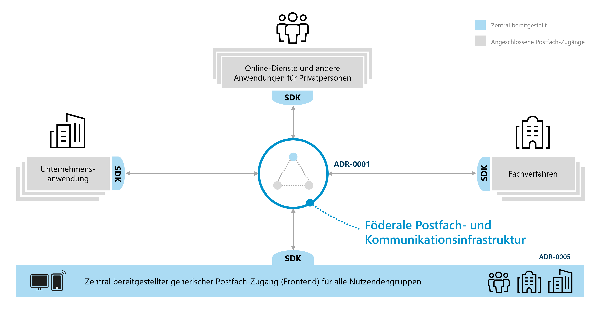
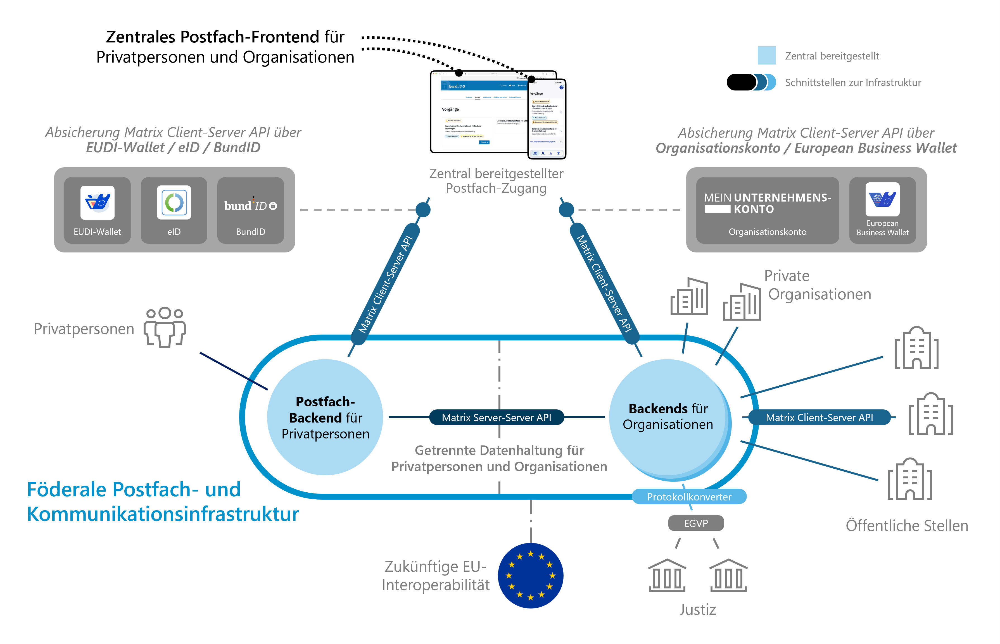
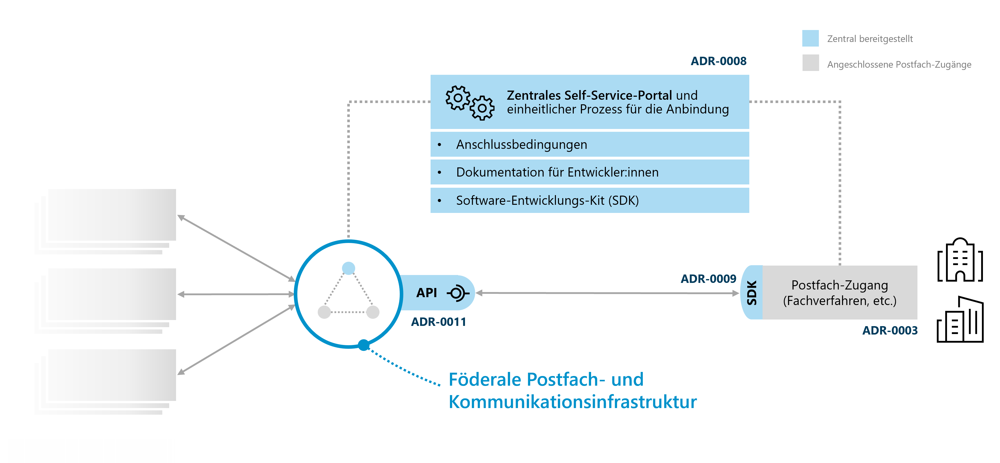

# Zielarchitektur Postfach- und Kommunikationslösungen

Die Zielarchitektur für föderale Postfach- und Kommunikationslösungen der öffentlichen Hand in Deutschland beschreibt eine Konfiguration der einschlägigen Geschäftsprozesse und IT-Systeme in einem anzustrebenden Zielzustand. Die Zielarchitektur dient somit als strukturierendes Rahmenwerk und konkrete Richtlinie für die strategische Planung und Umsetzung einer kongruenten föderalen Postfach- und Kommunikationsinfrastruktur.

## Dokumente im Fokus

Für die aktuelle Phase besonders relevante Dokumente.

| Dokument | Beschreibung |
| -------- | ------------ |
| Dieses Dokument | Überblick und Einstieg in die Zielarchitektur |
| [Architecture Decision Records (ADR)](./Architekturentscheidungen/) | Dokumentation, Diskussion und Bewertung der jeweiligen Optionen atomarer Architekturentscheidungen |
| [Architekturkonzept](./Architekturkonzept/)[^1] | Beschreibung der Methodik, der zugrundeliegenden Annahmen und des Zusammenspiels der verschiedenen Architekturentscheidungen. Bestandteil "02 Konzept Zielarchitektur" des IT-PLR-Beschlusses [B-2025/28-IT](https://www.it-planungsrat.de/beschluss/beschluss-2025-28) |

[^1]: Stand Sommer 2026. Die fortgeschriebenen Dokumente werden demnächst veröffentlicht und sind dann kongruent zu dieser Überblicksseite.

## Weitere Dokumente

Primär zu Dokumentationszwecken oder zum Nachschlagen.

| Dokument | Beschreibung |
| -------- | ------------ |
| [Überblick und Handlungsempfehlungen](../Zielarchitektur/Zusammenfassung/)[^1] | Zusammenfassung von Methodik und Erkenntnissen sowie Handlungsempfehlungen aus Phase 1 des Projekts (Konsolidierung der Anforderungen und Entwurf Zielarchitektur). Bestandteil "Überblick und Handlungsempfehlungen" des IT-PLR-Beschlusses [B-2025/28-IT](https://www.it-planungsrat.de/beschluss/beschluss-2025-28) |
| [Anforderungserhebung und Bestandsanalyse](../Konsolidierte-Anforderungen/Lesefassung/)[^1] | In Phase 1 des Projekts konsolidierte Anforderungen an die Zielarchitektur. Bestandteil "01 Anforderungserhebung und Bestandsanalyse" des IT-PLR-Beschlusses [B-2025/28-IT](https://www.it-planungsrat.de/beschluss/beschluss-2025-28) |
| [Rahmenbedingungen](./Rahmenbedingungen/)[^1] | Für die Zielarchitektur relevante Gesetze, Verordnungen und Beschlüsse. Bestandteil "03 Glossar und Rahmenbedingungen" des IT-PLR-Beschlusses [B-2025/28-IT](https://www.it-planungsrat.de/beschluss/beschluss-2025-28) |
| [Glossar](../Glossar.md)[^1] | Erklärung verwendeter Fachbegriffe. Extrakt und Fortschreibung aus "03 Glossar und Rahmenbedingungen" des IT-PLR-Beschlusses [B-2025/28-IT](https://www.it-planungsrat.de/beschluss/beschluss-2025-28) |
| [Abkürzungsverzeichnis](../Abkürzungen.md)[^1] | Erklärung verwendeter Abkürzungen aus allen Dokumenten. Extrakt, Vereinigung und Fortschreibung aus den Dokumenten des IT-PLR-Beschlusses [B-2025/28-IT](https://www.it-planungsrat.de/beschluss/beschluss-2025-28) |

## Überblick und Vision

Die Zielarchitektur beschreibt eine einheitliche föderale Postfach- und Kommunikationsinfrastruktur für die Kommunikation von Privatpersonen und private Organisationen mit öffentlichen Stellen.

Mit der vorliegenden Zielarchitektur wird eine Konsolidierung der bisher häufig in den jeweiligen fachlichen Kontexten heterogen umgesetzten Kommunikationsszenarien möglich. Für (verwaltungsexterne und -interne) Nutzende wird Kommunikation sowohl zur Laufzeit als auch in der Anbindung an einer Stelle gebündelt, sodass sich eine insgesamt deutlich verbesserte Nutzendenerfahrung ergibt. Auch die technische Komplexität zur flächendeckenden Nutzung und technische Integration der Infrastruktur wird aufgrund der reduzierten technischen Komplexität erheblich reduziert.

Die Infrastruktur hat dabei im [Deutschland- bzw. D-Stack](https://deutschland-stack.gov.de/) die **Natur einer fachlich agnostischen Basiskomponente**. Fachspezifische Prozesse und Funktionen werden nicht in der Infrastruktur verankert (vgl. [ADR-0001](./Architekturentscheidungen/ADR-0001-Querschnittlichkeit-und-Erweiterbarkeit-der-Infrastruktur.md)).

<!--  -->

> *Abbildung 1 zeigt eine einheitliche föderale Postfach- und Kommunikationsinfrastruktur aus Perspektive der diversen Nutzendengruppen: privaten Personen, privaten Organisationen (Unternehmen, Vereine, ...) und öffentlichen Stellen.*

Die Zielarchitektur ist eine **offene, föderierte Client-Server-Architektur mit hybrider Topologie** (vgl. [ADR-0002](./Architekturentscheidungen/ADR-0002-Infrastrukturtopologie.md)). 
 - Die **Server-Bausteine (hier: Postfach-Backends)**, verwalten die Postfächer und Zugriffsberechtigungen, speichern Nachrichten in Ende-zu-Ende verschlüsselter Form und löschen diese bei Bedarf, Loggen und Quittieren relevante Ereignisse und lösen Benachrichtigungen an Nutzer:innen aus (vgl. [ADR-0018](./Architekturentscheidungen/ADR-0018-Nichtabstreitbarkeit-Übermittlung.md)). Die Aufbewahrung bzw. Veraktung erfolgt nicht in den Postfach-Backends, sondern im Machtbereich der Datenbesitzer (vgl. [ADR-1135](./Architekturentscheidungen/ADR-1135-Veraktung-und-Aufbewahrung.md)). Über offene, standardisierte Schnittstellen als auch SDKs können eigene Clients und Server, aber auch Fachverfahren und Unternehmensanwendungen an den Kommunikationsverbund angeschlossen werden (vgl. [ADR-0003](./Architekturentscheidungen/ADR-0003-Bereitstellung-von-Postfach-Zugängen.md), [ADR-0011](./Architekturentscheidungen/ADR-0011-Kommunikationsschicht.md)). Optional können Organisationen (Behörden, Unternehmen, Vereine, Schulen, Gerichte etc.) auch dezentral eigene Backends betreiben und dem föderierten Kommunikationsverbund der Infrastruktur beitreten (vgl. [ADR-0004](./Architekturentscheidungen/ADR-0004-Bereitstellung-von-Postfach-Backends.md) und [ADR-1114](./Architekturentscheidungen/ADR-1114-Getrennter-Betrieb-der-zentralen-Postfach-Backends-nach-Teilnehmendengruppen.md)). Dabei kann z.B. abhängig von der Existenz einer eigenen IT aus unterschiedlichen Betriebsmodellen gewählt werden (vgl. [ADR-1103](./Architekturentscheidungen/ADR-1103-Mehrbenutzer-Organisationen-Betriebsmodelle.md)). Am Verbund beteiligte Teilnehmer:innen müssen verpflichtende Anschlussbedingungen einhalten (vgl. [ADR-1145](./Architekturentscheidungen/ADR-1145-Anschlussbedingungen-und-Foederationskontrolle.md)).
 - Die **Client-Bausteine (hier: Postfachzugänge)** ermöglichen Nutzer:innen den Zugriff auf die Postfächer sowie das Empfangen und Senden von Nachrichten unter Aufrechterhaltung einer Ende-zu-Ende-Verschlüsselung (vgl. [ADR-0012](./Architekturentscheidungen/ADR-0012-Ende-zu-Ende-Verschlüsselungsschicht.md)). Sie bieten Funktionen für das Verfassen, Lesen und Verarbeiten von Nachrichten und ver- bzw. entschlüsseln diese. Dabei können sowohl dedizierte Kommunikationsanwendungen mit grafischer Bedienoberfläche als auch andere IT-Systeme wie Online-Dienste, Fachverfahren oder Unternehmensanwendungen als Postfachzugänge auftreten (vgl. [ADR-0003](./Architekturentscheidungen/ADR-0003-Bereitstellung-von-Postfach-Zugängen.md)). Nutzer:innen können nahtlos zwischen verschiedenen Postfachzugängen wechseln (z. B. einer Smartphone-App und einer Webanwendung). Postfachzugänge können zudem die Erzeugung von Abruf- und Lesebestätigungen ermöglichen (vgl. [ADR-1118](./Architekturentscheidungen/ADR-1118-Abruf-und-Lesebestätigungen.md)).

Die Architektur folgt dem [**Zero-Trust-Ansatz**](https://www.bsi.bund.de/DE/Themen/Unternehmen-und-Organisationen/Informationen-und-Empfehlungen/Zero-Trust/zero-trust.html) und setzt das **Security-by-Design- und Privacy-by-Design-Prinzip** um. Sie basiert auf **modernen, international standardisierten Technologien auf dem aktuellen Stand der Technik**. Dabei setzt sie **Ende-zu-Ende verschlüsselte Kommunikation** mit **modernsten kryptographischen Eigenschaften** um. Die Endpunkte der Verschlüsselung sind Endgeräte (vgl. [ADR-1100](./Architekturentscheidungen/ADR-1100-Bilaterale-Kommunikation-Festlegung-E2EE-Endpunkte.md)) oder Systeme im Machtbereich der Teilnehmenden (vgl. [ADR-1101](./Architekturentscheidungen/ADR-1101-Mehrbenutzer-Kommunikation-Festlegung-E2EE-Endpunkte.md)). Die Prüfung von Anhängen auf Malware kann nach der Entschlüsselung sowohl in den Endgeräten als auch auf Servern der Organisation erfolgen (vgl. [ADR-1130](./Architekturentscheidungen/ADR-1130-Malware-Prüfung.md)).

Konkret setzt die Infrastruktur zwei offene, international etablierte Standards ein: 
- Die offene, dezentralisierte API-Spezifikation **[Matrix](https://spec.matrix.org/latest/) als Kommunikationsschicht** (vgl. [ADR-0011](./Architekturentscheidungen/ADR-0011-Kommunikationsschicht.md)) und 
- perspektivisch das durch den IETF (RFC 9420) standardisierte **[Messaging Layer Security (MLS)]( https://www.rfc-editor.org/rfc/rfc9420.html) Protokoll als Ende-zu-Ende-Verschlüsselungsschicht**. Bis zur Verfügbarkeit einer praxiserprobten Implementierung in Matrix wird übergangsweise das in Matrix eingesetzte Olm/Megolm-Protokoll genutzt (vgl. [ADR-0012](./Architekturentscheidungen/ADR-0012-Ende-zu-Ende-Verschlüsselungsschicht.md)). 

Postfach-Clients prüfen automatisiert die Identität der Kommunikationsparteien nach dem Zero-Trust-Ansatz und stellen die Authentizität des verschlüsselten Kommunikationskanals sicher, sodass Nutzer:innen stets ein hohes Maß an Sicherheit auf dem fachspezifisch festgelegten Vertrauensniveau geboten wird (vgl. [ADR-0013](./Architekturentscheidungen/ADR-0013-Authentizität-in-der-Nachrichtenübermittlung.md), [ADR-0014](./Architekturentscheidungen/ADR-0014-Authentizität-Identität-von-Privatpersonen.md), [ADR-0015](./Architekturentscheidungen/ADR-0015-Authentizität-Identität-öffentlicher-Stellen.md), [ADR-0016](./Architekturentscheidungen/ADR-0016-Authentizität-Identität-privater-Organisationen.md), [ADR-1106](./Architekturentscheidungen/ADR-1106-Fachlicher-Identitaetsnachweis-Matrix-Nachrichtenkontext.md)). Bei Bedarf können Absender:innen Dokumente vor dem Versand **siegeln oder qualifiziert elektronisch signieren (QES)** und als Anhang übermitteln, um Authentizität und Integrität auch ggü. Dritten nachzuweisen [(vgl. ADR-0017)](./Architekturentscheidungen/ADR-0017-Authentizität-und-Integrität-von-Inhalten.md).

Gemäß Zielarchitektur werden **Referenz- bzw. Standardimplementierungen für Clients und Server** zur Verfügung gestellt, sodass sie ohne Einsatz von Drittsoftware verwendet werden kann (vgl. [ADR-0007](./Architekturentscheidungen/ADR-0007-Implementierung-von-Postfach-Backends.md)). Ein **zentral bereitgestellter generischer Postfach-Zugang** und **nach Nutzendengruppe getrennte zentral bereitgestellte Backends** ermöglichen eine einfache Nutzung der Kommunikationsinfrastruktur ohne die Notwendigkeit, eigene Systeme zu betreiben (vgl. [ADR-0005](./Architekturentscheidungen/ADR-0005-Anzahl-und-Zuschnitt-der-zentral-bereitgestellten-Postfach-Zugänge.md), [ADR-0006](./Architekturentscheidungen/ADR-0006-Anzahl-und-Zuschnitt-der-zentral-bereitgestellten-Postfach-Backends.md), angepasst durch [ADR-1114](./Architekturentscheidungen/ADR-1114-Getrennter-Betrieb-der-zentralen-Postfach-Backends-nach-Teilnehmendengruppen.md)). 

 Die Interoperabilität mit anderen Kommunikationssystemen, z.B. auf EU-Ebene, wird über Protokollkonverter unter Aufrechterhaltung der Ende-zu-Ende-Verschlüsselung realisiert [(vgl. ADR-0010)](./Architekturentscheidungen/ADR-0010-Herstellung-von-Interoperabilität-mit-fremden-Systemen-außerhalb-des-Geltungsbereiches-der-Zielarchitektur.md).

<!--  -->

> *Abbildung 2 zeigt die Topologie der föderalen Postfach- und Kommunikationsinfrastruktur unter beispielhafter Darstellung von dezentralen Backend-Systemen inklusive Visualisierung einer beispielhaften Ende-zu-Ende-Verschlüsselung (rot).*

Die Anbindung an die Systeme der Zielarchitektur erfolgt über ein **Self-Service-Portal**, welches auch die Registrierung eigener Backend-Systeme und eine verbindliche, digitale Zustimmung zum Anschlussvertrag mit den **Anschlussbedingungen** realisiert (vgl. [ADR-0008](./Architekturentscheidungen/ADR-0008-Einheitliche-Anbindung-ueber-ein-zentrales-Self-Service-Portal.md), [ADR-1145](./Architekturentscheidungen/ADR-1145-Anschlussbedingungen-und-Foederationskontrolle.md), [ADR-1148](./Architekturentscheidungen/ADR-1148-Onboarding-im-Self-Service-Portal.md)). **Software Development Kits (SDK)** ermöglichen einen einfachen und aufwandsarmen Anschluss (vgl. [ADR-0009](./Architekturentscheidungen/ADR-0009-SDKs-zur-vereinfachten-Anbindung-von-Postfach-Zugängen.md)). Mit diesen Maßnahmen wird ein zügiger Flächenrollout unterstützt, sodass mittelfristige Kosteneinsparungen, Effizienzsteigerungen und deutliche Verbesserungen der Nutzendenerfahrung für alle Zielgruppen schnell zum Tragen kommen.

<!--  -->

> *Abbildung 3 zeigt die Unterstützung des Anbindungsprozesses im Self-Service durch standardisierte API’s, die Bereitstellung eines Self-Service-Portals, die Bereitstellung von Software-Development-Kit, sowie hochwertiger Dokumentationen.*
