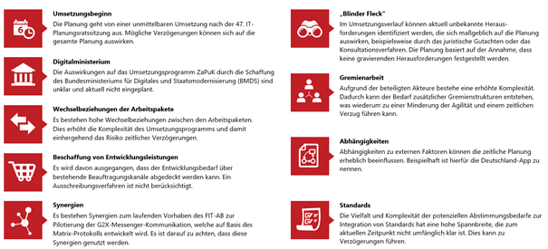
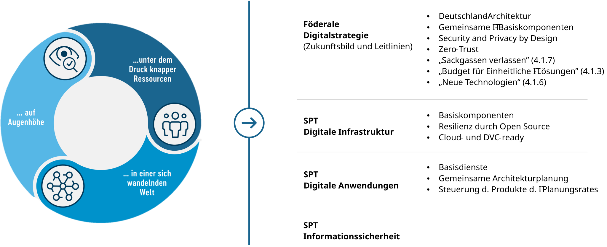

# Föderale Zielarchitektur für Postfach- und Kommunikationslösungen

***Zukunftsweisende föderale Infrastruktur für die Kommunikation zwischen Privatpersonen, privaten Organisationen und öffentlichen Stellen***

**Version 1.0** &ndash; **Stand: 13.05.2025** &ndash; **Überblick und Handlungsempfehlung**

> Dieses Dokument ist die maschinenlesbare Textfassung des vom IT-Planungsrat im PDF-Format verabschiedeten Dokuments ["Überblick und Handlungsempfehlungen" in Version 1.0](./2025-06-26_Beschluss-2025-28_ZaPuK_Überblick-und-Handlungsempfehlungen.pdf). Bei der Überführung wurden redaktionelle Änderungen für eine bessere Lesbarkeit und Anpassung an die openCode-Struktur vorgenommen.

------

## Dokumentübersicht

Das vorliegende Dokument gibt einen Überblick über die Zielarchitektur und beschreibt abgeleitete strategische Handlungsempfehlungen. Die in der folgenden Tabelle aufgelisteten Begleitdokumente geben einen tieferen Einblick in die im vorliegenden Dokument zusammenfassend dargestellten Inhalte.

| Titel | Dokumentart | Inhalt |
| ----- | ----------- | ------ |
| **Überblick und Handlungsempfehlung** | **Klammerdokument** | **Übergreifende Zusammenfassung des Vorhabens und Darstellung strategischer Implikationen** |
| [01 Anforderungserhebung und Bestandsanalyse](../../Konsolidierte-Anforderungen/Lesefassung/) | Begleitdokument | Beschreibung des Vorgehens und der Erkenntnisse aus der Anforderungs- und Bestandsanalyse mit Auflistung der 151 konsolidierten Anforderungen |
| [02 Konzept Zielarchitektur](../Architekturkonzept/) | Begleitdokument | Darstellung der auf die Ziele des Vorhabens ausgerichtete Zielarchitektur zur Umsetzung der identifizierten Anforderungen |
| [03 Glossar und Rahmenbedingungen](../Rahmenbedingungen/) | Begleitdokument | Übersicht über die zentralen Begriffe und Rahmenbedingungen |

## Nutzungsbedingungen

Die Inhalte dieses Dokumentes unterliegen der [Creative Commons Namensnennung 4.0 International Public License (CC BY 4.0)](https://creativecommons.org/licenses/by/4.0/).

------

## Management Summary

Mit Beschluss [B-2024/28-IT](https://www.it-planungsrat.de/beschluss/beschluss-2024-28) des IT-Planungsrates wurde das Föderale IT-Architekturboard beauftragt, eine Zielarchitektur für Postfach- und Kommunikationslösungen im öffentlichen Sektor zu entwickeln. Ziel ist es, der bestehenden komplexen Heterogenität entgegenzuwirken und die daraus folgenden hohen Aufwände für öffentliche Stellen zu reduzieren. Dieser Ergebnisbericht fasst die Ziele des Vorhabens, das Projektvorgehen und die erzielten Ergebnisse zusammen und gibt eine Handlungsempfehlung für die daraus resultierenden nächsten Schritte. Die Zielarchitektur soll bestehende Hürden für die Anbindung abbauen, die Nutzendenerfahrung verbessern, Ende-zu-Ende-Verschlüsselung sowie einen wirtschaftlichen Betrieb fördern und die Zukunftsfähigkeit im Rahmen der "Deutschland-Architektur" sicherstellen.

Die Analyse der bestehenden Postfachlösungen hat gezeigt, dass viele Postfachsysteme ähnliche Funktionen bieten, diese jedoch technisch, juristisch und organisatorisch unterschiedlich implementiert sind. Es fehlt an einer ganzheitlichen Strategie und Governance, die alle Nutzendengruppen einbezieht. Diese Erkenntnisse verdeutlichen das Potenzial zur Konsolidierung. Aus den erhobenen Anforderungen wurde eine Zielarchitektur für eine einheitliche föderale Postfach- und Kommunikationsinfrastruktur entwickelt. Sie unterstützt Ende-zu-Ende-Verschlüsselung mit modernsten kryptographischen Eigenschaften auf den aktuellen Stand der Technik. Sie basiert auf offenen Standards, folgt dem Zero-Trust-Ansatz und implementiert Security-by-Design und Privacy-by-Design auf Basis eines föderierten Architekturmodells.

Es wird empfohlen, ein Umsetzungsprogramm zu initiieren, um die Konsolidierung der Postfach-Frontends voranzutreiben, die Anbindungswege zu vereinheitlichen und ein Backend-System als technisch und organisatorisch eigenständiges Produkt zentral bereitzustellen. Darüber hinaus sind die Weiterentwicklung der eID-Infrastruktur und der V-PKI als kritische Umsysteme notwendig, um den Anforderungen einer modernen digitalen Verwaltung unter dem Zero-Trust-Paradigma gerecht zu werden.

Die Umsetzung der Zielarchitektur wird nicht nur die Nutzendenerfahrung verbessern, sondern auch die Effizienz der öffentlichen Verwaltung steigern und das Vertrauen der Bürger:innen in staatliche Dienstleistungen stärken. Die Empfehlungen des FIT-AB bieten einen klaren Handlungsrahmen für die erfolgreiche Implementierung und Weiterentwicklung einer einheitlichen Postfach- und Kommunikationsinfrastruktur im öffentlichen Sektor.

## 1. Einleitung

Mit Beschluss [B-2024/28-IT](https://www.it-planungsrat.de/beschluss/beschluss-2024-28) des *IT-Planungsrates (IT-PLR) wurde das Föderale IT-Architekturboard (FIT-AB)* beauftragt, eine **Zielarchitektur für Postfach- und Kommunikationslösungen** (nachfolgend: *die Zielarchitektur*) im öffentlichen Sektor zu entwickeln, um der bestehenden komplexen Heterogenität entgegenzuwirken. Aktuell bestehende Lösungen basieren auf unterschiedlichen Technologien und entsprechen teilweise nicht mehr dem aktuellen Stand der Technik, beispielsweise bei eingesetzten Technologie-Stacks oder der teils fehlenden Umsetzung einer Ende-zu-Ende-Verschlüsselung. Ausgelöst durch unterschiedliche gesetzliche Grundlagen sowie gewachsene Strukturen existieren zudem verschiedene technische Lösungen für gleichartige Anwendungsfälle. Diese Heterogenität und eine mangelnde übergeordnete Nutzendenzentrierung und Governance führt für Behörden zu hohen Aufwänden bei der Anbindung und für Privatpersonen sowie private Organisationen zu einer inkonsistenten Nutzendenerfahrung.

Abbildung 1 illustriert die aktuelle Ausgangslage sowie die Vision einer föderalen Zielarchitektur für Postfach- und Kommunikationslösungen.

*Legende: Bu-M &ndash; BundesMessenger, EGVP &ndash; Elektronisches Gerichts- und Verwaltungspostfach, MJP &ndash; Mein Justizpostfach, OZGPP &ndash; OZG-PLUS-Postfach, TI-M &ndash; TI-Messenger (Gesundheitswesen), ZBP &ndash; Zentrales Bürgerpostfach (BundID)*

> *Abbildung 1: Ausgangssituation und Vision*

Die Weiterentwicklung ressortübergreifender Infrastrukturen, orientiert an einer klar definierten Zielarchitektur für Postfach- und Kommunikationslösungen, leistet einen entscheidenden Beitrag zur Realisierung des **Zukunftsbildes** sowie der **Leitlinien** und **Schwerpunktthemen** **(SPT) der föderalen Digitalstrategie** (siehe [Abschnitt 4.3 - Eingliederung in die Föderale Digitalstrategie](#43-eingliederung-in-die-föderale-digitalstrategie)).

Durch die Konsolidierung von Postfachinfrastrukturen soll insbesondere die Komplexität in der föderalen IT-Landschaft reduziert werden. Im Sinne der Ziele des *föderalen IT-Architekturmanagement* (FIT-AM) (vgl. [FIT-AM Rahmenkonzept v2.0](https://www.it-planungsrat.de/fileadmin/beschluesse/2024/Beschluss2024-26_F%C3%B6derales_IT-Architekturmanagement_Rahmenkonzept_Version_2.0.pdf), Kap. 2) begünstigt dies die Wirtschaftlichkeit in der Ressourcennutzung, verbessert die Kohärenz und strategische Beherrschbarkeit der öffentlichen IT und ermöglicht eine zukunftsfähige Weiterentwicklung von Postfach- und Kommunikationsinfrastrukturen auf dem Stand der Technik. Darüber hinaus soll durch das Vorhaben die Anbindung, Authentifizierung und Adressierung von Postfachsystemen homogenisiert werden, um so Anschlusshürden für öffentliche Stellen, Unternehmen und andere Organisationen abzubauen. Mit der Zielarchitektur sollen zudem gezielt Ende-zu-Ende-verschlüsselte Lösungskonzepte gefördert und umgesetzt werden (vgl. [B-2024/28-IT](https://www.it-planungsrat.de/beschluss/beschluss-2024-28), Pkt. 2).

Das Dokument gliedert sich in mehrere, zentrale Kapitel, die einen Überblick über die Entwicklung der Zielarchitektur für Postfach- und Kommunikationslösungen im öffentlichen Sektor bieten. In den Zielen und erwarteten Wirkungen der Konsolidierung werden die zentralen Ziele des Projekts sowie die positiven Auswirkungen dargestellt. [Kapitel 2 (Vorgehensweise und Methodik)](#2-vorgehensweise-und-methodik) beschreibt die Ansätze zur Anforderungs- und Bestandsanalyse sowie die Entwicklung der Zielarchitektur und dem Vorgehen der finanziellen Betrachtung. [Kapitel 3 (Ergebnisse)](#3-ergebnisse) präsentiert die wesentlichen Erkenntnisse aus der Analyse und wesentliche Elemente der entwickelten Zielarchitektur. In [Kapitel 4 (Implikationen und Handlungsempfehlung)](#4-implikationen-und-handlungsempfehlung) werden konkrete Schritte zur Implementierung der Zielarchitektur für Postfach- und Kommunikationslösungen gegeben. Dieses Dokument bietet damit den Gesamtüberblick des Vorhabens. In den Begleitdokumenten werden die Inhalte vertiefend dargestellt.

### 1.1 Eine föderale Zielarchitektur als strategisches Steuerungswerkzeug

Das vorliegende Dokument beschreibt eine Zielarchitektur, d. h. die Konfiguration der einschlägigen Geschäftsprozesse und IT-Systeme in einem anzustrebenden Zielzustand[^1]. Die Zielarchitektur dient als strukturiertes Rahmenwerk und konkrete Richtlinie für die strategische Planung und Umsetzung einer kongruenten föderalen Postfach- und Kommunikationsinfrastruktur. Sie fungiert als Zielbild für die strategische Entscheidungsebene im Einsatz begrenzter Ressourcen und der Initiierung von wirksamen Projekten und Maßnahmen sowie als Blaupause für Produktmanager:innen und IT-Architekt:innen in der Ausgestaltung der einschlägigen Postfach- und Kommunikationslösungen in der föderalen IT, um den angestrebten Zielzustand effizient zu erreichen. Zudem unterstützt die Zielarchitektur die planvolle Umsetzung der föderalen Digitalstrategie, fördert die Integration und Interoperabilität zwischen IT-Systemen im öffentlichen Sektor und berücksichtigt moderne Nutzendenbedürfnisse, während sie eine konkrete Grundlage für Innovation und kontinuierliche Verbesserung schafft. Mit der Zielarchitektur hat das FIT-AM ein strategisches, planerisches und technisches Steuerungswerkzeug geschaffen. Die Kontextdarstellung in Abbildung 2 dient einer inhaltlichen Einordnung und Abgrenzung der Architektur.

> *Abbildung 2: Kontext der Zielarchitektur*

Die Zielarchitektur bezieht sich auf Postfachsysteme und alle konzeptionell verwandten Kommunikationslösungen (z. B. Messenger-Dienste) zur Abwicklung von elektronischem Schriftverkehr, im Sinne einer meist natürlichsprachlichen Kommunikation in unstrukturierter, teilstrukturierter oder strukturierter Form, sowohl asynchron als auch in Echtzeit, inklusive etwaiger Anhänge. Dieser Schriftverkehr erfolgt zwischen Verfahrensbeteiligten Privatpersonen und privaten Organisationen und zuständigen öffentlichen Stellen und erfolgt sowohl mittels fachspezifischer IT-Lösungen (Fachverfahren) als auch generische Ausführungsumgebungen wie Webbrowser und Smartphones.

Kommunikationsinfrastrukturen zur ausschließlichen Übermittlung strukturierter Daten zwischen Maschinen sind nicht Teil des Betrachtungsgegenstands obwohl mögliche Synergieeffekte zu bestehenden Infrastrukturen identifiziert wurden. Die föderale Zielarchitektur für Postfach- und Kommunikationslösungen behandelt jedoch nicht die Konsolidierung dieser Infrastrukturen. Die Zielarchitektur formuliert zudem ggf. Anforderungen an die Weiterentwicklung von außerhalb ihres Geltungsbereiches liege, funktional eng verknüpfte Querschnitts- und Basiskomponenten (bspw. die eID-Infrastruktur, die V-PKI, die EUDI-Wallet etc.).

### 1.2 Ziele und erwartete Wirkung der Konsolidierung

Die folgenden fünf Ziele werden als zentral für das Projekt angesehen. Jedes Ziel strebt eine spezifische Wirkung auf die Konsolidierung an.

- **Hürden für den Anschluss abbauen**: Vereinheitlichung der Anbindungsprozesse, insb. für öffentliche Stellen und private Organisationen, Reduktion der Schnittstellenkomplexität, und Verwendung international standardisierter, offener Schnittstellen (API), unterstützt durch ein Software Development Kit (SDK) zur einfachen Anbindung.
- **Wirtschaftlichen Betrieb durch Konsolidierung fördern**: Vermeidung heterogener Technologie-Stacks, komplexer Governance-Strukturen und multipler proprietärer Schnittstellen zur Erhöhung der Flexibilität und Beherrschbarkeit der Architektur.
- **Förderung von Ende-zu-Ende-Sicherheit**: Gewährleistung der Integrität und Vertraulichkeit der Kommunikation auf dem Stand der Technik, insb. durch den Einsatz von Ende-zu-Ende-verschlüsselten Lösungskonzepten, moderner Kryptografie und Umsetzung des Zero-Trust-Ansatzes.
- **Nutzendenerfahrung verbessern**: Moderne und vereinfachte Nutzung, bei der Teilnehmende ressortübergreifend nur ein Postfach (ein Zugang zur Infrastruktur) benötigen, welches die Kommunikation mit der öffentlichen Hand bei Bedarf auch mobil, auf mehreren Endgeräten und in Echtzeit ermöglicht.
- **Zukunftsfähige Weiterentwicklung auf dem Stand der Technik ermöglichen**: Die Zielarchitektur ermöglicht kontinuierliche Innovationen durch Anpassung an neue Technologien und Kryptografische Verfahren (vgl. Krypto-Agilität) sowie neue und geänderte Nutzenden-Anforderungen.

Das Projekt fügt sich nahtlos in die strategischen Zielvorgaben der **Föderalen Digitalstrategie** ein. Die Integrierbarkeit in die "**Deutschland-Architektur**" und **EU-Lösungen** wie **Single Digital Gateway (SDG)** und **EUDI-Wallet** wird vorbereitet, um mehrfach identische Lösungen zu verhindern. Schnittstellen zu einer übergreifenden Digitalisierungsplattform werden berücksichtigt, und die Anforderungen an Umsysteme werden definiert, um die Interoperabilität sicherzustellen.

## 2. Vorgehensweise und Methodik

Der gewählte methodische Ansatz gliedert sich in mehrere Phasen, die eine systematische Erhebung und Analyse der Anforderungen sowie die strukturierte Entwicklung der Zielarchitektur und des weiteren Vorgehens ermöglichen. Die Methodik kombiniert unter anderem Dokumentenanalysen, qualitative Interviews, Workshops und eine öffentliche Konsultation, um ein ganzheitliches Bild der aktuellen Situation und der zukünftigen Anforderungen zu erhalten. Auf deren Grundlage wurde die Zielarchitektur mithilfe etablierter Methoden und Wegekreuze der Architekturentwicklung[^2] iterativ erarbeitet. Dieser integrative Ansatz wurde gewählt, um sicherzustellen, dass alle relevanten Perspektiven berücksichtigt werden und die entwickelte Zielarchitektur den Bedürfnissen der Nutzenden entspricht. Abbildung 3 zeigt das Vorgehen in Form einer Prozessübersicht.

*Legende: Bu-M &ndash; BundesMessenger, EGVP &ndash; Elektronisches Gerichts- und Verwaltungspostfach, MJP &ndash; Mein Justizpostfach, OZGPP &ndash; OZG-PLUS-Postfach, TI-M &ndash; TI-Messenger (Gesundheitswesen), ZBP &ndash; Zentrales Bürgerpostfach (BundID)*

> *Abbildung 3: Prozessübersicht "Analyse - Erhebung - Zielarchitektur"*

Durch diesen methodisch getriebenen Ansatz wird sichergestellt, dass die Entwicklung der Zielarchitektur empirisch belastbar ist und sowohl den aktuellen Anforderungen als auch den zukünftigen Herausforderungen im Bereich des elektronischen Schriftverkehrs mit öffentlichen Stellen gerecht wird. Die gewählte Methodik fördert und gewährleistet die Mitwirkung der  
Stakeholder, ermöglicht eine fundierte Entscheidungsfindung und trägt zur Schaffung einer zukunftsfähigen und benutzerfreundlichen Infrastruktur bei.

### 2.1 Analyse der Bestandslösungen

Eine umfassende Analyse der Bestandslösungen bildet die Grundlage für eine anforderungsorientierte und fundierte Architekturarbeit. Hierbei wurden deren **Produktdokumentationen**, **regulatorische Rahmenbedingungen** und **bestehende Strategien und Konzepte** auf ihre Anforderungen untersucht sowie technologische und architektonische Merkmale und Vorgaben geprüft. Im Rahmen der Anforderungserhebung wurden in strukturierten Interviews mit relevanten Stakeholdern, darunter Betreiber bestehender Postfachlösungen sowie Fachexpert:innen, zusätzliche Anforderungen erfasst und validiert.

### 2.2 Erhebung und Konsolidierung

Die erhobenen und zunächst unkonsolidierten Anforderungen durchliefen einen Konsolidierungsprozess, in dem sie thematisch strukturiert und als konsolidierte Anforderungen in Einklang mit definierten Qualitätskriterien abgeleitet wurden. Dieser Konsolidierungsschritt war entscheidend, um redundante Funktionen zu identifizieren und die Basis für eine konsolidierte Lösung zu schaffen.

### 2.3 Architekturentwicklung

Die Entwicklung der Zielarchitektur erfolgte in zwei Schritten: Zunächst wurde eine **Greenfield-Architektur** entworfen, welche den Problemraum der metaphorischen "grünen Wiese" betrachtet, also auf dem aktuellen Stand der Technik basiert und bestehende Postfachlösungen und andere strukturelle Kontextfaktoren (juristisch, technisch, organisatorisch etc.) nicht als unmittelbar limitierende Randbedingungen berücksichtigt. Anschließend muss diese Architektur als Teil eines Umsetzungsprogramms im Rahmen der **Transitionsplanung** gemeinsam mit den Fachexpert:innen der Bestandslösungen zu einer **Brownfield-Architektur** erweitert werden, welche geeignet ist, unter faktischen Rahmenbedingungen umgesetzt zu werden. Dort werden die bestehenden Systeme und deren Transitions- und Migrationswege konkret betrachtet. Diese zweistufige Herangehensweise gewährleistet, dass sowohl innovative Ansätze als auch praktische Umsetzungsaspekte berücksichtigt werden, was die Wahrscheinlichkeit einer erfolgreichen Implementierung erhöht.

### 2.4 Handlungsfelder und Architekturentscheidungen

Entlang verschiedener inhaltlicher Themen- und Handlungsfeldern wurden zu Lösungs- oder Problemräumen Architekturentscheidungen systematisch hergeleitet und dokumentiert. Dafür wurden **Architecture Decision Records (ADRs)** erstellt, um die strukturierte Betrachtung und Bewertung aller wesentlichen Gestaltungsoptionen sowie Begründung und Nachvollziehbarkeit der getroffenen Entscheidungen zu gewährleisten. Diese Dokumentation ist wichtig, um Transparenz zu schaffen und zukünftige Anpassungen der Architektur zu erleichtern.

Darüber hinaus wurden **weitere Handlungsfelder** identifiziert, die unter der architektonischen Relevanzschwelle einer föderalen Zielarchitektur liegen oder sich nur auf einzelne Systembausteine beziehen und für die im Rahmen der Lösungsarchitektur somit noch eine konkrete Ausarbeitung des Lösungsansatzes erfolgen muss.

### 2.5 Finanzielle Betrachtung und Planung des weiteren Vorgehens

Auf Basis der finanziellen Betrachtung wurde eine, angesichts des aktuellen Konzeptionsstandes, bestmögliche **Einschätzung** zu den **finanziellen Auswirkungen** der Umsetzung der Zielarchitektur getroffen.

In einem ersten Schritt wurden **vergleichbare Bestandslösungen** identifiziert und analysiert, um die durchschnittlichen Weiterentwicklungs- und Betriebskosten sowie die maßgeblichen Einflussfaktoren zu ermitteln.

In einem zweiten Schritt wurde ein detailliertes Vorgehensmodell für die programmhafte Umsetzung der Zielarchitektur erstellt, welches eine **Phasen- und Arbeitspaketplanung** sowie eine **Aufwands- und Zeitplanung** umfasst. Ein **Kalkulationswerkzeug** wurde entwickelt, um sowohl die **einmaligen, an zentraler Stelle anfallenden Kosten** für den **Aufbau** und die **Einführung der Zielarchitektur** als auch die **laufenden Betriebskosten** zu schätzen. Diese Methodik ermöglichte ebenfalls die Kostenschätzung für die **Weiterentwicklung und Folgeprojekte**.

Das angewandte Vorgehen gewährleistet eine hinreichend fundierte Bewertung der finanziellen Auswirkungen, wodurch eine solide Grundlage für die Entscheidungsfindung geschaffen wurde, insbesondere für die kommende Phase "Transitionsplanung und Validierung".

### 2.6 Stakeholderbeteiligung als Querschnittsaufgabe

Die Stakeholderbeteiligung spielt eine zentrale Rolle im Entwicklungsprozess und umfasst sowohl die Stakeholderanalyse als auch die Durchführung von Workshops und eine öffentliche Konsultation.

Die **Stakeholderanalyse** identifizierte die relevanten Interessengruppen und deren spezifischen Bedürfnisse, um sicherzustellen, dass die Interessen aller Beteiligten in die Entwicklung einfließen. Im Verlauf des Projekts wurden mehrere **Workshops und Interviews** organisiert, um zentrale Handlungsfelder zu diskutieren und wertvolles Feedback zu sammeln. Die Rückmeldungen aus diesen Veranstaltungen wurden strukturiert ausgewertet und flossen in die weitere Entwicklung der Zielarchitektur ein.

Zusätzlich wurde ein **Konsultationsprozess auf der openCode-Plattform** initiiert, um eine breitere Beteiligung der Öffentlichkeit zu gewährleisten. Hierbei wurden die Projektergebnisse zur Kommentierung bereitgestellt, sodass alle relevanten Akteure ihre Perspektiven und Anregungen einbringen konnten. Dieser offene Konsultationsprozess stärkt die Transparenz und das Vertrauen in die Projektentwicklung und stellt sicher, dass die Zielarchitektur den Bedürfnissen aller Beteiligten gerecht wird.

## 3. Ergebnisse

Die folgenden Abschnitte fassen wesentliche Ergebnisse aus den Projektphase **Anforderungs- und Bestandsanalyse**, Konzeption der **Zielarchitektur** sowie **finanzielle Implikationen** zusammen. Für weiterführende Details sei auf die Begleitdokumente sowie die Referenzen auf das [Arbeitsverzeichnis auf der Plattform openCode](https://gitlab.opencode.de/it-planungsrat/fit-ab/zapuk/) verwiesen.

### 3.1 Anforderungs- und Bestandsanalyse

Die Anforderungen an die Zielarchitektur wurden in einem strukturierten multimethodischen Analyseprozess systematisch erhoben, strukturiert, konsolidiert, qualitätsgesichert und abgestimmt. Aus zunächst ca. **900 unkonsolidierten Anforderungen** wurden durch einen Konsolidierungsprozess ca. **150 konsolidierte Anforderungen für die Zielarchitektur** abgeleitet. Die im Anforderungsanalyseprozess einbezogenen Bestandslösungen und Best-Practices (auch aus dem EU-Ausland) wurden darüber hinaus hinsichtlich ihrer **Fähigkeiten** sowie ihren **architektonischen** und **technologischen Merkmalen** analysiert und in **Steckbriefen** dokumentiert, um diese Erkenntnisse in die Architekturarbeit einfließen lassen zu können.

Darüberhinausgehende **wesentliche analytische Erkenntnisse** aus der Anforderungs- und Bestandsanalyse werden im Folgenden zusammenfassend dargestellt:

- **Alle Lösungen setzen überwiegend identische Fähigkeiten um:** Alle Lösungen bieten ähnliche grundlegende Funktionsmerkmale zum Austausch von elektronischem Schriftverkehr. Dies bedeutet, dass in der Postfachlandschaft aktuell zahlreiche funktional ähnliche Lösungen parallel entwickelt und betrieben werden.

- **Vergleichbare Fähigkeiten sind heterogen umgesetzt und strukturell verankert:** Ähnlich geartete Fähigkeiten werden in bestehenden Postfach- und Kommunikationslösungen unterschiedlich umgesetzt. Sie unterscheiden sich insbesondere aufgrund der heterogenen und historisch gewachsenen technischen, juristischen und organisatorisch-strukturellen Lagen innerhalb der und zwischen den verschiedenen Bereichen des staatlichen Handelns. Exemplarisch konnten folgende Arten und Quellen der Heterogenität identifiziert werden:

    - **Rechtliche Rahmenbedingungen wirken auf die Systemgestaltung ein:** Rechtsvorschriften geben teils Fähigkeiten sowie Architektur- und Technologieentscheidungen vor. Eine über alle staatlichen Institutionen reichende Gesamtstrategie ist ohne Anpassung der aktuellen Rechtsgrundlagen rechtlich vermutlich nicht abbildbar.
    - **Governance- und Organisationsstrukturen sind heterogen:** Bestehende Lösungen werden teils im Rahmen entkoppelter Strukturen finanziert, gesteuert, technisch und planerisch weiterentwickelt und betrieben.
    - **Nutzendenorientierung ist kontextuell beschränkt:** Meist betrachtet jede Bestandslösung Nutzende isoliert im Kontext ihrer jeweiligen fachlichen Perspektive. Dem Umstand, dass dieselbe natürliche Person oder Organisation in unterschiedlichen Situationen in unterschiedlichen fachlichen Rollen auftritt (z. B. als Antragsteller:in, Kläger:in, Patient:in, Mitarbeiter:in, ...) wird nur selten Rechnung getragen.
    - **Lösungen sind architektonisch und technologisch heterogen:** Die historisch und planerisch entkoppelte Genese der bestehenden Lösungen führte zu Technologie- und Architekturentscheidungen, die zum jeweiligen Entwicklungszeitpunkt den gegebenen Anforderungen und dem Stand der Technik entsprachen, in der heutigen Gesamtschau der IT-Landschaft aber zu Komplexität führen. Beispiele sind dezentrale vs. zentrale Architekturen oder Identitäten, der Schnitt von Fähigkeiten auf Architekturbausteine sowie die Umsetzung der Verschlüsselung oder der Schnittstellen.

- **Unterschiede liegen in konkreten Funktionalitäten:** Neben zahlreichen gleich oder ähnlich gearteten Fähigkeiten setzen einzelne untersuchte Lösungen aber auch individuelle Fähigkeiten um. Funktionspostfächer, Adressierungsansätze oder Zustellregeln sind Beispiele dafür.

- **Unzureichende Adressierung zukünftiger Herausforderungen:** Die Föderale Digitalstrategie benennt die Herausforderungen und Rahmenbedingungen einer zukunftsweisenden digitalen Infrastruktur (Entwicklung und Eingliederung in eine Deutschland-Architektur, konzeptionelle Berücksichtigung von Security- und Privacy-by-Design, Resilienz, Cloud-Fähigkeit, Interoperabilität mit EU-Lösungen etc.). In der föderalen Digitalstrategie genannte, ambitionierte Herausforderungen werden bisher von den Lösungen nicht umfänglich und einheitlich adressiert. Dies bekräftigt die Notwendigkeit einer gleichsam ambitionierten strategisch-architektonischen Planung durch eine gemeinsame Zielarchitektur.

### 3.2 Zielarchitektur

Die Zielarchitektur beschreibt eine einheitliche föderale Postfach- und Kommunikationsinfrastruktur für die Kommunikation von Privatpersonen und private Organisationen mit öffent-lichen Stellen. Diese hat in der föderalen IT die Natur einer fachlich agnostischen Querschnitts- bzw. Basiskomponente und ist modular um querschnittliche Funktionen erweiterbar. Fachspezifische Prozesse und Funktionen werden nicht in der Infrastruktur verankert.

Die Zielarchitektur ist eine **offene, föderierte Client-Server-Architektur** mit einer hybriden **Mischung aus zentral und dezentral bereitgestellten Elementen**. Diese stellt **Standard-  
implementierungen** für Clients und Server zur Verfügung, sodass sie **niederschwellig** ohne Einsatz von Drittsoftware verwendet werden kann. Ein zentral bereitgestellter generischer Postfach-Zugang (Frontend) und ein zentral bereitgestelltes Backend für alle Nutzendengruppen ermöglicht eine einfache Nutzung der Kommunikationsinfrastruktur ohne die Notwendigkeit, eigene Systeme zu betreiben. Über **offene, standardisierte Schnittstellen** können eigene  
Clients und Server wie Fachverfahren und Unternehmensanwendungen an den Kommunikationsverbund angeschlossen werden. Dadurch können die Betreiber dieser Systeme bei Bedarf ein **hohes Maß an digitaler Souveränität** erreichen. Die Anbindung an die Systeme der Zielarchitektur erfolgt über ein Self-Service-Portal, welches auch die Registrierung eigener Backend-Systeme und eine rechtssichere, digitale Zustimmung zu Anschlussbedingungen realisiert. *Software Development Kits (SDK)* ermöglichen einen einfachen und aufwandsarmen Anschluss.

Die Architektur folgt dem **Zero-Trust**-Ansatz[^3] und setzt das **Security-by-Design-** und **Privacy-by-Design-Prinzip** um. Sie basiert auf modernen Technologien auf dem aktuellen Stand der Technik. Dabei setzt sie **Ende-zu-Ende-verschlüsselte** Kommunikation mit **modernsten kryptographischen Eigenschaften** um. Konkret setzt die Infrastruktur insbesondere auf zwei offene, international etablierte Standards: Das Kommunikationsprotokoll **Matrix**[^4] als Kommunikationsschicht und den Internet-Standard **Messaging Layer Security (MLS)**[^5] zur Realisierung der Ende-zu-Ende-Verschlüsselung. Einen Überblick dazu bietet Abbildung 4.

> *Abbildung 4: Topologie einer föderalen Postfach- und Kommunikationsinfrastruktur*

Alle wesentlichen Eigenschaften der Architektur sind in **[Architekturentscheidungen](../Architekturentscheidungen/) dokumentiert**. Dies betrifft die Topologie des Gesamtsystems, die Offenheit für Erweiterungen durch Dritte, die verwendeten Basistechnologien und Standards sowie die Mechanismen zur Authentifizierung der Nutzenden und zur Nichtabstreitbarkeit von Nachrichtenübermittlungen.

Im Rahmen der Brownfield-Betrachtung werden **Transitionsansätze** und mögliche **Integrationsszenarien** für den Umgang mit den Bestandslösungen vorgeschlagen. Die konkrete Ausarbeitung erfordert eine detaillierte Kenntnis der Bestandslösungen und muss **in Zusammenarbeit mit den Eigentümern** der Bestandslösungen erfolgen.

### 3.3 Finanzielle Implikation

Im Folgenden werden die Ergebnisse der finanziellen Betrachtung dargestellt, einschließlich der laufenden Kosten bestehender Lösungen und die geschätzten Kosten einer neuen Zielarchitektur. Die Nutzenbetrachtung der Zielarchitektur ist dem [Abschnitt 1.2 - Ziele und erwartete Wirkung der Konsolidierung](#12-ziele-und-erwartete-wirkung-der-konsolidierung) zu entnehmen.

#### 3.3.1 Laufende Kosten bestehender Lösungen

Um mögliche Potenziale des Vorhabens zu identifizieren und Ableitungen für die zukünftige Zielarchitektur zu treffen, wurden Kostenstrukturen verschiedener Postfach- und Kommunikationslösungen auf Bundes- und Landesebene analysiert. Dabei wird deutlich, dass der Korridor anfallender Kosten breit ist, insbesondere in Abhängigkeit folgender Treiber: (1) Anzahl der Nutzenden, (2) Funktionsumfang der Lösung, (3) Betriebsmodell, (4) Umfang von Updates und Wartungsbedarf, (5) Speicherbedarf und (6) Skalierbarkeit.

> **Je Lösung liegen die jährlichen Kosten im Betrieb zwischen 500 Tsd. € bis 2,5 Mio. € und für die Weiterentwicklung, Wartung und Pflege zwischen 1 bis 2 Mio. €.**

Der Kostenkorridor basiert primär auf verfügbaren Zahlen auf Landesebene. Zahlen von Systemen auf Bundesebene fließen zum aktuellen Zeitpunkt nur bedingt ein.

Betrachtet wurden dabei ausschließlich laufende Kosten, nicht aber die Einführung der jeweiligen Lösung bei einer betroffenen Organisation. Erfahrungsgemäß ist hier die Kostenspreizung noch breiter und in Abhängigkeit der Schnittstellenfunktionalität (a) der einzuführenden Lösung und (b) den anzubindenden Verfahren (Basis-, Querschnitts-, Fachverfahren), (c) dem gewünschten Grad an Automatisierung und (d) der Reife von Prozessen und Rollen in der Organisation. Ohne eine tiefergehende Betrachtung ist valide Aussage zum aktuellen Zeitpunkt nicht möglich. Diese bietet sich mit weiterer Ausgestaltung der Zielarchitektur an, um dann anhand analoger Lösungen auf konkrete Erfahrungswerte zurückzugreifen. Je nach Richtungsentscheidung sollten dann auch zu konsolidierende Lösungen umfassender berücksichtigt werden, um Einsparpotenziale im Zeitverlauf konkret beziffern zu können.

#### 3.3.2 Einmalige Kosten zum Aufbau und zur Einführung der Zielarchitektur

Um die Kosten zum Aufbau der Zielarchitektur zu konkretisieren, wurde ein Vorgehensmodell erarbeitet (vgl. [Abschnitt 4.2 - Transition und weiteres Vorgehen](#42-transition-und-weiteres-vorgehen)).

Erwartbare Kosten zum Aufbau der Zielarchitektur spiegeln sich in den Arbeitspaketen des Vorgehensmodells wider. Unter Berücksichtigung der genannten Einflussfaktoren (vgl. Abbildung 6) wurden mithilfe des erstellten Kalkulationswerkzeugs die zu erwartenden Kosten antizipiert.

> **Die geschätzten Kosten für die kommende Phase 2 "Transitionsplanung und Validierung" liegen bei ca. 1,7 Mio. € für externe Dienstleister und Sachmittel. Für intern anfallende Aufwände werden auf föderaler Ebene voraussichtlich drei Vollzeitäquivalente (VZÄ) benötigt, davon 1,5 VZÄ für die Rolle des/der IT-Architekt:in.**

Die kostenseitigen Schwerpunkte liegen in dieser Phase bei personellen Aufwänden für die weitere Konkretisierung der Zielarchitektur und den notwendigen Beteiligungsprozessen.

Die Kosten der anschließenden Phase 3 "Transition und Migration" sind maßgeblich abhängig von den Festlegungen der vorherigen Phase und können somit zum aktuellen Zeitpunkt nicht valide geschätzt werden. Es ist vorgesehen in Phase 2 eine Validierung und Konkretisierung der weiteren Zeitplanung vorzunehmen, als auch die weiteren Umsetzungskosten zu konkretisieren.

#### 3.3.3 Jährliche Kosten für den laufenden Betrieb sowie Kosten für Folgeprojekte und Skalierung

Die jährlichen Kosten können zum aktuellen Stand ausschließlich auf Basis der Analyse bestehender Lösungen heuristisch angenommen werden. Die geschätzten langfristigen jährlichen Kosten für die zentral bereitgestellten Bausteine der Zielarchitektur liegen voraussichtlich für den laufenden Betrieb zwischen 1,8 Mio. € bis 2,3 Mio. € und für die Weiterentwicklung zwischen 1,5 Mio. € bis 2 Mio. €. Die Höhe der Kosten ist hierbei ebenso maßgeblich unter dem Einfluss der oben genannten Treiber. Die geschätzten Kosten für Folgeprojekte liegen bei 1 Mio. € bis 1,3 Mio. €.

#### 3.3.4 Einschätzung

Trotz der nicht genau zu definierenden finanziellen Aufwände im gesamten weiteren Verlauf, empfiehlt es sich das Programm weiterzuführen und mit der Phase der "Transitionsplanung und Validierung" zu beginnen. Die Potenziale, insbesondere die strategische Bedeutung des Projekts, die Verbesserung der Nutzendenakzeptanz sowie die mittelfristig zu erwartenden Kostenvorteile einer Konsolidierung zahlreicher Lösungen, überwiegen hierbei.

## 4. Implikationen und Handlungsempfehlung

Das föderale IT-Architekturboard (FIT-AB) befürwortet die Etablierung einer **einheitlichen Postfach- und Kommunikationsinfrastruktur anhand der Zielarchitektur Postfach- und Kommunikationslösungen**. Diese Konsolidierung der Postfach- und Kommunikationslösungen sorgt für eine nachhaltige Verbesserung der Nutzendenerfahrung und versetzt IT-Dienstleister und Entwickler:innen in die Lage, ihre eigenen Systeme aufwandsarm im Self-Service und über moderne Standards und Schnittstellen an eine gemeinsame, föderal einheitliche Postfach- Kommunikationsinfrastruktur anzubinden. Um die oben genannten Ziele effektiv zu erreichen und die Herausforderungen der bestehenden heterogenen IT-Landschaft systematisch, langfristig und auf die Zielarchitektur ausgerichtet anzugehen, wird empfohlen, ein Umsetzungsprogramm zu initiieren.

Im Folgenden werden die vier wesentlichen Implikationen der Zielarchitektur für die föderale IT-Architektur beschrieben. Diese zielen darauf ab, die Herausforderungen der bestehenden Systeme systematisch anzugehen und eine zentrale, skalierbare Lösung zu schaffen, die den Anforderungen einer modernen, digitalen Verwaltung gerecht wird. Durch die Reduzierung der Anzahl von föderalen IT-Komponenten und die Schaffung klar definierter Governance-Strukturen wird eine effiziente und wartungsarme Betriebsführung und zukunftsfähige Weiterentwicklung ermöglicht. Die Empfehlungen umfassen konkret die (1) Konsolidierung der Postfach-Frontends, die (2) Vereinheitlichung der Anbindungswege und -prozesse, (3) den Betrieb zen-tral bereitgestellter Backend-Systeme sowie die (4) Weiterentwicklung kritischer Umsysteme.

Darüber hinaus wird für die Transition und das weitere Vorgehen ein Vorgehensmodell vorgeschlagen, das die Umsetzung der Zielarchitektur in mehreren Phasen strukturiert und diese als Teil der "Deutschland-Architektur" im Sinne der föderalen Digitalstrategie ausrichtet.

Diese Maßnahmen sind nicht nur entscheidend für die Verbesserung der Nutzendenerfahrung, sondern auch für die **langfristige Effizienz und Zukunftsfähigkeit** der digitalen Infrastruktur der öffentlichen Verwaltung.

### 4.1 Implikationen für die föderale IT-Architektur

Aus der föderalen Zielarchitektur Postfach- und Kommunikationslösungen ergeben sich, aufbauend auf den Erkenntnissen der empirischen Anforderungs- und Bestandsanalyse, folgende wesentliche Implikationen für die Ausgestaltung der föderalen IT-Architektur und des IT-Produktportfolios des IT-Planungsrates und des Bundes:

#### 4.1.1 Konsolidierung zentral bereitgestellter Postfach-Frontends

Aus Sicht von Privatpersonen und privaten Organisationen ergibt sich derzeit aufgrund der getrennten Entwicklung und Bereitstellung der genannten Postfach-Zugänge eine heterogene Nutzendenerfahrung. Parallele Entwicklung, Wartung und Betrieb von funktional sehr ähnlichen Software-Lösungen durch die öffentliche Hand führt zu einer ineffektiven und ineffizienten Ressourcenverwendung und zu ungerechtfertigter Komplexität in der IT-Landschaft, was deren Beherrschbarkeit, Verständlichkeit und Zukunftsfähigkeit beeinträchtigt. Durch die Konsolidierung sind daher qualitative Verbesserungen und ein effektiverer Einsatz von Ressourcen zu erwarten. Im Sinne eines Government-as-a-Plattform Ansatzes sind wenige und gut strukturierte Zugangswege zu digitalen Leistungen des Staates für Privatpersonen und private Organisationen zudem leichter zu überblicken und sind vertrauensstiftend (vgl. ADR-0005: "Anzahl und Zuschnitt der zentral bereitgestellten Postfach-Zugänge")[^6].

> **Die Zusammenführung der Frontends der bestehenden Postfachzugänge ZBP (BundID-Postfach), MJP, OZG-PLUS-Postfach und Postfach 2.0 in einem neuen Produkt unter zentraler Pflege und Weiterentwicklung wird daher empfohlen.**

Eine zentrale Entwicklung (in einer einzigen Code-Basis) unterstützt die Umsetzung einer einheitlichen User Experience und eines einheitlichen Designs der Standard-Zugänge für verschiedene Nutzendengruppen (insb. relevant für Personen in Doppelrollen wie z. B. Kleinunternehmer:innen). Abweichende Anforderungen von Organisationen gegenüber Privatpersonen (z. B. Funktionspostfächer, Rollen- und Rechte-Management, Funktion für Vertretung, etc.) werden marktüblich durch zielgruppengerechte (De-)Aktivierung einzelner Funktionen in demselben Softwareprodukt realisiert. Bestehende Fähigkeiten zur Identifizierung und Authentifizierung werden von Postfach-Funktionen entkoppelt. Identitätsprovider, wie BundID und Unternehmenskonto, kommen also weiterhin als Identitätsprovider für den Login ins Postfach zum Einsatz. Die Konsolidierung der Softwareentwicklung erfordert eine neue Governance-Struktur im Sinne eines neu geschaffenen Produkts des IT-Planungsrates[^7].

#### 4.1.2 Vereinheitlichung der Anbindungswege und -prozesse

Aufgrund der aktuell parallelen Bereitstellung mehrerer Lösungen müssen Zielgruppen mitunter mehrere Postfachsysteme parallel nutzen. Öffentliche Stellen müssen so zur Nutzung der verschiedenen Bestandssysteme derzeit jeweils einen Anbindungsprozess pro Bestandssystem durchlaufen. Die Anbindung von Fachverfahren an verschiedene Infrastrukturen erfordert zudem aufgrund der heterogenen Schnittstellentechnologien einen erheblichen technischen Anbindungs- und Wartungsaufwand.

> **Die Schaffung eines gesamtheitlichen Anbindungsweges für alle Nutzendengruppen in Form eines übergreifend nutzbaren Self-Service-Portals zur Vereinfachung des Anbindungsprozesses sowie der Bereitstellung eines SDKs wird daher empfohlen.**

Im Rahmen des Produktmanagements von FIT-Connect wurden bereits Erfahrungen mit der Nutzung einer ZBP-Anbindung für öffentliche Stellen gesammelt. Nach der Registrierung im Self-Service-Portal können diese Stellen aktuell das FIT-Connect-SDK verwenden, um Nachrichten an das ZBP zu übermitteln. Insbesondere für die Zielgruppen der öffentlichen Stellen und Unternehmen bietet es sich an, diesen Ansatz konsequent weiterzuverfolgen. Im Rahmen der OZG-Umsetzung empfangen öffentliche Stellen bereits Anträge über die FIT-Connect-Infrastruktur und haben daher die Anbindungsprozesse des Produktes FIT-Connect bereits durchlaufen. Die Etablierung von FIT-Connect, als zentralen Anbindungsweg reduziert organisatorische und technische Anbindungsaufwände für öffentliche Stellen signifikant. Voraussetzung hierfür ist die Unterstützung der Standards der Zielarchitektur (insb. Matrix und MLS) in den FIT-Connect-SDKs und in der FIT-Connect-Infrastruktur.

#### 4.1.3 Betrieb zentral bereitgestellter Backend-Systeme für alle Nutzendengruppen

Der langfristige Betrieb paralleler Backend-Strukturen bindet wertvolle Ressourcen und steht dem Grundgedanken einer echten Postfachkonsolidierung entgegen. Die Aufwände, viele Bestandslösungen parallel an vorliegende Zielarchitektur separat und redundant weiterzuent-  
wickeln sind dabei schätzungsweise erheblich. Auch würde ein verteiltes Produktmanagement zu mehreren sehr ähnlichen Komponenten einen hohen Abstimmungsaufwand bedeuten.

> **Die Realisierung des zentral bereitgestellten Postfach-Backends als technisch und organisatorisch eigenständiges Produkt durch Konsolidierung bestehender föderaler Backend-Systeme wird empfohlen.**

Dies kann Entwicklungs- und Betriebsaufwände erheblich reduzieren und bestehende Produktmanagement-Strukturen entlasten. Weiterhin werden qualitative Synergieeffekte, insb. hinsichtlich Fragen des hochverfügbaren Betriebs der erforderlichen Backend-Systeme gehoben. In der Umsetzung der Zielarchitektur wird die parallele technische Migration mehrerer getrennter Lösungen auf Matrix und MLS vermieden, wobei allerdings zusätzliche Governance-Migrationsbedarfe durch die voraussichtlich erforderliche Anpassung von Organisationsstrukturen, Beschlüssen, Verordnungen und ggf. Gesetzen zu erwarten sind. Insgesamt ist jedoch durch die Etablierung eines einheitlichen Produktes ein dauerhaft erheblich effizienterer Ressourceneinsatz und eine mittelfristige Amortisation von kurzfristigen Migrationsaufwänden zu erwarten. Zu klären im Rahmen des Umsetzungsprogramms sind rechtliche Möglichkeiten zur Zusammenlegung aufgrund bestehender gesetzlicher Vorgaben (insb. OZG). Möglicherweise wäre übergangsweise auch eine operative Zusammenlegung im Rahmen einer Auftragsdatenverarbeitung für die jeweils rechtlich verantwortlichen Stellen denkbar. Näheres ist im Rahmen des im Umsetzungsprogramm zu beauftragenden Rechtsgutachtens zu klären.

#### 4.1.4 Weiterentwicklung und Anpassungen von kritischen Umsystemen

Im Rahmen der Architekturarbeit haben sich Anpassungsbedarfe an Umsystemen der Zielarchitektur ergeben, die nicht direkt im Einflussbereich der Zielarchitektur stehen, jedoch für eine erfolgreiche Umsetzung von entscheidender Bedeutung sind. Hinsichtlich der Realisierung des Zero-Trust-Paradigmas sind Weiterentwicklungen folgender Umsysteme erforderlich.

**Notwendige Weiterentwicklung des eID-Ökosystems**

Die Zielarchitektur setzt im Sinne eines Zero-Trust-Ansatzes auf eine Ende-zu-Ende-Authentifizierung zwischen den Nutzendengruppen, um das notwendige Vertrauen in beteiligte Back-end-Systeme zu minimieren. Ein zentraler Hebel zur Förderung von Zero-Trust-Architekturen ist der Abbau von Rollout-Barrieren der eID-Infrastruktur.

Aktuelle eID-Server-Implementierungen sind oft durch technische und lizenzbedingte Hürden eingeschränkt. Daher wird empfohlen, einen einfach integrierbaren eID-Server und ein offenes eID-Server-SDK bereitzustellen. Diese leichtgewichtigen Lösungen ermöglichen einen effizienten Rollout mit minimalem Mitteleinsatz.

Das Ziel ist, eine behördeneigene eID-Infrastruktur innerhalb weniger Stunden aufbauen und so als öffentliche Stelle, Bürger:innen selbst per eID als Kommunikationspartner authentifizieren zu können. Die Entwicklung eines solchen SDKs sollte parallel zu den Anbindungs-SDKs für die Zielarchitektur erfolgen.

**Notwendige Weiterentwicklung der Verwaltungs-PKI hin zu IAM für öffentliche Stellen**

Die bestehende Verwaltungs-PKI[^8] muss modernisiert werden, um den Anforderungen einer Zero-Trust-Infrastruktur gerecht zu werden. Aktuell erfüllt sie nicht die Erwartungen an intuitive Self-Service-Prozesse und automatisierte Zertifikatsausstellung und -erneuerung über das ACME-Protokoll[^9].

Um Zero-Trust-Konzepte zu realisieren, sind kryptographisch gesicherte Attribute in Zertifikaten und die Implementierung von Certificate Transparency erforderlich. Diese Verbesserungen würden die Verwaltungs-PKI zu einer zentralen Komponente für ein sicheres Identity and  
Access Management (IAM) in der öffentlichen Verwaltung machen.

Die Verwaltungs-PKI ist entscheidend für zahlreiche Initiativen des IT-Planungsrates, und ähnliche Anforderungen sind auch aus anderen Projekten wie DVC und NOOTS zu erwarten.

### 4.2 Transition und weiteres Vorgehen

> *Abbildung 5: Mehrphasiges Vorgehensmodell eines Umsetzungsprogramms*

Um die Umsetzung der Zielarchitektur durchführen zu können, wurde ein **phasenorientiertes Vorgehensmodell** für das Umsetzungsprogramm entwickelt. Das vorliegende Modell benennt insgesamt **fünf Phasen** und ein phasenübergreifendes **Programmmanagement** sowie eine **initiale Zeitplanung**.

Die Zeitplanung unterliegt dabei vielen Einflussfaktoren (vgl. Abbildung 6 - Kritische Betrachtung und Risiken der Planung) und bedarf im weiteren Projektverlauf einer Validierung und Konkretisierung unter Einbeziehung aller beteiligten Akteure. Jede Phase umfasst festgelegte Arbeitspakete und identifizierte Aktivitäten, die priorisiert und soweit möglich parallel durchgeführt werden. Besonders die unmittelbar anstehende **Phase 2 "Transitionsplanung und Validierung"** wurde konkretisiert. Die weiteren Phasen hängen von entscheidenden Ergebnissen der kommenden Phase ab und sind derzeitig gröber umrissen. Das Ende jeder Umsetzungsphase stellt dabei ein Quality Gate (deutsch: Qualitätsprüfpunkt) dar, Synchronisationspunkte zu denen Fortschritt evaluiert und das jeweils weitere Vorgehen konkretisiert wird. Nachfolgend werden die einzelnen Phasen erläutert.

**Programmmanagement**

Das Programmmanagement erstreckt sich über die gesamte Umsetzung hinweg und umfasst die Arbeitspakete Gesamtsteuerung und Controlling, Gremienmanagement sowie Öffentlichkeitsarbeit. Es wird erwartet, dass die Aufwände insbesondere in Phase 3 "Transition und Migration" deutlich zunehmen.

**Phase 1: Konzeption Zielarchitektur**

Die Konzeption der Zielarchitektur ist mit den vorliegenden Arbeitsergebnissen weitestgehend abgeschlossen. Sie umfasste die Bestandsanalyse von Postfach- und Kommunikationslösungen, die Anforderungserhebung, den Entwurf der Zielarchitektur sowie die weitere Umsetzungsplanung.

**Phase 2: Transitionsplanung und Validierung**

In dieser Phase sollen detaillierte Transitions- und Migrationspläne entwickelt werden. Daneben soll die Zielarchitektur fortgeschrieben und in be- und entstehende föderale Referenzarchitekturen integriert werden. Weitere Konsultationen zu IT-Komponenten sollen in diesem Zuge abgehalten und die Abstimmung mit Fachministerkonferenzen und betroffenen Ressorts sichergestellt werden. Als Grundlage für die spätere Transition soll zudem eine einheitliche Governance-Struktur konzipiert und etabliert, ein juristisches Gutachten erstellt und etwaige Standardisierungsbedarfe föderal vorangetrieben werden. Dabei berücksichtigt das juristische Gutachten eine Machbarkeitsanalyse zur Einführung und Betrieb einer Zielarchitektur. Nötige Proofs-of-Concept sollen durchgeführt werden, um Annahmen zu validieren, wobei bedeutende Synergieeffekte zum laufenden Vorhaben des FIT-AB zur technischen Pilotierung von G2B-, G2C-, G2G-Messenger-Kommunikation zu erwarten sind.

**Phase 3: Transition und Migration**

In dieser Phase sollen die Referenzimplementierung und zentrale Bausteine entwickelt, Rolloutprojekte durchgeführt und zentrale Bestandslösungen migriert werden. Fachverfahren und Onlinedienste sollen dezentral angebunden werden. Es wird angenommen, dass dabei entsprechend der oben beschriebenen Implikationen initial insbesondere die Bestandslösungen Zen-trales Bürgerpostfach (ZBP), Mein Justizpostfach (MJP), ELSTER Postfach 2.0 sowie OZG-PLUS-Postfach betrachtet werden (vgl. [Abschnitt 4.1 - Implikationen für die föderale IT-Architektur](#41-implikationen-für-die-föderale-it-architektur)). Es ist als agiles Vorgehen geplant. Schließlich soll die Produktübergabe abgeschlossen werden und damit den Abschluss der Phase und der originären Projekttätigkeiten kennzeichnen. Das Umsetzungsprogramm im engeren Sinne endet mit dieser Phase. Aufgrund von Folgeprojekten wurden die weiteren Aufwände dennoch in das Vorgehensmodell mit aufgenommen.

**Phase 4: Laufender Betrieb**

Im laufenden Betrieb soll die Lösung durch fachverantwortliche Steuerung überwacht und kontinuierlich verbessert werden. Die Systembetreuung und -administration soll unter anderem die Wartung und Pflege der Lösung umfassen. Zudem soll durch gezielte Öffentlichkeitsarbeit, Schulungen und Workshops die Akzeptanz der Lösung gesteigert werden.

**Phase 5: Folgeprojekte und Skalierung**

In dieser Phase soll die Lösung kontinuierlich weiterentwickelt werden, während durch Einführungsprojekte die Transition und Migration weiterer Postfachlösungen vorangetrieben werden sollen. Die detaillierte Planung ist noch nicht erfolgt.

Zum aktuellen Zeitpunkt wurde primär die Phase 2 weiter konkretisiert. Im nächsten Schritt soll eine tiefgreifende Beschreibung der Arbeitspakete erfolgen, einschließlich der Spezifizierung der Liefergegenstände, Meilensteine, Abhängigkeiten, Risiken und Aufwände. Die aktuelle finanzielle Betrachtung zum Umsetzungsprogramm befindet sich im [Abschnitt 2.5 - Finanzielle Betrachtung und Planung](#25-finanzielle-betrachtung-und-planung-des-weiteren-vorgehens) des weiteren Vorgehens. Eine kritische Betrachtung sowie Risiken der Planung sind der Abbildung 6 zu entnehmen.

> *Abbildung 6: Kritische Betrachtung und Risiken der Planung*

### 4.3 Eingliederung in die Föderale Digitalstrategie

Das Umsetzungsprogramm zur Konsolidierung der Postfach- und Kommunikationslösungen unterstützt die Föderale Digitalstrategie. Eine einheitliche föderale Postfach- und Kommunikationsinfrastruktur steigert die Effizienz durch bundesweite Standards und Komponenten, während der Betrieb Resilienz und Anpassungsfähigkeit fördert. Abbildung 7 benennt wesentliche Aspekte der Eingliederung in das Zielbild und die Schwerpunktthemen der föderalen Digitalstrategie.

> *Abbildung 7: Eingliederung in das Zielbild der Föderalen Digitalstrategie*

Die zuverlässige Kommunikation mit öffentlichen Stellen stärkt das Vertrauen in Staat und Demokratie und bildet einen notwendigen Baustein für die Deutschland-Architektur. Durch die Konsolidierung der von Lösungen im Kontext einer föderalen Basiskomponente verringern sich Wartungs- und Entwicklungsaufwände. Ein Security-and-Privacy-by-Design-Ansatz sorgt dabei für sichere und datenschutzkonforme Kommunikation. Zudem wird die Lösung Open Source priorisieren, cloud-fähig und DVC-ready sein.

Die Zielarchitektur unterstützt insbesondere die Schwerpunktthemen "Digitale Anwendungen" und "Digitale Infrastruktur", indem sie eine föderal einheitliche Basiskomponente mit modernen Schnittstellen definiert und dabei den API-First-Ansatz bedient.

Die Konsolidierung fördert eine gemeinsame und föderal einheitliche Architekturplanung im Sinne einer "Deutschland-Architektur" und stärkt die strategische Produktsteuerung als Teil des Produkt- und Portfoliomanagements des IT-Planungsrates. Durch die Adaption internationaler und offener Standards für Kommunikation und Verschlüsselung werden die Ziele der digitalen Transformation, Datennutzung und Informationssicherheit erfüllt, wobei die Anforderungen des BSI sowie europäische und internationale Standards eingehalten werden. Die Erstellung von ADRs für die Zielarchitektur schafft zudem eine klar dokumentierte und solide Grundlage für deren Umsetzung.

Das Umsetzungsprogramm zur Konsolidierung der Postfach- und Kommunikationslösungen berücksichtigt das Once-Only-Prinzip, ermöglicht die Integration digitaler Wallets, unterstützt die Umsetzung des Single Digital Gateway (SDG) und entspricht EU-Initiativen zur Schaffung einer sicheren und effizienten digitalen Infrastruktur, wodurch die Effizienz der öffentlichen Verwaltung gesteigert und das Vertrauen der Bürger:innen und Organisationen in staatliche Dienstleistungen gestärkt wird.

## 5. Glossar und Abkürzungen

Die jeweils aktuellen Versionen befinden sich auf der Plattform openCode:

- [Glossar](../../Glossar.md)
- [Abkürzungsverzeichnis](../../Abkürzungen.md)

[^1]: [The TOGAF® Standard, Version 9.2 - Definitions](https://pubs.opengroup.org/architecture/togaf9-doc/arch/chap03.html#tag_03_75)
[^2]: hier insb. Architecture-Decision-Records (ADR) und die Enterprise-Architektur-Modelliersprache Archimate für die Architek-
turdokumentation sowie das TOGAF Rahmenwerk und ADM als Strukturgeber im analytischen Aufbau und Vorgehen
[^3]: [BSI - Zero Trust - Zero Trust](https://www.bsi.bund.de/DE/Themen/Unternehmen-und-Organisationen/Informationen-und-Empfehlungen/Zero-Trust/zero-trust.html)
[^4]: [Matrix Specification](https://spec.matrix.org/latest/)
[^5]: [RFC 9420: The Messaging Layer Security (MLS) Protocol](https://www.rfc-editor.org/rfc/rfc9420.html)
[^6]: Eine [Übersicht zu allen ADR](../Architekturentscheidungen/) befindet sich im ZaPuK-Projekt auf openCode
[^7]: [Produktmanagement-Modell | FITKO](https://www.fitko.de/produktmanagement/produktmanagement-modell)
[^8]: [vgl. BSI - Verwaltungs-PKI](https://www.bsi.bund.de/DE/Themen/Oeffentliche-Verwaltung/Moderner-Staat/Verwaltungs-PKI/verwaltungs-pki_node.html)
[^9]: [RFC 8555: Automatic Certificate Management Environment (ACME)](https://www.rfc-editor.org/rfc/rfc8555)
