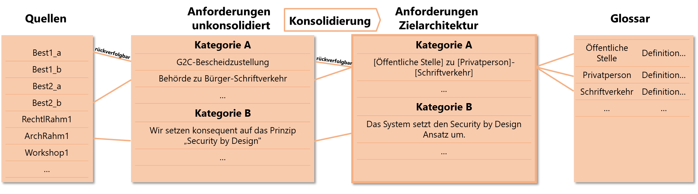

# Anforderungen

1. [Konsolidierte Anforderungsliste](#konsolidierte-anforderungsliste)
2. [Öffentliche Kommentierung & Diskussion](#öffentliche-kommentierung--diskussion)
2. [Methodik](#methodik)
    - [Erhebung und Validierung von Anforderungen](#erhebung-und-validierung-von-anforderungen)
    - [Thematische Strukturierung](#thematische-strukturierung)
    - [Konsolidierung von Anforderungen](#konsolidierung-von-anforderungen)
    - [Qualitätssicherung](#qualitätssicherung)

## Konsolidierte Anforderungsliste

Ein zentrales Ergebnis der Anforderungserhebung und -analyse für die föderale Zielarchitektur Postfach- und Kommunikationslösungen ist die *konsolidierte Anforderungsliste* (aktuell: Version 0.7 | Stand: 03.06.2025), welche aus der Analyse der zuvor erhobenen Anforderungen synthetisiert wurde und basierend auf Feedback regelmäßig fortgeschrieben wird.

| [Zur Konsolidierten Anforderungsliste](../../Konsolidierte-Anforderungen/README.md) |
| - |

## Öffentliche Kommentierung & Diskussion

<!--
> 🚧 **VORSICHT BAUSTELLE** 🚧 
> - Die organisatorische Vorarbeit für die Kommentierung der Anforderungen an die Zielarchitektur Postfach- und Kommunikationslösungen läuft noch. Es wird gebeten, von der Kommentierung abzusehen, bis dieser Hinweis entfernt wurde.
-->

Vom 19.03.2025 bis zum 02.05.2025 konnten Sie die konsolidierten Anforderungen in [Version 0.5.2](../../Konsolidierte-Anforderungen/Vorversionen/Konsolidierte-Anforderungen-v-0-5-2.md) hier auf openCode öffentlich kommentieren und mit anderen interessierten Personen über diese diskutieren. 

[&rarr; zu den Diskussionsverläufen aus der Konsultationsphase März-Mai 2025](https://gitlab.opencode.de/it-planungsrat/fit-ab/zapuk/-/issues?sort=created_date&state=closed&first_page_size=20)

Erste Ergebnisse der Konsultation sind u.A. in [Version 0.6](../../Konsolidierte-Anforderungen/Vorversionen/Konsolidierte-Anforderungen-v-0-6-0.md) eingeflossen, welche im Mai 2025 dem IT-Planungsrat vorgelegt wurden und werden fortlaufend in der weiteren Architekturarbeit zu Rate gezogen. 

> _Vielen Dank an die vielen Personen, die sich mit den Anforderungen an die föderalen Zielarchitektur Postfach- und Kommunikationslösungen befasst und akiv an den öffentlichen Diskussion teilgenommen haben! Ihr Feedback war und ist äußerst nützlich und wir hoffen Sie auch in zukünftigten öffentlichen Konsultationen dabei zu haben._
>                                                                                   _— Ihr ZaPuK-Team_ 

Weitere öffentliche Kommentierungsrunden basierend auf überabeiteten Fassungen der Anforderungsliste folgen gegebenenfalls im weiteren Programmverlauf. Entsprechende Ankündigen und Neuigkeiten finden sich jederzeit [hier auf openCode.](https://gitlab.opencode.de/it-planungsrat/fit-ab/zapuk)

## Methodik

Die Anforderungen an die Zielarchitektur P&K wurden im Rahmen eines strukturierten Prozesses zwischen Herbst 2024 und Frühjahr 2025 systematisch erhoben und abgestimmt.
Dabei kamen verschiedene Methoden zur Identifikation, Dokumentation, Validierung, Konsolidierung und Qualitätssicherung zum Einsatz. Eine auführliche Erläuterung der Methodik findet sich im entsprechenden Konzeptdokument. 

| [zum Konzeptdokument 'Anforderungs- und Bestandsanalyse (Version 1.0)'](https://www.it-planungsrat.de/fileadmin/beschluesse/2025/Beschluss_2025_28_ZaPuK_Anforderungs-_und_Bestandsanalyse.pdf) |
| - |

### Erhebung und Validierung von Anforderungen

Ausgangspunkt für die strukturierte Erhebung von Anforderungen sowie relevanter Erkenntnisse für die Entwicklung der Zielarchitektur war eine Bestandsanalyse, in der bestehende Postfachlösungen und Best-Practices untersucht wurden.
Die Analyse erfolgte anhand strukturierter Interviews sowie Textanalyse anforderungsrelevanter Quellen.
Ergänzend wurden weitere anforderungsrelevante Quellen identifiziert.
Dazu zählten regulatorische Vorgaben (wie Gesetze und Verordnungen), architektonische und strategische Rahmenbedingungen (wie Architekturrichtlinien oder die Föderale Digitalstrategie) sowie technische Standards und Richtlinien (beispielsweise die Technischen Richtlinien des BSI).
Diese Quellen wurden bewertet, priorisiert und in die Anforderungsanalyse integriert.

Alle analysierten Quellen wurden in ein umfassendes Quellenverzeichnis aufgenommen, wobei die zugehörigen Dokumente in einer zentralen Projektablage hinterlegt wurden.
Die im Rahmen der Textanalyse identifizierten Anforderungen wurden zunächst in einer strukturierten Anforderungsliste unkonsolidiert dokumentiert, rückverfolgbar zu den jeweiligen Quelldokumenten und den entsprechenden Textpassagen (vgl. Abbildung unten).
Ergänzend wurden die unkonsolidierten Anforderungen in Interviews und Workshops mit Fachexpert:innen validiert und erweitert.

### Thematische Strukturierung

Zur Unterstützung einer vergleichbaren und strukturierten Analyse erfolgte eine induktive Zerlegung des Lösungsraumes in thematische Kategorien und Unterkategorien.
Das resultierende Kategorienschema war strukturgebend sowohl für die Methodik (bspw. Interviewleitfaden, Stakeholderworkshop), als auch für Ergebnisartefakte.
Ergänzt wurden die thematischen Kategorien um Kategorien für Qualitätsanforderungen, die sich an der Struktur des Standards ISO 25010 orientieren.

### Konsolidierung von Anforderungen

Alle 896 identifizierten Einzelanforderungen wurden in einem Konsolidierungsprozess zusammengeführt.
Dieser mündetet im ersten Entwurf einer [konsolidierten Anforderungsliste](../../Konsolidierte-Anforderungen/README.md) mit 144 konsolidierten Anforderungen.
Hierzu wurden verschiedene Faktoren holistisch abgewogen, insbesondere deren Architekturrelevanz und das jeweilige Abstraktionsniveau.
Im Rahmen des Prozesses erfolgte zunächst eine Bewertung der „Flughöhe“ und Relevanz der Anforderungen.
Detail-Anforderungen ohne Relevanz für die übergreifende Zielarchitektur wurden für eine spätere Betrachtung im Rahmen der Realisierung konkreter Lösungsarchitekturen zurückgestellt.
Technologiebezogene sowie lösungsspezifische, nicht generalisierbare Anforderungen wurden ausgegrenzt oder verworfen.
Darüber hinaus wurden redundante Anforderungen aus unterschiedlichen Quellen zusammengefasst.

Ein weiterer Schwerpunkt des Konsolidierungsprozesses lag auf der begrifflichen Schärfung und Vereinheitlichung.
Durch wurde ein [Glossar](../../Glossar.md) erstellt, welches zentrale Begriffe definiert und so die durchgängige Verwendung einer kohärenten Terminologie sicherstellt.

Durch ein System methodengetriebener Verweise in einem zentralen Anforderungsregister[^1] wurde die Rückverfolgbarkeit aller Anforderungen sichergestellt, sodass die Herkunft jeder konsolidierten Anforderung zurückführbar auf eine oder mehrere nicht-konsolidierte Ursprungsanforderungen ist und bis auf die entsprechende Textpassage ihrer ursprünglichen Quelle nachvollzogen werden kann (siehe Abbildung oben).

Detailanforderungen ohne Relevanz für die übergreifende Architekturgestaltung (z.B. Anforderungen zur Ausgestaltung von UIs) oder industrieübliche Qualitätsanforderungen an daraus abgeleitete Lösungsarchitekturen wurden aus Gründen der Übersichtlichkeit in der Anforderungskonsolidierung ausgegrenzt.

### Qualitätssicherung

Aufgrund der hohen Relevanz der [konsolidierten Anforderungsliste](../../Konsolidierte-Anforderungen/README.md) erfolgten im Verlauf des Projektes bereits verschiedene Maßnahmen zur Qualitätssicherung.
Neben einer kontinuierlichen internen Qualitätssicherung im Projektteam wurde die konsolidierte Anforderungsliste den Verantwortlichen bestehender Postfach- und Kommunikationslösungen, den Mitgliedern der Arbeitsgruppe des [Föderalen IT-Architekturboards](https://www.fitko.de/foederale-koordination/gremienarbeit/foederales-it-architekturboard) sowie weiteren Fachexpert:innen zur Kommentierung bereitgestellt.
In einem Anforderungsworkshop am 27. und 28. Januar 2025 in den Räumlichkeiten der FITKO in Frankfurt am Main erfolgte mit ca. 30 Fachexpert:innen aus Bund und Ländern unter Einbeziehung aller Betreiber:innen der betrachteten Bestandslösungen ein intensiver Diskurs über die erste Fassung der konsolidierten Anforderungsliste.
Dort eingebrachtes Feedback zu bestehenden Anforderungen sowie neu erfasste Anforderungen wurden in der vorliegenden Anforderungsliste bereits berücksichtigt.

<!--- > 🕔 **SAVE THE DATE** 🕔 Im weiteren Verlauf des Projektes wird darüber hinaus eine öffentliche Konsultation durchgeführt, die auch die konsolidierte Anforderungsliste mit einschließt.
> Weitere Informationen hierzu werden **Anfang März 2025** [🠒 hier auf openCode](../) veröffentlicht. --->

<!--- ### Limitationen --->

[^1]: Hinweis: Das vollständige Anforderungsregister ist aktuell noch nicht für die Veröffentlichung aufbereitet, liegt aber auf Arbeitsebene vor.

