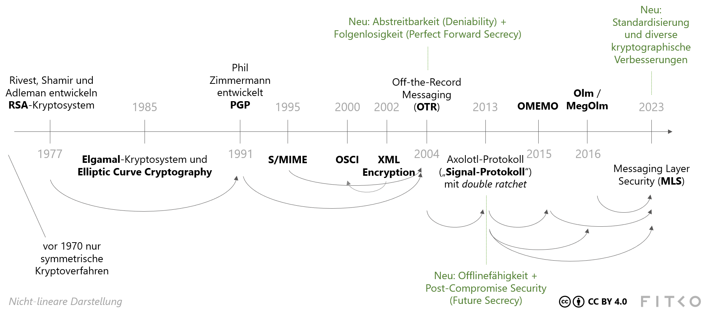

> **Status:** ✔️ Operativ entschieden | **Datum:** 14. April 2025

# ADR-0012: Ende-zu-Ende-Verschlüsselungsschicht

## Kontext und Problembeschreibung

Eines der wesentlichen Projektziele ist die Förderung von Ende-zu-Ende-verschlüsselten Lösungskonzepten (vgl. [ITPLR-Beschluss 2024/28](https://www.it-planungsrat.de/beschluss/beschluss-2024-28)).
Zur Realisierung dieser Ende-zu-Ende-Verschlüsselung (engl. end to end encryption, kurz: E2EE) ist die Wahl einer Verschlüsselungsschicht (E2EE-Protokoll) entscheidend.

Die folgende Grafik stellt die Entwicklungen ausgewählter Verschlüsselungsprotokolle in den letzten Jahren dar:

## Entscheidungstreiber

- Das eingesetzte E2EE-Protokoll und die Transportschicht müssen eng aufeinander abgestimmt, d.h. interoperabel sein. Die vorliegende Architekturentscheidung hat daher starke Wechselwirkung mit [ADR-0011 (Kommunikationsschicht)](ADR-0011-Kommunikationsschicht.md).
- Relevante Anforderungen:
  - SIC_ÜBE_ÜBE_015: Das System setzt den Security by Design Ansatz um.
  - SIC_ÜBE_ÜBE_018: Das System setzt den Zero Trust Ansatz um.
  - SIC_AUT_ÜBE_014: Die Integrität und Ende-zu-Ende-Authentizität der übermittelten [Nachrichten] wird auf kryptographischer Ebene unter Wahrung *glaubwürdiger Abstreitbarkeit* (Plausible Deniability) realisiert, um im Falle von Kompromittierungen keine Echtheit einzelner übermittelter Informationen belegen zu können und so Individuen vor Stigmatisierung und Diskriminierung zu schützen.
  - SIC_ÜBE_ÜBE_007: Das System erlaubt Zugriff auf [Nachrichten] durch die [Empfänger:in] nur, wenn die [Empfänger:in] mit dem von der [Absender:in] für diese [Nachricht] definierten Vertrauensniveau authentifiziert wurde.
  - SIC_AUT_ÜBE_007: Das System stellt die Authentizität einer [Nachricht] auf dem Vertrauensniveau sicher, auf dem die [Absender:in] authentifiziert wurde.
  - SIC_AUT_ÜBE_013: Das System ermöglicht die [qualifizierte elektronische Signatur] oder [qualifiziertes elektronisches Siegeln] von [Nachrichten].
  - SIC_INT_ÜBE_003: Das System stellt die Integrität der übermittelten [Nachrichten] sicher.
  - SIC_VER_ÜBE_026: Das System stellt eine Ende-zu-Ende-Verschlüsselung der übermittelten [Nachrichten] (inklusive [Anhängen] und [Vertraulichen Metadaten]) sicher.
  - SIC_VER_ÜBE_029: Das eingesetzte Verschlüsselungsverfahren unterstützt moderne kryptographische Eigenschaften wie Perfect Forward Secrecy (PFS), Post-Compromise Security (PCS, auch: Future Secrecy) und Plausible Deniability.
  - SIC_VER_ÜBE_032: Die Verschlüsselung übermittelter und gespeicherter [Nachrichten] kann weder von der Betreiberin des Systems, noch von Dritten gebrochen, umgangen oder entschlüsselt werden.
  - SIC_VER_ÜBE_055: Das System verwendet - zusätzlich zur Inhaltsdatenverschlüsselung (E2EE) - flächendeckende Transportverschlüsselung.
  - SIC_VER_ÜBE_027: [Nachrichten] werden ausschließlich in verschlüsselter Form gespeichert. 
  - SIC_VER_ÜBE_028: Das für die E2E-Verschlüsselung genutzte private Schlüsselmaterial darf nur der [Absender:in] bzw. der [Empfänger:in] zugänglich sein (kein Zugriff durch Dritte Parteien).
  - SIC_VER_ÜBE_031: Das System setzt Crypto-Agilität um, um beim Bekanntwerden von Schwächen in eingesetzten Verschlüsselungsverfahren auf neue [Verfahren] wechseln zu können und um in der Zukunft Post-Quantum-Kryptographie zu realisieren.
  - SIC_VER_ÜBE_051: Alle Metadaten, die nicht zwingend für die korrekte Zustellung einer [Nachricht] erforderlich sind, werden vermieden, als Teil der übermittelten [Nachricht] als [vertrauliche Metadaten] verschlüsselt oder durch Privatsphäre-schützende Technologien (Privacy-enhancing Technologies, PET) verschleiert.

## Betrachtete Optionen

    - [Einsatz von E-Mail-Verschlüsselungsstandards (OpenPGP, S/MIME)](#einsatz-von-e-mail-verschlüsselungsstandards-openpgp-smime)
    - [Einsatz von XML-Encryption](#einsatz-von-xml-encryption)
    - [Einsatz von JSON Web Encryption](#einsatz-von-json-web-encryption)
    - [Einsatz der Verschlüsselungsebene des Protokolls OSCI-Transport](#einsatz-der-verschlüsselungsebene-des-protokolls-osci-transport)
    - [Einsatz von TLS bzw. mTLS](#einsatz-von-tls-bzw-mtls)
    - [Einsatz von OTR](#einsatz-von-otr)
    - [Einsatz der Verschlüsselungsebene des Signal-Protokolls](#einsatz-der-verschlüsselungsebene-des-signal-protokolls)
    - [Einsatz von OMEMO bzw. Olm/Megolm](#einsatz-von-omemo-bzw-olmmegolm)
    - [Einsatz von Messaging Layer Security (MLS)](#einsatz-von-messaging-layer-security-mls)

## Gegenüberstellung der jeweiligen Optionen

### Einsatz von E-Mail-Verschlüsselungsstandards (OpenPGP, S/MIME)

Die Standards OpenPGP ([RFC9580](https://www.rfc-editor.org/rfc/rfc9580)) und S/MIME ([RFC8551](https://www.rfc-editor.org/rfc/rfc8551)) gehören zu den ersten Standards zur Realisierung einer Inhaltsdatenverschlüsselung.
Sie basieren technisch auf vergleichsweise einfachen [kryptographischen Primitiven](https://de.wikipedia.org/wiki/Kryptographisches_Primitiv), insb. zur asymmetrischen Verschlüsselung und bieten keine modernen kryptographischen Eigenschaften wie Perfect Forward Secrecy (PFS), Post-Compromise Security (PCS, auch: Future Secrecy) und Plausible Deniability (vgl. SIC_VER_ÜBE_029).

- Gut, denn OpenPGP und S/MIME sind bewährte, praxiserprobte Verschlüsselungsstandards, die auch außerhalb der öffentlichen Verwaltung eingesetzt werden.
- Gut, denn OpenPGP und S/MIME haben den strengen Standardisierungsprozess der IETF durchlaufen.
- Gut, denn OpenPGP und S/MIME sind geeignet, um Inhaltsdaten verschlüsselt auch über intermediäre Systeme hinweg durchgehend verschlüsselt zu übermitteln.
- Gut, denn OpenPGP und S/MIME sind auch in asynchronen Kommunikationsszenarien nutzbar (die Kommunikationsparteien müssen nicht gleichzeitig online sein).
- Gut, denn OpenPGP und S/MIME sehen auch die Kommunikation mit mehreren Kommunikationsparteien vor (Gruppen, Mehrgerätefähigkeit).
- Schlecht, da keine modernen kryptographischen Eigenschaften wie Perfect Forward Secrecy (PFS), Post-Compromise Security (PCS, auch: Future Secrecy) und Plausible Deniability unterstützt werden.
- Schlecht, denn OpenPGP und S/MIME enthalten keine Verfahren zur Herstellung einer Post-Quantum-Sicherheit.

### Einsatz von XML-Encryption

Der [XML-Encryption-Standard](https://www.w3.org/TR/xmlenc-core/) spezifiziert Methoden zur Anwendung kryptographischer Algorithmen im XML-Umfeld.
Spezifiziert werden vergleichsweise einfache [kryptographische Primitive](https://de.wikipedia.org/wiki/Kryptographisches_Primitiv), u.a. zur asymmetrischen Verschlüsselung, welche keine modernen kryptographischen Eigenschaften wie Perfect Forward Secrecy (PFS), Post-Compromise Security (PCS, auch: Future Secrecy) und Plausible Deniability bieten (vgl. SIC_VER_ÜBE_029).
XML-Encryption kommt u.a. im [OSCI-Transport-Standard](https://www.xoev.de/osci) zum Einsatz (siehe unten).

- Gut, denn XML-Encryption ist ein bewährter, praxiserprobter Verschlüsselungsstandard, der auch außerhalb der öffentlichen Verwaltung eingesetzt wird.
- Gut, denn XML-Encryption hat den strengen Standardisierungsprozess des W3C durchlaufen.
- Gut, denn XML-Encryption ist geeignet, um Inhaltsdaten verschlüsselt auch über intermediäre Systeme hinweg durchgehend verschlüsselt zu übermitteln.
- Gut, denn XML-Encryption ist auch in asynchronen Kommunikationsszenarien nutzbar (die Kommunikationsparteien müssen nicht gleichzeitig online sein).
- Schlecht, da keine modernen kryptographischen Eigenschaften wie Perfect Forward Secrecy (PFS), Post-Compromise Security (PCS, auch: Future Secrecy) und Plausible Deniability unterstützt werden.
- Schlecht, denn XML Encryption enthält keine Verfahren zur Herstellung einer Post-Quantum-Sicherheit.
- Schlecht, denn XML Encryption ist aufgrund der fehlenden nativen Unterstützung in Browsern und der damit einhergehenden hohen Komplexität von Eigenentwicklungen nicht gut geeignet für den Einsatz im modernen Web-Umfeld.
- Schlecht, da es in der Vergangenheit häufig zu Sicherheitslücken aufgrund einer falschen Anwendung des XML-Encryption-Standards kam ([1](https://blog.cryptographyengineering.com/2011/10/23/attack-of-week-xml-encryption/), [2](https://www.cvedetails.com/cve/CVE-2017-10670/), [3](https://www.cvedetails.com/cve/CVE-2017-10668/), [4](https://www.cvedetails.com/cve/CVE-2017-10669/)).
- Schlecht, da XML-Encryption konzeptionell nur die direkte Kommunikation zwischen zwei Kommunikationsparteien und nicht den Einsatz mit mehr als zwei Enden vorsieht. Dies schränkt nicht nur auf fachlicher Ebene Gruppenkommunikation, sondern auch Mehrgerätefähigkeit stark ein bzw. erfordert zusätzliche Maßnahmen zur Realisierung dieser Funktionalität.

### Einsatz von JSON Web Encryption

Der JSON Web Encryption-Standard ([RFC7516](https://www.rfc-editor.org/rfc/rfc7516)) spezifiziert Methoden zur Anwendung kryptographischer Algorithmen im JSON-Umfeld.
Gemeinsam mit [weiteren RFCs der IETF-Arbeitsgruppe „Javascript Object Signing and Encryption“](https://datatracker.ietf.org/wg/jose/documents/) spezifiziert RFC7516 vergleichsweise einfache [kryptographische Primitive](https://de.wikipedia.org/wiki/Kryptographisches_Primitiv), u.a. zur asymmetrischen Verschlüsselung, welche keine modernen kryptographischen Eigenschaften wie Perfect Forward Secrecy (PFS), Post-Compromise Security (PCS, auch: Future Secrecy) und Plausible Deniability bieten (vgl. SIC_VER_ÜBE_029).
JSON Web Encryption kommt u.a. in [FIT-Connect](https://docs.fitko.de/fit-connect/) zum Einsatz.

- Gut, denn JSON Web Encryption ist ein bewährter, praxiserprobter Verschlüsselungsstandard, der auch außerhalb der öffentlichen Verwaltung eingesetzt wird.
- Gut, denn JSON Web Encryption hat den strengen Standardisierungsprozess der IETF durchlaufen.
- Gut, denn JSON Web Encryption ist geeignet, um Inhaltsdaten verschlüsselt auch über intermediäre Systeme hinweg durchgehend verschlüsselt zu übermitteln.
- Gut, denn JSON Web Encryption ist auch in asynchronen Kommunikationsszenarien nutzbar (die Kommunikationsparteien müssen nicht gleichzeitig online sein).
- Gut, denn JSON Web Encryption ist aufgrund nativer Unterstützung in Browsern gut geeignet für den Einsatz im modernen Web-Umfeld.
- Schlecht, da keine modernen kryptographischen Eigenschaften wie Perfect Forward Secrecy (PFS), Post-Compromise Security (PCS, auch: Future Secrecy) und Plausible Deniability unterstützt werden.
- Schlecht, denn JSON Web Encryption enthält keine Verfahren zur Herstellung einer Post-Quantum-Sicherheit.
- Schlecht, da JSON Web Encryption konzeptionell nur die direkte Kommunikation zwischen zwei Kommunikationsparteien und nicht den Einsatz mit mehr als zwei Enden vorsieht. Dies schränkt nicht nur auf fachlicher Ebene Gruppenkommunikation, sondern auch Mehrgerätefähigkeit stark ein bzw. erfordert zusätzliche Maßnahmen zur Realisierung dieser Funktionalität.

### Einsatz der Verschlüsselungsebene des Protokolls OSCI-Transport

Der [OSCI-Transport-Standard](https://www.xoev.de/osci)) spezifiziert sowohl ein Verfahren zur Realisierung eines Nachrichten-Transport mittels SOAP, also auch ein Verfahren zur Realisierung einer Ende-zu-Ende-Verschlüsselung von Inhaltsdaten durch Festlegungen konkreter Verschlüsselungsverfahren zur sicheren Datenübermittlung zwischen zwei über einen Intermediär miteinander kommunizierenden Systemen.
Der vorliegende ADR behandelt ausschließlich das im OSCI-Standard spezifizierte Protokoll zur Ende-zu-Ende-Verschlüsselung (zur Realisierung des Nachrichten-Transports, siehe [ADR-0011](ADR-0011-Kommunikationsschicht.md)).

Die Ende-zu-Ende-Verschlüsselung in OSCI-Transport basiert auf einer mittels des XML-Encryption-Standards realisierten hybriden Verschlüsselung.
Hierzu spezifiziert OSCI-Transport konkrete Vorgaben zur Anwendung des XML-Encryption-Standards.
Die in OSCI-Transport realisierte hybride Verschlüsselung bietet keine modernen kryptographischen Eigenschaften wie Perfect Forward Secrecy (PFS), Post-Compromise Security (PCS, auch: Future Secrecy) oder Plausible Deniability (vgl. SIC_VER_ÜBE_029).
Zudem verzichtet der OSCI-Transport-Standard auf die Vorgabe zum verpflichtenden Einsatz von HTTPS als Transportverschlüsselung (dies kann jedoch per Profilierung über sogenannte Transportprofile im jeweiligen Einsatzszenario festgelegt werden).

- Gut, denn OSCI-Transport ist geeignet, um Inhaltsdaten verschlüsselt auch über intermediäre Systeme hinweg durchgehend verschlüsselt zu übermitteln.
- Gut, denn OSCI-Transport ist auch in asynchronen Kommunikationsszenarien nutzbar (die Kommunikationsparteien müssen nicht gleichzeitig online sein).
- Neutral, denn die Ende-zu-Ende-Verschlüsselungsschicht von OSCI-Transport ist spezifisch für den Einsatz in der Kommunikationsschicht von OSCI-Transport entwickelt worden. Eine Adaptierung auf andere Kommunikationsprotokolle wäre jedoch denkbar.
- Neutral, denn OSCI-Transport ist ein in der Deutschen Innenverwaltung und Justiz bewährter, praxiserprobter Verschlüsselungsstandard, der jedoch außerhalb der öffentlichen Verwaltung praktisch nicht eingesetzt wird.
- Schlecht, denn OSCI-Transport hat keinen internationalen Standardisierungsprozess durchlaufen (nationale Eigenentwicklung) und profitiert damit nicht von einem internationalen Ökosystem.
- Schlecht, denn der in OSCI-Transport eingesetzte XML Encryption-Standard ist aufgrund der fehlenden nativen Unterstützung in Browsern und der damit einhergehenden hohen Komplexität von Eigenentwicklungen nicht gut geeignet für den Einsatz im modernen Web-Umfeld.
- Schlecht, da es in der Vergangenheit zu Sicherheitslücken aufgrund einer falschen Anwendung des XML-Encryption-Standards kam ([1](https://blog.cryptographyengineering.com/2011/10/23/attack-of-week-xml-encryption/), [2](https://www.cvedetails.com/cve/CVE-2017-10670/), [3](https://www.cvedetails.com/cve/CVE-2017-10668/), [4](https://www.cvedetails.com/cve/CVE-2017-10669/)).
- Schlecht, da keine modernen kryptographischen Eigenschaften wie Perfect Forward Secrecy (PFS), Post-Compromise Security (PCS, auch: Future Secrecy) und Plausible Deniability unterstützt werden.
- Schlecht, denn OSCI enthält keine Verfahren zur Herstellung einer Post-Quantum-Sicherheit.
- Schlecht, da OSCI konzeptionell nur die direkte Kommunikation zwischen zwei Kommunikationsparteien und nicht den Einsatz mit mehr als zwei Enden vorsieht. Dies schränkt nicht nur auf fachlicher Ebene Gruppenkommunikation, sondern auch Mehrgerätefähigkeit stark ein bzw. erfordert zusätzliche Maßnahmen zur Realisierung dieser Funktionalität.

### Einsatz von TLS bzw. mTLS

Der Transport Layer Security (TLS)-Standard ([RFC8446](https://www.rfc-editor.org/rfc/rfc8446)) spezifiziert Schlüsselaustausch- und Verschlüsselungsverfahren zur sicheren Datenübermittlung zwischen zwei miteinander kommunizierenden Systemen.
In der aktuellen Version TLS 1.3 kommt unter anderem das Diffie-Hellman-Schlüsselaustauschprotokoll zum Einsatz, um für jede Verbindung einen neuen Sitzungsschlüssel (Session Key) auszuhandeln.
Da dies ohne Verwendung eines Langzeitschlüssels geschieht, erreicht TLS 1.3 Perfect Forward Secrecy ([1](https://de.wikipedia.org/wiki/Transport_Layer_Security)).
TLS bietet zudem Post-Compromise Security [2](https://ethz.ch/content/dam/ethz/special-interest/infk/inst-infsec/appliedcrypto/education/theses/masters-thesis_matteo-scarlata.pdf) und erfüllt aufgrund des Einsatzes von [Message Authentication Codes (MACs)](https://de.wikipedia.org/wiki/Message_Authentication_Code)) auch die Plausible-Deniability-Eigenschaft.
Kommen Client-Zertifikate zum Einsatz (mTLS), so können sich beide Kommunikationsparteien gegenseitig zertifikatsbasiert authentisieren.

- Gut, denn TLS/mTLS ist ein bewährter, praxiserprobter Verschlüsselungsstandard, der auch außerhalb der öffentlichen Verwaltung eingesetzt werden.
- Gut, denn TLS/mTLS hat den strengen Standardisierungsprozess der IETF durchlaufen.
- Gut, denn TLS/mTLS wurden in der internationalen wissenschaftlichen Community intensiv auf mögliche Schwachstellen untersucht ([3](https://scholar.google.com/scholar?q=TLS+analysis)).
- Gut, da moderne kryptographische Eigenschaften wie Perfect Forward Secrecy (PFS), Post-Compromise Security (PCS, auch: Future Secrecy) und Plausible Deniability unterstützt werden.
- Gut, denn es stehen (u.a. aufgrund der Vorgaben des IETF-Standardisierungsprozess und der extrem breiten Nutzung) diverse frei verfügbare Implementierungen bereit ([4](https://de.wikipedia.org/wiki/Transport_Layer_Security#Implementierungen)).
- Neutral, denn TLS/mTLS ist nicht per-se darauf ausgelegt, um Inhaltsdaten verschlüsselt auch über intermediäre Systeme hinweg durchgehend verschlüsselt zu übermitteln. TLS/mTLS kann jedoch zu diesem Zweck genutzt werden (so bspw. realisiert in [IRIS Connect](https://github.com/iris-connect/iris-client/blob/develop/infrastructure/deployment/docs/Architektur.md)).
- Schlecht, denn TLS enthält aktuell keine Verfahren zur Herstellung einer Post-Quantum-Sicherheit. Derzeit werden jedoch bereits erste Ansätze zur Umsetzung einer Post-Quantum-Sicherheit in TLS diskutiert ([5](https://datatracker.ietf.org/wg/tls/documents/)).
- Schlecht, da TLS/mTLS nur in synchronen Kommunikationsszenarien nutzbar ist (beide Kommunikationsparteien müssen gleichzeitig online sein). Da TLS nicht darauf ausgelegt ist, verschlüsselte Nachrichten vorzuhalten, würde das Entschlüsseln solcher Nachrichten (beispielsweise auf einem neuen Gerät) es erfordern, Schlüssel aus vergangener Kommunikation zu speichern oder zu teilen, wozu TLS keine Mechanismen vorsieht.
- Schlecht, da TLS/mTLS konzeptionell nur die direkte Kommunikation zwischen zwei Kommunikationsparteien und nicht den Einsatz mit mehr als zwei Enden vorsieht. Dies schränkt nicht nur auf fachlicher Ebene Gruppenkommunikation, sondern auch Mehrgerätefähigkeit stark ein bzw. erfordert zusätzliche Maßnahmen zur Realisierung dieser Funktionalität.

### Einsatz von OTR

Das [Off-the-Record Messaging-Protokoll (OTR)](https://otr.cypherpunks.ca/) beschreibt Verfahren zum Schlüsselaustausch, zur Schlüsselverwaltung und zu Verschlüsselungsverfahren im Kontext des Instant Messaging.
Das Protokoll setzt im Gegensatz zu den bis dato üblichen Verfahren PGP und S/MIME das Prinzip der glaubhaften Abstreitbarkeit (Plausible Deniability) um.
Nach Beendigung einer Unterhaltung kann damit von keiner der beteiligten Kommunikationsparteien ggü. Dritten bewiesen werden, dass eine der Kommunikationsparteien eine bestimmte Aussage gemacht hat.
Damit setzt OTR das Recht am gesprochenen Wort im Allgemeinen Persönlichkeitsrecht in der digitalen Welt um ([1](https://otr.cypherpunks.ca/otr-wpes.pdf)).
Unbenommen davon können Aussagen über einen OTR-verschlüsselten Kommunikationskanal bei Bedarf auch nicht-abstreitbar übermittelt werden (z.B. durch zusätzliche Anbringung einer Qualifizierten Elektronischen Signatur, siehe [ADR-0017](./ADR-0017-Authentizität-und-Integrität-von-Inhalten.md), [ADR-0018](./ADR-0018-Nichtabstreitbarkeit-Übermittlung.md)).
OTR realisiert zudem die kryptographische Eigenschaft der Perfect Forward Secrecy und bietet Methoden zur Authentisierung von Kommunikationspartner:innen ([2](https://otr.cypherpunks.ca/otr-wpes.pdf)).
OTR setzt jedoch voraus, dass beide Kommunikationsparteien zeitgleich online sind und ist daher nicht für asynchrone Kommunikationsszenarien geeignet.

- Gut, denn OTR ist ein bewährter, praxiserprobter Verschlüsselungsstandard, der auch außerhalb der öffentlichen Verwaltung eingesetzt wird.
- Gut, denn OTR wurde u.a. von führenden Kryptograph:innen der University of California, Berkeley mitentwickelt und wurde in der internationalen wissenschaftlichen Community intensiv auf mögliche Schwachstellen untersucht ([3](https://scholar.google.com/scholar?q=OTR+protocol+analysis)).
- Gut, denn OTR ist geeignet, um Inhaltsdaten verschlüsselt auch über intermediäre Systeme hinweg durchgehend verschlüsselt zu übermitteln.
- Gut, da moderne kryptographische Eigenschaften wie Perfect Forward Secrecy (PFS) und Plausible Deniability unterstützt werden.
- Neutral, denn OTR ist spezifisch für den Einsatz in XMPP entwickelt worden. Eine Adaptierung auf andere Kommunikationsprotokolle wäre jedoch denkbar.
- Schlecht, da die moderne kryptographische Eigenschaft der Post-Compromise Security (PCS, auch: Future Secrecy) nicht unterstützt wird.
- Schlecht, denn OTR enthält keine Verfahren zur Herstellung einer Post-Quantum-Sicherheit.
- Schlecht, da OTR nur in synchronen Kommunikationsszenarien nutzbar ist (beide Kommunikationsparteien müssen gleichzeitig online sein).
- Schlecht, da OTR konzeptionell nur die direkte Kommunikation zwischen zwei Kommunikationsparteien und nicht den Einsatz mit mehr als zwei Enden vorsieht. Dies schränkt nicht nur auf fachlicher Ebene Gruppenkommunikation, sondern auch Mehrgerätefähigkeit stark ein bzw. erfordert zusätzliche Maßnahmen zur Realisierung dieser Funktionalität.

### Einsatz der Verschlüsselungsebene des Signal-Protokolls

Das [Signal-Protokoll](https://signal.org/docs/) (ehemals *Axolotl*-Protokoll) ist stark inspiriert vom OTR-Protokoll und enthält Optimierungen insb. für mobile (asynchrone) Kommunikationsszenarien, in denen die Kommunikationsparteien nicht gleichzeitig online sein müssen.
Zudem führt das Signal-Protokoll die kryptographische Eigenschaft der Post-Compromise Security (PCS, auch: Future Secrecy oder „Selbstheilungs-Fähigkeit“) ein und erweitert damit das Sicherheitsmodell des OTR-Protokolls um Vertraulichkeit nach Kompromittierung jeglichen Schlüsselmaterials (auch kurzlebiger Sitzungsschlüssel).
Diese Eigenschaft wird erreicht durch die Einführung des Double-Ratchet-Verfahrens, einer Kombination des bereits durch OTR eingeführten Diffie-Hellman-Ratchet-Verfahrens mit einer zusätzlichen, Hash-basierten Schlüsselableitung (Hash-Ratchet).
Das Signal-Protokoll setzt mit der Einführung des Post-Quantum Extended Diffie-Hellman-Schlüsselaustauschverfahrens (PQXDH) erste Schutzmaßnahmen vor Angriffen unter Verwendung von Quantencomputern um ([1](https://signal.org/blog/pqxdh/), [2](https://signal.org/docs/specifications/pqxdh/)).

- Gut, denn das Signal-Protokoll ist ein bewährter, praxiserprobter Verschlüsselungsstandard, der auch außerhalb der öffentlichen Verwaltung eingesetzt wird.
- Gut, denn das Signal-Protokoll wurde von der renommierten Signal Foundation entwickelt und wurde in der internationalen wissenschaftlichen Community intensiv auf mögliche Schwachstellen untersucht ([3](https://scholar.google.com/scholar?q=Signal+messaging+protocol+analysis)).
- Gut, denn das Signal-Protokoll ist geeignet, um Inhaltsdaten verschlüsselt auch über intermediäre Systeme hinweg durchgehend verschlüsselt zu übermitteln.
- Gut, denn das Signal-Protokoll ist auch in asynchronen Kommunikationsszenarien nutzbar (die Kommunikationsparteien müssen nicht gleichzeitig online sein).
- Gut, da moderne kryptographische Eigenschaften wie Perfect Forward Secrecy (PFS), Post-Compromise Security (PCS, auch: Future Secrecy) und Plausible Deniability unterstützt werden.
- Gut, da erste Verfahren zur Herstellung einer Post-Quantum-Sicherheit bereits in das Protokoll integriert sind.
- Gut, denn das Signal-Protokoll sieht auch die Kommunikation mit mehreren Kommunikationsparteien vor (Gruppen, Mehrgerätefähigkeit).
- Schlecht, denn produktionsreife Implementierungen des Signal-Protokolls sind ausschließlich GPL-/AGPL-lizenziert, was eine Nutzung in proprietären Systemen ohne vorherige zusätzliche Lizenzierung durch die Signal Foundation verbietet. Eine Integration in bestehende proprietäre Fachverfahren in Form eines Software-Entwicklungskits wäre damit beispielsweise nicht ohne Weiteres möglich.

### Einsatz von OMEMO bzw. Olm/Megolm

Die Protokolle [OMEMO](https://conversations.im/omemo/) und [Olm](https://gitlab.matrix.org/matrix-org/olm/-/blob/master/docs/olm.md)/[Megolm](https://gitlab.matrix.org/matrix-org/olm/-/blob/master/docs/megolm.md) sind stark inspiriert vom Signal-Protokoll und bieten (abgesehen von Post-Quantum-Sicherheit) dieselben kryptographischen Eigenschaften wie das Signal-Protokoll.
OMEMO wurde für den Einsatz im [XMPP-Standard](https://xmpp.org/extensions/) entwickelt, während Olm/Megolm für den Einsatz im [Matrix-Standard](https://spec.matrix.org/) konzipiert sind.

- Gut, denn OMEMO und Olm/Megolm sind bewährte, praxiserprobte Verschlüsselungsstandards, die auch außerhalb der öffentlichen Verwaltung eingesetzt werden.
- Gut, denn OMEMO und Olm/Megolm wurden in der internationalen wissenschaftlichen Community auf mögliche Schwachstellen untersucht ([1](https://conversations.im/omemo/audit.pdf), [2](https://scholar.google.com/scholar?q=Olm+Megolm+analysis)).
- Gut, denn OMEMO und Olm/Megolm sind geeignet, um Inhaltsdaten verschlüsselt auch über intermediäre Systeme hinweg durchgehend verschlüsselt zu übermitteln.
- Gut, denn OMEMO und Olm/Megolm sind auch in asynchronen Kommunikationsszenarien nutzbar (die Kommunikationsparteien müssen nicht gleichzeitig online sein).
- Gut, da moderne kryptographische Eigenschaften wie Perfect Forward Secrecy (PFS), Post-Compromise Security (PCS, auch: Future Secrecy) und Plausible Deniability unterstützt werden.
- Gut, denn OMEMO sieht auch die Kommunikation mit mehreren Kommunikationsparteien vor (Gruppen, Mehrgerätefähigkeit).
- Gut, denn Olm/MegOlm wurden für den Einsatz in dezentralen Systemen konzipiert.
- Neutral, denn beide Protokolle sind spezifisch für den Einsatz in XMPP bzw. Matrix entwickelt worden. Eine Adaptierung auf andere Kommunikationsprotokolle wäre jedoch denkbar.
- Schlecht, denn OMEMO und Olm/Megolm enthalten keine Verfahren zur Herstellung einer Post-Quantum-Sicherheit. Es gibt jedoch bereits Ansätze zur Umsetzung einer Post-Quantum-Sicherheit in Olm/Megolm basierend auf dem Schlüsseleinigungsverfahren PQXDH ([3](https://github.com/matrix-org/vodozemac/pull/120), [4](https://signal.org/docs/specifications/pqxdh/)).

### Einsatz von Messaging Layer Security (MLS)

Der [Messaging Layer Security-Standard (MLS)](https://www.rfc-editor.org/rfc/rfc9420) ist stark inspiriert von OTR, OMEMO, Olm/Megolm und dem Signal-Protokoll, bietet (abgesehen von Post-Quantum-Sicherheit) dieselben kryptographischen Eigenschaften wie das Signal-Protokoll und enthält u.a. kryptographische Optimierungen zur Verbesserung der Skalierbarkeit für große Gruppen (Verbesserung des Double-Ratchet-Verfahrens mithilfe von *Tree*-Datenstrukturen).

- Gut, denn MLS ist ein international standardisierter Verschlüsselungsstandard, der auch außerhalb der öffentlichen Verwaltung eingesetzt werden.
- Gut, denn MLS hat den strengen Standardisierungsprozess der IETF durchlaufen.
- Gut, denn MLS wurde bereits in der internationalen wissenschaftlichen Community auf mögliche Schwachstellen untersucht ([1](https://scholar.google.com/scholar?q=Messaging+Layer+Security+analysis)).
- Gut, denn MLS ist geeignet, um Inhaltsdaten verschlüsselt auch über intermediäre Systeme hinweg durchgehend verschlüsselt zu übermitteln.
- Gut, denn MLS ist auch in asynchronen Kommunikationsszenarien nutzbar (die Kommunikationsparteien müssen nicht gleichzeitig online sein).
- Gut, da moderne kryptographische Eigenschaften wie Perfect Forward Secrecy (PFS) und Post-Compromise Security (PCS, auch: Future Secrecy) unterstützt werden.
- Gut, denn es stehen (u.a. aufgrund der Vorgaben des IETF-Standardisierungsprozess und der Förderung durch die EU-Kommission und des Bundesministeriums für Bildung und Forschung (BMBF)) gleich mehrere frei verfügbare Implementierungen bereit ([2](https://openmls.tech/), [3](https://github.com/cisco/mlspp), [4](https://github.com/mlswg/mls-implementations/blob/main/implementation_list.md)).
- Gut, denn MLS ist nicht spezifisch für den Einsatz in einem bestimmten Kommunikationsprotokoll entwickelt worden. Eine Nutzung in diversen Kommunikationsprotokollen ist also möglich.
- Gut, denn MLS sieht auch die Kommunikation mit mehreren Kommunikationsparteien vor (Gruppen, Mehrgerätefähigkeit).
- Neutral, denn die Unterstützung von MLS in Kommunikationslösungen/-protokollen befindet sich derzeit noch in der Umsetzung. Es existieren jedoch bereits nutzbare Implementierungen ([5](https://www.ietf.org/blog/support-for-mls-2023/), [6](https://arewemlsyet.com/), [7](https://security.googleblog.com/2023/07/an-important-step-towards-secure-and.html)), die eine Integration in prinzipiell beliebige Kommunikationslösungen/-protokolle ermöglichen.
- Schlecht, da die moderne kryptographische Eigenschaft der Plausible Deniability aktuell nicht unterstützt wird.
- Schlecht, denn MLS enthält aktuell keine Verfahren zur Herstellung einer Post-Quantum-Sicherheit. Es werden jedoch bereits Ansätze zur Umsetzung einer Post-Quantum-Sicherheit in MLS diskutiert ([8](https://cryspen.com/post/pq-mls/), [9](https://eprint.iacr.org/2022/1533.pdf), [10](https://pqshield.com/post-quantum-messaging-examining-apples-new-pq3-protocol/), [11](https://datatracker.ietf.org/wg/mls/documents/)).
- Schlecht, denn MLS wurde für den Einsatz in zentralisierten Systemen entwickelt und ist daher nicht trivial in dezentralen Systemen einsetzbar. Es gibt jedoch Bestrebungen, MLS für den Einsatz in dezentralen Settings weiterzuentwickeln ([12](https://www.ietf.org/archive/id/draft-kohbrok-mls-decentralized-mls-00.html#abstract)).

## Architekturentscheidung

Gewählte Option: [„Einsatz von Messaging Layer Security (MLS)“](#einsatz-von-messaging-layer-security-mls), denn MLS verfügt über im Vergleich zu OpenPGP, S/MIME, XML-Encryption, JSON Web Encryption, OSCI-Transport und OTR (bis auf Plausible Deniability) überragende kryptographische Eigenschaften, ist im Vergleich zu TLS und OTR offline-fähig, ist im Vergleich zu OSCI-Transport, OTR, dem Signal-Protokoll, OMEMO und Olm/Megolm nicht spezifisch für den Einsatz in einem bestimmten Kommunikationsprotokoll entwickelt worden, sieht im Vergleich zu XML-Encryption, JSON Web Encryption, OSCI-Transport, TLS und OTR auch die Kommunikation mit mehreren Kommunikationsparteien vor (Gruppen, Mehrgerätefähigkeit) und erscheint im Vergleich zu OSCI-Transport, OTR, dem Signal-Protokoll, OMEMO und Olm/Megolm aufgrund des erfolgten Standardisierungsprozesses durch die IETF ein geeigneter, nachhaltiger Kandidat für die Herstellung einer größtmöglichen Interoperabilität mit externen Infrastrukturen (insb. perspektivische Interoperabilität mit Kommunikationslösungen anderer EU-Mitgliedsstaaten).
Die fehlende Eigenschaft der Plausible Deniability und die noch notwendigen Anpassungen zum Einsatz in dezentralen Settings erscheinen ggü. den anderen genannten Vorteilen vertretbar.

> [!note] Hinweis
> Die Integration des MLS-Standards in das gemäß [ADR-0011](ADR-0011-Kommunikationsschicht.md) festgelegte Matrix-Protokoll befindet sich derzeit noch in der Umsetzung ([1](https://github.com/matrix-org/matrix-spec-proposals/pull/4256), [2](https://github.com/matrix-org/matrix-spec-proposals/pull/4244), [3](https://github.com/matrix-org/matrix-spec-proposals/pull/2883)).
> Bis zur Verfügbarkeit einer praxiserprobten Implementierung kann übergangsweise auf das in Matrix eingesetzte Olm/Megolm-Protokoll zurückgegriffen werden.
> Im Vergleich zu MLS wurde Olm/Megolm nicht von der IETF standardisiert, sondern von der Matrix Foundation im Rahmen des Standardisierungsprozesses des Matrix-Standard.
> Gegenüber der Nutzung von MLS ergeben sich hieraus geringere Synergieeffekte (inkl. einer möglichen perspektivischen Interoperabilität mit Kommunikationslösungen anderer EU-Mitgliedsstaaten), sodass ein zeitnaher Umstieg auf MLS erstrebenswert ist, sobald andere Stakeholder im Matrix-Ökosystem diese Umstellung vollziehen.

### Auswirkungen

- Gut, denn MLS erscheint durch die Nutzung von Synergieeffekten, die sich aus der Standardisierung als Internet-Standard ergeben, als zukunftssicherste, risikoärmste und damit nachhaltigste Option. Durch zukünftige Investitionen der Bundesrepublik Deutschland könnten bei Bedarf weitere Verbesserungen am Standard herbeigeführt werden (beispielsweise zu Plausible Deniability oder Post-Quantum-Resilienz), die anschließend allen Nutzenden des Standards international zur Verfügung stehen.
- Gut, denn MLS erscheint derzeit auch als aussichtsreichster Kandidat für eine harmonisierte Ende-zu-Ende-Verschlüsselungsschicht zur Herstellung einer Messenger-Interoperabilität nach dem [EU Digital Markets Act (DMA)](https://digital-markets-act.ec.europa.eu/), woraus sich weitere Synergieeffekte auf europäischer Ebene ergeben könnten.
- Neutral, denn die Nutzung von MLS zur Herstellung einer Interoperabilität unter Wahrung der Ende-zu-Ende-Verschlüsselung erfordert teils hohe Anpassungsbedarfe in der bestehenden Landschaft an Postfach- und Kommunikationslösungen. Da hier derzeit kein einheitlich genutztes Verfahren zur Ende-zu-Ende-Verschlüsselung im Einsatz ist, entstünden diese Aufwände jedoch auch bei der Wahl anderer einheitlich genutzter Verschlüsselungsverfahren.
- Neutral, denn die Wahl des Verfahrens zur Umsetzung der Ende-zu-Ende-Verschlüsselungsschicht hat Wechselwirkungen mit der Wahl des Protokolls der Kommunikationsschicht (siehe [ADR-0011](ADR-0011-Kommunikationsschicht.md)).
- Schlecht, denn die Einsatzfähigkeit von MLS in dezentralen Systemen ist (im Gegensatz zu Olm/Megolm) bislang nicht gegeben. Es gibt jedoch Vorarbeiten zur Weiterentwicklung des Protokolls in diesem Aspekt.
- Schlecht, denn die gewünschte kryptographische Eigenschaft der Post-Quantum-Sicherheit wird derzeit von keinem der untersuchten Protokolle unterstützt. Für Olm/MegOlm und MLS gibt es jedoch bereits Vorarbeiten zur Realisierung dieser Eigenschaft.
