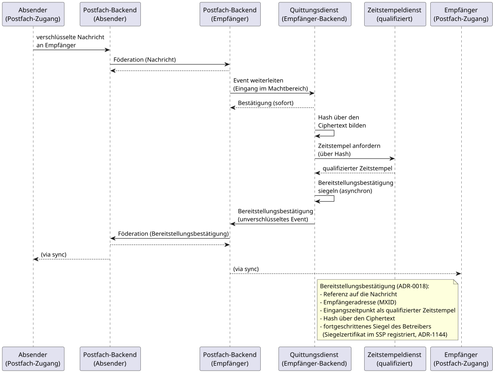
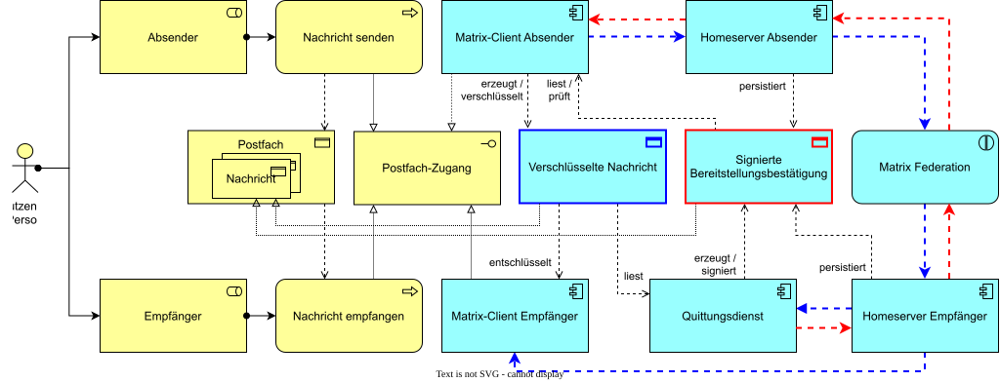

# ADR-0018: Bereitstellungsbestätigung

> **Status:** ✔️ Operativ entschieden | **Datum:** 13. November 2026

## Kontext und Problembeschreibung

Für Anwendungsfälle, bei denen eine Übermittlung rechtssicher und beweisbar erfolgen muss, werden entsprechende Nachweise benötigt. Zum Beispiel müssen [Behörden](../../Glossar.md#behörde) den Zeitpunkt und die Bereitstellung der [Bekanntgabe](../../Glossar.md#bekanntgabe) eines [Verwaltungsaktes](../../Glossar.md#verwaltungsakt) nach § 9 Abs. 1 OZG im Zweifel nachweisen können.[^1] Diese Architekturentscheidung behandelt, wie der Eingang einer [Nachricht](../../Glossar.md#nachricht) im [Postfach-Backend](../../Glossar.md#postfach-backend) des [Empfängers](../../Glossar.md#empfängerin) nachgewiesen wird und somit die Behörde die Bereitstellung nach § 9 Abs. 1 OZG bzw. den Zugang nach § 41 Abs. 2 Satz 3 VwVfG belegen kann.[^2]

Der Zugang einer Nachricht findet objektiv mit dem Eingang im Postfach-Backend des Empfängers statt. Die [Bereitstellungsbestätigung](../../Glossar.md#bereitstellungsbestätigung) dokumentiert diesen Eingang. Sie wird vom Postfach-Backend des Empfängers erzeugt. Eine Protokollierung im Backend des [Absenders](../../Glossar.md#absenderin) kann sie ergänzen.

Der Entwurf der Bereitstellungsbestätigung orientiert sich an den Anforderungen für die Zustellung [elektronischer Einschreiben](../../Glossar.md#elektronisches-einschreiben) (ERDS) der eIDAS-VO[^3]. Eine spätere Umsetzung eines qualifizierten Zustelldienstes wird somit ermöglicht.

Die im Matrix-Protokoll spezifizierten Methoden, die dem Absender eine Rückmeldung über die erfolgreiche Übermittlung geben, sind für diese Bereitstellungsbestätigung nicht ausreichend:

- **Matrix Read Receipts:** Die im Matrix-Protokoll spezifizierten [Lesebestätigungen](../../Glossar.md#lesebestätigung) sind im Client unterdrückbar. Die für eine rechtssichere Bekanntgabe notwendige Verlässlichkeit ist damit nicht gegeben.[^4] Zudem setzen sie den Lesestatus für alle vorangegangenen Nachrichten auf „gelesen“, was kein passendes Konzept ist.
- **Transportbestätigungen:** Der Transport der verschlüsselten Nachrichten zwischen den beteiligten Postfach-Backends über HTTP erzeugt keine signierten Quittungen, die für eine rechtssichere Bekanntgabe ausreichen.[^5]

### Abgrenzung

- **[ADR-0017](./ADR-0017-Authentizität-und-Integrität-von-Inhalten.md):** Nachweis der [Authentizität](../../Glossar.md#authentizität) und [Integrität](../../Glossar.md#integrität) des Inhalts

- **PKI:** Schlüssel und Sperrmechanismen werden in einer Folge-Entscheidung geregelt.

## Entscheidungstreiber

- **Rechtssichere Bekanntgabe:** Nachweis des Eingangs im [Machtbereich](../../Glossar.md#machtbereich) des Empfängers als Zugangsnachweis der Behörde nach § 41 Abs. 2 Satz 3 VwVfG, über die Abrufmodelle nach § 9 Abs. 1 OZG, § 122a AO und § 37 Abs. 2a SGB X hinaus (ANF_FUN_ZUS_024, ANF_FUN_ZUS_044). In der Richtung zu [öffentlichen Stellen](../../Glossar.md#öffentliche-stelle) belegt die Bestätigung dem Absender den Eingang eines [Antrags](../../Glossar.md#antrag) oder einer Erklärung (SIC_NAC_NIC_004).

- **Beweiskraft im ERV:** Erfüllt Anforderungen bzgl. [Zustellfiktion](../../Glossar.md#zustellfiktion) an automatisierte Eingangsbestätigung des Empfängerpostfachs nach § 173 Abs. 4 Satz 4 ZPO (ANF_FUN_ZUS_044).

- **Zero-Trust:** Umsetzung des Zero-Trust-Ansatzes (SIC_ÜBE_ÜBE_018).

- **E2EE-Konformität:** Betreiber der Infrastruktur und Dritte können den Klartext der Nachrichten nicht einsehen (SIC_VER_ÜBE_032).

- **Metadatenschutz:** Für den Transport irrelevante Metadaten werden Ende-zu-Ende-verschlüsselt übertragen oder vermieden (SIC_VER_ÜBE_026, SIC_VER_ÜBE_051).

- **Dezentralität:** Der Nachweis wird vom empfangenden Postfach-Backend erzeugt, sowohl von zentralen als auch dezentral betriebenen Backends ([ADR-0002](./ADR-0002-Infrastrukturtopologie.md), [ADR-0005](./ADR-0005-Anzahl-und-Zuschnitt-der-zentral-bereitgestellten-Postfach-Zugänge.md)).

- **Standardisierung:** Die Erzeugung und Prüfung der Bereitstellungsbestätigung soll im Matrix-Protokoll per [MSC](../../Glossar.md#msc) standardisiert werden (ANF_ARC_ANB_007, ANF_ARC_ANB_021).

- **Modernisierungsagenda Maßnahme 207:** Harmonisierung von Vorschriften bzgl. der digitalen Bekanntgabe und Zustellung.[^6]

- **Löschbarkeit:** [Nutzende](../../Glossar.md#nutzerinnen) können Nachrichten oder [Anhänge](../../Glossar.md#anhang) löschen (ANF_FUN_USE_070).

## Betrachtete Optionen

### Option 1: Das empfangende Postfach-Backend erstellt signierte Bereitstellungsbestätigungen

Beim Empfang einer Nachricht erzeugt das empfangende Postfach-Backend signierte Bereitstellungsbestätigungen, die unverschlüsselt den Kommunikationsteilnehmern im Raum bereitgestellt werden.[^7] Somit wird die Bereitstellungsbestätigung unabhängig von den Teilnehmenden im Server umgesetzt. Der dafür zuständige [Quittungsdienst](../../Glossar.md#quittungsdienst) ist als Application Service, als Modul des [Homeservers](../../Glossar.md#homeserver) oder in einem dezentral betriebenen Backend als Bot im Machtbereich des Betreibers umsetzbar. Der Absender der Bereitstellungsbestätigung wird klar als „[technischer Nutzer](../../Glossar.md#technischer-nutzer)“ gekennzeichnet. Nutzt der Homeserver für das Versenden der Bestätigung die Adresse des Empfängers, erfolgt die Kennzeichnung über den Eventtyp. Die mit dem Schlüssel des Postfach-Backends signierte Bereitstellungsbestätigung enthält die Prüfsumme der verschlüsselten Nachricht.

- Gut, denn die Signatur beweist den Eingang im Machtbereich des Empfängers.

- Gut, denn auf dem Server ist kein Zugriff auf den Klartext notwendig.

- Gut, denn die Lösung ist ohne Matrix-Protokoll-Änderung umsetzbar. Alle drei Umsetzungen nutzen spezifizierte Matrix-Schnittstellen.

- Gut, denn die Bereitstellungsbestätigung ist durch Dritte unabhängig prüfbar.

- Gut, denn die Bestätigung wird im Raum bzw. den beteiligten Homeservern gespeichert und ist für alle Mitglieder des betreffenden Raums einsehbar.

- Gut, denn der Application Service tritt unter einer eigenen Adresse im Raum auf und ist dadurch von den Kommunikationsteilnehmenden unterscheidbar.

- Gut, denn bei einer Umsetzung als Modul des Homeservers entfällt ein zusätzlicher Dienst mit eigener Adresse und eigenem Betrieb.

- Schlecht, denn der Application Service ist als eigener Dienst neben dem Homeserver zu entwickeln und zu betreiben.

- Schlecht, denn die Application-Service-API setzt eine Registrierung in der Konfiguration des Homeservers voraus. Der Dienst erhält alle [Events](../../Glossar.md#event) der von ihm beanspruchten Räume und verwaltet in exklusiven Namespaces Nutzer und Aliase allein. Diese Rechte vergrößern den Angriffsvektor.

- Schlecht, denn die Application-Service-API wird in der Praxis fast ausschließlich für Bridges genutzt. Es gibt wenige Implementierungen und im Matrix-Rust-SDK keine, was die Wiederverwendung im SDK der Zielarchitektur erschwert.

### Option 2: Standardisierung der Bereitstellungsbestätigung im Matrix-Protokoll

Beim Empfang einer Nachricht erzeugt der Homeserver signierte Bereitstellungsbestätigungen, die unverschlüsselt den Kommunikationsteilnehmenden im Raum bereitgestellt werden. Die Bereitstellungsbestätigung enthält die Prüfsumme der verschlüsselten Nachricht. Die Lösung wird im Matrix-Protokoll standardisiert (MSC). Ein zusätzlicher Dienst und ein zusätzlicher Matrix-Account sind nicht erforderlich. Der Homeserver versendet die Bestätigung mit der Adresse der empfangenden Person als Absender und signiert sie mit dem Siegel des Betreibers. Die Option beschreibt damit das Zielbild für die Umsetzungen nach Option 1.

- Gut, denn die Signatur beweist den Eingang im Machtbereich des Empfängers.

- Gut, denn auf dem Server ist kein Zugriff auf den Klartext notwendig.

- Gut, denn die Lösung ist im Matrix-Protokoll standardisiert.

- Gut, denn die Bereitstellungsbestätigung ist durch Dritte unabhängig prüfbar.

- Gut, denn die Bestätigung wird im Homeserver gespeichert und ist für alle Mitglieder des betreffenden Raums einsehbar.

- Gut, denn ein zusätzlicher Dienst mit eigener Adresse und eigenem Betrieb entfällt.

- Schlecht, denn der Prozess zur Etablierung eines Standards (mittels MSC) ist aufwändig, langwierig und steht einer schnellen Entwicklung entgegen. Ein entsprechender MSC existiert bislang nicht.

### Option 3: Zentraler Bereitstellungsbestätigungsdienst (Trusted Third Party)

Eine unabhängige zentrale Instanz bestätigt und dokumentiert die Übermittlung zwischen den Kommunikationspartnern.

- Gut, denn die Bereitstellungsbestätigung ist durch Dritte unabhängig prüfbar.

- Schlecht, denn ein zentraler Dienst kann die Ausfallsicherheit verringern und wäre eine kritische Komponente, die entsprechend aufwändig zu betreiben ist.

- Schlecht, denn Metadaten der Übermittlung würden zentral gespeichert, was Anforderungen an die Privatsphäre entgegensteht.

- Schlecht, denn ein zentraler Quittungsdienst widerspricht dem Zero-Trust-Paradigma.

### Option 4: Clientseitig erzeugte Abrufbestätigung

Der Empfänger-Client sendet nach Erhalt der Nachricht eine signierte [Abrufbestätigung](../../Glossar.md#abrufbestätigung) verschlüsselt in den Matrix-Raum. Zudem kann ein Nutzer eine Lesebestätigung aktiv auslösen.

- Gut, denn die Bestätigungen wären im Raum verschlüsselt und es entstünden keine unverschlüsselten Metadaten.

- Gut, denn Lesebestätigungen hätten eine hohe Beweiskraft.

- Schlecht, denn das Senden der Bestätigung durch den Empfänger wäre freiwillig bzw. im Client unterdrückbar.

- Schlecht, denn das Versenden der Bestätigung wäre nur möglich, wenn der Empfänger aktiv bzw. online ist.

- Schlecht, denn eine Abrufbestätigung ist für eine Bekanntgabe nach § 9 Abs. 1 OZG nicht notwendig.

### Option 5: Server-internes Transaktionsprotokoll 

Der sendende Homeserver protokolliert den Nachrichtenversand in einem internen Transaktionsprotokoll.

- Gut, denn die Logs können den Versand der Nachrichten belegen, wenn der Betreiber vertrauenswürdig ist (Indiz, Verwaltung)

- Gut, denn die Umsetzung wäre vergleichsweise einfach möglich.

- Schlecht, denn Logs müssten revisionssicher umgesetzt werden.

- Schlecht, denn Logs wären intransparent gegenüber den Kommunikationsteilnehmenden.

- Schlecht, denn Logs wären für andere Bereiche (z. B. [ERV](../../Glossar.md#elektronischer-rechtsverkehr)) ggf. nicht ausreichend.

## Architekturentscheidung

Gewählt werden die durch das empfangende Postfach-Backend serverseitig erzeugten Bereitstellungsbestätigungen (Option 1), weil

- **Beweisbarkeit:** Die vom Server signierte Bereitstellungsbestätigung beweist als unabstreitbare Quittung den Eingang im Machtbereich des Empfängers.

- **E2EE-Konformität:** Die Bereitstellungsbestätigung enthält die Prüfsumme der verschlüsselten Nachricht. Es wird kein Zugriff auf den Klartext benötigt.

- **Umsetzbarkeit:** Die Bereitstellungsbestätigung wird mittels Application Service, Modul des Homeservers oder bei dezentralen Backends mittels Bot umgesetzt. Die Wahl trifft der Betreiber des Backends, weil im [Verbund](../../Glossar.md#verbund) unterschiedliche Serverimplementierungen zulässig sind. Eine Anpassung des Matrix-Protokolls ist für alle Möglichkeiten nicht erforderlich.

- **Unabhängige Prüfbarkeit:** Die Bereitstellungsbestätigung wird im Server gespeichert und ist im Matrix-Raum und über den Server zugänglich. Sie erlaubt eine unabhängige Prüfung durch Dritte.

Folgende Nachteile werden bewusst akzeptiert:

- **Uneinheitliche Umsetzung:** Solange die Bestätigung nicht im Matrix-Protokoll standardisiert ist, setzen die Betreiber sie unterschiedlich um. Die Struktur des Events und die Regeln für die Prüfung sind verbindlich vorgegeben.

Die **Standardisierung der Bereitstellungsbestätigung im Matrix-Protokoll (Option 2)** wird parallel verfolgt.

**Option 5: Server-internes Transaktionsprotokoll** kann vom Betreiber des Absender-Backends umgesetzt sein, wobei dies transparent für die Nutzenden des Absender-Backends sein muss und ggf. deren Zustimmung erfordert. Eine datenschutzkonforme Lösung, die den rechtlichen Anforderungen bzgl. der Beweiskraft entspricht, ist zu definieren. Die Logs können einen Indizien- bzw. Anscheinsbeweis für den Zugang liefern, wenn der Betreiber des Empfänger-Backends Bereitstellungsbestätigungen schuldhaft zurückhält (Beweisvereitelung).

### Details der gewählten Option

#### 1. Technischer Nutzer

Der Quittungsdienst kann etwa als Application Service[^8] umgesetzt werden, also als Erweiterung des Matrix-Homeservers auf Basis der spezifizierten Matrix-Schnittstelle. Der Quittungsdienst erhält jedes Event bzw. jede verschlüsselte Nachricht mit Metadaten in den Räumen des Homeservers. Der Quittungsdienst muss die Nachrichten des Raums nicht entschlüsseln. Eine [Ende-zu-Ende-Verschlüsselung](../../Glossar.md#ende-zu-ende-verschlüsselung) wird somit aufrechterhalten. Bei eingehenden Nachrichten kann er eine Prüfsumme bilden und diese mit durch ihn einsehbaren Metadaten in einem Nachweis signieren. Der Nachweis wird in den Raum gestellt und ist allen Kommunikationsteilnehmenden zugänglich. Der Absender wird klar als „technischer Nutzer“ erkennbar gemacht.

#### 2. Erzeugung und Versand der Bereitstellungsbestätigung

Durch den Quittungsdienst wird im Raum ein technischer Nutzer registriert, der kein Device mit Verschlüsselungsschlüsseln registriert und somit keinen Zugang zum Klartext hat. Der Homeserver leitet in den Raum eingehende Events an den Quittungsdienst weiter, der diese dann entsprechend verarbeiten kann und die Bereitstellungsbestätigung ausstellt. Diese wird dann als unverschlüsseltes Event den anderen Raumteilnehmern zugänglich gemacht.

#### 3. Struktur der Bereitstellungsbestätigung

Eine Bereitstellungsbestätigung ist als spezielles unverschlüsseltes Matrix-Event umgesetzt. Es enthält folgende Felder:

- **Matrix-Referenz** (Reference Relations) auf die ursprüngliche Nachricht [^9]

- **Empfängeradresse:** die adressierte [MXID](../../Glossar.md#mxid), in deren Machtbereich die Nachricht eingegangen ist. Bei [Organisationen](../../Glossar.md#organisation) ist sie im [Adressregister](../../Glossar.md#adressregister) geführt (vgl. Folge-Entscheidung).

- **Eingangszeitpunkt** im Machtbereich (Matrix-Home-Server) des Empfängers ([qualifizierter elektronischer Zeitstempel](../../Glossar.md#qualifizierter-elektronischer-zeitstempel) über zentralen Zeitstempeldienst)

- **Kryptografischer Hash** über den raumspezifisch verschlüsselten Ciphertext der Nachricht (Integritätsnachweis). Der Hash bezieht sich auf den Ciphertext, nicht auf den Klartext, und ist aufgrund des raumeindeutigen Group-Keys nicht über Raumgrenzen hinweg korrelierbar. Bei Anhängen ist ein Hash-Wert über den Datei-Blob im [Nachrichtentext](../../Glossar.md#nachrichtentext) enthalten (vgl. Matrix Spec: Sending encrypted attachments). [^10]

- **Kryptografische Signatur** ([Fortgeschrittenes elektronisches Siegel](../../Glossar.md#fortgeschrittenes-elektronisches-siegel)) des empfangenden Servers über die Metadaten der Bereitstellungsbestätigung

#### 4. Signatur & Verifikation

Die Daten werden mit dem fortgeschrittenen Siegel des Betreibers des empfangenden Servers signiert. Das Siegelzertifikat ist an den Betreiber als juristische Person gebunden und im [Self-Service-Portal](../../Glossar.md#self-service-portal) (SSP) registriert (vgl. Folge-Entscheidungen PKI-Anforderungen und Onboarding).

Durch das in der Bereitstellungsbestätigung enthaltene Siegel (Signatur) über die verschlüsselte Nachricht und den enthaltenen Zeitstempel ist eine Beweisbarkeit gegeben. Die Prüfung erfolgt mit dem für das Siegel verwendeten öffentlichen Schlüssel des empfangenden Servers.

#### 5. Löschquittung

Wird eine bereits übermittelte und quittierte Nachricht durch die Absender:in oder die Empfänger:in gelöscht, erzeugt der Quittungsdienst eine signierte [Löschquittung](../../Glossar.md#löschquittung) und sendet diese als unverschlüsselten technischen Datensatz in den Raum. Sie enthält folgende Felder.

- **Referenz** auf das gelöschte Event und die zugehörige Bereitstellungsbestätigung.

- **MXID** der löschenden Partei und den Zeitpunkt der Löschung.

- **Fortgeschrittenes elektronisches Siegel** des Betreibers des empfangenden Servers über die Löschquittungsdaten.

### Datensicherheit und Metadaten

#### Vertraulichkeit (E2EE)

Die Ende-zu-Ende-Verschlüsselung bleibt vollständig gewahrt. Da der Quittungsdienst lediglich den Erhalt eines verschlüsselten Pakets bestätigt, bleibt die Vertraulichkeit der Nachricht bestehen.

#### Adressierungsmetadaten

Der Quittungsdienst verarbeitet [Adressierungsmetadaten](../../Glossar.md#adressierungsmetadaten) (Wer, Wann, Routing-Informationen). Innerhalb der Zielarchitektur ist dies aus folgenden Gründen unkritisch.

- Der Quittungsdienst wird im administrativen Machtbereich der empfangenden Stelle betrieben.

- Die verarbeiteten Daten liegen auf dem Server technisch ohnehin vor.

- Die Verarbeitung dient zweckgebunden der Erzeugung einer Bereitstellungsbestätigung.

- Die MXIDs von [Privatpersonen](../../Glossar.md#privatperson) und Mitarbeitenden sind pseudonymisiert.

- Eine Auswertung zur Verhaltens- und Leistungskontrolle von Mitarbeitenden muss ausgeschlossen werden.

## Auswirkungen

- Postfach-Backends im Verbund müssen durch einen Application Service, ein Modul des Homeservers oder einen Bot die Bereitstellungsbestätigung ermöglichen.

- [Postfach-Zugänge](../../Glossar.md#postfach-zugang) (Clients) können die Bereitstellungsbestätigung anzeigen und die Signatur verifizieren. Zu [Vertrauensankern](../../Glossar.md#vertrauensanker), qualifizierten elektronischen Zeitstempeln und langfristiger Verifikation siehe die Folge-Entscheidung PKI-Anforderungen.

- Durch die Trennung der Betreiber und die Übermittlung der Bereitstellungsbestätigung durch den Empfänger ist der Beweiswert hoch.

- Raumschlüssel dürfen nur nach erfolgreicher [Geräteverifizierung](../../Glossar.md#geräteverifizierung) (Cross-Signing) an Geräte gegeben werden.

## Risiken

- **MLS-Kompatibilität:** Die Bereitstellungsbestätigung wird als unverschlüsseltes Event in den Raum gesendet. Je nach Umsetzung von MLS in Matrix kann diese Möglichkeit entfallen (siehe MSC4256[^11]). Der Quittungsmechanismus muss dann angepasst werden. Die konkrete Lösung hängt davon ab, wie Matrix MLS implementiert, und kann zum jetzigen Zeitpunkt nicht festgelegt werden.

- **Entschlüsselbarkeit:** Die Bereitstellungsbestätigung beweist den Zugang des Ciphertexts im Machtbereich, nicht dessen Entschlüsselbarkeit. Sind dem sendenden Client zum Sendezeitpunkt nicht alle Devices bekannt (z. B. weil die Mitgliederliste nicht synchronisiert war), erhalten diese Devices keinen Session-Key und können die Nachricht nicht entschlüsseln. Der sendende Client muss daher Mitgliederliste und Device-Keys vor dem Senden synchronisieren. Im Projekt Matrix-Rust-SDK wird an diesem Thema gearbeitet. [^12] Wenn die Entschlüsselung auf der Empfängerseite nicht möglich ist, weil die Schlüssel verloren gingen und es keine Möglichkeit zur Wiederherstellung gibt, kann trotz Bereitstellungsbestätigung ein mangelnder Zugang geltend gemacht werden (vgl. § 41 Abs. 2 Satz 2 VwVfG). Die Wirksamkeit der Bekanntgabe ist von einer funktionierenden Entschlüsselung abhängig, weshalb eine sinnvolle Schlüsselverwaltung mit Wiederherstellungsmöglichkeiten in der Zielarchitektur zwingend umgesetzt werden muss (vgl. Folge-Entscheidung).

- **Offline-Server:** Ist der Empfänger-Homeserver nicht erreichbar, kann keine Bereitstellungsbestätigung erzeugt werden. Der Absender muss dies erkennen und ggf. einen alternativen Übermittlungsweg wählen. Hierbei ist festzustellen, dass technisch der absendende Matrix-Homeserver eine Übermittlung zyklisch automatisch wiederholt, weshalb kleinere technische Störungen unproblematisch sind.

- **Push-Notifications über Drittanbieter:** Bestätigungs-Events können auf Endgeräten Push-Notifications über externe Anbieter (etwa Apple, Google) auslösen. Der Inhalt der Push-Payload für Bestätigungs-Events ist so zu gestalten, dass keine sensitiven Informationen unverschlüsselt über Drittanbieter-Server transportiert werden (vgl. SIC_ÜBE_ÜBE_017).

- **Beweiskraft:** Bereitstellungsbestätigungen behördlich betriebener Backends können die Beweiskraft öffentlicher elektronischer Dokumente nach § 371a Abs. 3 ZPO erreichen, wenn ihre Form durch Rechtsvorschrift festgelegt wird. Bestätigungen privat betriebener Backends erreichen diese Beweiskraft nicht (vgl. Folge-Entscheidung [Betriebsmodelle](../../Glossar.md#betriebsmodell)).

- **Rechtsgrundlage:** § 9 Abs. 1 OZG gilt nur für das [Postfach](../../Glossar.md#postfach) eines OZG-Nutzerkontos. Für ein vom [Nutzerkonto](../../Glossar.md#nutzerkonto) entkoppeltes Postfach (vgl. Folge-Entscheidung) greift bei der Bereitstellung zum Abruf § 41 Abs. 2a VwVfG, der einen tatsächlichen Abruf voraussetzt. Das Sozial- und das Steuerverfahren haben mit § 37 Abs. 2a SGB X und § 122a AO eigene Regelungen. Damit die [Bekanntgabefiktion](../../Glossar.md#bekanntgabefiktion) an die Bereitstellung anknüpft, ist § 9 OZG anzupassen.

- **Schlüsselzugriff durch Betreiber:** Der Server registriert kein Gerät mit Schlüsseln. Er erhält keine Raumschlüssel. Ein Betreiber könnte Geräte für Konten anlegen und nutzen, um die Raumschlüssel zu erhalten. Dies muss über den Client mit der Prüfung der [Identität](../../Glossar.md#identität) abgesichert werden.

## Folge-Entscheidungen

- **Betriebsmodelle für Organisationen:** Verantwortlichkeit für den Quittungsdienst bei zentralem Betrieb, Teilbetrieb und souveränem Betrieb, siehe [ADR-1103](./ADR-1103-Mehrbenutzer-Organisationen-Betriebsmodelle.md).

- **PKI-Anforderungen:** Vertrauensanker, qualifizierte Zeitstempel, langfristige Verifikation und Sperrmechanismen, siehe [ADR-1144](./ADR-1144-PKI-Anforderungen-und-Vertrauensinfrastruktur.md).

- **Beweissichere Übermittlung von Anhängen:** ergänzt die Bereitstellungsbestätigung um Verfügbarkeitsnachweise für Anhänge, die aufgrund des Pull-Prinzips nicht im Quittungsumfang enthalten sind, siehe [ADR-1120](./ADR-1120-Beweissichere-Übermittlung-von-Anhängen.md).

- **Abruf- und Lesebestätigungen:** ergänzen die Bereitstellungsbestätigung um clientseitige Bestätigungen der Kenntnisnahme, siehe [ADR-1118](./ADR-1118-Abruf-und-Lesebestätigungen.md).

- **Absendergesteuerte Übermittlungsoptionen:** Steuerung, ob für eine konkrete Nachricht eine Bereitstellungsbestätigung angefordert wird, siehe [ADR-1119](./ADR-1119-Absendergesteuerte-Übermittlungsoptionen-mit-Berechtigungsprüfung.md).

- **Entkopplung von Nutzerkonto und Postfach:** Bekanntgabe für ein vom Nutzerkonto entkoppeltes Postfach, siehe [ADR-1110](./ADR-1110-Entkopplung-von-Nutzerkonto-und-Postfach.md).

- **Auflösung organisationsbezogener Postfachadressen:** Adressregister für die in der Bereitstellungsbestätigung genannte Empfängeradresse, siehe [ADR-1111](./ADR-1111-Auflösung-Organisationsbezogene-Postfachadressen.md).

- **Onboarding im Self-Service-Portal:** Registrierung des Siegelzertifikats des Betreibers, siehe [ADR-1148](./ADR-1148-Onboarding-im-Self-Service-Portal.md).

- **Schlüsselwiederherstellung:** Umgang mit Schlüsselverlust der Empfänger, siehe [ADR-1147](./ADR-1147-Schluesselwiederherstellung.md).

## Offene Punkte

- Die Anforderungen an die Postfach-Zugänge sind in den [Anschlussbedingungen](../../Glossar.md#anschlussbedingungen) festzulegen.

## Referenzen

[^1]: [§ 9 OZG Bekanntgabe des Verwaltungsaktes](https://www.gesetze-im-internet.de/ozg/__9.html), abgerufen am 11. Mai 2026.

[^2]: [Verwaltungsverfahrensgesetz (VwVfG) § 41 Bekanntgabe des Verwaltungsaktes](https://www.gesetze-im-internet.de/vwvfg/__41.html), abgerufen am 21. August 2026

[^3]: [eIDAS-Verordnung (EU) Nr. 910/2014, konsolidierte Fassung vom 18. Oktober 2024, Art. 44 Anforderungen an qualifizierte Dienste für die Zustellung elektronischer Einschreiben](https://eur-lex.europa.eu/legal-content/DE/TXT/?uri=CELEX:02014R0910-20241018), abgerufen am 12. November 2026

[^4]: [Matrix Spec, Read and unread markers](https://spec.matrix.org/latest/client-server-api/#read-and-unread-markers), abgerufen am 11. Mai 2026.

[^5]: [Matrix Spec, Checks performed on receipt of a PDU (Server-Server API)](https://spec.matrix.org/latest/server-server-api/#checks-performed-on-receipt-of-a-pdu), abgerufen am 11. Mai 2026.

[^6]: [Besprechung des Bundeskanzlers mit den Regierungschefinnen und Regierungschefs der Länder am 4. Dezember 2025, TOP 2.2](https://bmds.bund.de/fileadmin/BMDS/Dokumente/2025-12-04-mpk-staatsmodernisierung-data_CDR.pdf), abgerufen am 11. Mai 2026

[^7]: [Matrix Spec, Retrieving server keys](https://spec.matrix.org/v1.19/server-server-api/#retrieving-server-keys), abgerufen am 24. September 2026

[^8]: [Matrix Spec, Application Service API](https://spec.matrix.org/latest/application-service-api/), abgerufen am 11. Mai 2026.

[^9]: [Matrix Spec, Forming relationships between events](https://spec.matrix.org/latest/client-server-api/#forming-relationships-between-events), abgerufen am 11. Mai 2026.

[^10]: [Matrix Spec, Sending encrypted attachments](https://spec.matrix.org/latest/client-server-api/#sending-encrypted-attachments), abgerufen am 11. Mai 2026.

[^11]: [Matrix Spec Proposal MSC4256: MLS-Verschlüsselung in Matrix](https://github.com/matrix-org/matrix-spec-proposals/pull/4256), abgerufen am 11. Mai 2026.

[^12]: [Matrix Rust SDK: Synchronisation der Mitgliederliste vor dem Senden, commit](https://github.com/matrix-org/matrix-rust-sdk/blob/79c6e21ac6ed1a23e99ba335d79540a2c7c64ad2/crates/matrix-sdk/src/room/futures.rs#L521-L538), abgerufen am 11. Mai 2026.
