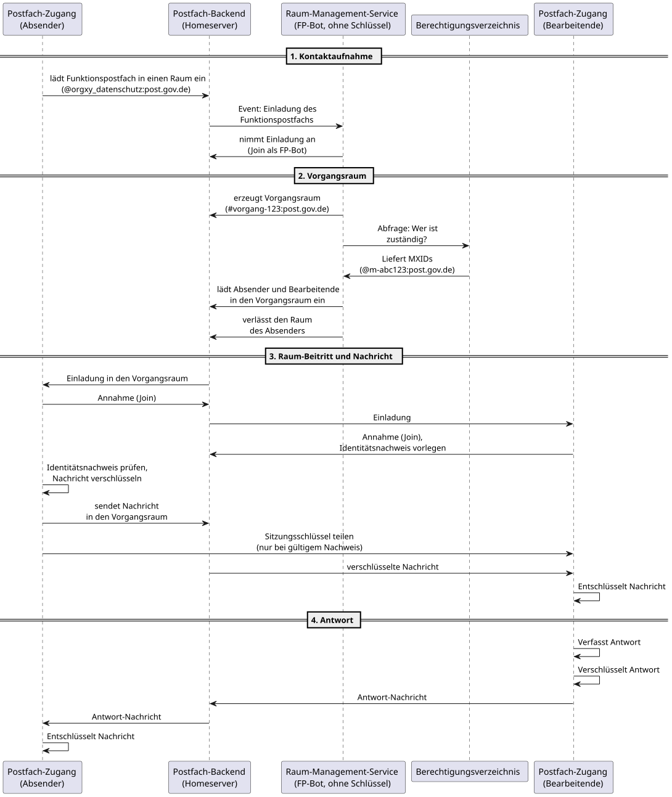

# ADR-1102: Umsetzung von Funktionspostfächern und Vorgangsräumen

> **Status:** ✔️ Operativ entschieden | **Datum:** 12. November 2026

## Kontext und Problembeschreibung

Diese Architekturentscheidung behandelt die Umsetzung der [Funktionspostfächer](../../Glossar.md#funktionspostfach) in einer [Organisation](../../Glossar.md#organisation). Diese [Postfächer](../../Glossar.md#postfach) erlauben es Gruppen, externe Anfragen unter einer gemeinsamen Adresse (z. B. `@datenschutz:firma-xy.de`) entgegenzunehmen. Die zugehörige Bearbeitergruppe besteht aus den berechtigten Mitarbeitenden und [technischen Nutzern](../../Glossar.md#technischer-nutzer), die Anfragen in einzelnen voneinander getrennten [Vorgängen](../../Glossar.md#vorgang) bearbeiten. Im TI-Messenger der gematik findet sich ein entsprechendes Konzept unter dem Begriff “Funktionsaccount” (gemSpec_TI-M_Pro §5.2)[^1].

Im Folgenden wird erläutert, wie das Funktionspostfach zugehörige Vorgänge auf Ende-zu-Ende-verschlüsselte Matrix-Räume abbildet. Dabei wird auf die Verwaltung der Postfachmitgliedschaften in den Bearbeitergruppen, die Umsetzung von [Bearbeitungsvertretungen](../../Glossar.md#bearbeitungsvertretung) und die dafür notwendige Schlüsselverwaltung eingegangen.

### Abgrenzung

- Die allgemeine Umsetzung der [Ende-zu-Ende-Verschlüsselung](../../Glossar.md#ende-zu-ende-verschlüsselung) bei der Mehrbenutzerkommunikation mit Matrix wurde in [ADR-1101](./ADR-1101-Mehrbenutzer-Kommunikation-Festlegung-E2EE-Endpunkte.md) entschieden.
- Eine Bearbeitungsvertretung bezeichnet die Vertretung von Mitarbeitenden in den Bearbeitergruppen der Funktionspostfächer einer Organisation. Davon zu unterscheiden sind Bevollmächtigungen und gesetzliche Vertretungen, die in einer Folgeentscheidung betrachtet werden.

## Entscheidungstreiber

- **Funktionspostfach:** Die Zielarchitektur muss die Nutzung von Funktionspostfächern ermöglichen (ANF_FUN_USE_072).

- **Rollenmodell:** Im Funktionspostfach werden die Rollen Postfachmitglied und [Org-Admin](../../Glossar.md#org-admin) unterschieden (ANF_FUN_USE_074).

- **Postfachverwaltung:** [Nutzer](../../Glossar.md#nutzerinnen) mit der Rolle Org-Admin erteilen und entziehen Zugriffe auf Funktionspostfächer (ANF_FUN_ADR_062).

- **Auditierung:** Änderungen an Bearbeitungsvertretungen und Gruppen sind einer natürlichen Person zuzuordnen und revisionssicher protokolliert (SIC_NAC_NAC_005, ANF_FUN_ADR_070).

- **Datenschutz:** Die organisationsinterne [Identität](../../Glossar.md#identität) der Mitarbeitenden und Organisationsstrukturen sollen nicht nach außen gelangen, wenn dies nicht zwingend erforderlich ist (DAT_ÜBE_ÜBE_021).

- **Bearbeitungsvertretung:** Das System muss berechtigte [Postfachmitglieder](../../Glossar.md#postfachmitglieder) in einen [Vorgangsraum](../../Glossar.md#vorgangsraum) aufnehmen können, ohne dass die ursprünglich zuständige Person mitwirken muss (ANF_FUN_ADR_025).

- **Vertraulichkeit vs. Verfügbarkeit:** Ein an der Ende-zu-Ende-Verschlüsselung teilnehmender technischer Nutzer erhöht die Verfügbarkeit, da neue Mitglieder jederzeit hinzugefügt werden können. Dies erhöht die Angriffsfläche, da die Schlüssel auf einem Server und nicht allein in Endgeräten der Nutzer vorliegen müssen.

- **Trennung Funktionspostfach und Vorgangsraum:** Das Funktionspostfach ist ein fachliches Objekt mit eigener Adresse, dem eine Menge von Vorgangsräumen zugehörig sind.

- **Zugang zur Kommunikationshistorie:** Die bisherige Kommunikation muss neuen Kommunikationsteilnehmern im Raum zugänglich gemacht werden (ANF_FUN_ADR_063).

## Betrachtete Optionen

### Option A: Geteilte Zugangsdaten für Funktionspostfächer

Das Funktionspostfach wird als einzelner Matrix-Account angelegt. Mehrere Mitarbeitende teilen sich die Zugangsdaten und die privaten E2EE-Schlüssel dieses Accounts.

- Gut, denn die Option wäre mit geringem Entwicklungsaufwand umsetzbar.

- Schlecht, denn die Kommunikationsteilnehmer wären nicht eindeutig identifizierbar.

- Schlecht, denn bei Personalwechsel müssen Schlüssel rotiert und neu verteilt werden.

- Schlecht, denn geteilte Zugangsdaten widersprechen dem Zero-Trust-Paradigma.

### Option B: Statische Gruppenräume

Für jede Funktionseinheit wird ein dauerhafter, gemeinsamer Raum erstellt. Externe Partner werden bei Bedarf in diesen einen Raum eingeladen.

- Gut, denn die Option wäre mit geringem Entwicklungsaufwand umsetzbar.

- Schlecht, denn es gäbe keine fachliche Trennung der Vorgänge.

- Schlecht, denn Externe sehen Vorgänge anderer Externer.

### Option C: Fallbasierte Vorgangsräume

Die Kommunikation wird über bedarfsgesteuerte Räume abgewickelt. Ein technischer Nutzer entkoppelt die externe Adressierung von der internen Bearbeitung. Er ermittelt über ein [Berechtigungsverzeichnis](../../Glossar.md#berechtigungsverzeichnis) die Mitglieder der Bearbeitergruppe und lädt deren [MXIDs](../../Glossar.md#mxid) dynamisch in den Raum ein (vgl. [ADR-1101](./ADR-1101-Mehrbenutzer-Kommunikation-Festlegung-E2EE-Endpunkte.md) Option B).

- Gut, denn jeder Vorgang wird in einem eigenen kryptografisch getrennten Raum bearbeitet. Nach außen ist nur das Funktionspostfach sichtbar, innerhalb der Organisation ist der Zugriff über die Bearbeitergruppe geregelt.

- Gut, denn die externe Adressierung und die interne Zuständigkeit sind voneinander unabhängig.

- Gut, denn Bearbeitungsvertretungen lassen sich so durchsetzen.

- Schlecht, denn ein technischer Nutzer ist erforderlich, was die Angriffsfläche vergrößert (vgl. [ADR-1101](./ADR-1101-Mehrbenutzer-Kommunikation-Festlegung-E2EE-Endpunkte.md)).

## Architekturentscheidung

Gewählte Option: **Option C (Fallbasierte Vorgangsräume)**, denn jeder Vorgang erhält einen eigenen kryptografisch isolierten Raum, in dem die Bearbeitung durch einen technischen Nutzer gesteuert wird (organisationseigen oder zentral bereitgestellt, siehe [Raum-Management-Service](../../Glossar.md#raum-management-service), vgl. [ADR-1101](./ADR-1101-Mehrbenutzer-Kommunikation-Festlegung-E2EE-Endpunkte.md) Option B). Externe sehen ausschließlich ihren eigenen Vorgang.

### Funktionspostfach als fachliches Objekt

Das Funktionspostfach ist kein Matrix-Raum, sondern ein dauerhaftes fachliches Objekt der Organisation mit eigener Adresse (MXID), eigenem Berechtigungsprofil und eigener Sicht auf die zugeordneten Vorgänge. Die Adresse des Funktionspostfachs wird im [Adressregister](../../Glossar.md#adressregister) des [Verbundes](../../Glossar.md#verbund) (vgl. Folge-Entscheidung) geführt.

### Raum-Management-Service

Der Raum-Management-Service (RMS) ist die zentrale Komponente für die Verwaltung von Vorgangsräumen im Kontext von Funktionspostfächern. Der RMS kann organisationsintern und zentral bereitgestellt werden:

1.  **Organisationseigener RMS:** Betrieb im [Machtbereich](../../Glossar.md#machtbereich) der Organisation (Org-Server). Der technische Nutzer kann als E2EE-Teilnehmer konfiguriert werden. Der Org-Server muss nicht zwingend ein eigener Matrix-Homeserver sein, er kann auch über einen Matrix-Client an den Verbund angeschlossen sein ([ADR-1101](./ADR-1101-Mehrbenutzer-Kommunikation-Festlegung-E2EE-Endpunkte.md)).

2.  **Zentral bereitgestellter RMS:** Betrieb als Teil des zentralen [Postfach-Backends](../../Glossar.md#postfach-backend), ohne E2EE-Teilnahme. Ein technischer Nutzer verwaltet Räume über unverschlüsselte State [Events](../../Glossar.md#event) und besitzt selbst keine Schlüssel des Raums. Der Klartext ist im zentralen Postfach-Backend damit serverseitig nicht zugänglich. Der technische Nutzer kann jedoch weitere Konten in den Raum einladen. Damit darüber keine Schlüssel abfließen, erhalten von ihm eingeladene Mitglieder Schlüssel nur mit gültigem [Identitätsnachweis](../../Glossar.md#fachlicher-identitätsnachweis) (vgl. Folge-Entscheidung). Die Berechtigungen werden im zentralen Berechtigungsverzeichnis über die Administrationsoberfläche des zentralen Postfach-Backends gepflegt.

Der RMS hat folgende Aufgaben:

- Erzeugung von Vorgangsräumen bei eingehenden oder intern angestoßenen Vorgängen

- Persistente Zuordnung jedes Vorgangsraums zum auslösenden Funktionspostfach

- Synchronisation der aus Postfachmitgliedschaften, Rollen und Bearbeitungsvertretungen abgeleiteten Bearbeitergruppe mit allen zugeordneten Vorgangsräumen

- Vergabe und Anpassung von Rechten (Matrix: Power-Levels) gemäß den Rollen aus dem Berechtigungsverzeichnis

Der RMS bezieht alle Berechtigungs- und Zuordnungsinformationen aus dem Berechtigungsverzeichnis und führt selbst keine Stammdatenpflege durch.

### Vorgangsraum als Matrix-Raum

Ein Vorgang wird in der Zielarchitektur in einem eigenen kryptografisch abgeschlossenen Matrix-Raum (Vorgangsraum) bearbeitet. Mindestens für die Dauer der Bearbeitung eines Vorgangs bleibt ein Vorgangsraum bestehen. Bei einem neuen Anlass für die Kommunikation an ein Funktionspostfach wird ein neuer Vorgangsraum erzeugt.

Jedem Funktionspostfach ist eine Bearbeitergruppe zugeordnet, die durch den Raum-Management-Service (RMS) auf Basis des Berechtigungsverzeichnisses verwaltet wird. Die Mitglieder der Bearbeitergruppe erhalten Zugang zu den Vorgangsräumen des Funktionspostfachs. Eine Änderung der Mitgliedschaften wird durch den RMS automatisch auf alle Vorgangsräume übertragen. Bei der E2EE-Teilnahme des RMS erhalten hinzukommende Mitarbeitende über die automatische Schlüsselweitergabe Zugriff auf die gesamte Historie des Raums. Ohne E2EE-Teilnahme müssten Schlüssel alter [Nachrichten](../../Glossar.md#nachricht) durch aktive Raummitglieder geteilt werden. Aus dem Raum ausgeschiedene Mitarbeitende können neue Nachrichten nicht mehr einsehen.

### Aggregierte Postfachsicht

Mitarbeitende, Clients und [Fachverfahren](../../Glossar.md#fachverfahren) können über das Funktionspostfach eine aggregierte Sicht auf alle zugeordneten Vorgangsräume erhalten. Die aggregierte Sicht ist eine fachliche Postfachsicht und kein gemeinsamer Matrix-Gruppenraum. Sie wird über Schnittstellen des Postfach-Backends bereitgestellt und gemäß den Berechtigungen aus dem Berechtigungsverzeichnis gefiltert.

Die aggregierte Postfachsicht stützt sich auf den Raum-Management-Service, der die Zuordnung von Vorgangsräumen zum Funktionspostfach kennt. Sie zeigt jeder anfragenden Identität ausschließlich die Vorgangsräume, in denen sie Mitglied ist.

### Absenderkontext einer Nachricht

Für jede aus einem Vorgangsraum versendete Nachricht muss der fachliche Absenderkontext nachvollziehbar sein. Der Kontext umfasst mindestens die technische Sender-MXID, Organisation oder Funktionspostfach, den Versandzeitpunkt und die zum Versandzeitpunkt gültige Berechtigung aus dem Berechtigungsverzeichnis. Die organisationsinterne Identität der Mitarbeitenden verlässt die Organisation nur, wenn dies notwendig ist. Wie diese fachliche Aussage gegenüber Empfangenden nachgewiesen wird, wird in einer Folge-Entscheidung geregelt.

### Details der gewählten Option

#### Verwaltung des Vorgangsraums

Die externe Adressierung eines Funktionspostfachs ist von der internen Bearbeitung entkoppelt.

- Die Einladung an die Adresse des Funktionspostfachs (z. B. an `@datenschutz:firma-xy.de`), nimmt der technische Nutzer an.  Der RMS lädt über den technischen Nutzer die Mitglieder der Bearbeitergruppe in den Vorgangsraum (z. B. `#datenschutz-123:firma-xy.de`) ein und verwaltet die Mitgliedschaften. Welche Seite den Raum erzeugt und wie die Räume zwischen den Organisationen geschnitten sind, regelt die Folge-Entscheidung.

- Sendet ein Postfachmitglied aus einem anderen Funktionspostfach, erzeugt der senderseitige RMS einen Verbindungsraum mit dem technischen Nutzer (RMS) der Gegenseite oder einen gemeinsamen Vorgangsraum direkt mit der empfangenden Person. Genaueres ist in einer Folgeentscheidung geregelt.

- Der RMS ermittelt über das Berechtigungsverzeichnis die Mitglieder der Bearbeitergruppe und lädt deren pseudonyme MXIDs in den Raum ein. Er weist den Mitarbeitenden die Rechte zu, die sich aus ihrer Rolle im Funktionspostfach ergeben.

- Der externe Kommunikationspartner ist Mitglied des Vorgangsraums und durch einen übermittelten Nachweis identifizierbar.

- Um historische Nachrichten neu beitretenden Teilnehmern zugänglich zu machen, wird der Raum geeignet konfiguriert. Dazu wird die Einstellung `m.room.history_visibility` vom RMS bei der Raumerzeugung auf `shared` gesetzt [^2].

- Wird ein neuer Teilnehmer zum Raum hinzugefügt, erhält dieser die Megolm-Session-Keys der bestehenden Nachrichten vom technischen Nutzer (sofern dieser E2EE-Teilnehmer ist) oder von Clients aktiver Mitarbeitender [^3]. Die bisherige Kommunikation wird ihm damit zugänglich gemacht.

- Externe Kommunikationsteilnehmer sehen ausschließlich ihre eigenen Vorgänge.

#### Trennung von Raumadministration und Kommunikation

Der technische Nutzer ist administrativer Teilnehmer im Raum und lädt berechtigte Personen in diesen Raum ein, wobei er ihnen Rechte (Power-Levels) zum Lesen, Schreiben oder Moderieren zuweist.

#### Rollen

Im Funktionspostfach werden die fachlichen Rollen Postfachmitglied und Org-Admin unterschieden (vgl. ANF_FUN_USE_074). Org-Admins verwalten die Zuordnung von Personen zu Funktionspostfächern, Postfachmitglieder bearbeiten die zugeordneten Vorgänge.

Im Vorgangsraum werden die fachlichen Rollen über Matrix-Power-Levels abgebildet. Power-Levels regeln die Raumadministration und das Senderecht im Raum. Den Lesezugriff auf Nachrichteninhalte regeln sie nicht. Dieser ergibt sich aus der E2EE-Schlüsselverteilung:

- **Raum-Administrator (Org-Admin oder technischer Nutzer):** Höchste Berechtigungsstufe im Raum (Power-Level 100). Ausschließlich für Raumverwaltung (Einladungen, Vergabe von Power-Levels) zuständig.

- **Moderator (Postfachmitglied mit erweiterten Rechten):** Kann zusätzliche berechtigte Postfachmitglieder als Bearbeitungsvertretung dem Raum hinzufügen (z. B. Power-Level 50).

- **Bearbeiter (Postfachmitglied):** Reguläre Schreib- und Leserechte für die Fallbearbeitung.

- **Lesende (Postfachmitglied oder Systeme):** Ausschließlich Leserechte (z. B. für eine Archivierungskomponente).

Der technische Nutzer ist gemäß ANF_FUN_IDE_047 für die anderen Kommunikationsteilnehmer als solcher zu kennzeichnen. [Postfach-Zugänge](../../Glossar.md#postfach-zugang) zeigen diese Kennzeichnung an. Administrative Änderungen sind revisionssicher zu protokollieren (vgl. ANF_FUN_ADR_070).

#### E2EE-Beteiligung der Administration

Administrative Vorgänge in Matrix (Einladungen, Power-Levels) sind State Events und erfolgen unverschlüsselt. Der technische Nutzer benötigt für die Raumverwaltung keine E2EE-Schlüssel. Grundlage ist die in der Matrix-Spezifikation definierte Trennung von State Events und Message Events [^4]. Beim organisationseigenen RMS entscheidet die Organisation, ob der technische Nutzer zusätzlich als E2EE-Teilnehmer konfiguriert wird:

- **Mit E2EE-Teilnahme:** Der technische Nutzer kann Schlüssel an neue Teilnehmer weitergeben, sodass diese die bisherige Kommunikationshistorie lesen können. Archivierung und Malware-Prüfung sind serverseitig umsetzbar. Der Server hält Schlüsselmaterial persistent vor und ist entsprechend abzusichern.

- **Ohne E2EE-Teilnahme:** Der technische Nutzer verwaltet die Bearbeitergruppe des Raums. Da er keine Schlüssel des Raums besitzt, kann er diese nicht an hinzugefügte Teilnehmer weitergeben. Damit neue Teilnehmer Zugriff auf die Kommunikationshistorie erlangen, muss ein aktiver E2EE-Teilnehmer die Schlüssel teilen. Wie die Einladung durch technische Nutzer umgesetzt wird, ist offen (vgl. Folge-Entscheidung). Damit der Zugang zum Vorgangsraum und den alten Nachrichten für die Organisation erhalten bleibt, lädt das System die festgelegten Bearbeitungsvertretungen bereits zu Beginn in den Raum ein. Es muss bei der Konfiguration entsprechend gewarnt werden, wenn eine Konfiguration nicht mindestens zwei Mitglieder mit Schlüsselbesitz hätte. Diese Variante ist Basis für die Umsetzung des zentral bereitgestellten RMS.

#### Manuelle Raumverwaltung durch Moderatoren

Die laufende Raumverwaltung kann auch durch menschliche Moderatoren erfolgen, unabhängig von der Entscheidung zur E2EE-Beteiligung des technischen Nutzers. Der RMS lädt weiterhin über den technischen Nutzer die Mitglieder der Bearbeitergruppe ein. Das Einladen neuer Teilnehmer und das Setzen der Berechtigungen erfolgt durch die Moderatoren. Der technische Nutzer verlässt den Raum nach der initialen Erzeugung. Seit Raumversion 12 können ihn die Moderatoren als Ersteller des Raums nicht entfernen. Er verlässt den Raum deshalb selbst und erhält mit einer erneuten Einladung alle Rechte zurück.[^5] Danach findet die Raumverwaltung nur noch manuell statt.

Die manuelle Raumverwaltung durch Moderatoren eignet sich insbesondere für Kommunikation mit besonderen Anforderungen an die Vertraulichkeit, bei der ein dauerhafter Zugriff des technischen Nutzers auf den Raum nicht gewünscht ist.

## Auswirkungen

- Die Schlüsselrotation bleibt auf den jeweiligen Vorgangsraum begrenzt und betrifft nicht die gesamte Organisation.

- Archivierung lässt sich durch technische Nutzer als Raumteilnehmer realisieren (unter Kontrolle der jeweiligen Organisation).

- Fachverfahren können die Raumverwaltung über ein zentral bereitgestelltes SDK umsetzen.

- Bearbeitungsvertretungen lassen sich flexibel organisieren. Personen können zum jeweiligen Raum hinzugefügt oder daraus entfernt werden (vgl. Folge-Entscheidung).

- Bei Nutzung des zentral bereitgestellten RMS sind Bearbeitungsvertretungen zwar automatisiert verfügbar, der Zugriff auf alte Nachrichten für neue Teilnehmer hängt dann an der Schlüsselweitergabe aktiver Mitglieder. Durch das initiale Einladen der Vertretenden und die Warnung, wenn es weniger als zwei Schlüsselhalter (Mitglieder) gibt, werden die Risiken begrenzt (ANF_FUN_ADR_063 eingeschränkt erfüllt, siehe Risiken).

## Risiken

- MLS-Kompatibilität: Je nach Umsetzung von MLS in Matrix kann die Trennung von unverschlüsselten State Events und verschlüsselten Message Events entfallen (siehe z. B. MSC4256[^6]). Ein technischer Nutzer müsste dann MLS-Gruppenmitglied sein, um den Raum verwalten zu können. Die Möglichkeit der Administration “ohne E2EE-Teilnahme” stünde in diesem Fall nicht mehr zur Verfügung. Darüber hinaus bietet MLS kein natives Verfahren für den Historienzugriff neuer Teilnehmer [^7]. Eine Bearbeitungsvertretung könnte nur Nachrichten ab dem Zeitpunkt ihres Beitritts einsehen, sofern kein Workaround auf Applikationsebene geschaffen wird.
  Ob ein zentral bereitgestellter RMS mit MLS umsetzbar bleibt, hängt von der konkreten Umsetzung in Matrix ab und ist derzeit nicht abschließend zu beurteilen.

- Mit dem RMS ohne einen technischen Nutzer mit Schlüsselbesitz, wie zum Beispiel beim zentral bereitgestellten RMS, kann der Zugriff auf alte Nachrichten unmöglich werden, wenn es keine Mitarbeitenden mit Schlüsselbesitz mehr gibt. Aus diesem Grund soll das System warnen, wenn weniger als zwei Schlüsselhalter konfiguriert werden. Ein Schlüsselbackup ist darüber hinaus wichtig (siehe Folgeentscheidung). Will eine Organisation auch dieses Restrisiko nicht tragen, kann der RMS mit Schlüsselhaltung selbst betrieben werden ([ADR-1103](./ADR-1103-Mehrbenutzer-Organisationen-Betriebsmodelle.md)).

- Ein kompromittierter Server, auf dem der technische Nutzer betrieben wird, betrifft alle Räume, in denen dieser Teilnehmer ist. Die Absicherung des Servers ist daher sicherheitskritisch (siehe [ADR-1101](./ADR-1101-Mehrbenutzer-Kommunikation-Festlegung-E2EE-Endpunkte.md)).

- Bei manueller Raumverwaltung lassen sich Vertretungen auch nur durch menschliche Moderation umsetzen. Ohne Moderatoren im Raum ist keine Verwaltung mehr möglich.

## Folge-Entscheidungen

- **Absenderkontext:** Die kryptografische Bindung von fachlicher Identität, MXID und Geräteidentität im Vorgangsraum sowie die Weitergabe von Schlüsseln nur an Mitglieder mit gültigem Identitätsnachweis, siehe [ADR-1106](./ADR-1106-Fachlicher-Identitaetsnachweis-Matrix-Nachrichtenkontext.md).

- **Berechtigungsverzeichnis:** Erlaubt die Verwaltung der Zuordnung von Personen und technischen Nutzern zu Funktionspostfächern und das Setzen von Berechtigungen, siehe [ADR-1112](./ADR-1112-Berechtigungsverzeichnis-Funktionspostfächer.md).

- **Raumtopologie bei Kommunikation mit Funktionspostfächern:** Erzeugung und Verwaltung der Vorgangsräume und Weitergabe historischer Schlüssel an neue Mitglieder, siehe [ADR-1109](./ADR-1109-Raumtopologie-Funktionspostfaecher.md).

- **Archivierung:** Die Veraktung oder Archivierung ist automatisiert über technische Nutzer als E2EE-Teilnehmer möglich, siehe [ADR-1135](./ADR-1135-Veraktung-und-Aufbewahrung.md).

- **Bevollmächtigung und gesetzliche Vertretung**, gerichtliche oder behördlich angeordnete Vertretung, Vormundschaften, Prokura etc., siehe [ADR-1113](./ADR-1113-Externe-Bevollmaechtigung-und-gesetzliche-Vertretung.md).

- **Zuordnung der RMS-Betriebsvarianten** zu [Betriebsmodellen](../../Glossar.md#betriebsmodell), siehe [ADR-1103](./ADR-1103-Mehrbenutzer-Organisationen-Betriebsmodelle.md).

- **Adressregister für Organisationen:** Die Zuordnung von Postfachadressen zu Organisationen ist über das Adressregister des Verbundes abfragbar, siehe [ADR-1111](./ADR-1111-Auflösung-Organisationsbezogene-Postfachadressen.md).

- **Schlüsselwiederherstellung:** siehe [ADR-1147](./ADR-1147-Schluesselwiederherstellung.md).

## Offene Punkte

- Beim TI-Messenger der gematik werden die “Funktionsaccounts” als Endpunkte im VZD-FHIR-Directory gelistet. Die Konzepte zur Automatisierung werden aktuell noch weiterentwickelt und müssen beobachtet werden.[^8]

## Referenzen

[^1]: [gematik gemSpec TI-M Pro V1.1.1, §5.2 Funktionsaccounts](https://gemspec.gematik.de/docs/gemSpec/gemSpec_TI-M_Pro/gemSpec_TI-M_Pro_V1.1.1/), abgerufen am 11. Mai 2026.

[^2]: [Matrix Spec, Room history visibility](https://spec.matrix.org/latest/client-server-api/#room-history-visibility), abgerufen am 11. Mai 2026.

[^3]: [Matrix Spec, Sharing keys between devices](https://spec.matrix.org/latest/client-server-api/#sharing-keys-between-devices), abgerufen am 11. Mai 2026.

[^4]: [Matrix Spec, Types of room events](https://spec.matrix.org/latest/client-server-api/#types-of-room-events), abgerufen am 11. Mai 2026.

[^5]: [Matrix Spec, Room Version 12](https://spec.matrix.org/latest/rooms/v12/), abgerufen am 11. November 2026.

[^6]: [Matrix Spec Proposal MSC4256: MLS-Verschlüsselung in Matrix](https://github.com/matrix-org/matrix-spec-proposals/pull/4256), abgerufen am 11. Mai 2026.

[^7]: [RFC 9420 (MLS), Abschnitt 3 Protocol Overview](https://www.rfc-editor.org/rfc/rfc9420#section-3), abgerufen am 11. Mai 2026.

[^8]: [gematik, Entwurf gemF_TI-M_Automatisierung (Automatisierung und Bots; Bot-Engine)](https://gemspec.gematik.de/prereleases/Draft_gemF_TI-M_Automatisierung/), abgerufen am 21. Juni 2026.
