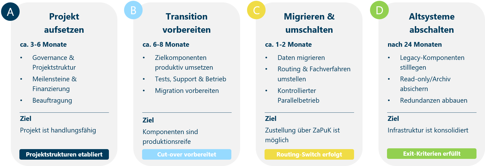
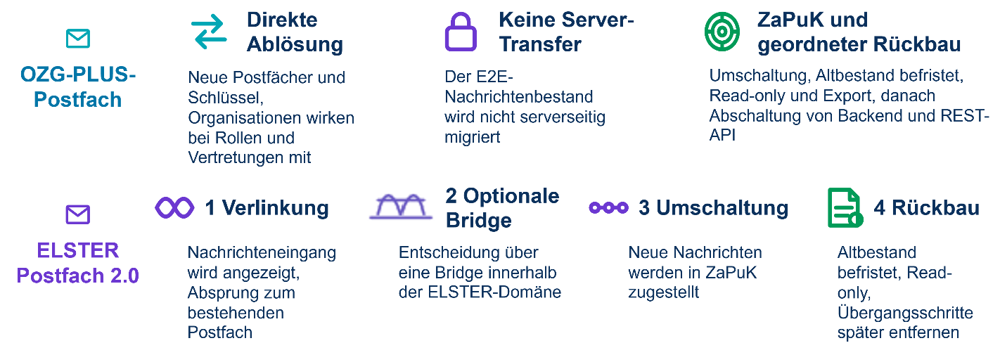

# Föderale Zielarchitektur für Postfach- und Kommunikationslösungen

***Bauplan einer modernen Kommunikationsinfrastruktur für Privatpersonen, private Organisationen und öffentliche Stellen***

**Version 1.1** &ndash; **Stand: 06.10.2026** &ndash; **Übergreifende Transitionsstrategie**

> Dieses Dokument ist die maschinenlesbare Textfassung des Dokuments, das dem IT-Planungsrat zur 51. Sitzung vorgelegt wurde. Es liegt dem Beschluss [B-2026/43-IT](https://www.it-planungsrat.de/beschluss/b-2026-43-it) als [PDF](https://www.it-planungsrat.de/fileadmin/beschluesse/2026/Beschluss_2026_43_ZaPuK_Transitionsstrategie.pdf) bei. Bei der Überführung wurden redaktionelle Änderungen für eine bessere Lesbarkeit und Anpassung an die openCode-Struktur vorgenommen.

------

## Dokumentübersicht

Das vorliegende Dokument gibt einen Überblick über die Transitionsstrategie und enthält die einzeln ausgearbeiteten Transitionspläne für die bestehenden Postfachlösungen "Zentrales Bürgerpostfach" als Teil der BundID, "Mein Justizpostfach", "Mein ELSTER"-Fachportal sowie OZG-Plus-Postfach und Postfach 2.0 (beide Teil von "Mein Unternehmenskonto"). Die in der folgenden Tabelle aufgelisteten Begleitdokumente geben einen tieferen Einblick in die im vorliegenden Dokument zusammenfassend dargestellten Inhalte.

| Titel                               | Dokumentenart       | Inhalt                                                                                                      |
| ----------------------------------- | ------------------- | ----------------------------------------------------------------------------------------------------------- |
| [Überblick und Handlungsempfehlungen](/Zielarchitektur/Zusammenfassung/README.md) | Klammerdokument     | Übergreifende Zusammenfassung des Vorhabens und Darstellung strategischer Implikationen                     |
| [Zielarchitektur](/Zielarchitektur/Architekturkonzept/README.md)   | Begleitdokument | Fortschreibung der auf die Ziele des Vorhabens ausgerichteten Zielarchitektur                           |
| **Übergreifende Transitionsstrategie**  | **Begleitdokument**     | **Transitionsstrategie zur schrittweisen Überführung bestehender Postfachlösungen in die ZaPuK-Infrastruktur** |
| [Rechtsgutachten](/Zielarchitektur/Rechtsgutachten/README.md)                     | Begleitdokument     | Prüfung der rechtlichen Rahmenbedingungen sowie Ableitung von Handlungsempfehlungen für die Umsetzung       |

## Nutzungsbedingungen

Die Inhalte dieses Dokumentes unterliegen der [Creative Commons Namensnennung 4.0 International Public License (CC BY 4.0)](https://creativecommons.org/licenses/by/4.0/).

------

## 1. Management Summary

Ziel des Arbeitspakets 2.2 "Transitions- und Migrationsplanung" war es, den Übergang (Transition) von einer heterogenen Landschaft bestehender Postfachlösungen hin zu einer zentralen, föderalen Zielarchitektur für Postfach- und Kommunikationslösungen (ZaPuK) gemeinsam mit den Bestandslösungen zu planen. Die Transition der bestehenden Postfachlösungen "Zentrales Bürgerpostfach" als Teil der BundID (ZBP/BundID), "Mein Justizpostfach" (MJP), "Mein ELSTER"-Fachportal sowie OZG-PLUS-Postfach und Postfach 2.0 (beide Teil von "Mein Unternehmenskonto" – MUK) orientiert sich an einem koordinierten, phasenweisen Programm bzw. Ausbaustufen mit lösungsspezifischen Transitionspfaden. Damit erfolgt keine einheitliche Stichtagmigration. Gemeinsamer Zielpunkt dieser konsolidierten Postfach- und Kommunikationsinfrastruktur ist u. a. die Verfügbarkeit eines zentralen Postfach-Zugangs, der auf dem modernen und offenen Standard "Matrix" basiert, Backends für natürliche und juristische Personen, durchgehende Ende-zu-Ende-Verschlüsselung (End-to-End-Encryption, E2EE) sowie sukzessive Abschaltung redundanter Legacy-Infrastruktur. Die übergreifende Transitionsstrategie dient als übergeordneter Handlungsrahmen von der Schaffung gemeinsamer Zielkomponenten und der Herstellung einer Betriebsgrundlage bis zur abgeschlossenen Umstellung der Fachverfahren und Dekommissionierung von Altsystemen.

ZaPuK bildet als Teil des D-Stacks die Grundlage für eine interoperable Postfach- und Kommunikationsinfrastruktur. Aufbauend auf den Inhalten der Transitionsplanung werden in Programmphase III zentrale Komponenten umgesetzt und Bestandslösungen migriert. Bundesportal und perspektivisch Deutschland-App dienen als zentraler Zugang, während bestehende Authentifizierungslösungen wie BundID, eID, European Digital Identity Wallet (EUDI-Wallet) und MUK nachgenutzt werden.

Empfehlung: Die Bestandslösungen werden schrittweise in die ZaPuK-Infrastruktur überführt. ZBP/BundID bildet den Ausgangspunkt und wird einschließlich der Bestandsdaten in die neue Infrastruktur migriert. Fachverfahren werden sukzessive über FIT-Connect angebunden. MJP und die MUK-Postfächer werden funktionell abgelöst. EGVP bleibt in seiner bisherigen Kernfunktion bestehen. MUK bleibt als Identitäts- und Authentifizierungslösung bestehen. Die Postfächer von OZG-PLUS und Postfach 2.0 werden dabei über spezifische Übergangslösungen konsolidiert. Mein ELSTER wird aufgrund der engen Fachlogik schrittweise angebunden, wobei geeignete Nachrichten künftig über ZaPuK zugestellt werden.

Die langfristige, über die Programmphase III hinausgehende Strategie beabsichtigt überdies die Zusammenführung jeglicher anlassbezogenen Kommunikation mit dem Staat in der ZaPuK-Infrastruktur über alle Verwaltungsbereiche hinweg.

## 2. Zielsetzung und Geltungsbereich

Die übergreifende Transitionsstrategie definiert den gemeinsamen Handlungsrahmen aller beteiligten Stakeholder im Zuge des Übergangs von isolierten IT-Systemen hin zu einer konsolidierten Postfach- und Kommunikationsinfrastruktur im Zuge der ZaPuK. Im Geltungsbereich der Transitionen im ZaPuK-Programm liegen:

- Zentrales Bürgerpostfach als Teil der BundID
- Mein Justizpostfach
- Mein ELSTER-Fachportal
- OZG-Plus-Postfach und Postfach 2.0 im Mein Unternehmenskonto

Die Transition jeder dieser Bestandslösungen, insbesondere die Phasen, Maßnahmen, Verantwortlichkeiten und erwarteten Ergebnisse, wird jeweils in einem eigenen Transitionsplan beschrieben. In diesem Zusammenhang werden ebenfalls nötige Transitionen im D-Stack, insbesondere beim Zentralen Nutzenden-Frontend (Bundesportal, Deutschland-App) und FIT-Connect, peripher eingeplant und koordiniert. Die Transitionspläne sind lebende Dokumente, die bei neuen Erkenntnissen und veränderten Rahmenbedingungen angepasst werden. Getroffene Entscheidungen zum Transitionsvorgehen werden in Entscheidungen zu Transitionsarchitekturen (engl. Transition Architecture Decision Records, TADR) nachvollziehbar dokumentiert.

Nicht Bestandteil dieses Dokumentes sind eine verbindlich terminierte Meilensteinplanung, Ressourcenbedarfsplanungen sowie die Transition möglicher weiterer Postfach- und Kommunikationslösungen über den Geltungsbereich hinaus.

## 3. Strategische Leitprinzipien

Zur Unterstützung des gemeinsamen Handlungsrahmens in der Transition wurden strategische Leitprinzipien aufgestellt. Diese legen den Entscheidungs- und Priorisierungsrahmen fest, helfen bei der Übersetzung von Abstraktion in praxistaugliche Handlungsoptionen und reduzieren Komplexität durch Orientierung auf gemeinsam abgestimmte Grundregeln. Im Kern dienen sie einem stufenweisen Vorgehen, das der ZaPuK-Zielarchitektur entspricht und Planungssicherheit im Zuge der Konsolidierung gibt. Die sieben Leitprinzipien gliedern sich wie folgt auf:

1. **Phasen statt Big Bang:** Abgestimmte, schrittweise Transition mit klar definierten Kriterien für Zwischenzustände und die spätere Dekommissionierung.
2. **Zielarchitektur als Leitplanke:** Neue Funktionen werden konsequent in ZaPuK umgesetzt, Bestandslösungen werden nur soweit erforderlich für den Übergang angepasst.
3. **E2E ohne Abstriche:** Die Ende-zu-Ende-Verschlüsselung bleibt erhalten, Bridges kommen nur übergangsweise und an zulässigen Stellen zum Einsatz.
4. **Ein Frontend, differenzierte Postfächer:** Ein zentraler Postfachzugang wird mit spezifischen Backends für natürliche und juristische Personen kombiniert.
5. **Funktionalität vor Abschaltung:** Bestandskomponenten werden erst zurückgebaut, wenn der Zielbetrieb produktiv, getestet, skalierbar und supportfähig ist.
6. **Klare Führungslogik:** Es gibt einen verbindlichen Zustellkanal, weitere Anzeigen einer Nachricht erfolgen lediglich als entsprechend gekennzeichnete Kopien.
7. **Dezentral umsetzen, zentral steuern:** Die Umsetzung erfolgt lokal bzw. dezentral, aber entlang einer gemeinsamen Roadmap sowie gemeinsamer SDKs, Kommunikation und Steuerung.

## 4. Übergreifendes Phasenmodell

Alle Transitionspläne unterliegen einem einheitlichen Vier-Phasen-Modell (Phase A-D), in dem die folgenden Phasen fachlich sowie technisch aufeinander aufbauen. Dabei ist anzumerken, dass die o. g. Bestandslösungen die Phasen nicht zwingend gleichzeitig durchlaufen werden und sich die Phasen einer Lösung überlappen können. Allgemein gilt: Zunächst werden die zentralen Komponenten und Betriebsprozesse entwickelt. Dazu zählen insbesondere das zentrale Frontend und dedizierte Backends, Adressregister, Self-Service-Portal, SDK sowie erforderliche Übergangstechnologien wie Protokollkonverter und Bridges. Programmweite Quality Gates stellen die notwendige Reife sicher, bevor bestehende Postfächer und Funktionalitäten angebunden und integriert werden.

Die einzelnen Phasen, welche die Grundlage für alle Transitionsprojekte darstellen, sind Abbildung 1 zu entnehmen.

> _Abbildung 1: Transitionsphasen_

## 5. Lösungsspezifische Transitionspläne

Die lösungsspezifischen Transitionspläne zeichnen den Weg der Überführung bestehender Komponenten, Schnittstellen und Systeme hin zu einer zentralen Kommunikations- und Postfachinfrastruktur. Nachfolgend werden die Transitionspfade je Postfachlösung in Kurzform beschrieben. Für eine detaillierte Betrachtung relevanter Maßnahmen, Verantwortlichkeiten usw. dienen die Transitionspläne je Bestandslösung. Diese befinden sich im Anhang zu diesem Dokument.

### 5.1 Zentrales Bürgerpostfach der BundID

Das ZBP wird vollständig in das Matrix-basierte Backend für Privatpersonen überführt. Das zentrale Postfach-Frontend ersetzt den bisherigen Postfach-Zugang. Die BundID bleibt als Authentifizierungskomponente bestehen. Die bestehende ZBP-API wird für eine Übergangszeit über eine ZBP-Matrix-Bridge weitergeführt. Zur Umsetzung dieses Zielbilds sind auszugsweise die nachfolgenden aufeinander aufbauenden Transitionsschritte vorgesehen:

1. Aufbau und Produktivsetzung des Backends für Privatpersonen,
2. Migration der Nachrichten, Statusmonitor-Daten und Metadaten nach abgeschlossenen Migrationstests,
3. Aufbau und Produktivsetzung des zentralen Postfach-Frontends im Bundesportal und in einer zukünftigen Deutschland-App,
4. Umstellung auf Bundesportal, automatische Weiterleitung aus bisherigem BundID-Postfach-Frontend zum Bundesportal und Abschaltung des ZBP-Backends,
5. gleichzeitig: Parallelbetrieb der ZBP-API für Fachverfahren und Onlinedienste über eine Matrix-Bridge, keine Neu-Registrierung für die Legacy-API,
6. Schrittweise Umstellung der Fachverfahren auf Matrix-basierte Schnittstellen und anschließend Abschaltung der Bridge.

### 5.2 Mein Justizpostfach

Das MJP wird funktionell durch den zentralen Postfach-Zugang sowie die Backends für Justiz-Organisationen und für Privatpersonen ersetzt. Die Anbindung der justizseitigen EGVP-Infrastruktur erfolgt über einen OSCI-Matrix-Protokollkonverter als Teil des Backends für Justiz-Organisationen. Der Protokollkonverter vermittelt bidirektional zwischen EGVP und Matrix-basierter Infrastruktur unter Aufrechterhaltung der E2EE. Die EGVP-Infrastruktur bleibt unverändert im Betrieb. Zur Umsetzung dieses Zielbilds sind auszugsweise die nachfolgenden aufeinander aufbauenden Transitionsschritte vorgesehen:

1. Erweiterung des zentralen Postfach-Frontends um EGVP-Ver-/Entschlüsselung inkl. Schlüsselverwaltung,
2. Bereitstellung des Backends für Justiz-Organisationen und des Protokollkonverters,
3. Migration der MJP-Bestandsdaten in das Backend für Privatpersonen,
4. Abschaltung von MJP-Frontend und -Backend nach stabilem Praxisbetrieb.

### 5.3 OZG-Plus-Postfach und Postfach 2.0 des Mein Unternehmenskonto

Die bisherigen Postfach-Frontends und -Backends im MUK entfallen und werden im zentralen Postfach-Zugang funktionell neu abgebildet. Das MUK verbleibt weiterhin als Authentifizierungskomponente für juristische Personen. Für die jeweiligen Postfächer ergeben sich dabei getrennte Übergangspfade, die der Abbildung 2 zu entnehmen sind.

> _Abbildung 2: Getrennte Übergangspfade für MUK-Postfächer_

Das OZG-Plus-Postfach kann direkt abgelöst und funktionell innerhalb von ZaPuK integriert werden. Dabei stehen die Neuanlage der Postfächer und Schlüssel, die Schaffung von Funktionspostfächern sowie Rollen- und Vertretungsfunktionen im Vordergrund. Eine serverseitige Migration des verschlüsselten Nachrichtenbestandes erfolgt nicht; übergangsweise ist ein clientseitiger Export von Altdatenbeständen im Read-Only-Betrieb möglich. Nach einer entsprechenden Frist können die redundanten Infrastruktur-Komponenten abgeschaltet werden.

Für das Postfach 2.0 wird zunächst eine Verlinkung im Frontend dargestellt und es werden Metadaten zu den im Postfach 2.0 eingehenden Nachrichten an die ZaPuK-Postfach-Backends übermittelt. Auch die Anbindung einer Bridge innerhalb der ELSTER-Domäne ist möglich, da die Nachrichten beim Eingang im Postfach 2.0 temporär unverschlüsselt im Server vorliegen.

### 5.4 Mein ELSTER-Portal

Die Transition für das Mein ELSTER-Portal wird durch eine technische Anbindung mittels Bereitstell-Bridge und tiefere Einbindung durch das SDK mit der Notwendigkeit eines dauerhaften Parallelbetriebes beschrieben. Grund hierfür ist die enge Kopplung von Postfachfunktionalität und Fachlogik. Für das Postfach des ELSTER-Fachportals erfolgt eine schrittweise Anbindung, bei der Nachrichten bei passender Datenart via Bridge im zentralen ZaPuK-Postfach bereitgestellt werden. In einem weiteren perspektivischen Schritt erfolgt die Bereitstellung Matrix-nativ über das Postfach eines:r Sachbearbeiter:in in das ZaPuK-Postfach.
