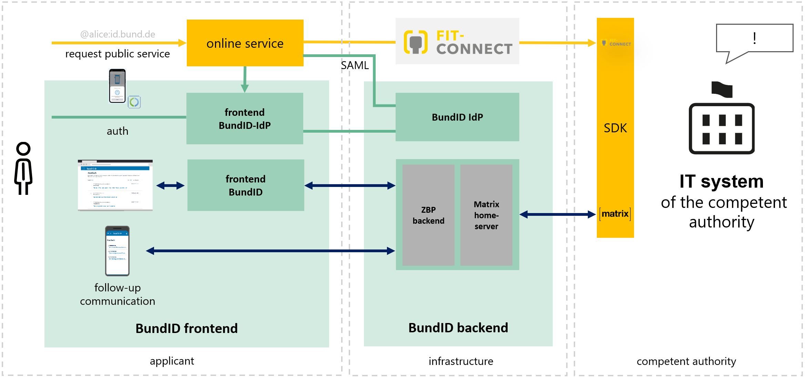

<!--
SPDX-FileCopyrightText: 2025 FITKO (Föderale IT-Kooperation)

SPDX-License-Identifier: CC-BY-SA-4.0
-->

# Context and Scope

## Business Context

After a private individual requested some government service via an existing
web service [Onlinedienst], the competent authority [zuständige Fachbehörde]
may need to re-contact the applicant, e.g. for further questions or in order to
announce the authority's decision [Bescheid].

In this context, the project is to be conducted within the existing legal
framework for follow-up communication [Antragsfolgekommunikation] between
public bodies and private individuals: [§§ 8 (5) and 9 Online Service Act
(OZG)](https://www.gesetze-im-internet.de/ozg/BJNR313800017.html).

### Detailed Description of Target Groups

> Information that is validated through user interviews are in bold. That
does not mean that the other insights are not correct. They might just not have
come up in the interviews e.g. forgetting a password.

| Target group | Bürger:innen (citizens) | Sachbearbeiter:innen (case worker) |
| ------------ | ----------------------- | ---------------------------------- |
| Name | Pia Privatperson | Sascha Sachbearbeiter |
| Context of use | **Private individuals who are in contact with a public regarding an official matter; Private individuals want to deal with the matter as quickly as possible; The target group wants to do this from home or on the go (?); On their cell phone, PC, or both! Last went through the process 6-12 months ago** | Works with different but recurring specialist procedures every day; Often has to switch between cases; Often has to request more information or issue a decision; Works from home or the office on a PC; Is interrupted during tasks |
| Tasks | **Search for Online Antrag**; Start by registering and logging in to Bund-Id; **Wait for feedback (however long); Recheck with Fachbehörde, if everything is still moving**; Read and understand the message that the status has changed; Know where to log in to get information; Log in; Read and understand the message; Know **how to reply and what to reply; in which format; Attach any additional documents; Receive Bescheid; File Bescheid**; Reactivate forgotten password; **get in touch with Fachbehörde to make their case clear** | Review and evaluate submitted technical procedures; Provide feedback; Ask appropriate questions/make additional requests; Send to the right person; Send reminder/reminder message if necessary; Review, process, and file returned information; Create and send notification; Complete process |
| Functional Results | **Completed application with a quick and easy communication** | Completed application; Quick and easy communication, Good; neatly filed documentation |
| Fears & Challenges | **Data protection; providing the agency with incorrect information, which prolongs the process;** fear of deleting something/doing something wrong; forgetting logins | Many cases at once; interruptions at work; new technologies that create extra work/are complicated IT changes “I don't understand how that works.” “Why do we need that?” Seemingly unnecessarily complicated; does not integrate with existing solutions |
| Needs | be guided; **understand clearly and simply what needs to be done;** know that you can't do anything wrong; always have a way back; feel confident using the technology; **know what the status is; have the information in your hands -> file it away (know where everything is); have the possibility to get in touch with relevant personal; needs to know that the solution is secure** | Complete a task in one go without having to take too many extra steps; Learn quickly and easily how communication works; Not having to download and upload again to send it; Good documentation of the communication; A good way to integrate it into the file storage system |

| Target Group | Verwaltungsmitarbeiter:innen (administrative staff) | Dienstleister (service provider) |
| ------------ | --------------------------------------------------- | -------------------------------- |
| Name | Verena Verwaltung | Dieter Dienstleister |
| Context of use | Works from home or in the office; Works on the PC, has to extinguish IT fires and introduce new procedures; Available to answer questions and solve problems; Also communicates with service providers | Works in their own office, at the government agency's office, or from home. Has several projects. Works “on call.” Works closely with administrative staff. |
| Tasks | Collects requirements from specialist departments and adapts IT solutions; Passes on information to service providers about what they need to do; Receives SDK and must integrate it into specialist procedures; Reads the documentation; Coordinates service providers; Sets up question types and form types for specialist procedures; Helps with problems; Determines how and where document storage works | Understand what needs to be connected; Review the information provided; Check the feasibility and cost of the administration's requests; Put together the necessary team; Schedule the project request |
| Functional result | Integrated, functioning bidirectional communication with citizens from existing specialized procedures; Training sessions with administrators | SDK integrated into own software |
| Fears & Challenges | Has little time; many different specialized procedures that need to be connected; emotional resistance from administrators; Sufficient technical understanding? Service providers who refuse to support | Complex SDK; Insufficient documentation; Impact of the SDK on own software; Hidden costs; Unclear requirements |
| Needs | Good documentation, introduction, and instructions; Good arguments for the service provider; Little effort required for integration; Clear communication from the administrators, so that they actually want to be successful; Have a contact person who can help | Good documentation, introduction, and instructions; Good arguments for the service provider; Little effort required for integration; Clear communication from the administrators, so that they actually want to be successful; Having a contact person who can help |

## Technical Context

The high-level architecture view above depicts the following:

- The existing BundID communication backend (central citizen mailbox,
  [Zentrales Bürger:innen-Postfach], ZBP) will be complemented by a Matrix
  homeserver.
- The existing FIT-Connect SDK will be extended so that it can be used to
  interact with this Matrix homeserver in order to communicate with applicants
  after they requested some government service.
- A Matrix client will be integrated in the existing BundID web frontend so
  that it is able to send and receive messages via the Matrix homeserver.
- Additionally to extending the existing BundID web frontend, a new
  Matrix-capable mobile application will be created which also allows to send
  and receive messages via the Matrix homeserver.
- The [AusweisApp SDK](https://www.ausweisapp.bund.de/sdk/) will be integrated
  into the mobile application in order to simplify eID login (no standalone eID
  client app is required).

> [!TIP] FIT-Connect
> Applications for government services are usually send from the central web
> service [EfA-Onlinedienst] to the competent authority (which may be a
> municipality) via [FIT-Connect](https://docs.fitko.de/fit-connect/).
